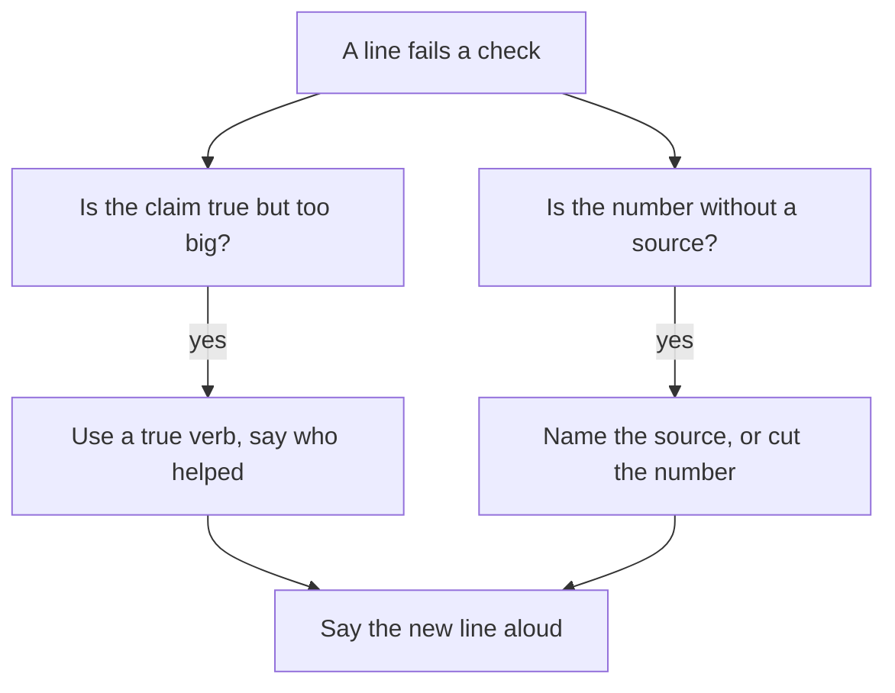

## A week before the next call

Karam has another interview in a week. This time he does not wait for the founder to find the weak points. He opens his resume on his phone, puts a notebook next to him, and reads the first line as if he were the founder. "Led the redesign of the checkout page, increasing conversion by 20 percent." He asks himself the question a founder would ask first. What exactly did I do?

In chapters 3.2 and 3.3 he learned what a why chain does to a line, and what a then-note is. Now he needs a way to do it for every line on the page, fast, without a long story each time. The tool for that is a short audit: five questions, always in the same order, with one honest answer written for each. A line that passes stays. A line that fails is rewritten before the interview, not defended during it.

## The five checks

The audit is small on purpose. You can do it on a bus or during a power cut, with a pen and the back of an old page. Here are the five checks.

| Check | The question | The line passes when |
|---|---|---|
| 1. What I did | What exactly did I do myself? | The verb is true, and the line separates my part from the team's |
| 2. Why | What was the reason I had at the time? | I can say it in one or two sentences, with who asked and what I decided |
| 3. What happened | What changed because of it? | There is a result with a before, an after and a time, or the line makes no claim |
| 4. How I know | Where does the result come from? | I can name the source, or I say I did not measure it |
| 5. What I would change | What would I do differently? | I have one honest sentence |

The first check uses what you learned in module 1: your part and the team's, and the whole path of the work. The third and fourth use module 2: a number needs a before, an after, a time window and a source. The second is chapter 3.3: the reason you had then. The fifth is new, and it is the one fellows skip. A founder often ends a long chain with "What would you do differently?" because the answer shows if you learn from your own work. A line you cannot improve in your head is a line you have not looked at closely.

Before you step through the canvas, think about what should happen to the number in Karam's line.

```predict
prompt: "Karam does not know how the 20 percent was measured. After the audit, what should happen to the number in his line?"
options:
  - id: remove
    label: "Be taken out of the line"
  - id: keep-source
    label: "Stay, with its source"
correctOptionId: keep-source
explanation: "The number is real, because his manager reported it. What was missing was the truth about where it came from. Keeping it with its source, and saying he did not measure it, is honest and still useful. If nobody could confirm it, leaving it out would also be honest. Presenting it as his own measurement was the problem."
```

The canvas below runs the five checks on Karam's checkout line, one at a time. Then it shows a second line of his that passes everything.

<InteractiveCanvas slug="resume-line-audit" />

**What this shows:** five checks run in order on one resume line, a rewrite of the line that fails, and a line that passes and is kept. **Try this:** before step 2, guess which check fails first. At step 7, say the rewritten line aloud and ask if you could answer a why about every word. **What changed:** at each step the answer moved from the words on the page to what Karam could actually say. Checks 1 and 4 failed, check 3 was unclear, and checks 2 and 5 passed once he used his then-note. **Limits of the model:** the checks find lines you cannot defend. They do not make a weak project strong, and they do not say which line to put first.

## Reading the audit of Karam's line

Check 1 failed because "led" was bigger than what he did. The designer led the redesign, and Karam built the page from her screens. The fix is not to hide the designer. It is to use a verb that is true: "Built the redesigned checkout page from the designer's screens." That line is shorter and easier to say. It also invites the founder to ask good questions, such as how he chose to build the form, which he can answer.

Check 2 passed, but only because Karam had done the work of chapter 3.3. The line does not need to state the reason. It only needs a reason behind it. Many fellows think that every check must show on the page. It does not. Some checks only prepare you for the room.

Check 3 and check 4 belong together. The line said conversion rose 20 percent. Karam had the final figure and nothing else: no before, no window, no method. He could not defend it as his own measurement. So he did the honest thing. He kept the number, named where it came from, and said he did not measure it. The line became: "Built the redesigned checkout page from the designer's screens. Conversion rose 20 percent after launch (my manager's figure; I did not measure it)." In the room, he can add one more sentence: "I do not know how the 20 percent was measured." That sentence sounds weak for two seconds, and then the founder moves on to the page Karam built, which is where his real work is.

Check 5 gave Karam a simple, honest answer: he would ask for the visit and order counts before and after, with dates, before he put any number on the page. This also tells a founder that he understands what a good number needs.

## A line that stays

The canvas ends with a second line, and this one matters as much as the first. "Fixed the date picker on the order form that stopped some phones from submitting orders. Support emails about it fell from 7 in the month before to 0 in the month after." Karam does not touch it. He did the work alone. He knows why: a support email brought it to his attention. The result has a before, an after and a source, the support inbox. He knows what he would change: add a test so the bug cannot return unseen.

The point of the audit is not to find fault with every line. A line that passes all five checks is a gift. Keep it as it is, and do not make it longer. Some fellows make a good line weaker by adding words that sound big. If the line is true, specific and sourced, it needs nothing more.

## A second example, from operations

Lama is a student who helps run a university club. Her resume says: "Improved event sign-ups and increased attendance." She audits it. Check 1: what did she do? She replaced a paper sheet with an online form, and the club president asked for it. The word "improved" says nothing about that. Check 3: did attendance rise? 18 people signed the paper sheet for the October talk and 31 used the form for the November talk. But those were different talks, so the numbers cannot be compared. Check 4: she cannot say how she knows attendance rose. She did not count who came.

Lama does not defend "increased attendance." She rewrites the line: "Built an online sign-up form for the university club's events, used for 3 events so far." In the room she can say, "I did not compare attendance, because the events were different. Next time I would count who signs up and who comes." The new line is smaller than the old one, and every word of it is true. It also leads to a better conversation, because a founder can ask how she built it and why she chose that tool.

## How to write a short line

When you rewrite, there are four habits that help. Start with a verb that is true: built, wrote, fixed, tested, designed, counted, proposed. If you did the work with others, say so in a few words: "with the designer", "with one other developer". Use one number at most, and only a number with a source. Keep the line to one or two lines on the page.

Many readers skim a resume, so put the strongest, most specific line first. The strongest line is not the one with the biggest number. It is the one where you can answer every why with a fact. If your best line is a small one, such as the date picker fix, it can still go first.



The diagram shows what to do after a failed check. It is a repair, not a punishment. There are two common problems, a claim that is too big and a number with no source, and each has a simple fix. After either fix, say the new line aloud. If you hesitate on any word, that word needs another look. What to notice is that the repair never adds a new fact. It only takes away what you cannot support.

## Where people go wrong

The most common mistake is to defend a failed line instead of rewriting it, because rewriting feels like losing something. It is the other way round. A defended line takes your time in the room, and every question puts it at risk. A rewritten line takes two minutes today. A second mistake is to rewrite by adding. "Led" becomes "Spearheaded", or a number becomes a larger number. Rewrite by making the line closer to what happened. A third mistake is to fix only the lines you are worried about. The line you are sure about may be the one the founder picks. Audit all of them.

## Try it on your own resume today

Take every line on your resume, and write the five answers for each, in one sentence each. Use a table if you like. Mark each line with a pass or a fail for each check. Rewrite the lines that fail, using the habits above, and keep the old line next to the new one so you can see the change. Do not paste your resume into the AI interviewer yet. If you do, remove your name, your contact details and the names of employers and clients first, and use roles such as "a web agency" or "a retail client".

## Check your understanding

```quiz
type: mcq
question: "Mazen wrote a script that builds his team's weekly sales report. His notes: for 4 Fridays he timed the report by hand, 85 to 95 minutes each time. The script runs in about 4 minutes, which he checked once. The report is only his. His resume says 'Automated the weekly report, saving hours.' Which rewrite passes the checks?"
options:
  - "Wrote a script that builds the weekly sales report and saves the whole team hours"
  - "Wrote a script for the weekly report that saves me about 3 hours each Friday"
  - "Wrote a script for the weekly report: 85 to 95 minutes by hand, about 4 by script"
  - "Automated the weekly report, saving hours"
correct: 2
explanations:
  - "The report is only Mazen's, so 'the whole team' claims more than his part. It also gives no number."
  - "His timings were 85 to 95 minutes, which is about 1.5 hours, not 3. The number does not match his own notes."
  - "Right. It says what he did, and the numbers are the ones he timed, with the count of Fridays behind them. A founder can ask how he knows, and he has the answer."
  - "This is the original line. His notes have real numbers, so 'saving hours' hides a good fact and fails the check on what happened."
```

```quiz
type: mcq
question: "Hiba fixed a bug that stopped receipts printing at a small shop's till. She worked on it alone. Her notes: the shop's ticket list shows 12 tickets about it in the month before and 0 in the month after. Her manager asked her after the third ticket. Her line says: 'Fixed the receipt printing bug; tickets about it fell from 12 to 0 in a month.' What should she do?"
options:
  - "Leave out the 0, because it looks too good to be true"
  - "Change 'Fixed' to 'Helped fix', to sound more modest"
  - "Add 'cutting tickets by 100 percent', to sound more precise"
  - "Keep the line as it is, because it passes all five checks"
correct: 3
explanations:
  - "The 0 comes from the ticket list, so she can show it. Removing a true, sourced number would make the line weaker for no reason."
  - "She worked alone, so 'Fixed' is the true verb. 'Helped fix' would be less accurate, and the founder may ask who else was involved."
  - "A percent adds nothing here. 12 to 0 is already clear, and a percent without the counts invites the question 'from what?'"
  - "Right. She did it alone, she has the reason, the counts and the source, and she can say what she would change. A line that passes is kept as it is."
```

**Next:** Quiz: five short cases on why chains, real reasons and resume lines.
