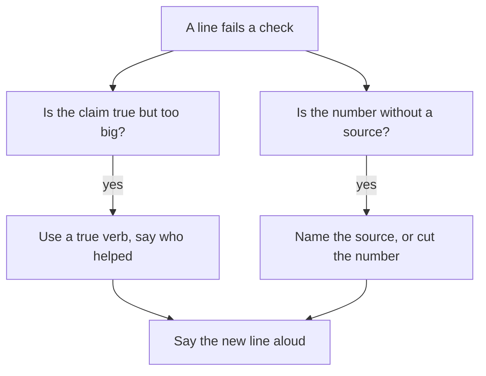

## A week before the next call

Karam has another interview in a week. This time he does not wait for the founder to find the weak points. He opens his resume on his phone, puts a notebook next to him, and reads the first line as if he were the founder. "Led the redesign of the checkout page, increasing conversion by 20 percent." He asks himself the question a founder would ask first. What exactly did I do?

In chapters 3.2 and 3.3 he learned what a why chain does to a line, and what a then-note is. Now he needs a way to do it for every line on the page, fast, without a long story each time. The tool for that is a short audit: five questions, always in the same order, with one honest answer written for each. A line that passes stays. A line that fails is rewritten before the interview, not defended during it.

## The five checks

The audit is small on purpose. You can do it on a bus or during a power cut, with a pen and any scrap of paper. Here are the five checks.

| Check | The question | The line passes when |
|---|---|---|
| 1. What I did | What exactly did I do myself? | The verb is true, and the line separates my part from the team's |
| 2. Why | What was the reason I had at the time? | I can say it in one or two sentences, with who asked and what I decided |
| 3. What happened | What changed because of it? | I can say the result in one sentence, or the line claims no result |
| 4. How I know | Where does the result come from? | I can name the source, the before and after and the time, or I say I did not measure it |
| 5. What I would change | What would I do differently? | I have one honest sentence |

The first check uses what you learned in module 1: your part and the team's, and the whole path of the work. The third and fourth use module 2: a number needs a before, an after, a time window and a source. The second is chapter 3.3: the reason you had then. The fifth is new, and it is the one fellows skip. A founder often ends a long chain with "What would you do differently?" because the answer shows if you learn from your own work. A line you cannot improve in your head is a line you have not looked at closely.

Before you step through the canvas, think about the first check that Karam's line fails. His facts: the designer led the redesign and he built the page from her screens. His manager showed the 20 percent on a slide. The checks run in order, from 1 to 5.

```predict
prompt: "Karam's facts: the designer led the redesign and he built the page from her screens. His manager showed the 20 percent on a slide. In the order of the five checks, which is the first one his line fails?"
options:
  - id: did
    label: "Check 1: what I did"
  - id: know
    label: "Check 4: how I know"
correctOptionId: did
explanation: "The checks run in order. The line says he led, but the designer led and he built the page, so check 1 fails first. Check 4 also fails, because the 20 percent has no source he can show, but it comes later."
```

The canvas below runs the five checks on Karam's checkout line, one at a time. The arrow that leaves each check says how it went. Then it shows a second line of his that passes everything.

<InteractiveCanvas slug="resume-line-audit" />

The canvas runs the five checks in order and ends with one line rewritten and one line kept. Guess which check fails first before you press Next, and say the rewritten line aloud at the end. It does not make a weak project strong, and it does not choose which line goes first.

## Reading the audit of Karam's line

Check 1 failed because "led" was bigger than what he did. The designer led the redesign, and Karam built the page from her screens. The fix is not to hide the designer. It is to use a verb that is true: "Built the redesigned checkout page from the designer's screens." That line is shorter and easier to say. It also invites the founder to ask good questions, such as how he chose to build the form, which he can answer.

Check 2 passed, but only because Karam had done the work of chapter 3.3. The line does not need to state the reason. It only needs a reason behind it. Many fellows think that every check must show on the page. It does not. Some checks only prepare you for the room.

Check 3 passed because Karam can say the result in one sentence: conversion rose 20 percent after launch, as his manager reported. Check 4 is where the line fails. Karam had the final figure and nothing else: no before, no window, no method. He could not defend it as his own measurement. So he did the honest thing. He kept the number, named where it came from, and said he did not measure it. The line became: "Built the redesigned checkout page from the designer's screens. Conversion rose 20 percent after launch (my manager's figure; I did not measure it)." In the room, he can add one more sentence: "I do not know how the 20 percent was measured." That sentence sounds weak for two seconds, and then the founder moves on to the page Karam built, which is where his real work is.

If nobody could confirm the figure, leaving it out would also be honest. What he cannot do is present it as his own measurement. Check 5 gave Karam a simple answer: he would ask for the visit and order counts before and after, with dates, before he put any number on the page. This also tells a founder that he understands what a good number needs.

## A line that stays

The canvas ends with a second line, and this one matters as much as the first. "Fixed the date picker on the order form that stopped some phones from submitting orders. Support emails about it fell from 7 in the month before to 0 in the month after." Karam does not touch it. He did the work alone. He knows why: a support email brought it to his attention. The result has a before, an after and a source, the support inbox. He knows what he would change: add a test so the bug cannot return unseen.

The point of the audit is not to find fault with every line. A line that passes all five checks is a good result of your work. Keep it as it is, and do not make it longer. Some fellows make a good line weaker by adding words that sound big. If the line is true, specific and sourced, it needs nothing more.

## A second example, from a school office

Lama is a teaching assistant who looks after her school's timetable sheet. Her resume says: "Improved the school timetable and reduced room clashes." She audits it. Check 1: what did she do? She replaced a paper grid with a shared sheet that marks a room booked twice, and the head teacher asked for it. The word "improved" says nothing about that. Check 3: she can say the result in a sentence: there were fewer clashes. Check 4: how does she know? In the autumn term, which lasted 12 weeks, teachers reported 10 clashes. In the first 4 weeks of the spring term, they reported none. But 12 weeks and 4 weeks are not the same length of time. Counts over different lengths of time can only be compared as per-week rates, and with care, because a short period can mislead.

Lama does not defend "reduced room clashes." She rewrites the line: "Built a shared timetable sheet that marks a room booked twice, used by 14 teachers." The 14 comes from the names in the sheet's edit list. In the room she can say, "I do not know yet if clashes fell, because the two terms have different lengths, and four weeks is a short time. After 12 weeks I would count them again." The new line is smaller than the old one, and every word of it is true. It also leads to a better conversation, because a founder can ask how she built it and why she chose a shared sheet.

## How to write a short line

When you rewrite, there are four habits that help. Start with a verb that is true: built, wrote, fixed, tested, designed, counted, proposed. If you did the work with others, say so in a few words: "with the designer", "with one other developer". Use one number at most, and only a number with a source. Keep the line to one or two lines on the page.

Many readers skim a resume, so put the strongest, most specific line first. The strongest line is not the one with the biggest number. It is the one where you can answer every why with a fact. If your best line is a small one, such as the date picker fix, it can still go first.



The diagram shows what to do after a failed check. It is a repair, not a punishment. There are two common problems, a claim that is too big and a number with no source, and each has a simple fix. After either fix, say the new line aloud. If you hesitate on any word, that word needs another look. What to notice is that the repair never adds a new fact. It only takes away what you cannot support.

## The line Anas defended

Anas is a frontend developer. He had one line he was sure about, so he skipped it in his audit and fixed the others. It said: "Built the booking form for a small gym." In the call, the founder picked that line. She asked what exactly he built, and he said the form. She asked which parts were his, and he said the whole form. She asked who chose the classes it listed, and he stopped. The gym owner had chosen the classes, and Anas had only built what he was given. The line had been true. His answer, "the whole form", had not been.

The lesson is simple. Defending a line you have not checked costs time in the room, and every question puts it at risk. Checking it costs two minutes today. A line you are sure about may be the one the founder picks, so audit all of them.

## Your turn today

Take every line on your resume, and write the five answers for each, in one sentence each. Use a table if you like. Mark each line with a pass or a fail for each check. Rewrite the lines that fail, using the habits above, and keep the old line next to the new one so you can see the change. If you prefer not to use your own resume, audit Karam's two lines, using only the facts in this chapter. Do not paste your resume into the AI interviewer yet. If you do, remove your name, your contact details and the names of employers and clients first, and use roles such as "a web agency" or "a retail client".

## Check your understanding

```quiz
type: mcq
question: "Mazen wrote a script that builds his team's weekly sales report. His notes: for 4 Fridays he timed the report by hand, 85 to 95 minutes each time. The script runs in about 4 minutes, which he checked once. Only Mazen uses the script. His resume says 'Automated the weekly report, saving hours.' Which rewrite passes the checks?"
options:
  - "Wrote a script for the weekly sales report that saves the team about 90 minutes each week."
  - "Wrote a script for the weekly report that saves me about 3 hours on each Friday that it runs."
  - "Automated the weekly report with a script, which saves hours of work for the team each week."
  - "Wrote a script for the weekly report: 85 to 95 minutes by hand over 4 Fridays, about 4 by script."
correct: 3
explanations:
  - "The 90 minutes is near his timings, but only Mazen uses the script. Saying it saves the team time claims more than his part."
  - "His timings were 85 to 95 minutes, which is about 1.5 hours, not 3. The number does not match his own notes."
  - "This is the original line. His notes have real numbers, so 'saving hours' hides a good fact and fails the check on what happened."
  - "Right. It says what he did, and the numbers are the ones he timed, with the count of Fridays behind them. A founder can ask how he knows, and he has the answer."
```

```quiz
type: mcq
question: "Tamer fixed a bug that stopped receipts printing at a shop's till. He worked alone, and his manager asked after the third ticket. The shop's ticket list shows 12 tickets about it in the month before and 0 in the month after. Asked what he would change, he says he would add an automatic test so the bug cannot return unseen. His line: 'Fixed the receipt printing bug; tickets about it fell from 12 to 0 in a month.' What should he do?"
options:
  - "Keep the line as it is: he did it alone, and the counts of 12 and 0 and their source are his."
  - "Change 'Fixed' to 'Helped fix', because his manager asked after the third ticket in the list."
  - "Add 'cutting tickets by 100 percent', because the counts of 12 and 0 need a percent figure."
  - "Take out the 0, because the ticket list may have missed some tickets in the month after."
correct: 0
explanations:
  - "Right. He did it alone, he has the reason, the counts and the source, and he can say what he would change. A line that passes is kept as it is."
  - "The manager asked for the work, but Tamer did it alone. 'Fixed' is the true verb, and 'Helped fix' would be less accurate."
  - "A percent adds nothing here. 12 to 0 is already clear, and a percent without the counts invites the question 'from what?'"
  - "The 0 comes from the shop's own ticket list, so he can show it. Removing a true, sourced number would make the line weaker for no reason."
```

**Next:** Quiz: five short cases on why chains, real reasons and resume lines.
