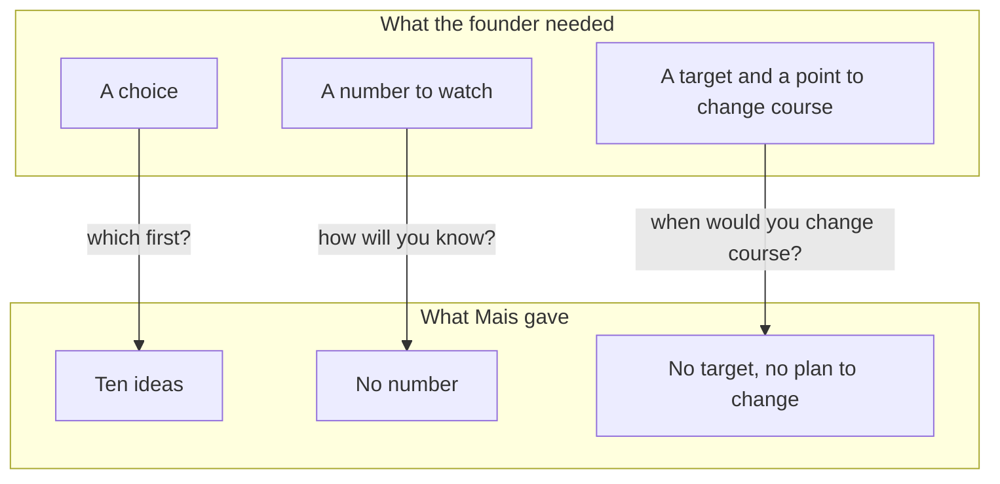

## Ten ideas in two minutes

Mais is 27. She has worked for two years in quality testing at a software company, and she is applying for a product role at a nine-person team that runs a food delivery app in one city. The founder is on a video call. Halfway through, her connection drops for a few seconds. She asks the founder to say the last part again, and the founder does, kindly and slowly. Then comes the question Mais has been waiting for.

> **Founder:** "Repeat orders have fallen from about 40 percent of customers to about 30 percent over two months. You start next week. What would you do?"

By "repeat orders" the founder means this: out of 100 customers who order in a month, about 40 used to order again within the next 30 days, and now only about 30 do. This is the kind of problem a small team has every month, and it is a real one. Mais knows how to find faults, because she does it for a living. She starts talking at once.

She says the app could lower the delivery fee. It could add a loyalty programme. It could send reminders to customers who have not ordered for a while. It could improve the food photos, add more restaurants, run a survey, give out coupons, speed up delivery, start a referral bonus, or redesign the app. That is ten ideas, and she gets through them in about two minutes. She sounds sure and she does not stop.

When she finishes, the founder says, "Thanks. Which one would you do first?"

## The silence after the list

Mais had not expected this question. In her mind, every idea on the list was a good one, and the list showed how much she could think of. She says, "They are all important, so it depends." The founder asks, "If you could only do one this week, which would it be?" There is a long pause. Mais says that she would probably start with the survey, and then adds that the discount might also help. The founder nods and moves to the next topic.

Mais did not give a wrong answer. Each idea on her list could be right in some world. That was the trouble. A list of ten ideas does not tell the founder what she would do on Monday, and it does not tell the founder how she would know if she was right. After the call she felt that she had said a lot and answered nothing.

Before we look at why, think about what the long list did for her. Her skills were real, and her ideas were good. The question is only whether the list was the right shape for the answer.

```predict
prompt: "The founder asked for one idea, and Mais named the survey. What is still missing from her answer?"
options:
  - id: reason-check
    label: "Why the survey, and how she would check it"
  - id: nothing
    label: "Nothing, because she named a single idea"
correctOptionId: reason-check
explanation: "The founder asked which one first, and Mais did name one. But she said 'probably' and then added the discount, so the pick was not firm. The founder also cannot tell why she picked the survey or how she would know it worked. A choice with no reason and no number to watch is still a guess. A small team can only do one or two things at a time, so the choice has to come with its reason and a way to check it."
```

## What the founder was really asking

A case question is a kind of "what would you do if" question. Researchers who study interviews call these situational questions. They tend to draw on how you reason more than on how much experience you have, so a fellow with little work experience can do well by thinking clearly. Hiring advice written by founders often includes asking how a candidate would solve a problem the company has now. It is a short test of how you think, and it needs no special knowledge of the business.

In a nine-person team, the founder cannot try ten things. There is probably one developer for this kind of work, and about a month to show a result. The founder does not need a list from a new hire. A list is what the founder already has. The founder wants to see whether Mais can narrow the problem, choose one option for a reason, and say what number would tell them they were right. Those are the three things that Mais left out.

The method in this module is practical advice from interview coaches and this course. It is not research. One study of 213 people preparing for promotion interviews in police and fire services found that those who went to coaching and prepared specifically went with better performance on this kind of question, partly through better-organised answers. That is one setting, not a startup, but it points the same way as the coaches. Organised thinking can be practised.

## Why a list feels safe

There is a reason why Mais, and many fellows, answer with a list. A list cannot be wrong. If one idea fails, another is still there. In her work in testing, finding every possible fault is a strength, and she was good at it. The habit comes from a real skill, used in the wrong place.

The wrong place is the decision. In testing, you report everything you found. In a product role, someone has to choose what to do first, with limited time and money. A founder who hires for a small team is hiring someone who will help to choose. A list with no choice shows that the candidate can think of things. A choice, with honest limits, shows that the candidate can be trusted with the next step.

The diagram sets two things side by side. The top group is what the founder needed from the answer. The bottom group is what Mais gave. Each arrow is a question the founder asked, and it points from the need to what was there.



What to notice is that every box at the bottom is true. The ten ideas were reasonable. The answer failed because each need at the top has an empty answer below it. Everything in this module is a way to fill those three gaps before the questions are asked.

A few facts from the call matter later. Mais did not know the business well, and she did not need to. She did not ask who the customers were, or what had changed. She did not say what she was assuming. In the first thirty seconds she could have asked a question, and she went straight to answers. The founder had the information she needed, and was ready to share it. Nobody gave it to her because nobody asked.

## What a stronger answer needs

Imagine Mais's call again. This time she says: "Can I take a moment to think?" Then she asks two questions. Is the drop in new customers or in returning ones? Did anything change about two months ago? She says what she will assume. She names two or three options, and compares them on cost, time and risk. She picks one in a single sentence. She says which number she would watch, what it is now, her target, and what result would make her change course.

That answer takes about the same two minutes. It has no more ideas than the first one, and it has fewer. But the founder can follow it, argue with it and act on it. The founder can also see how Mais works. That is what the case question is for.

You do not need to know the food delivery business to do this. You need a habit. Chapter 4.2 teaches the first part, which is to ask a few questions and say your assumptions. Chapter 4.3 teaches the second part, which is to compare a small number of real options. Chapter 4.4 teaches the third part, which is to decide and say how you would measure the result. The gate in 4.6 asks you to work through one case aloud, on your own or with a provided case.

<BigWordAlert term="Case question" plainEnglish="A made-up but realistic problem that a founder asks you to work through aloud, such as 'Our sign-ups fell by a third last month. What would you do?'" whyItMatters="There is no single right answer. The founder is looking at how you narrow the problem, choose and check your choice." />

## What this module teaches

Mais, the founder and the team in this module are fictional. The skills are real. In this module you will do three things in order. You will ask one to three questions and say what you assume. You will give two or three real options and compare what each one costs and risks. And you will choose one, say why in one sentence, and name the number that would tell you if you were right.

None of this asks you to know more than you do. It asks you to think in an order that the founder can follow. It also gives you a way to say "I do not know yet" in a form that sounds like a plan. Because the hardest part of a case question is the first minute, you will practise starting. A short pause to think is allowed, and asking a question first is a good start.

<LearningObjectives items={["Say what a case question tests, and why a list of ideas is not an answer", "Ask one to three clarifying questions and say your assumptions aloud", "Give two or three real options and compare cost, time, risk and what you give up", "Choose one option in a sentence and name the number you would watch, your target, and the result that would make you change course", "Work through one case aloud, with the AI interviewer or in writing"]} />

## Key words

| Word | Plain English |
|---|---|
| **Clarifying question** | A short question that makes the problem clearer before you answer |
| **Assumption** | Something you decide to treat as true because you do not know yet |
| **Option** | One real thing you could do, not a general idea |
| **Trade-off** | What you give up to get something else |

## What is in this module

| Chapter | You will practise |
|---|---|
| 4.2 | Asking one to three questions and saying your assumptions |
| 4.3 | Comparing two or three options on cost, time, risk and what you learn |
| 4.4 | Deciding in one sentence and naming the number you would watch |
| 4.5 | A quiz with five short cases |
| 4.6 | One case worked aloud, with the AI interviewer or in writing |

**Next:** Clarify and say your assumptions: how Mais's first minute could have gone differently.
