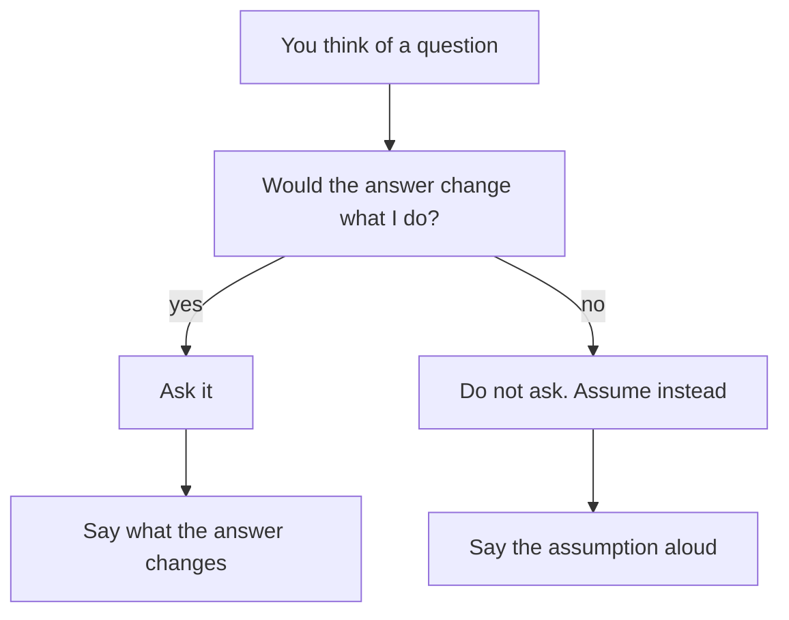

## The first thirty seconds

A week after her call, Mais practises the same question with her cousin, who plays the founder. Her cousin says, "Repeat orders have fallen from about 40 percent of customers to about 30 percent over two months. You start next week. What would you do?" This time Mais does not start with ideas. She says, "Can I take thirty seconds to think?" Her cousin nods. Mais looks at the ceiling for a moment and says the problem back in her own words.

"So out of 100 customers who order in a month, about 40 used to order again within 30 days, and now about 30 do. I have two questions before I answer. Is the drop in new customers, or in people who have ordered before? And did anything change about two months ago?"

Thirty seconds ago she had no plan. Now she has asked two questions, and the answers will decide what she does. This chapter is about those first thirty seconds. They are the cheapest part of a case question, and the part where most fellows hurry.

## The idea in plain words

There are three small habits, and they come before any answer. The first is to say the question back in your own words. This checks that you heard it right, which matters on a call with a weak connection or in a second language. The second is to ask one to three clarifying questions about the goal, the users, the time and the limits. The third is to say your assumptions aloud: what you will treat as true where you do not know.

It is fine to ask for a short pause. "Can I take thirty seconds to think?" is a normal thing to say, and then you think out loud as much as you can, because the point of a case is to see how you think. These habits come from interview coaches and from this course. They are practical advice, not research. But they follow a simple logic. A case question is always short on facts, and you cannot solve a problem you have misunderstood. A good question is cheaper than a wrong answer.

A clarifying question is worth asking only if the answer would change what you do. Before each question, ask yourself: if the founder says yes, I do one thing, and if the founder says no, I do another thing. If both answers lead to the same plan, do not ask. Say an assumption instead.

Before you step through the canvas, think about what the first question does to Mais's list of ten ideas.

```predict
prompt: "Mais asks whether the drop is in new customers or in customers who ordered before. The founder says it is mostly in new customers. What happens to her ten ideas?"
options:
  - id: shorter
    label: "Some of them no longer fit"
  - id: same
    label: "They all still fit equally"
correctOptionId: shorter
explanation: "If older customers still order as before, ideas that aim at them, such as rewards for long-time customers, matter less. One answer can remove several ideas from the list. That is what a good clarifying question is for."
```

The canvas has three lanes: the founder, Mais, and the facts the team knows. Step through it and watch the problem get smaller after each fact.

<InteractiveCanvas slug="clarify-the-case" />

**What this shows:** two clarifying questions and one spoken assumption turn a wide case into a narrow one. **Try this:** before step 4, predict what the founder will say about new and returning customers. At step 7, find the assumption and say what would change it. **What changed:** the case began as "repeat orders are falling" and ended as "new customers are ordering a second time less often, and the delivery fee rose two months ago". That is a question about one fee, for one group, on one order. **Limits of the model:** a real founder may not have these facts. The founder may say, "I do not know, what do you assume?" Then you assume aloud and go on.

## The full exchange, with the reasoning

Here is what happened in the canvas, step by step. Mais's first question was about who. She asked whether the drop was in new customers, in customers who had ordered before, or in both. The founder said it was mostly in customers who ordered for the first time in the last two months. Customers who joined earlier still order at about the same rate. This one answer tells her to look at what a new customer sees, and not at long-time customers.

Her second question was about when. She asked whether anything changed in the app, the prices or the restaurants about two months ago. The founder said that the delivery fee on orders under 15 dollars went from 1 dollar to 2 dollars. That is a lead. It is not proof. Two things that happen in the same month are not always cause and effect, and Mais knows this from her work in testing. She says so.

Her third question, which the canvas does not draw, was about limits: "How much developer time do we have this month?" The founder said one developer and about a week. That matters for chapter 4.3, because it tells her which options are even possible. Three questions is the most a founder will usually want to answer. After that, it begins to feel like an interview in the other direction.

Then Mais said her assumptions aloud. "I will assume the fee is one cause, not the only one. I will also assume the restaurants and the delivery times did not change, and I would check that first." Notice what she did. She did not hide the gap in her knowledge. She named it, and she named what she would do about it. A founder hears a person who knows where the facts stop.

## Weak and strong, side by side

A weak start is the one from chapter 4.1: a list. The follow-up that breaks it is the founder's "Which one first?" Mais had nothing to say, because she had not narrowed the problem. A second weak start is a string of questions with no purpose: "How many customers do you have? What is the budget? Who is your biggest competitor? How old is the company?" None of these changes the plan. The founder will answer two and then wonder why.

The strong start is the one above. It is short: the problem said back, a pause, two or three questions that each change what she does, and a spoken assumption. It takes about a minute. It also gives the founder a chance to correct a wrong picture early, when it costs nothing.

## A second example, from engineering

Tamer is a backend developer. The founder says, "Some users wait 8 seconds for the search page to load. What would you do?" Tamer says the problem back: some users, search page, 8 seconds. He asks three questions. Is it all users or some? Since when? Does it depend on the phone or on the account? The founder says it is users with many saved items, and it began after last month's update. Tamer says his assumption: "I will assume the slow part is the data request, not the images, and I would check the request time first."

Notice that none of Tamer's questions asks about the company. Each one points at a place to look. And the assumption gives him a first step that he can say in one breath. You do not need the founder's business knowledge to ask like this. You need to ask where the problem is, and when it started.



The diagram is a test for each question you think of. If the answer would change your plan, ask it. If not, make it an assumption and say it. What to notice is that both exits end by saying something aloud. A question you ask and do not use is a waste. An assumption you keep silent can sink your whole answer, because the founder may not share it.

## Where people go wrong

The first mistake is to ask nothing, which is the mistake in chapter 4.1. The second is to ask too many questions, or questions with answers you cannot use, and so to delay the answer. The third is to ask and then ignore the answer, and go back to the plan you had before. If the founder says the drop is in new customers, your next sentence should show that you heard it. The fourth is a silent assumption. You decide the fee is the cause, say nothing, and build a whole answer on it. If it is wrong, the founder will see the whole answer fall.

A fifth mistake is about nerves. Some fellows think that asking questions looks weak. The research does not tell us how interviewers judge a candidate who asks for a question to be repeated, so this is course advice: checking that you understood is better than answering the wrong question. On a video call with a weak connection, ask for the question again if you lost part of it. Answering the question they asked matters more than answering fast.

## Try it on your own work today

Write down a problem from your own work or study, in one sentence, as if a founder asked it: "Our form is slow", or "Our reports are often late". Then write up to three questions that would change your plan, and next to each one write what you would do if the answer were yes and what you would do if it were no. Then write two assumptions you would say aloud. If you prefer, use this case: "Our online tutoring service gets fewer sign-ups this month." What three questions would you ask?

## Check your understanding

```quiz
type: mcq
question: "A founder tells Hiba: 'Weekly users of our notes app fell by 20 percent in March. What would you do?' She knows only that the app has a phone version and a web version. Which clarifying question is most worth asking first?"
options:
  - "How much money did the company make in total over the last year?"
  - "Is the fall on the phone version, the web version, or both?"
  - "Which competitor has the most users, and how many users do they have?"
  - "Why did users stop opening the app, and what should we do about it?"
correct: 1
explanations:
  - "The total money made does not change where she looks first, so she would do the same either way."
  - "Right. If the fall is only on one version, she looks there first. If it is on both, she looks for something shared. The answer changes her plan."
  - "A competitor's numbers do not change her first step. They are also hard for the founder to know."
  - "This asks the founder to solve the case for her. She is the one who has to work out why users left."
```

```quiz
type: mcq
question: "Sara is a design intern. A founder says: 'Visitors drop off at field 3 of our 5-field sign-up page. What would you do?' Sara asks if most visitors use phones. The founder says: 'I do not know.' What should Sara say next?"
options:
  - "I will assume most visitors use phones, and check the split first"
  - "I need to know the device split before I can say anything useful"
  - "Most visitors are on phones, so the fields are too small to tap"
  - "The founder should know this, so I will keep asking until they say"
correct: 0
explanations:
  - "Right. She names the assumption, says it is an assumption, and says how she would check it. The founder can correct her or agree, and the answer goes on."
  - "This stops the answer. The founder has said they do not know, and a case is meant to be worked with missing facts."
  - "This turns a guess into a fact. If most visitors are on computers, the whole answer falls, and the founder cannot tell it was a guess."
  - "The founder has already said they do not know. Asking again will not produce a fact and may seem like pressure."
```

**Next:** Options and trade-offs: how to give two or three real options instead of ten.
