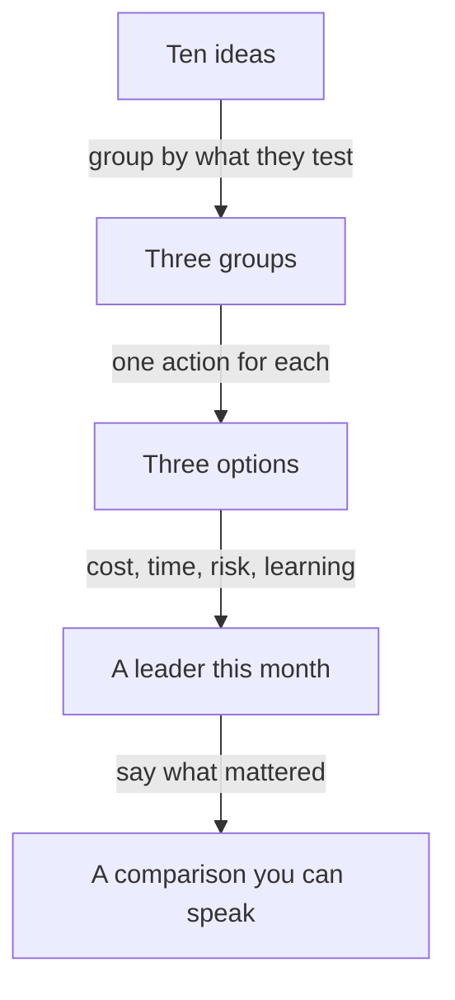

## From ten ideas to three

Mais has her two answers. The drop is in new customers, and the delivery fee on small orders went from 1 dollar to 2 dollars two months ago. She also knows that the team has one developer and about a week. Now she sits with a pen and the back of an envelope, and she has to decide what to say next. Her old list of ten ideas is still in her head. She knows that saying all ten again would end the way it did in chapter 4.1.

She does something simple. She asks of each idea: what would this test? The delivery fee idea tests the lead the founder just gave her. A survey of lost customers tests what customers say. A loyalty discount tests whether a reward brings people back. Improving the food photos, adding restaurants, speeding up delivery and redesigning the app do not test the lead, and most of them need much more than a week. She does not say they are bad. She says she is setting them aside for now, and why.

By the end she has three options. This chapter shows how she gets there and how she compares them, in a way that she can say aloud in a minute.

## The idea in plain words

An option is something you could do in the time you have, written as an action. "Improve the app" is an idea, not an option. "Lower the delivery fee on a new customer's second order from 2 dollars to 1 dollar for four weeks" is an option. You can tell the difference by asking if someone could start it on Monday. If they cannot, it is still an idea.

Give two or three options, not ten. Two is fine when the problem is narrow. Three is the most a listener can hold in their head while you compare them. Then compare them on the same few questions. How much does it cost? How long does it take? What can go wrong? What do you learn from it, whether it works or not? The last question is the one that fellows forget. In a case, an option that teaches you something is worth more than one that only hopes to work.

You do not need a famous framework for this. The coaches' advice is to use a simple structure, and the questions above are one. This is a practical habit from interview coaches and this course. It is not research, and it is not a method you have to remember by name.

Before you use the canvas, think about which of Mais's three options you would expect to lead, given one developer and one week.

```predict
prompt: "Mais has one developer and one week. Which of her three options do you expect to lead on cost, time, risk and what she learns?"
options:
  - id: ask
    label: "Ask ten lost customers"
  - id: fee
    label: "Lower the fee"
correctOptionId: fee
explanation: "Lowering the fee is quick, because it is a setting, and it tests the lead directly: the repeat rate will show in a few weeks if the fee mattered. Asking ten customers is cheap and low risk, so it is close. Mais's scores put the fee option ahead by 2 points, and a change in what matters can flip it."
```

The canvas below holds Mais's three options and four questions. Each option has a score from 1 to 5, where 5 is the better side: low cost, fast, low risk, a lot learned. You can change how much each question matters this month.

<InteractiveCanvas slug="case-options-weights" />

**What this shows:** each score is multiplied by how much that question matters this month, and the results are added up. **Try this:** predict the leader first. Then set Low cost to Very important, and then set Fast this month to Nice to have. **What changed:** with Mais's weights, lowering the fee leads with 38 points, against 36 for asking customers and 22 for the loyalty discount. When money matters most, asking ten customers wins, 41 to 40. When speed matters less, it wins again, 30 to 28. **Limits of the model:** the scores and weights are Mais's judgment, and the model treats them as exact. It cannot see an option she left off, and it cannot tell her whether the fee is really the cause.

## Why Mais scored the options this way

The scores are not facts. They are judgments, and a founder will ask why. Here is the reasoning for each, in short sentences, as Mais would say it.

Lowering the fee costs the shop about 1 dollar on each second order from a new customer, so she gives it 2 for cost. It is a setting change, about a day of work, so it gets 5 for speed. It carries some risk, since it costs real money on every order and wastes that money if the fee is not the cause, so it gets 2 for risk. It teaches a lot, because the repeat rate will show within weeks whether the fee mattered, so it gets 5 for what she learns.

Asking ten lost customers costs almost nothing, so it gets 5 for cost. It takes about a week to reach ten people and wait for their replies, so it gets 3 for speed. It risks nothing, but ten people may not be typical, so it gets 4 for risk. It teaches reasons but not how common each one is, so it gets 3 for what she learns.

The loyalty discount costs money and developer time, so it gets 2 for cost. It needs about two weeks of the developer's time, and she has only one, so it gets 2 for speed. It gets 3 for risk. It does not test the fee lead, so it gets 2 for what she learns. In this case it is the weakest option, and Mais says so.

Now the point of the weights. At the start, Mais gives speed and learning the most weight, because she has one week and she needs to know what is going on. With that, the fee leads by 2 points. That is a small gap, and she says so. If the founder tells her that money is tight, the answer flips. If the founder tells her that speed does not matter, it flips again. The choice follows what matters this month, and a good answer says what mattered.

## Saying it aloud

In the room, Mais does not show a table. She says the comparison in a few sentences.

> **Mais:** "I see three options. Lower the fee for a new customer's second order. Ask ten lost customers why. Or add a loyalty discount. The discount needs two weeks of development, and we have one, so I would set it aside. The fee is quick and tests our main lead, but it costs money on each order. Asking customers is cheap, but ten people may not be typical."

That is about fifty words. She has dropped the weakest option and given the cost and the risk of the other two. She has not yet decided. That comes in chapter 4.4. What she has done is show the founder that she weighs things, and that she does it with the team's real limits in mind.



The diagram shows how a long list becomes a short comparison. The key step is the first one: grouping ideas by what they test. It lets you drop most of the list without saying any idea is bad. What to notice is the last arrow. The leader on its own is not the answer. The answer is the leader and what mattered.

## A second example, from design

Sara is a designer. The founder says that new users often stop in the middle of onboarding, and asks what she would do. Her three options are to cut onboarding from five screens to three, to add a progress bar, and to watch five new users try it. She compares them. Cutting screens costs a developer's week and may remove something users need. A progress bar is cheap and quick, but it may change nothing. Watching five users costs an afternoon and teaches where they stop. She does not know which is best yet. She knows which one teaches the most for the least, and she says that.

## Where people go wrong

The first mistake is to give ten options, or to give one real option and two weak ones that make it look good. Founders see this quickly. The second is to give options that are really one option, such as three versions of a discount. The third is to compare without saying what matters. "Option A is faster, but B is cheaper" is true and it decides nothing. Say which one matters more this month, and why.

A fourth mistake is to invent numbers. If you do not know the cost of an option, say "about" and say how you would check: "I would ask the developer how long it takes." A fifth is to score the options to match the one you already like. If your table always puts your first idea on top, check if you chose the scores to fit. Last, do not name a famous framework to look serious. A plain comparison that you can speak is better than a long name you cannot explain.

## Try it on your own work today

Take the problem you used in chapter 4.2. Write ten ideas for it, quickly. Then group them by what they test, and write three options as actions that someone could start on Monday. Score each option from 1 to 5 on cost, time, risk and what you learn. Then write one sentence that says which question matters most this month and why. Say the comparison aloud in under a minute. If you prefer, use Sara's onboarding case, and write your own scores.

## Check your understanding

```quiz
type: mcq
question: "Tamer compares two options for a sign-up problem, scoring each from 1 to 5, where 5 is best. Add a progress bar: cost 4, time 5, learn 2. Watch five users try the sign-up: cost 5, time 3, learn 4. His team has no developer this month. He decides cost and learning each matter twice as much as time. Which is right?"
options:
  - "A leads, because speed is its strongest score and time still counts"
  - "B leads, 12 to 11, adding the scores without any weights"
  - "B leads, 21 to 17, once cost and learning are counted twice"
  - "The table cannot decide, because scores are only a judgment"
correct: 2
explanations:
  - "With the weights, the progress bar scores 4 x 2 + 5 x 1 + 2 x 2 = 17. Speed is its best score, but time counts only once."
  - "This adds the scores with no weights, which gives 11 and 12. Tamer has said cost and learning count double, so the weights must be used."
  - "Right. The progress bar scores 4 x 2 + 5 x 1 + 2 x 2 = 17. Watching users scores 5 x 2 + 3 x 1 + 4 x 2 = 21. The weights move the result."
  - "The scores are a judgment, but the table still shows how Tamer's own weights lead to a result. It is a way to say what mattered, not a proof."
```

```quiz
type: mcq
question: "Ruba is asked: 'Many shoppers leave our online shop with items in the cart. You have one developer for one week.' Her options: offer free delivery above 30 dollars; email people who left a cart (2 days of work); redesign the checkout (3 weeks). Which is the best way to compare them aloud?"
options:
  - "All three could work, so I would do all three over the next three months or so"
  - "The redesign is the most important, so I would start there and finish it this month"
  - "Free delivery is best, because customers like free things and are likely to buy more"
  - "Set the 3-week redesign aside; free delivery costs money, the email is quick"
correct: 3
explanations:
  - "This does not use the team's one week, and it gives no comparison. The founder is left to choose."
  - "A redesign may matter most in the long run, but it needs three weeks and she has one. The comparison ignores the limit she was given."
  - "This says what customers like, but gives no cost, time or risk. It is a reason to like an option, not a comparison."
  - "Right. It sets aside the option that does not fit the week, and it names the cost of the second and the speed of the third. The founder can follow each step."
```

**Next:** Decide and say what you would measure: how to finish a case with one choice, one number and one line that would change your mind.
