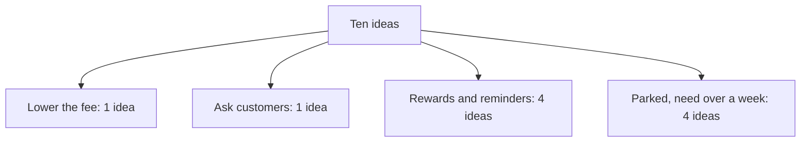

## From ten ideas to three

Mais has her two answers. The drop is in new customers, and the delivery fee on small orders went from 1 dollar to 2 dollars two months ago. She also knows that the team has one developer and about a week. Now she sits with a pen and a piece of paper, and she has to decide what to say next. Her old list of ten ideas is still in her head. She knows that saying all ten again would end the way it did in chapter 4.1.

She does something simple. She asks of each idea: what would this test? The delivery fee idea tests the lead the founder just gave her. A survey of lost customers tests what customers say. Four of the ideas, a loyalty programme, coupons, a referral bonus and reminders, all try to reward or win back customers, so she groups them as one. Improving the food photos, adding restaurants, speeding up delivery and redesigning the app do not test the lead, and most of them need much more than a week. She does not say they are bad. She says she is setting them aside for now, and why.

By the end she has three options. This chapter shows how she gets there and how she compares them, in a way that she can say aloud in a minute.

## Two or three real options

An option is something you could do in the time you have, written as an action. "Improve the app" is an idea, not an option. "Lower the delivery fee on a new customer's second order from 2 dollars to 1 dollar for four weeks" is an option. You can tell the difference by asking if someone could start it on Monday. If they cannot, it is still an idea.

Give two or three options, not ten. Two is fine when the problem is narrow. Three is the most a listener can hold in their head while you compare them. Then compare them on the same few questions. How much does it cost? How long does it take? What can go wrong? What do you learn from it, whether it works or not? The last question is the one that fellows forget. In a case, an option that teaches you something is worth more than one that only hopes to work.

You do not need a famous framework for this. The coaches' advice is to use a simple structure, and the questions above are one. This is a practical habit from interview coaches and this course. It is not research, and it is not a method you have to remember by name.

The diagram shows where Mais's ten ideas went. It adds something the story does not: the count in each group.



Three of the four groups become options. The fourth is parked, and Mais says so aloud. What to notice is that four ideas end up in one option, and four in none. Grouping by what an idea tests is how a long list becomes a short comparison without calling any idea bad.

Before you use the canvas, work out the leader yourself. Mais scores each option from 1 to 5 on cost, time, risk and what she learns, where 5 is the better side. Lower the fee scores 2, 5, 2, 5. Ask ten lost customers scores 5, 3, 4, 3. The loyalty discount scores 2, 2, 3, 2. She counts cost and risk twice, and time and learning three times.

```predict
prompt: "Mais's scores are in the paragraph above: cost and risk count twice, time and learning count three times. Which of these two options leads?"
options:
  - id: ask
    label: "Ask ten lost customers why"
  - id: fee
    label: "Lower the fee, second orders"
correctOptionId: fee
explanation: "Lower the fee scores 2 x 2 + 5 x 3 + 2 x 2 + 5 x 3 = 38. Asking ten customers scores 5 x 2 + 3 x 3 + 4 x 2 + 3 x 3 = 36. The loyalty discount scores 22. The fee option leads by 2 points, which is a small gap, and a change in what matters can flip it."
```

The canvas below holds Mais's three options and four questions. You can change how much each question matters this month.

<InteractiveCanvas slug="case-options-weights" />

The canvas multiplies each score by how much that question matters, and adds the results. Try raising the weight of cost first, and see whether the leader changes. The scores are Mais's judgment in this example, and the model cannot see an option she left off.

## Why Mais scored the options this way

The scores are not facts. They are judgments, and a founder will ask why. Here is the reasoning for each, in short sentences, as Mais would say it.

Lowering the fee costs the shop about 1 dollar on each second order from a new customer, so she gives it 2 for cost. It is a setting change, about a day of work, so it gets 5 for speed. It carries some risk, since it costs real money on every order and wastes that money if the fee is not the cause, so it gets 2 for risk. It teaches a lot, because the repeat rate will show within weeks whether the fee mattered, so it gets 5 for what she learns.

Asking ten lost customers costs almost nothing, so it gets 5 for cost. It takes about a week to reach ten people and wait for their replies, so it gets 3 for speed. It risks little, but ten people may not be typical, so it gets 4 for risk. It teaches reasons but not how common each one is, so it gets 3 for what she learns.

The loyalty discount costs money and developer time, so it gets 2 for cost. It needs about two weeks of the developer's time, and she has only one, so it gets 2 for speed. It gets 3 for risk. It does not test the fee lead, so it gets 2 for what she learns. In this case it is the weakest option, and Mais says so.

Now the point of the weights. At the start, Mais gives speed and learning the most weight, because she has one week and she needs to know what is going on. With that, the fee leads by a small gap. If the founder tells her that money is tight, the answer can flip. If the founder tells her that speed matters less, it can flip again. The choice follows what matters this month, and a good answer says what mattered. Because these scores belong to Mais's example, score your own options on paper with the same four questions when you practise.

## Saying it aloud

In the room, Mais does not show a table. She says the comparison in a few sentences.

> **Mais:** "I see three options. Lower the fee for a new customer's second order. Ask ten lost customers why. Or add a loyalty discount. The discount needs two weeks of development, and we have one, so I would set it aside. The fee is quick and tests our main lead, but it costs money on each order. Asking customers is cheap, but ten people may not be typical."

That is about 67 words. She has dropped the weakest option and given the cost and the risk of the other two. She has not yet decided. That comes in chapter 4.4. What she has done is show the founder that she weighs things, and that she does it with the team's real limits in mind.

## A second example, from design

Sara is a product designer. The founder says that new users often stop in the middle of onboarding, which means the first few screens a new user sees, and asks what she would do. Her three options are to cut onboarding from five screens to three, to add a progress bar, and to watch five new users try it. She compares them. Cutting screens costs a developer's week and may remove something users need. A progress bar is cheap and quick, but it may change nothing. Watching five users costs an afternoon and teaches where they stop. She does not know which is best yet. She knows which one teaches the most for the least, and she says that.

## Five slips to watch for

The first slip is to give ten options, or to give one real option and two weak ones that make it look good. Founders see this quickly. The second is to give options that are really one option, such as three versions of a discount. The third is to compare without saying what matters. "Option A is faster, but B is cheaper" is true and it decides nothing. Say which one matters more this month, and why.

The fourth slip is to invent numbers. If you do not know the cost of an option, say "about" and say how you would check: "I would ask the developer how long it takes." The fifth is to score the options to match the one you already like. If your table always puts your first idea on top, check if you chose the scores to fit. Last, do not name a famous framework to look serious. A plain comparison that you can speak is better than a long name you cannot explain.

## Do this today

Take the problem you used in chapter 4.2. Write ten ideas for it, quickly. Then group them by what they test, and write three options as actions that someone could start on Monday. Score each option from 1 to 5 on cost, time, risk and what you learn. Then write one sentence that says which question matters most this month and why. Say the comparison aloud in under a minute. If you prefer, use Sara's onboarding case, and write your own scores.

## Check your understanding

```quiz
type: mcq
question: "Tamer compares two options for a sign-up problem, scoring each from 1 to 5, where 5 is best. Add a progress bar: cost 4, time 5, learn 2. Watch five users try the sign-up: cost 5, time 3, learn 4. He decides cost and learning each matter twice as much as time. Which is right?"
options:
  - "A leads, 16 to 15, once time counts double."
  - "B leads, 12 to 11, adding the scores with no weights."
  - "A leads, 17 to 15, because speed is its strongest score."
  - "B leads, 21 to 17, once cost and learning count double."
correct: 3
explanations:
  - "That would be right if time counted double. Tamer said cost and learning count double, so time counts once."
  - "This adds the scores with no weights, which gives 11 and 12. Tamer has said cost and learning count double, so the weights must be used."
  - "With his weights the progress bar scores 4 x 2 + 5 x 1 + 2 x 2 = 17, but watching users does not score 15. It scores 21."
  - "Right. The progress bar scores 4 x 2 + 5 x 1 + 2 x 2 = 17. Watching users scores 5 x 2 + 3 x 1 + 4 x 2 = 21. The weights move the result."
```

```quiz
type: mcq
question: "Mazen is asked: 'Many shoppers leave our online shop with items in the cart. You have one developer for one week.' His options: offer free delivery above 30 dollars; email people who left a cart (2 days of work); redesign the checkout (3 weeks). Which is the best way to compare them aloud?"
options:
  - "The email needs 2 days, so do it first. Free delivery and the redesign both need 3 weeks of work."
  - "The redesign needs 3 weeks, so set it aside. Free delivery costs money; the email takes 2 days."
  - "The redesign matters most, so start it this week and finish it by the end of the month."
  - "Free delivery costs 30 dollars a customer, so drop it. The email and the redesign are equal."
correct: 1
explanations:
  - "Free delivery has no work time in the facts, so it does not need 3 weeks. This answer gets two of the three facts wrong."
  - "Right. It sets aside the option that does not fit the week, and it names the cost of the second and the time of the third. The founder can follow each step."
  - "A redesign may matter most in the long run, but it needs three weeks and he has one. The comparison ignores the limit he was given."
  - "The 30 dollars is the order size above which delivery is free, not a cost per customer. The email takes 2 days and the redesign 3 weeks, so they are not equal."
```

**Next:** Decide and say what you would measure: how to finish a case with one choice, one number and one target that tells you when to change course.
