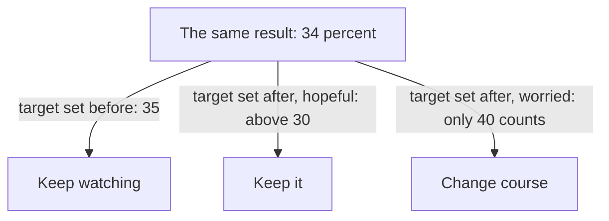

## "So what would you do first?"

Mais has asked her questions, said her assumptions and compared three options. She feels good about it. The founder listens, nods, and then asks the question that every case ends with. "So what would you do first?" This is the moment where, in chapter 4.1, she gave ten ideas and no choice. This time she is ready.

> **Mais:** "I would lower the fee on a new customer's second order back to 1 dollar for four weeks. It is quick, and it tests our main lead. I would watch the repeat rate for new customers. It is about 30 percent now, and my target is 35. If it reaches 37 or more, I keep it. At 33 or less, I change course and ask lost customers why. In between, I keep watching."

That is about 75 words, and it answers four questions at once: what, why, how she will know, and what she will do if it does not work. The founder does not have to ask a single follow-up to understand it. This chapter takes that answer apart, so you can build one for any case.

## Five sentences

A good end to a case has five parts, in this order. First, the recommendation, in one sentence, at the start. Interview coaches advise to lead with the recommendation, then give the evidence, then the limits. It is easier to follow, and it shows that you are willing to decide. Second, the reason, in one more sentence. Third, the number you would watch, with where it is now. In chapter 2.2 this was called the number before. If the founder has not told you, say so: "I would ask what it is today." Fourth, your target, and the results that tell you to keep the change or to change course. Fifth, the assumption that matters most, and how you would check it.

The fourth part is the one fellows forget, and it is the one that makes the answer honest. It says: here is how I could be wrong, and here is how I would find out. A founder who hears it knows that you will not defend a bad plan out of pride. The rule that makes it work is simple: you decide the target before you look at the result. If you set the target after you see the number, it will move to match what you hoped for. Everyone does this, and nobody notices.

This is again a practical method from interview coaches and this course. It is not research. But it copies how good teams run a test: say what you expect, then look.

## A target, and the swing around it

Numbers move by chance. Suppose that in the six months before the fall, the repeat rate stayed between 38 and 42 percent. That means the rate moves up and down by about 2 points in a normal month, with no change at all. We call this the **normal swing**. If Mais's target is 35 percent and the result is 34, she cannot tell if the fee did not work or if the month was a little low. A result 1 point under the target is inside the normal swing.

This gives a simple rule with three answers. The **target** is the baseline plus the rise you need, set before you look. Keep the change if the result is at or above the target plus the swing. Change course if it is at or below the target minus the swing. Otherwise keep watching for another few weeks. With a target of 35 and a swing of 2, that means 37 or more to keep, 33 or less to change course, and 34 to 36 to keep watching. This is the course's rule of thumb, not statistics. It is a habit that stops you from reading too much into one number. A founder who hears you say "that could be chance" will trust the rest of your answer more.

Before you use the canvas, think about the case where the result is 34 percent.

```predict
prompt: "Mais's target is 35 percent and the normal swing is 2 points. After four weeks the repeat rate is 34 percent. What should she conclude?"
options:
  - id: watch
    label: "Keep watching for a few more weeks"
  - id: change
    label: "Change course, it missed the target"
correctOptionId: watch
explanation: "34 is only 1 point under the target, and the rate moves by about 2 points in a normal month. The result could be chance. She keeps watching. She would keep the change at 37 or more, and change course at 33 or less."
```

In the canvas, you can change the rate before, the result, the rise Mais needs, and the normal swing. Watch the verdict and read the sentence under it.

<InteractiveCanvas slug="decide-and-measure" />

The canvas shows the verdict for the target you set, and the sentence under it says why. Try the three results from the try-this list, then set the swing to 0. This is a simple illustration of a rule of thumb, and real results move up and down for many reasons.

## The same result, three readers

Why set the target first? The diagram shows what happens to one result, 34 percent, when the target is set at different times. It adds something the rule alone does not show: the verdict follows the target, not the number.



What to notice is that the number never changed. Only the target did, and the verdict went three ways. A target set before you look gives one honest answer. A target set after you look gives the answer you wanted. This is why founders like to hear the target first.

## Checking the size of the numbers

Interview coaches also advise to check that your numbers make sense. When a founder asks "Are you sure?", it is often a prompt to look again at the numbers, and it does not always mean you are wrong. Mais does a quick check on her case, with figures that she labels as an example. If about 1,000 customers order in a month, a repeat rate of 40 percent means 400 come back, and 30 percent means 300. So the fall is 100 customers a month. Her target of 35 percent means about 350, so a rise of 5 points is about 50 more customers a month.

Now she can say something useful: "If I win back half of what we lost, that is about 50 customers a month. I would check if that is worth 1 dollar off each second order." The numbers are small, and she says they are an example. She has also shown that she thinks about size and cost, which a founder cares about. If the founder asks "Are you sure?", she can say, "Let me check the arithmetic," and do it aloud. She does not back down at once, and she does not defend a mistake.

## The assumption and how to check it

Mais's main assumption is that the fee, not something else, caused the drop. She has a lead and not a proof. Two things that happen in the same month are not always cause and effect. So her fifth part is: "My main assumption is that the fee caused the drop. I would check the restaurant list and the delivery times first, to see if they changed. And I would compare new customers who paid 2 dollars with those who paid 1 dollar." That sentence turns a weakness in her plan into a first step.

A second example shows the same shape in engineering. Tamer is asked how he would fix a slow search page. He says: "I would start with the data request. I would watch the middle load time for users with many saved items. That means I put the times in order and take the middle one. It is 8 seconds now, and my target is 4 or less. The time normally moves by about 1 second. If it falls to 3 or less, I keep the change. If it is still 5 or more, I look at the images next. My main assumption is that the request is the slow part, and I would check that by timing it first." Notice that the shape is the same. A recommendation, a number with its value now, a target with its edges, and an assumption with a check.

## Where a decision goes wrong

One way is to say "it depends" and stop. It does depend, and the founder knows. Say what it depends on, and then pick. Another is to give no value for the number now, so that "watch the repeat rate" means nothing. If you do not know it, say you would ask for it. A third is to watch too many numbers, such as sign-ups, visits, clicks and time on page, which lets you find a good sign in any result. Choose one number, and perhaps one more to check it did not cause harm.

A fourth is to treat the founder's challenge as a vote. If the founder asks "Are you sure?" and you change your answer at once, you show that your answer was not based on anything. If you check the numbers aloud and they hold, say so. If they do not hold, say that too, and change the answer. A last one is to hide your doubt. "I might be wrong about the fee, and here is how I would know" is a stronger sentence than a promise.

## Say it aloud and time it

Take the options you compared in chapter 4.3, or use Sara's onboarding case. Pick one, and write the five sentences: the recommendation, the reason, the number with its value now and your target, the assumption, and the check. Set the target before you imagine the result. Then ask yourself what the normal swing of your number is, and whether your target is clear of it. Say all five sentences aloud, and time yourself. It should take under a minute.

## Check your understanding

```quiz
type: mcq
question: "Hiba tests a reminder message to customers who started a quote on a print shop's website and left. Before the test, 20 percent of started quotes were finished. Her target is 24 percent, and the normal swing is 1 point. After four weeks, 24 percent are finished. What should she conclude?"
options:
  - "Keep watching: she keeps it at 25 or more and changes course at 23 or less."
  - "Keep it, because 24 reached the target of 24 that she set before the test began."
  - "Change course, because 24 is under the 25 that she had hoped to reach."
  - "Keep it, and set a new target of 26 for the next test after four weeks."
correct: 0
explanations:
  - "Right. With a target of 24 and a swing of 1, she keeps the change at 25 or more and changes course at 23 or less. 24 is in between, so she keeps watching."
  - "The result reached the target, but the rule keeps the change only at the target plus one swing, which is 25. Being on the target is inside the normal swing."
  - "Her target was 24, not 25. Changing the target after she sees the result is the mistake the rule is built to prevent."
  - "Moving to a new target after she sees the result changes the question. The rule is decided before the result, and 24 does not reach the keep edge of 25."
```

```quiz
type: mcq
question: "Sara, a product designer, recommends removing the phone-number field from a sign-up form. The sign-up rate is now 2.4 percent of visitors, and in recent weeks it varied between 2.2 and 2.6 percent. She needs a rise of 0.5 points. Which statement of her target and edges is best?"
options:
  - "My target is 2.9 percent. If the rate is above 2.4 after two weeks, I will keep the change."
  - "I will watch sign-ups, visits, clicks and time on page, and decide from the four."
  - "My target is 2.9 percent. After two weeks I will decide whether that is a good result."
  - "Target 2.9 percent. Keep it at 3.1 or more, undo it at 2.7 or less, and watch in between."
correct: 3
explanations:
  - "A rate of 2.5 is inside the 2.2 to 2.6 range it already moves in. The edge is not clear of chance, so it could pass by itself."
  - "Four numbers let her find a good sign in almost any result. A clear answer names one number and its edges."
  - "This sets a target but no edges. After the result comes in, any rate could be read as good or bad."
  - "Right. The normal swing is about 0.2 points, so the edges are 3.1 and 2.7. It names the number, the target and the action at each edge, before the result."
```

**Next:** Quiz: five short cases on clarifying, options, trade-offs and measures.
