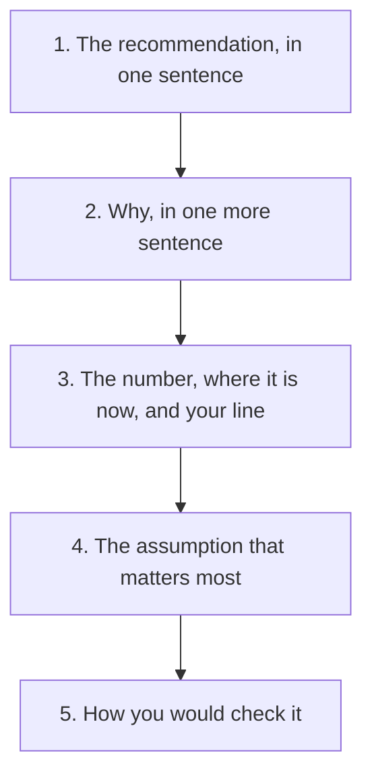

## "So what would you do first?"

Mais has asked her questions, said her assumptions and compared three options. She feels good about it. The founder listens, nods, and then asks the question that every case ends with. "So what would you do first?" This is the moment where, in chapter 4.1, she gave ten ideas and no choice. This time she is ready.

> **Mais:** "I would lower the fee on a new customer's second order back to 1 dollar for four weeks. It is quick, and it tests our main lead. I would watch the repeat rate for new customers. It is about 30 percent now. If it reaches 35 or more, I would keep it. If it stays near 30, I would stop and ask lost customers why."

That is about seventy words, and it answers four questions at once: what, why, how she will know, and what she will do if it does not work. The founder does not have to ask a single follow-up to understand it. This chapter takes that answer apart, so you can build one for any case.

## The idea in plain words

A good end to a case has five parts, in this order. First, the recommendation, in one sentence, at the start. Interview coaches advise to lead with the recommendation, then give the evidence, then the limits. It is easier to follow, and it shows that you are willing to decide. Second, the reason, in one more sentence. Third, the number you would watch, with where it is now. In chapter 2.2 this was called the number before. If the founder has not told you, say so: "I would ask what it is today." Fourth, the result that would change your mind. Fifth, the assumption that matters most, and how you would check it.

The fourth part is the one fellows forget, and it is the one that makes the answer honest. It says: here is how I could be wrong, and here is how I would find out. A founder who hears it knows that you will not defend a bad plan out of pride. The rule that makes it work is simple: you decide the line before you look at the result. If you set the line after you see the number, it will move to match what you hoped for. Everyone does this, and nobody notices.

This is again a practical method from interview coaches and this course. It is not research. But it copies how good teams run a test: say what you expect, then look.

## A line, and the swing around it

Numbers move by chance. Suppose that in the six months before the fall, the repeat rate stayed between 38 and 42 percent. That means the rate moves up and down by about 2 points in a normal month, with no change at all. So if Mais sets her line at 35 percent and the result is 34, she cannot tell if the fee did not work or if the month was a little low. A result 1 point under the line is inside the normal swing.

This gives a simple rule with three answers. If the result is at least one normal swing above the line, keep the change. If it is more than one swing below the line, change course. If it is in between, it is too close to call, and the honest thing is to keep watching for another few weeks. The rule is not a law of nature. It is a habit that stops you from reading too much into one number. A founder who hears you say "that could be noise" will trust the rest of your answer more.

Before you use the canvas, think about the case where the result is 34 percent.

```predict
prompt: "Mais's line is 35 percent and the normal swing is about 2 points. After four weeks the repeat rate is 34 percent. What should she conclude?"
options:
  - id: watch
    label: "Too close to call, keep watching"
  - id: change
    label: "Change course, it missed the line"
correctOptionId: watch
explanation: "34 is only 1 point under the line, and the rate moves by about 2 points in a normal month. The result could be noise. She should keep watching for a few more weeks before she stops. A result 3 points or more under the line would be a different story."
```

In the canvas, you can change the rate before, the result, the rise Mais needs, and the normal swing. Watch the verdict and read the sentence under it.

<InteractiveCanvas slug="decide-and-measure" />

**What this shows:** the verdict follows a line set in advance, and the normal swing decides how much room chance gets. **Try this:** predict the verdict at the start. Then set the result to 38 percent, and then to 31. Last, set the normal swing to 0 with the result at 34. **What changed:** at 34 percent the verdict is too close to call. At 38 it is keep it, because the result is 3 points above the line. At 31 it is change course, because it is 4 points below. With a swing of 0, 34 is below 35 and the line says change course, which shows why the swing matters. **Limits of the model:** this is a simple illustration. Real results move up and down for many reasons, and four weeks may be too short. The lesson is to set the line first, not these exact numbers.

## Checking the size of the numbers

Interview coaches also advise to check that your numbers make sense. When a founder asks "Are you sure?", it is often a prompt to look again at the numbers, and it does not always mean you are wrong. Mais does a quick check on her case, with figures that she labels as an example. If about 1,000 customers order in a month, a repeat rate of 40 percent means 400 come back, and 30 percent means 300. So the fall is 100 customers a month. Her line of 35 percent means about 350, so a rise of 5 points is about 50 more customers a month.

Now she can say something useful: "If I win back half of what we lost, that is about 50 customers a month. I would check if that is worth 1 dollar off each second order." The numbers are small, and she says they are an example. She has also shown that she thinks about size and cost, which a founder cares about. If the founder asks "Are you sure?", she can say, "Let me check the arithmetic," and do it aloud. She does not back down at once, and she does not defend a mistake.

## The assumption and how to check it

Mais's main assumption is that the fee, not something else, caused the drop. She has a lead and not a proof. Two things that happen in the same month are not always cause and effect. So her fifth part is: "My main assumption is that the fee caused the drop. I would check the restaurant list and the delivery times first, to see if they changed. And I would compare new customers who paid 2 dollars with those who paid 1 dollar." That sentence turns a weakness in her plan into a first step.

A second example shows the same shape in engineering. Tamer is asked how he would fix a slow search page. He says: "I would start with the data request. I would watch the median load time for users with many saved items. It is 8 seconds now. If it does not fall below 4 seconds after the change, I would look at the images next. My main assumption is that the request is the slow part, and I would check that by timing it first." Notice that the shape is the same. A recommendation, a number with its value now, a line, and an assumption with a check.



The diagram shows the order of a finished answer. It starts with the decision, and the doubts come last, so the founder hears your choice before your caution. What to notice is that every box is one sentence. The whole answer is five sentences, and you can say it in under a minute. If you cannot say a part in one sentence, you have not finished thinking about it.

## Where people go wrong

The first mistake is to say "it depends" and stop. It does depend, and the founder knows. Say what it depends on, and then pick. The second is to decide the line after you see the result. The third is to give no value for the number now, so that "watch the repeat rate" means nothing. If you do not know it, say you would ask for it. The fourth is to watch too many numbers, such as sign-ups, visits, clicks and time on page, which lets you find a good sign in any result. Choose one number, and perhaps one more to check it did not cause harm.

A fifth mistake is to treat the founder's challenge as a vote. If the founder asks "Are you sure?" and you change your answer at once, you show that your answer was not based on anything. If you check the numbers aloud and they hold, say so. If they do not hold, say that too, and change the answer. A sixth is to hide your doubt. "I might be wrong about the fee, and here is how I would know" is a stronger sentence than a promise.

## Try it on your own work today

Take the options you compared in chapter 4.3. Pick one, and write the five sentences: the recommendation, the reason, the number with its value now and your line, the assumption, and the check. Set the line before you imagine the result. Then ask yourself what the normal swing of your number is, and whether your line is clear of it. Say all five sentences aloud, in under a minute. If you prefer, use Sara's onboarding case from chapter 4.3 and write a plan for the option you think is best.

## Check your understanding

```quiz
type: mcq
question: "Hiba tests a reminder message for people who left items in a cart. Before the test, 20 percent of carts were finished. She sets her line at 24 percent. The normal week-to-week swing is 1 point. After four weeks, 22 percent of carts are finished. What should she conclude?"
options:
  - "Change course, because the result is 2 points under her line"
  - "Keep it, because the result rose from 20 to 22 percent"
  - "Too close to call, because 22 is near 24 and chance matters"
  - "Keep it, and move the line to 22 so that it counts as a success"
correct: 0
explanations:
  - "Right. The line was 24 and the swing is 1 point. A result of 22 is 2 points under the line, which is more than one swing. She should change course."
  - "The rate did rise, but her line was 24. A rise of 2 points is as large as two normal swings, and she said she needed 4."
  - "The gap to her line is 2 points, and the normal swing is only 1. That is too far below to blame on chance."
  - "Moving the line after she sees the result defeats the purpose of setting it first. A line that moves to fit the result cannot change her mind."
```

```quiz
type: mcq
question: "Sara, a product intern, recommends removing the phone-number field from a sign-up form. The sign-up rate is now 2.4 percent of visitors. In recent weeks it has varied between 2.2 and 2.6 percent. She says what would change her mind. Which statement is best?"
options:
  - "If the rate does not go up by then, I will decide what to do next"
  - "If the rate is not above 2.9 percent after two weeks, I will undo it"
  - "If the rate is above 2.4 percent after two weeks, the change worked"
  - "I will watch sign-ups, visits, clicks and time on page, and decide from all"
correct: 1
explanations:
  - "This sets no line. After the result comes in, any rate could be read as a reason to stay or to go."
  - "Right. It names the number, a line set in advance, a time and the action. 2.9 is clear of the 2.2 to 2.6 range, so chance alone is unlikely to reach it."
  - "A rate of 2.5 is inside the range it already moves in. The line is not clear of normal swings, so it could pass by chance."
  - "Four numbers let her find a good sign in almost any result. A clear answer names one number and one line."
```

**Next:** Quiz: five short cases on clarifying, options, trade-offs and measures.
