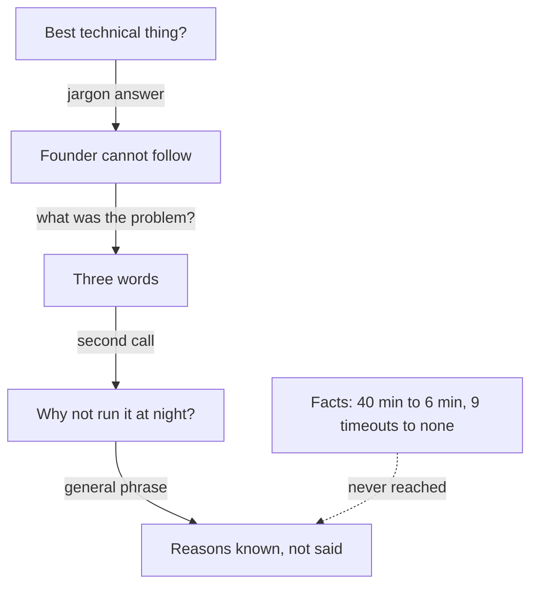

<BigWordAlert term="Founder version" plainEnglish="A short account of your technical work in plain words: the problem, what you built, the key choice and the result." whyItMatters="A founder who can follow you in one minute can ask good questions. A founder who cannot follow has nothing to ask except the words." />

## Two conversations in one day

Yazan is 29. He is a backend developer, and he has worked for 18 months at a payments startup with a team of eight. Now he wants to join a remote team of seven that builds an invoicing app for freelancers. The company has asked him to do two video calls on the same day. The first is with the founder. The second is with one of the engineers.

Yazan prepared with care. His internet is steadier in the late morning, so he asked for a call at 11:00. He charged his laptop the night before and checked his headphones. He also chose the project he wanted to talk about. In his last year, he moved the monthly merchant report to a background job. The report is the file that shows a business all of its card payments for one month. It was slow, and for the largest merchants it often failed. Yazan fixed it. He is proud of it, and he is right to be.

The founder starts the first call with a short, friendly question.

> **Founder:** "What is the best technical thing you have done?"
>
> **Yazan:** "I moved our monthly merchant report to an async worker. It uses a queue, so the report builds in the background. The retries are idempotent, so a failed part can run again safely. It is eventually consistent, and it scales much better now."

Every word in that answer is correct. An engineer would nod. But the founder does not write code, and he looks at the camera for a moment before he speaks again.

## The founder cannot follow

> **Founder:** "Sorry, I do not write code. What was the problem?"
>
> **Yazan:** "The report was slow."
>
> **Founder:** "OK. And now?"
>
> **Yazan:** "Now it is faster."

The founder says thank you and moves to a new topic. Look at what happened. Yazan gave five technical terms, and none of them was explained. When the founder asked for the problem, Yazan gave three words. When he asked for the result, Yazan gave three more. The founder learned that the report had been slow and was now faster. That is true of almost any project.

This is a very common mistake, and it is not a sign of a weak developer. When you know something well, it is hard to remember what it is like not to know it. Economists named this the curse of knowledge, and chapter 5.3 explains it. Yazan used the words he uses every day with his team. They felt like plain words to him.

## The engineer asks "why not?"

The second call is with an engineer from the team. She is friendly and direct. She has read Yazan's resume, and she asks about the same project.

> **Engineer:** "Why a background job? Why not just run it at night?"
>
> **Yazan:** "A queue is better practice for this kind of work."
>
> **Engineer:** "Better in what way?"
>
> **Yazan:** "It is more scalable, and it is cleaner."

The engineer writes something down and asks about a different project. Yazan ends the call feeling that he was not clear, but he cannot say why. Before you read on, think about the question that stopped him.

```predict
prompt: "Yazan did have real reasons for choosing a background job over a night run. Why do you think he did not give them?"
options:
  - id: never-said
    label: "He had never said them in plain words"
  - id: no-reasons
    label: "He had chosen it without any real reason"
correctOptionId: never-said
explanation: "Yazan made the choice for good reasons at the time: merchants asked for reports at any time, and some needed today's numbers. But a reason you hold in your head is different from a reason you can say in a sentence. He had never practised saying it, so under a direct question he reached for a general phrase."
```

## What Yazan knew and did not say

Yazan did have reasons. When he built the job, he looked at what merchants did. They asked for their report on any day of the month. Some needed the numbers the same day, for example to check a payment before they paid a supplier. A night run would give them yesterday's figures, and it would make them wait until the next morning. That was the reason he did not choose a night run. He had never said it in a sentence, because nobody had asked him until that day.

He also had numbers. He had read them from the report logs, which record the start time, the end time and any timeout of every report. In the month before his change, the report for the largest merchants took about 40 minutes, and there were 9 timeouts for the 12 largest merchants. In the two months after, the largest report took about 6 minutes and there were no timeouts. He knew what would happen if the job stopped halfway: it restarts from the last finished part, and the merchant never gets the same report twice. He had tested that by stopping the job by hand.

All of that was true, and all of it was checkable. None of it reached either listener. The founder heard terms without a problem. The engineer heard "better practice" without a decision. Both of them were asking for the same thing in different forms: show me your thinking.

Imagine the first answer again, with the same facts and no new work. "Our biggest merchants waited about 40 minutes for their monthly report, and it failed nine times last month. I changed it so the report is built in the background, and a link is emailed when it is ready." That is two sentences, and the founder can follow them. He would have asked a question about the merchants, and the talk would have moved forward. The facts did not change. Only the order and the words changed.

The same problem appears outside engineering. A designer says "we ran a usability test" and forgets that she chose to test with five patients on a cheap phone, not with colleagues on a large screen. An operations coordinator says "I automated the stock sheet" and forgets that he chose a simple formula over a script, because the shop owner needed to change it herself. In this course, "technical" means the most careful and skilled decision you made in your own craft. It does not mean code only.

## Why this matters in founder and small-team interviews

Founders who write about hiring say that they ask about your most impressive project and go deep into what you actually did. They also say they turn away candidates who cannot explain a project in plain terms. In a small team, a second conversation with a person who does the same work as you is common. That person asks the other kind of question: why this and not that, and what happens if it fails.

So the same story has two listeners. The founder wants the problem in words they know, the choice you made and the result. The engineer wants the options, the reason, the failure case and the test. If you only have one version, you fail one of them. Yazan had one version, and it was written for his own team. This module teaches you to build both versions from the same facts, in the right order.

The five qualities from the earlier modules help here. Your own part is the one from module 1. The honest number with a before and an after is from module 2. The real reason you had at the time is from module 3. This module adds one thing: saying all of that to a person who does not share your words.

The diagram below shows Yazan's day as a path. Each arrow is a follow-up question, and each box is what happened next.



Look at what the path does not contain. There is no moment where Yazan says what he decided, what he gave up, or how he checked that it worked. Those are the three things a founder and an engineer both listen for, even when they ask for them in different words. Notice that the path ends where Yazan's reasons begin. The dotted arrow shows the facts he had, and the path never reaches them. Neither listener was unkind. Both of them kept asking, and each time Yazan answered at the level of his own team.

## What this module covers

The module has three teaching chapters and a gate. In chapter 5.2, you choose the story to tell. The best technical story is not always the one with the newest tools. It is the one where you made a real decision and can explain it. In chapter 5.3, you write the founder version: under a minute, in plain words, in four parts. In chapter 5.4, you prepare the engineer version. You learn how to answer "why not this?" and "what happens if it fails?". Each answer uses a decision or a test, or an honest "I did not test that".

At the end of the module you write both versions of your own best technical work. If you do not want to use your own work, you can use Hadeel's, a fellow whose work is provided in the gate. The people and teams in this chapter are fictional, and so are the founder and the engineer in Yazan's story.

<LearningObjectives items={["Choose the technical story where you made a real decision and can explain it", "Tell a founder your technical work in under a minute, in plain words", "Answer an engineer's why not, what if and how did you test it", "Say what you did not test, and what you would do about it"]} />

## Key words

| Word | Plain English |
|---|---|
| **Founder version** | A short, plain account of your work: the problem, what you built, the key choice, the result |
| **Engineer version** | The deeper account you give when an engineer asks why, what if it fails and how you tested it |
| **Jargon** | Words that people in one field know and other people do not |
| **Key choice** | The one decision in the work that shaped the result |
| **Failure case** | What happens when part of your work stops or goes wrong |

## What is in this module

| Chapter | You will practise |
|---|---|
| 5.2 | Choosing the technical story you can defend, not the one with the newest tools |
| 5.3 | The founder version: problem, what you built, key choice, result, in under a minute |
| 5.4 | The engineer version: why not, what if, how you tested it, what you would change |
| 5.5 | A graded quiz with five short cases, including an AI answer to check |
| 5.6 | Both versions of your best technical work, practised with the AI interviewer or in writing |

**Next:** How to choose which technical story to tell, and why the one with the best tools is often the wrong one.
