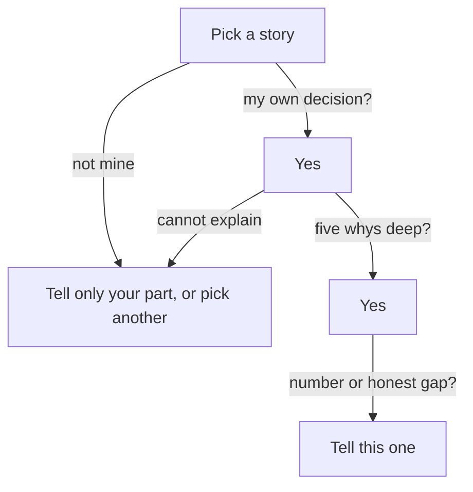

## The story with the best tools

After his two calls, Yazan writes down three projects he could talk about. His friend Osama, a developer at a logistics company, reads the list and says, "Tell them about the events project. It has a message streaming system and containers on a cloud cluster. Those are the tools every founder wants to hear." Yazan wrote the tests for that project. He did not choose the tools.

Yazan thinks about it. The events project sounds big. His report job sounds small, because it is "only" a background job. It is easy to see why Osama gave that advice. Many people believe that the most impressive tools make the most impressive story. This chapter tests that belief against what an interviewer does next.

## Four questions to ask of each story

The story you choose decides the next five minutes of the interview. The interviewer will follow it with questions, and every question goes deeper into the same story. So the question is not "which project sounds best?" It is "which project can I still explain when the questions get deep?"

Four things make a technical story strong. First, you made a real decision in it. A decision means you had at least two options and you chose one for a reason. Second, you can explain that decision to the end of a why chain, which you met in chapter 3.2. That means: why this approach, what you rejected, what broke, and how you know it worked. Third, there is a result you can state with a before and an after (chapter 2.2), or an honest gap with a plan to measure (chapter 2.4). Fourth, it is recent enough that you remember the reasons you had at the time.

Impressive tools are not on that list, and that is on purpose. Hiring advice written by startup founders asks the same thing in different words: pick one project, then keep asking what the candidate actually did. One of these writers points out that it is easy to take credit for a successful project. If the project is big and your part was small, the questions will reach your part quickly.

The list does not say that "technical" must mean "code". A designer's best technical decision may be how she tested a prototype. An operations coordinator's may be how he built a spreadsheet that checks itself. The test is the same: your own decision, explained to the end.

## Three stories, five questions

Yazan scores his three stories on five questions. The first is the report job. The second is the events project, where he wrote the tests. The third is a weekend app he built for himself to track bills, with a new database he wanted to learn. The five questions are: was it my own decision, can I explain it five whys deep, is there a result or an honest gap, is it recent, and are the tools impressive. The scores in the canvas are Yazan's own judgment. Yours would differ, which is why you will score your own stories later in this chapter.

Each question also has a weight: how much it matters to you. Yazan starts with the weights he would choose after reading this chapter. Before you open the canvas, predict what happens when he gives more and more weight to impressive tools.

```predict
prompt: "Yazan raises the weight of Impressive tools one level at a time, starting from Nice to have. At which level does the events project first beat the report job?"
options:
  - id: important
    label: "At Important, the next step up"
  - id: very-important
    label: "At Very important, two steps up"
correctOptionId: very-important
explanation: "One step up is not enough: the report job still leads, because it scores far higher on his own decision, on explaining it and on its result. At the top level the events project passes it, because its tools score 5 and the report job's score 1. The weights can change the winner, but only when tools matter more than almost everything else."
```

Step through the canvas. Change one weight at a time, and read the sentence under "What changed" after each move.

<InteractiveCanvas slug="choose-technical-story" />

The canvas scores three stories on five questions, and the weight you give each question decides the winner. Try the tools weight first, then put it back and raise the weight on explaining the story. Remember that the scores are one person's judgment, so the model shows how weights work, not which story is yours.

## What it means

The result is a trap, and it is a trap many people walk into. The events project can win, but only when you decide that impressive tools matter a lot. That is exactly the choice Osama was recommending. It feels reasonable, because tools are easy to see and easy to name. But the weight you give them is a decision, and the canvas shows what it costs: the story you can defend least becomes the one you tell.

The weekend app is also useful to look at. It has one strength, which is that Yazan made every decision. It has one weakness: there was no result. Nobody used the app but him, and he did not measure anything. It could still be a fine story if no work story is available. In that case, say clearly that it is a project for yourself, and say what you learned. It is a weaker choice when you have a work story that you owned.

## A full worked example

Here is how the choice looks when the questions begin. First, the events project. Imagine Yazan tells it, and the founder follows with whys.

> **Founder:** "What was your part in the events project?"
>
> **Yazan:** "I wrote the tests."
>
> **Founder:** "Why did you test it that way?"
>
> **Yazan:** "That was the test plan we had."
>
> **Founder:** "What did the tests find?"
>
> **Yazan:** "Some bugs. I do not remember the details."

Look at the reasoning. The first answer is honest, and it names a real part. The second why ends the chain: the plan was not his, so he has no reason of his own. "That was not my decision" is a good answer in an interview, but it cannot carry a whole story. By the third question there is no result and no memory. The tools were impressive, and nothing under them was Yazan's.

Now the report job, with the same three questions.

> **Founder:** "What was your part in the report job?"
>
> **Yazan:** "All of it. I saw the timeouts in the logs, chose the approach and built it."
>
> **Founder:** "Why that approach?"
>
> **Yazan:** "Merchants ask for reports at any time, and some need today's numbers. A night run would give yesterday's."
>
> **Founder:** "How do you know it worked?"
>
> **Yazan:** "The report logs. Before, about 40 minutes and 9 timeouts in a month for the 12 largest merchants. After, about 6 minutes and no timeouts in two months."

Three questions in, the story is stronger. The part is his. The reason is his, and it was true at the time. The number has a before, an after and a source. The tools were simple, and that did not matter. Notice also the honest limit: two months is a short time, and Yazan does not claim more. The next question, "what would you change?", has an answer ready, which chapter 5.4 teaches.

## A diagram of the choice

The canvas weighs the questions. The diagram below puts them in order, as a filter. It shows that each question removes some stories before you weigh anything. A story that fails an early question should not reach the end, however good the tools are.



Read it from the top. The first question asks whether the decision was yours. If it was not, you can still tell your part, as the events project shows, but it is a poor choice for "the best thing you did". The second question asks whether you can explain it. The third asks for a number or an honest gap. Only a story that passes all three reaches the bottom. Tools do not appear anywhere in the filter.

## Common ways the choice goes wrong

The first mistake is choosing by size. "The biggest project I worked on" is a popular choice, and the size often belongs to the team. The second is choosing by tools, which the canvas showed. The third is choosing a story where you only owned the middle and not saying so. Chapter 1.3 taught you to say your part and the team's part. If you pick a team story, say which part was yours in the first sentence.

The fourth mistake is picking an old story whose reasons you no longer remember. If you cannot say why you chose an option, you may fill the gap with a reason that sounds good now. Chapter 3.3 warned about this. The fifth is picking a story with a number you cannot source. A number with no before invites "from what?".

A last mistake is thinking you have no story because your work looks small. Sana is an operations coordinator at a school office. She built a sheet that shows which rooms are free in each period, and she chose plain colours over a script, because the head teacher's assistant needed to fix it herself. That is a technical decision with a reason, an alternative and a clear owner. It is a good story.

## Score your own stories today

Write down three projects or pieces of work. Use the same five questions as Yazan: was the key decision mine, can I explain it past the third why, do I have a number with a before or an honest gap, was it in the last two years, and are the tools impressive. Give each story a score from 1 to 5 on each question, on paper. Do not add the weights yet. Look first at the stories that score 4 or 5 on the first two questions, and put a cross beside any story where you must say "the team decided".

Pick the story with the best first two scores, and write one sentence for each of the first three whys. If you prefer not to use your own work, score Hadeel's three stories instead: her page-speed work, her text-message reminders and her bakery order form, all shown in her resume in chapter 3.6.

## Check your understanding

```quiz
type: mcq
question: "Manar is a product designer choosing a story for 'the best design thing you have done'. Story A: a school timetable app redesign by a team of 10 with a famous design tool. She drew the icons. It finished last month. Story B: a paper test of a bakery's order form with 6 customers. She saw 4 of them stop at the delivery date and moved that field to the end. It was 8 months ago, and she did not count orders afterwards. Which should she tell?"
options:
  - "Story A, since it finished last month and Story B is already 8 months old now."
  - "Story B: she chose the test, saw 4 of 6 stop at one field, and did not count orders."
  - "Story A, since a team of 10 and a famous tool show she can work at scale."
  - "Neither, since Story B has no count of orders and Story A was a team of 10 developers."
correct: 1
explanations:
  - "Recent work helps, but she drew the icons only, so the questions would reach her part fast. The age of Story B matters less than who made the choices."
  - "Right. She made the decisions, can say why she moved the field, and has a real observation: 4 of 6 stopped there. The missing result is an honest gap with a clear next step."
  - "The team size belongs to the team, and she did not choose the tool. The first 'why this way?' would have no answer from her."
  - "A missing count is an honest gap, not a reason to drop the story. She can say that she did not count orders and that she would count them over two weeks."
```

**Next:** The founder version: how to say your chosen story in under a minute, in words a founder knows.
