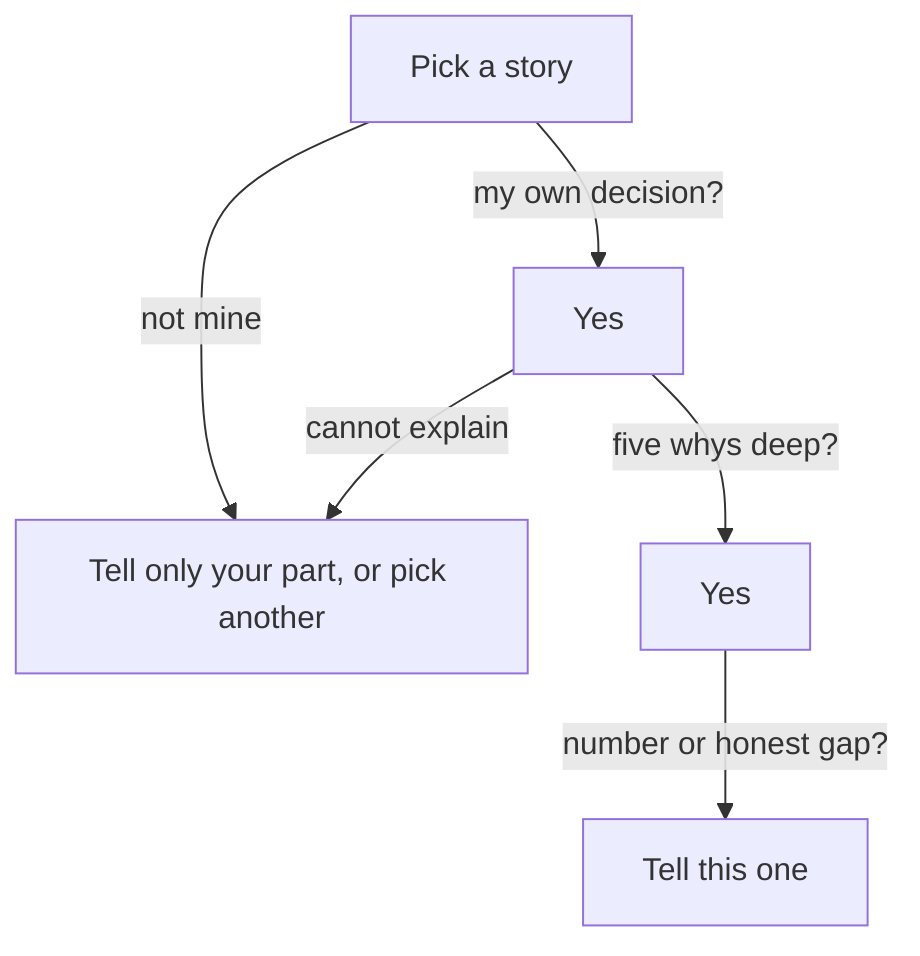

## The story with the best tools

After his two calls, Yazan writes down three projects he could talk about. His friend Osama, a developer at a logistics company, reads the list and says, "Tell them about the events project. It has a message streaming system and containers on a cloud cluster. Those are the tools every founder wants to hear." Yazan wrote the tests for that project. He did not choose the tools.

Yazan thinks about it. The events project sounds big. His report job sounds small, because it is "only" a background job. It is easy to see why Osama gave that advice. Many people believe that the most impressive tools make the most impressive story. This chapter tests that belief against what an interviewer does next.

## The idea in plain words

The story you choose decides the next five minutes of the interview. The interviewer will follow it with questions, and every question goes deeper into the same story. So the question is not "which project sounds best?" It is "which project can I still explain when the questions get deep?"

Four things make a technical story strong. First, you made a real decision in it. A decision means you had at least two options and you chose one for a reason. Second, you can explain that decision to the end of a why chain, which you met in chapter 3.2. That means: why this approach, what you rejected, what broke, and how you know it worked. Third, there is a result you can state with a before and an after (chapter 2.2), or an honest gap with a plan to measure (chapter 2.4). Fourth, it is recent enough that you remember the reasons you had at the time.

Impressive tools are not on that list, and that is on purpose. Founders who write about hiring say they ask about your most impressive project, then keep asking what you actually did. One of them points out that it is easy to take credit for a successful project. If the project is big and your part was small, the questions will reach your part quickly.

Notice that the list does not say "technical" must mean "code". A designer's best technical decision may be how she tested a prototype. An operations coordinator's may be how he built a spreadsheet that checks itself. The test is the same: your own decision, explained to the end.

## Three stories, five questions

Yazan scores his three stories on five questions. The first is the report job. The second is the events project, where he wrote the tests. The third is a weekend app he built for himself to track bills, with a new database he wanted to learn. The scores in the canvas are his own judgment. Before you open it, decide what you expect.

```predict
prompt: "With the starting weights, which story do you think leads?"
options:
  - id: report-job
    label: "The report job: his own decision"
  - id: team-project
    label: "The events project: the best tools"
correctOptionId: report-job
explanation: "The report job was Yazan's own choice, he can explain it five whys deep, and he has numbers with a before. The events project has the best tools and is the most recent, but his part was the tests and he did not choose the design. At the start, the questions that matter most for a deep interview carry the most weight."
```

Step through the canvas. Change one weight at a time, and read the sentence under "What changed" after each move.

<InteractiveCanvas slug="choose-technical-story" />

**What this shows:** three stories scored on five questions, where the weight you give each question decides the winner. **Try this:** set Impressive tools to Very important, then put it back and set I can explain five whys to Very important. **What changed:** when tools became very important, the events project passed the report job, 41 to 38. When five whys became very important and tools went back to a small weight, the report job led by 7 points. **Limits of the model:** the scores are Yazan's own judgment, and a story that is not on the list cannot win. It is a simple illustration of how much weight tools should have.

## What the canvas showed

The result is the trap. The events project wins only when you decide that impressive tools matter a lot. That is exactly the choice Osama was recommending. It feels reasonable, because tools are easy to see and easy to name. But the weight you give them is a decision, and the canvas shows what it costs: the story you can defend least becomes the one you tell.

The weekend app is also useful to look at. It has one strength, which is that Yazan made every decision. It has one weakness: there was no result. Nobody used the app but him, and he did not measure anything. It could still be a fine story if no work story is available. In that case, say clearly that it is a project for yourself, and say what you learned. It is a weaker choice when you have a work story that you owned.

## A full worked example

Here is how the choice looks when the questions begin. First, the events project. Imagine Yazan tells it, and the founder follows with whys.

> **Founder:** "What was your part in the events project?"
>
> **Yazan:** "I wrote the tests."
>
> **Founder:** "Why did you test it that way?"
>
> **Yazan:** "That was the test plan we had."
>
> **Founder:** "What did the tests find?"
>
> **Yazan:** "Some bugs. I do not remember the details."

Look at the reasoning. The first answer is honest, and it names a real part. The second why breaks the chain: the plan was not his, so he has no reason of his own. "That was not my decision" is a good answer in an interview, but it cannot carry a whole story. By the third question there is no result and no memory. The tools were impressive, and nothing under them was Yazan's.

Now the report job, with the same three questions.

> **Founder:** "What was your part in the report job?"
>
> **Yazan:** "All of it. I saw the timeouts in the logs, chose the approach and built it."
>
> **Founder:** "Why that approach?"
>
> **Yazan:** "Merchants ask for reports at any time, and some need today's numbers. A night run would give yesterday's."
>
> **Founder:** "How do you know it worked?"
>
> **Yazan:** "The report logs. Before, about 40 minutes and 9 timeouts in a month for the 12 largest merchants. After, about 6 minutes and no timeouts in two months."

Three questions in, the story is stronger. The part is his. The reason is his, and it was true at the time. The number has a before, an after and a source. The tools were simple, and that did not matter. Notice also the honest limit: two months is a short time, and Yazan does not claim more. The next question, "what would you change?", has an answer ready, which chapter 5.4 teaches.

## A diagram of the choice

The canvas weighs the questions. The diagram below puts them in order, as a filter. It shows that each question removes some stories before you weigh anything. A story that fails an early question should not reach the end, however good the tools are.



Read it from the top. The first question asks whether the decision was yours. If it was not, you can still tell your part, as the events project shows, but it is a poor choice for "the best thing you did". The second question asks whether you can explain it. The third asks for a number or an honest gap. Only a story that passes all three reaches the bottom. Tools do not appear anywhere in the filter.

## Where people go wrong

The first mistake is choosing by size. "The biggest project I worked on" is a popular choice, and the size often belongs to the team. The second is choosing by tools, which the canvas showed. The third is choosing a story where you only owned the middle and not saying so. Chapter 1.3 taught you to say your part and the team's part. If you pick a team story, say which part was yours in the first sentence.

The fourth mistake is picking an old story whose reasons you no longer remember. If you cannot say why you chose an option, you may fill the gap with a reason that sounds good now. Chapter 3.3 warned about this. The fifth is picking a story with a number you cannot source. A number with no before invites "from what?".

A last mistake is thinking you have no story because your work looks small. Sana is an operations coordinator at a charity shop. She built a stock sheet that adds up donations by category, so volunteers stop counting the same boxes twice. She chose a simple formula over a script, because the shop manager needed to fix it herself. That is a technical decision with a reason, an alternative and a clear owner. It is a good story.

## Try it on your own resume today

Write down three projects or pieces of work. Under each, answer four questions with yes or no. Was the key decision mine? Can I explain it past the third why? Do I have a number with a before, or an honest gap? Was it in the last two years? Put a cross beside any story where you have to say "the team decided". Pick the story with the most yes answers, and write one sentence for each of the first three whys. If you prefer not to use your own work, use Hadeel's: her page-speed work, which the gate gives you.

## Check your understanding

```quiz
type: mcq
question: "Manar is a product designer choosing a story for 'the best design thing you have done'. Story A: a school timetable app redesign by a team of ten with a famous design tool. She drew the icons. It finished last month. Story B: a paper test of a bakery's order form. She chose to watch six customers, saw four stop at the delivery date, and moved that field to the end. It was eight months ago, and she did not count orders afterwards. Which should she tell?"
options:
  - "Story A, since it is newer and a big team shows she can work at scale"
  - "Story A, since a well-known tool will sound senior to the interviewer"
  - "Neither, since she has no number for Story B and Story A was a team"
  - "Story B: her own choices, with an honest gap about the results"
correct: 3
explanations:
  - "She drew the icons only, so the questions would reach her part fast. Being newer helps a little, but the team's size is not her decision."
  - "A well-known tool is the trap this chapter showed. She did not choose the tool, and she cannot explain why it was used."
  - "A missing number is an honest gap, not a reason to drop the story. She can say that she did not count orders and that she would count them over two weeks."
  - "Right. She made the decisions, can say why she moved the field, and has a real observation: four of six stopped there. The missing result is an honest gap with a clear next step."
```

**Next:** The founder version: how to say your chosen story in under a minute, in words a founder knows.
