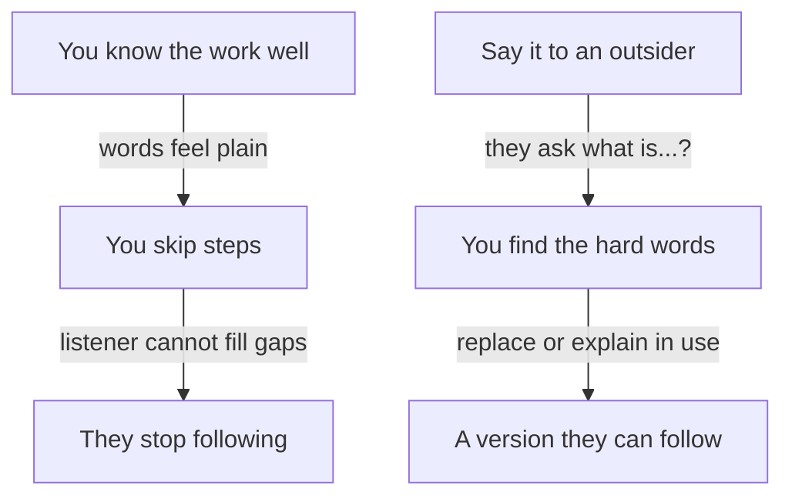

## A test with a baker

Yazan has chosen his story, the report job. Now he has to say it in words a founder knows. He writes four sentences, reads them aloud, and they sound clear to him. Then he tries them on his cousin Duaa, who runs a small bakery and has never written code.

He says, "The merchant report timed out for large merchants, so I moved it to a background job." Duaa stops him. "What is a merchant report? And what does timed out mean?" He explains. She stops him again two sentences later. After five minutes, his four sentences have turned into a long talk, and Duaa says, "Now I understand. Why did you not say that first?"

Duaa did not need Yazan to know less. She needed him to start where she stands. That is the whole skill of the founder version, and this chapter teaches it in four parts.

<BigWordAlert term="Curse of knowledge" plainEnglish="When you know something well, it is hard to remember what it is like not to know it." whyItMatters="You will skip steps and use words that feel plain to you, and the listener will stop following without telling you." />

## The idea in plain words

The founder version is a short answer to "What is the best technical thing you have done?" that a person outside your field can follow. It has four parts, in this order. First, the problem, in the words of the person who had it. Second, what you built or changed, in one sentence. Third, the key choice: the one decision that shaped the result, with the option you did not take. Fourth, the result, with a before, an after and where the numbers come from.

It should take under a minute to say. That is about six to eight short sentences. It is not the whole story. It is the doorway to the story, and the founder decides which door to open next.

Founders who write about hiring say they turn away candidates who cannot explain a project in plain terms. They do not say that plain means shallow. A founder who follows you can ask a good question. A founder who cannot follow can only nod, and then move on to someone else's project.

## Why experts forget

Economists named this problem the curse of knowledge. Better-informed people find it hard to ignore what they know, even when they try to imagine what a less-informed person thinks. In one well-known study, people tapped the rhythm of a song on a table and expected listeners to guess it far more often than the listeners did. The tapper hears the whole song in their head. The listener hears only taps.

Your words are the taps. When Yazan says "queue", he hears a picture of a waiting list of jobs. Duaa hears a word. This is not a sign of a weak speaker. The more you know, the stronger the effect, so your best technical work is the work where it is most likely to happen.

It also applies to what you write. In five experiments, researchers found that people overestimate how clearly their tone and meaning come across in email, because they hear their own intention while they read. This matters in a chat interview and in a written gate answer. The answer that looks clear to you has not yet met a reader.

## Predict the founder's next question

Yazan gives his founder version. Before you see it, think about what a founder will ask next. A founder thinks about users and money, and about the people who use the product. An engineer thinks about parts and failures.

```predict
prompt: "After Yazan's founder version, which question do you expect from the founder?"
options:
  - id: merchant-question
    label: "A question about the merchant who waits"
  - id: tech-question
    label: "A question about the technology he used"
correctOptionId: merchant-question
explanation: "A founder follows the user and the business. Once the problem is in plain words, the easiest thing to ask about is the merchant: do they sit and wait, and what do they get? That question gives Yazan a doorway to explain his key choice. Technical questions come later, mostly from engineers."
```

<InteractiveCanvas slug="founder-version-first" />

**What this shows:** the same work told twice, first in terms and then in four parts. **Try this:** say the four parts in your own words before step 5, then check them against Yazan's. **What changed:** in the first answer the founder said he could not follow and had nothing to ask except the words. In the second answer the founder asked "Does the merchant sit and wait?", which is a business question, and Yazan could explain "background job" in use. **Limits of the model:** this is one founder asking one helpful question. Real founders vary, and some want detail at once.

## What the canvas showed

The two answers contain the same facts. The difference is the order, and who can act on the answer. In the first, every sentence assumed the listener's knowledge. In the second, each sentence gave the listener one thing to hold. The founder's business question was possible only because the problem was already in business words.

Notice also what Yazan did at the end. He did not stop at "background job". When the founder asked whether the merchant waits, he explained the term while using it: "They can close the page, and an email brings the link. That is why it is a background job." The term arrived after the need for it. You do not have to avoid every technical word. You can introduce one when the listener has a reason to want it.

## A full worked example

Here is how Yazan builds the four parts from his notes. He starts with the jargon sentence and rewrites one part at a time.

The problem. His note says "report generation timed out for high-volume merchants". The question to ask is "who had the problem, and what did they see?" The merchants waited for a report that often did not come. So the first part becomes: "Our biggest merchants waited about 40 minutes for their monthly report, and it failed nine times last month." The numbers come from the report logs, and they cover the 12 largest merchants.

What he built. His note says "async worker with a queue". The question to ask is "what is different for the user?" The report is built out of sight, and a link arrives. So the second part becomes: "I changed it so the report is built in the background, in parts, and a link is emailed when it is ready."

The key choice. His note says "queue over cron". A cron job is a task that runs at a fixed time, such as every night. The question is "what else could I have done, and why not?" He could have run the report every night. But merchants ask at any time, and some need today's numbers. So the third part becomes: "I chose that over a night run, because merchants ask at any time."

The result. His note says "build time reduced". The question is "what changed, and how do I know?" Now the largest report takes about 6 minutes, and there were no failures in the next two months. He adds the source: "That is from our report logs."

Put together, the answer is about eighty words. It has a problem, a change, a choice and a result, and no unexplained term. A small table shows the same method on three of his words, which you can use on your own.

| Your word | What the listener needs |
|---|---|
| async worker | A program that does a job out of sight, so the user does not wait |
| queue | A waiting list of jobs, done one after another |
| idempotent retries | If a part fails and runs again, nothing is sent twice |

A second example, from a different role. Jamal is an operations coordinator at a translation agency with five translators. His jargon version: "I automated the intake pipeline with folder triggers and a naming convention." His founder version: "Translators lost time every week looking for the right file. I made one folder per job with a fixed name, and a shared sheet that shows each job's stage. I chose a sheet over a new tool, because all five translators already knew how to use one. I did not measure the time saved. Four of the five told me they find files faster, and I would count the minutes for two weeks." Notice the honest gap. A number he did not have is replaced by what he does know, and by a plan.

## A diagram of the problem and the test

The diagram shows why an explanation fails and what to do about it. The top path is what happens to an expert. The bottom path is the test you can run before the interview.



Read the top path first. Each arrow shows how one small thing leads to the next, and nothing in it is a mistake you chose. The bottom path starts with a person who does not share your words. Their questions are the useful part. Each "what is...?" marks a word to replace or to explain when you use it. The takeaway: you cannot find your hard words by reading your own answer. You need a listener.

## Where people go wrong

The first mistake is starting with the company, the tools or the history. "We are a payments startup and our stack is..." gives the founder nothing to hold. Start with the problem. The second is listing technologies. A founder cannot judge a list of names, and an engineer will ask you about each one.

The third is leaving out the key choice. Without it, the founder version is only a story of what happened, and the engineer has nothing to ask "why not?" about. The fourth is dropping the number, or giving one with no source. Chapter 2.2 gave you the four things a number needs. The fifth is to speak down to the listener. Plain words are not a way to say "this is easy". Say what happened as you would to a respected colleague from another team.

A last mistake is thinking simple means shallow. The founder version is a doorway. The depth is behind it, and chapter 5.4 shows how to open it.

## Try it on your own resume today

Pick the story you chose in chapter 5.2. Write the four parts, one or two sentences each. Then find one person who does not work in your field and read it to them. Mark every word they ask about. Replace it, or plan to explain it when you use it. If you will have a chat interview, send your written version to that person and ask them to tell you which sentence they read twice. Do not share private company details, only the story. If you want to use Hadeel's work, her page-speed story is in the gate.

## Check your understanding

```quiz
type: mcq
question: "Rana is a mobile developer who built a note-taking app for nurses at a clinic. She says: 'I rewrote the sync layer as offline-first, with a local database and conflict resolution on reconnect.' Her facts: nurses lost about 6 notes a week when the clinic's internet dropped. She chose to save on the phone first rather than ask the clinic to buy a faster line. The next month, the clinic's log showed 1 lost note. Which is the best founder version?"
options:
  - "Nurses lost about 6 notes a week when the internet dropped. I made the app save on the phone first, not buy a faster line. The log then showed 1 lost note."
  - "I made the app work offline with a local database, so notes sync when the phone reconnects. Conflicts between two edits are resolved, and the server keeps the newest note."
  - "Nurses were unhappy with how the app handled bad internet, so I improved the sync a great deal. Notes are now saved much more safely, and the nurses like it better."
  - "The clinic's internet dropped often, so I built a new app with a local database. Lost notes went from 6 a week to none, and the nurses said it was better."
correct: 0
explanations:
  - "Right. It starts with the problem in the nurses' terms, says what changed in one sentence, names the key choice against a faster line, and gives a number with a before and a source."
  - "This still uses her own terms: sync, conflicts and the server. A founder has no problem, no choice and no number to hold, and nothing to ask about except the words."
  - "This is plain, but it has no number, no choice and no source. 'Improved a great deal' invites the question 'from what?'."
  - "This says the lost notes went to none, but her log showed 1. It also says she built a new app, and she rewrote the sync, and it skips the choice against a faster line."
```

```quiz
type: mcq
question: "Jamal answers a founder in a chat interview with 120 words, and some terms such as 'webhook' and 'cron'. He read it twice and thinks it is clear. His sister, who sells clothes online and does not code, is free to help. The founder will read it in full. What should he do before sending?"
options:
  - "Read it a third time, slowly, and fix any sentence that feels unclear"
  - "Ask his sister to read it and tell him which sentence she read twice"
  - "Add more technical detail so the founder can see how senior he is"
  - "Cut it to one sentence so there is nothing in it to misunderstand"
correct: 1
explanations:
  - "He has already read it twice. The writer is the one person who cannot see the gaps, because he knows what he meant."
  - "Right. A reader outside the field finds the words he cannot see. Her pause on a sentence marks a word to replace or explain."
  - "The founder asked for something he can follow, and more detail would add more unexplained words. Depth belongs in the engineer version."
  - "One sentence would drop the key choice and the result, which are what the founder most needs. Short is good, but four short parts are better than one."
```

**Next:** The engineer version: how to answer "why not this?" and "what happens if it fails?" with a decision, a test, or an honest "I did not test that".
