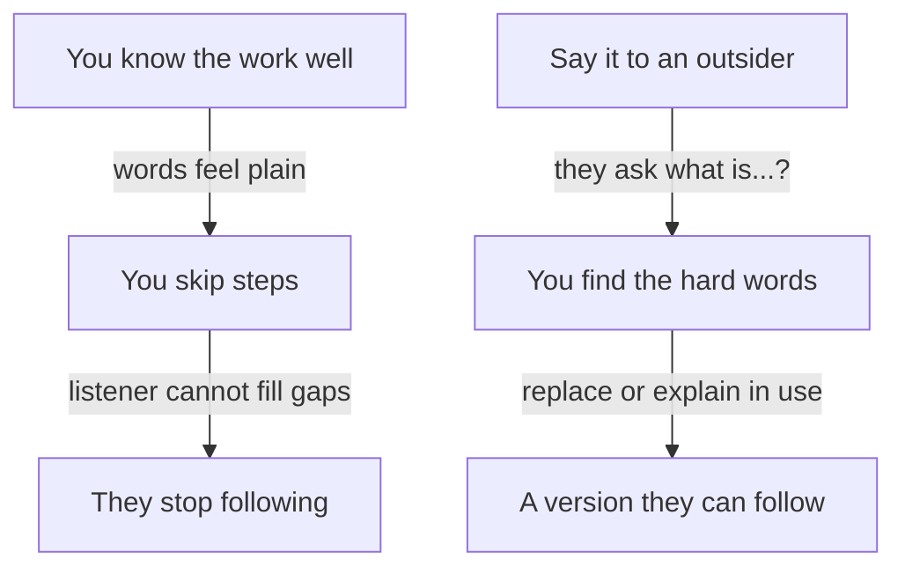

## A test with a baker

Yazan has chosen his story, the report job. Now he has to say it in words a founder knows. He writes four sentences, reads them aloud, and they sound clear to him. Then he tries them on his cousin Duaa, who runs a small bakery and has never written code.

He says, "The merchant report timed out for large merchants, so I moved it to a background job." Duaa stops him. "What is a merchant report? And what does timed out mean?" He explains. She stops him again two sentences later. After five minutes, his four sentences have turned into a long talk, and Duaa says, "Now I understand. Why did you not say that first?"

Duaa did not need Yazan to know less. She needed him to start where she stands. That is the whole skill of the founder version, and this chapter teaches it in four parts.

<BigWordAlert term="Curse of knowledge" plainEnglish="When you know something well, it is hard to remember what it is like not to know it." whyItMatters="You will skip steps and use words that feel plain to you, and the listener will stop following without telling you." />

## What a founder version is

The founder version is a short answer to "What is the best technical thing you have done?" that a person outside your field can follow. It has four parts, in this order. First, the problem, in the words of the person who had it. Second, what you built or changed, in one sentence. Third, the key choice: the one decision that shaped the result, with the option you did not take. Fourth, the result, with a before, an after and where the numbers come from.

It should take under a minute to say. That is about six to eight short sentences. It is not the whole story. It is the doorway to the story, and the founder decides which door to open next.

Hiring essays by startup founders say that they turn away candidates who cannot explain a project in plain terms. They do not say that plain means shallow. A founder who follows you can ask a good question. A founder who cannot follow can only nod, and then move on to someone else's project.

## Why experts forget

Economists named this problem the curse of knowledge. Better-informed people find it hard to ignore what they know, even when they try to imagine what a less-informed person thinks. In one well-known study, people tapped the rhythm of a song on a table and expected listeners to guess it far more often than the listeners did. The tapper hears the whole song in their head. The listener hears only taps.

The same thing happens with words. When Yazan says "queue", he sees a waiting list of jobs. Duaa hears only a word. This is not a sign of a weak speaker. The more you know, the stronger the effect, so your best technical work is the work where it is most likely to happen.

It also applies to what you write. In five experiments, researchers found that people overestimate how clearly their tone and meaning come across in email, because they hear their own intention while they read. This matters in a chat interview and in a written gate answer. The answer that looks clear to you has not yet met a reader.

## Predict the founder's next question

Yazan practises a founder version with his friend Osama, who plays the founder. A founder thinks about users and money. An engineer thinks about parts and failures. Before you open the canvas, think about which question comes first.

```predict
prompt: "Yazan says: 'Our biggest merchants waited about 40 minutes for their monthly report, and it failed nine times last month. I changed it so the report is built in the background, and a link is emailed when it is ready.' Which question does a founder most likely ask next?"
options:
  - id: tech-question
    label: "Which programming tools did you use for it?"
  - id: merchant-question
    label: "Does the merchant sit and wait while it builds?"
correctOptionId: merchant-question
explanation: "A founder follows the user and the business. Once the problem is in plain words, the easiest thing to ask about is the merchant: do they wait, and what do they get? That question gives Yazan a doorway to explain his key choice. Questions about tools come later, mostly from engineers."
```

<InteractiveCanvas slug="founder-version-first" />

The canvas lets you answer for Yazan before each step shows what he said. Say the four parts in your own words before you press Next at step 4. At the end, notice who asks the next question, and what it is about. The model is one founder asking one helpful question, so real founders will vary.

## Building the four parts from your notes

Here is how Yazan builds the four parts from his notes. He starts with the jargon sentence and rewrites one part at a time.

The problem. His note says "report generation timed out for high-volume merchants". The question to ask is "who had the problem, and what did they see?" The merchants waited for a report that often did not come. So the first part becomes: "Our biggest merchants waited about 40 minutes for their monthly report, and it failed nine times last month." The numbers come from the report logs, and they cover the 12 largest merchants.

What he built. His note says "async worker with a queue". The question to ask is "what is different for the user?" The report is built out of sight, and a link arrives. So the second part becomes: "I changed it so the report is built in the background, in parts, and a link is emailed when it is ready."

The key choice. His note says "queue over cron". A cron job is a task that runs at a fixed time, such as every night. The question is "what else could I have done, and why not?" He could have run the report every night. But merchants ask at any time, and some need today's numbers. So the third part becomes: "I chose that over a night run, because merchants ask at any time."

The result. His note says "build time reduced". The question is "what changed, and how do I know?" Now the largest report takes about 6 minutes, and there were no failures in the next two months. He adds the source: "That is from our report logs."

Put together, the answer is about eighty words. It has a problem, a change, a choice and a result, and no unexplained term. A small table shows the same method on three of his words, which you can use on your own.

| Your word | What the listener needs |
|---|---|
| async worker | A program that does a job out of sight, so the user does not wait |
| queue | A waiting list of jobs, done one after another |
| idempotent retries | If a part fails and runs again, nothing is sent twice |

## The same method in a support inbox

Wael is a support lead at a small online shop with five support agents. He wants to tell a founder about his best technical work. His first draft is below, and it goes wrong in four ways at once.

> **Wael (first draft):** "We are an online shop, and our help desk has workflows. I implemented tagging rules, a triage queue and routing. It improved our response efficiency."

First, it starts with the shop and its tools, not with a problem. Second, it uses three terms the founder must ask about. Third, it has no key choice, so an engineer or a founder has no "why not?" to ask. Fourth, "improved efficiency" has no number and no source, and it invites "from what?". Now Wael rewrites it with the four parts.

> **Wael (founder version):** "Customers wrote about deliveries, refunds and urgent problems in one inbox, and urgent ones waited. I made five labels and put the urgent label on top. I chose labels over a new tool, because all five of us already knew how to use them. Before, 6 of 20 urgent messages waited more than a day. In the next month it was 1 of 20. I counted them by hand in the inbox."

Check the parts. The problem is in the customers' words. The change is one sentence. The key choice has an alternative and a reason. The result has a before, an after and a source, and Wael says how he counted. He does not claim more than one month. If he had not counted, the honest version would say, "I did not measure the waiting time, and I would count 20 messages before and after."

## A diagram of the problem and the test

The diagram shows why an explanation fails and what to do about it. The top path is what happens to an expert. The bottom path is the test you can run before the interview.



Read the top path first. Each arrow shows how one small thing leads to the next, and nothing in it is a mistake you chose. The bottom path starts with a person who does not share your words. Their questions are the useful part. Each "what is...?" marks a word to replace or to explain when you use it. The takeaway: you cannot find your hard words by reading your own answer. You need a listener.

## Do this today with your own work

Pick the story you chose in chapter 5.2. Write the four parts, one or two sentences each. Then find one person who does not work in your field and read it to them. Mark every word they ask about. Replace it, or plan to explain it when you use it. If you will have a chat interview, send your written version to that person and ask them to tell you which sentence they read twice. Do not share private company details, only the story. Then say the whole answer aloud once, and time it with a phone. If you prefer a provided case, use Hadeel's page-speed story, which is in the gate.

## Check your understanding

```quiz
type: mcq
question: "Rana is a mobile developer who built a note-taking app for nurses at a clinic. She says: 'I rewrote the sync layer as offline-first, with a local database and conflict resolution on reconnect.' Her facts: nurses lost about 6 notes a week when the clinic's internet dropped. She chose to save on the phone first rather than ask the clinic to buy a faster line. In the next month, the clinic's log showed 1 lost note. Which is the best founder version?"
options:
  - "Nurses lost about 6 notes a week when the internet dropped. I rewrote the sync layer so notes survive, and the log then showed 1 lost note."
  - "Nurses were unhappy with how the app handled bad internet, so I improved how notes are saved. Lost notes fell by a large share, and the nurses like it."
  - "The clinic's internet dropped often, so I built a new app. Lost notes went from 6 a week to none, and the nurses said the new app was better."
  - "Nurses lost about 6 notes a week when the internet dropped. I made the app save on the phone first, not buy a faster line. The log then showed 1 lost note."
correct: 3
explanations:
  - "It has the right numbers, but 'sync layer' is still her term. It also leaves out the key choice: saving on the phone first, rather than a faster line."
  - "This is plain, but it has no number, no choice and no source. 'A large share' invites the question 'from what?'."
  - "This says the lost notes went to none, but her log showed 1. It also says she built a new app, and she rewrote how notes are saved, and it skips the choice against a faster line."
  - "Right. It starts with the problem in the nurses' terms, says what changed in one sentence, names the key choice against a faster line, and gives a before and an after from the log."
```

```quiz
type: mcq
question: "Jamal works on the checkout of a small online shop. He wrote a 120-word answer for a chat interview, with terms such as 'webhook' and 'cron'. He has read it twice and found nothing to change. His sister sells clothes online and does not code, and she is free to read it. The founder will read it in full. What should he do before sending it?"
options:
  - "Ask his sister to read it and tell him which sentence she read twice."
  - "Read it a third time, out loud, and fix a sentence that feels unclear."
  - "Add two more lines of technical detail to show how deep his work goes."
  - "Cut it to one sentence of 20 words so little can be misunderstood."
correct: 0
explanations:
  - "Right. A reader outside the field finds the words he cannot see. Her pause on a sentence marks a word to replace or explain."
  - "He has already read it twice and found nothing. The writer is the one person who cannot see the gaps, because he knows what he meant."
  - "The founder asked for something he can follow, and two more lines would add more unexplained words. Depth belongs in the engineer version."
  - "One sentence of 20 words would drop the key choice and the result, which are what the founder most needs. Four short parts are better than one."
```

**Next:** The engineer version: how to answer "why not this?" and "what happens if it fails?" with a decision, a test, or an honest "I did not test that".
