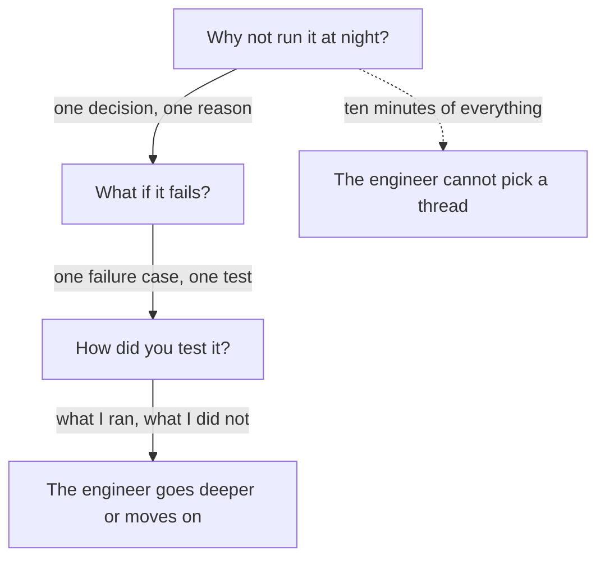

## The same question, a second time

Yazan has his founder version ready, and he says it to himself on a walk. Then he thinks about the second call, the one with the engineer. He remembers her question: "Why not just run it at night?" He could not answer it then. Now he can, and he is nervous about something else. He knows many more details than the engineer will ask for. He is afraid that he will say all of them.

His fear is reasonable. When people know a lot, the easy way to feel safe is to say it all, from the first design note to the last test. That is not what an engineer wants. An engineer wants to find out what you decided, what you checked and where your knowledge ends. This chapter shows how to give that, one question at a time.

## The idea in plain words

The engineer version is not a longer speech. It is a set of short answers to a ladder of follow-up questions, given when each one is asked. The ladder has six rungs. What did you build? Why this way? Why not the other way? What happens if it fails? How did you test it? What would you change?

Each rung needs one of three things from you: a decision you made, a test you ran, or an honest "I did not test that" with what you would do. Notice that none of them is "I used the best tools". The engineer is not checking your vocabulary. She is checking whether you made the choices yourself and know where the work is weak.

Founders who write about hiring say they go deep in one area to find out what a candidate actually did. A second conversation with an engineer does the same in your own craft. Researchers who study faking in interviews found something that matters here: follow-up questions can push candidates to make something up. An invented test or an invented reason is easy to say, and the very next question can break it. The honest answer is safer, and it also gives the engineer more to work with.

## Predict the honest gap

Imagine Yazan reaches the fifth rung. The engineer asks how he tested the job, and then she asks what happens if ten times more merchants ask for a report at once. Yazan never tested that. He knows it. Before you read on, think about how an engineer hears "I did not test that".

```predict
prompt: "Yazan says: 'I did not test that. I would try the largest merchant on a copy of the data.' How does the engineer hear it?"
options:
  - id: hurts
    label: "It hurts him, since engineers want tests"
  - id: helps
    label: "It helps him, with a plan to test it"
correctOptionId: helps
explanation: "An engineer knows that nobody tests everything. What she checks is whether he knows where his tests stop and what he would do next. A plan shows judgment. A confident claim that he cannot back up is the answer that hurts, because the next question breaks it."
```

Now step down the ladder. Try to say your own answer to each question before you read Yazan's.

<InteractiveCanvas slug="engineer-depth-ladder" />

**What this shows:** six follow-up questions on one piece of work, and what each one needs from the answer. **Try this:** at rung 3, name the option Yazan did not choose and what he gave up. At rung 5, read his answer about ten times more merchants. **What changed:** at every rung the note names a decision, a test, or an honest gap. The trade-off at rung 3 and the gap at rung 5 are marked as strong answers. **Limits of the model:** a real engineer may ask in another order, and may ask a question that is not on the ladder.

## What the canvas showed

Look at rung 3. Yazan does not say that a background job is better. He says what merchants need, names the other option, and says what his choice cost: more parts to watch than one night script. A trade-off is a gain and a cost together, as chapter 1.4 taught. An answer that names only the gain sounds like a sales page. An answer that names both sounds like a person who thought.

Look at rung 4 and rung 5 together. He says what happens when the job stops halfway: it restarts from the last finished part, and a report is never emailed twice. Then he says how he knows: he stopped the job by hand and watched. That is a test, and it is small. A small test he really ran is stronger than a large claim he cannot show.

Rung 5 also holds the honest gap. He says what he did test, and what he did not. Notice that he does not stop at "I did not test that". He adds one sentence about what he would do. That sentence is what turns the gap into a good answer.

## A full worked example

Here are two rungs again, as an interview, each with a weak answer, the follow-up that breaks it, and a stronger answer.

> **Engineer:** "Why not just run it at night?"
>
> **Yazan (weak):** "A queue is better practice."
>
> **Engineer:** "Better in what way?"
>
> **Yazan (weak):** "It is more scalable."

The weak answer gives a judgment without a reason. The follow-up "better in what way?" has no answer under it, because "better practice" is a label and not a decision. Now the stronger answer.

> **Yazan (stronger):** "Merchants ask for reports at any time, and some need today's numbers. A night run would give yesterday's. The price of my choice is more parts to watch."

It names the need, the alternative and the cost. It is three sentences, and the engineer can ask about any of them. The second example is the failure case.

> **Engineer:** "What if the job stops halfway?"
>
> **Yazan (weak):** "It handles failures well."
>
> **Engineer:** "How do you know?"
>
> **Yazan (weak):** "It is built to be reliable."

The weak answer repeats the question as a claim. "How do you know?" has no test behind it. The stronger answer follows.

> **Yazan (stronger):** "It restarts from the last finished part, and it never sends the same report twice. I tested that by stopping the job by hand in the middle."

Check the reasoning step by step. First, say what happens, in one sentence. Second, say the rule that makes it safe. Third, say the test you ran, however small. If the test was small, say so. "I stopped it by hand" is an honest description of a small test. It would be a mistake to call it "full test coverage".

A third rung is the one that most people dread: what would you change? Yazan's answer is honest and specific. Today he learns that a job has stopped by reading the logs. He would send the team a message when a job stops, so nobody waits for a report that is not coming. A good answer to this question is a real weak point, with a change. "Nothing, it is perfect" is not believed, and "everything" is not useful.

The same ladder works outside code. Osama is a product designer at a university club. He tested a new sign-up screen for club events with 8 students. The engineer, or a design lead, asks: "Why 8?" He answers, "Those were the students I could reach in two days." "Why not a larger test?" "I had two days, and 8 was enough to see the same problem four times." "What did you not test?" "I did not test with a screen reader. I would test that next." Each answer is a decision, a limit or an honest gap, and none of them needs a tool.

## A diagram of the flow

The diagram shows the shape of a good conversation with an engineer. The main path is a chain of short answers, each leading to the next question. The dotted path is what happens when you say everything at once.



On the main path, each answer is short, and each ends at a place where the engineer can choose. The engineer holds the next question, so you do not have to guess it. On the dotted path, the answer is long, and the engineer has to decide which part to ask about. Often the engineer picks the weakest sentence in the pile. The takeaway: your job is to give one good thing at a time, and let the engineer pull you deeper.

## Where people go wrong

The first mistake is saying everything at once. It feels thorough, and it removes the engineer's chance to lead. The second is defending when you should explain. "Why not X?" is not an attack. It is the engineer's way to learn how you think, so answer it as you would answer a colleague.

The third mistake is claiming a test you did not run. "I tested it thoroughly" will be followed by "what did you test?", and a vague answer ends the story. The fourth is guessing to fill a silence. A guessed number or a guessed cause usually falls apart in the next question, as chapter 3.3 showed. The fifth is to refuse to name a change. Every piece of work has a weak point. Naming one shows that you can see your own work clearly.

A last mistake is mixing up "I did not test that" with "I did not measure that" from module 2. Both are honest, and both need a plan. Say "test" for a check that the work behaves, and "measure" for a number about its effect.

## Try it on your own resume today

Take the story from chapter 5.2. Write the six rungs, one or two sentences each. After each, write one word: decision, test, or gap. If a rung has none of the three, you have found a hole to fill. Fill it by checking your notes or logs, or by writing the honest gap and what you would do. Then ask a developer friend to ask you the six questions out loud, in a different order. If you prefer not to use your own work, write the rungs for Hadeel's page-speed story, which the gate provides.

## Check your understanding

```quiz
type: mcq
question: "Wael built a nightly import of supplier price files for a charity shop's stock sheet. He tested it with a file that had one bad row, and the import skipped the row and listed it. The largest file he ran had 2,000 rows. An engineer asks: 'What if a supplier sends a file ten times bigger?' Which answer is strongest?"
options:
  - "It will be fine, since the import is written to be fast and reliable and has run well so far"
  - "I did not run a larger file. My biggest was 2,000 rows. I would try 20,000 on a copy"
  - "I tested a file that size and it worked, so there is nothing to worry about here at all"
  - "That will not happen, because our suppliers only send small files each night and always have"
correct: 1
explanations:
  - "This is a claim with no test under it. 'Fast and reliable' invites the question 'how do you know?', and he has no run to point to."
  - "Right. It states what he ran, says honestly what he did not, and gives a next step with a real size. The engineer can trust the rest of his answers."
  - "He never ran a larger file, so this is invented. The next question, 'how long did it take?', would break it."
  - "This dismisses the question with a guess about the future. It also gives the engineer no sign that he has thought about the limit."
```

**Next:** A quiz with five short cases on choosing and explaining your best technical work, including an AI answer to check.
