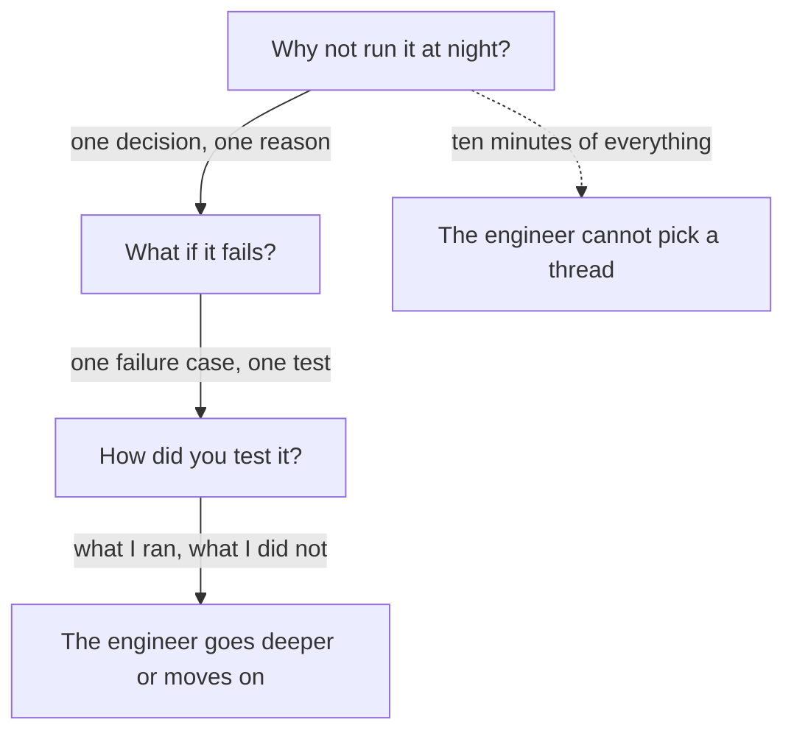

## The same question, a second time

Yazan has his founder version ready, and he says it to himself on a walk. Then he thinks about the second call, the one with the engineer. He remembers her question: "Why not just run it at night?" He could not answer it then. Now he can, and he is nervous about something else. He knows many more details than the engineer will ask for. He is afraid that he will say all of them.

His fear is reasonable. When people know a lot, the easy way to feel safe is to say it all, from the first design note to the last test. That is not what an engineer wants. An engineer wants to find out what you decided, what you checked and where your knowledge ends. Before the chapter shows how, try one question that engineers often ask last.

```predict
prompt: "Yazan's report job passes its tests and has run for a month. An engineer asks: 'What would you change?' Yazan answers: 'Nothing. It works.' How does she hear that?"
options:
  - id: no-weak-points
    label: "As a sign he has not looked for weak spots"
  - id: proof-it-works
    label: "As proof the job is good, since it works"
correctOptionId: no-weak-points
explanation: "Passing tests and a month of running show that the job works today. They do not show where it could break, and every piece of work has such a place. An engineer knows this. 'Nothing' tells her that he has not looked, or that he will not say. A specific change, tied to a real weak point, shows that he has looked at his own work and can name what he found."
```

## Six steps, one question at a time

The engineer version is not a longer speech. It is a set of short answers to a series of follow-up questions, given when each one is asked. There are six steps. What did you build? Why this way? Why not the other way? What happens if it fails? How did you test it? What would you change?

Each step needs one of three things from you: a decision you made, a test you ran, or an honest "I did not test that" with what you would do. Notice that none of them is "I used the best tools". The engineer is not checking your vocabulary. She is checking whether you made the choices yourself and know where the work is weak.

A second conversation with an engineer goes deep into your own craft, in the same way that a founder's questions go deep into what you did. Researchers who study faking in interviews found something that matters here: follow-up questions can push candidates to make something up. An invented test or an invented reason is easy to say, and the very next question can break it. The honest answer is safer, and it also gives the engineer more to work with.

## What an honest gap sounds like

Imagine Yazan reaches the fifth step. The engineer asks how he tested the job, and then she asks what happens if ten times more merchants ask for a report at once. Yazan never tested that. He knows it. Step through the canvas, and try to say your own answer to each question before you read Yazan's.

<InteractiveCanvas slug="engineer-depth-ladder" />

The canvas walks through the six questions in order and shows the decision, test or gap behind each answer. Try to answer step 3 and step 5 yourself before you read them. The order is for practice, and a real engineer may ask in a different order.

## Two steps worked out in full

Here are two steps as an interview, each with a weak answer, the follow-up that shows the gap, and a stronger answer.

> **Engineer:** "Why not just run it at night?"
>
> **Yazan (weak):** "A queue is better practice."
>
> **Engineer:** "Better in what way?"
>
> **Yazan (weak):** "It is more scalable."

The weak answer gives a judgment without a reason. The follow-up "better in what way?" has no answer under it, because "better practice" is a label and not a decision. Now the stronger answer.

> **Yazan (stronger):** "Merchants ask for reports at any time, and some need today's numbers. A night run would give yesterday's. The price of my choice is more parts to watch."

It names the need, the alternative and the cost. It is three sentences, and the engineer can ask about any of them. A trade-off, as chapter 1.4 taught, is a gain and a cost together. An answer that names only the gain sounds like a sales page. An answer that names both sounds like a person who thought. The second example is the failure case.

> **Engineer:** "What if the job stops halfway?"
>
> **Yazan (weak):** "It handles failures well."
>
> **Engineer:** "How do you know?"
>
> **Yazan (weak):** "It is built to be reliable."

The weak answer repeats the question as a claim. "How do you know?" has no test behind it. The stronger answer follows.

> **Yazan (stronger):** "It restarts from the last finished part, and it never sends the same report twice. I tested that by stopping the job by hand in the middle."

Check the reasoning step by step. First, say what happens, in one sentence. Second, say the rule that makes it safe. Third, say the test you ran, however small. If the test was small, say so. "I stopped it by hand" is an honest description of a small test. It would be a mistake to call it "full test coverage".

The step about ten times more merchants has the honest gap. Yazan says what he did test and what he did not: "I did not test that. I would run the biggest merchant's report on a copy of the data with several jobs at once." He does not stop at "I did not test that". The sentence about what he would do is what turns the gap into a good answer.

The last step is the one that people often answer badly: what would you change? Yazan's answer is specific. Today he learns that a job has stopped by reading the logs. He would send the team a message when a job stops, so nobody waits for a report that is not coming. A good answer to this question is a real weak point, with a change. "Nothing, it is perfect" is not believed, and "everything" is not useful.

The same steps work outside code. Manar is a product designer. She tested a paper version of a bakery's order form with 6 customers. A design lead asks: "Why 6?" She answers, "Those were the customers I could reach in two days." "Why paper and not a working form?" "A paper form could change in minutes, and I wanted to see where people stopped." "What did you not test?" "I did not test it on a phone. I would do that next." Each answer is a decision, a limit or an honest gap, and none of them needs a tool.

## A diagram of the flow

The diagram shows the shape of a good conversation with an engineer. The main path is a chain of short answers, each leading to the next question. The dotted path is what happens when you say everything at once.



On the main path, each answer is short, and each ends at a place where the engineer can choose. The engineer holds the next question, so you do not have to guess it. On the dotted path, the answer is long, and the engineer has to decide which part to ask about. Often the engineer picks the weakest sentence in the pile. The takeaway: your job is to give one good thing at a time, and let the engineer lead you deeper.

## An afternoon that went wrong

Rana is a developer who built a nightly report for a delivery company. In her interview, the engineer asks how she tested it. Rana wants to sound sure, so she says, "I tested it thoroughly." The engineer asks, "What did you test?" Rana says, "Everything." The engineer waits. Rana adds a number to fill the silence: "It handled about 50,000 rows." She had never run more than 5,000.

The engineer writes the number down, and a few minutes later she asks, "How long did the 50,000-row run take?" Rana has no answer. She remembers the 5,000-row run, and the two numbers now sit side by side in the engineer's notes. The rest of the interview goes badly. Nobody doubts that Rana is a good developer. They doubt her answers, because one of them did not hold.

Now imagine the same moment with the honest answer: "I ran it on one real file of 5,000 rows, and I stopped it once by hand. I did not run a larger file. I would try 50,000 on a copy." That answer is shorter and less impressive, and it holds at every follow-up. Three habits protect you. Say a claim only if you can name the test behind it. Say a small test as small. Fill silence with the next honest sentence, not a number. Finally, remember that "I did not test that" and "I did not measure that" from module 2 are both honest. Say "test" for a check that the work behaves, and "measure" for a number about its effect.

## Write your six steps today

Take the story from chapter 5.2. Write the six steps, one or two sentences each. After each, write one word: decision, test, or gap. If a step has none of the three, you have found a hole to fill. Fill it by checking your notes or logs, or by writing the honest gap and what you would do. Then ask a developer friend to ask you the six questions out loud, in a different order. If you prefer not to use your own work, write the steps for Hadeel's page-speed story, which the gate provides.

## Check your understanding

```quiz
type: mcq
question: "Osama built a nightly import of driver address lists into a delivery dashboard. An engineer asks: 'How did you test it?' His draft answer has three sentences. (1) 'I ran the import once on last month's real file of 2,000 rows.' (2) 'I stopped it by hand halfway once, and it restarted from the last row.' (3) 'So it will handle a file 10 times bigger.' He never ran a file larger than 2,000 rows. Which sentence should he change?"
options:
  - "Sentence 1, because one run on a real file of 2,000 rows is too small a test to mention."
  - "Sentence 2, because stopping the import by hand once does not count as a test of a restart."
  - "Sentence 3, because he never ran a file above 2,000 rows, so it should say what he would try."
  - "None, because two real runs of the import are enough to say it will handle a file 10 times bigger."
correct: 2
explanations:
  - "One real run on a real file is a small test, and he can say it is small. It is true, so it should stay."
  - "Stopping the job by hand is a small test, but it is a real one, and it shows exactly what happened. It should stay as it is."
  - "Right. The first two sentences state what he ran. The third claims a result he never tested. A better sentence says that he did not run a larger file and would try 20,000 rows on a copy."
  - "Two runs on a 2,000-row file say nothing about a file 10 times bigger. The claim goes past his facts, and the next question, 'how long did it take?', has no answer."
```

**Next:** Why this and not that: how to say why you chose something, why you did not choose the other option, and whether the choice was right.
