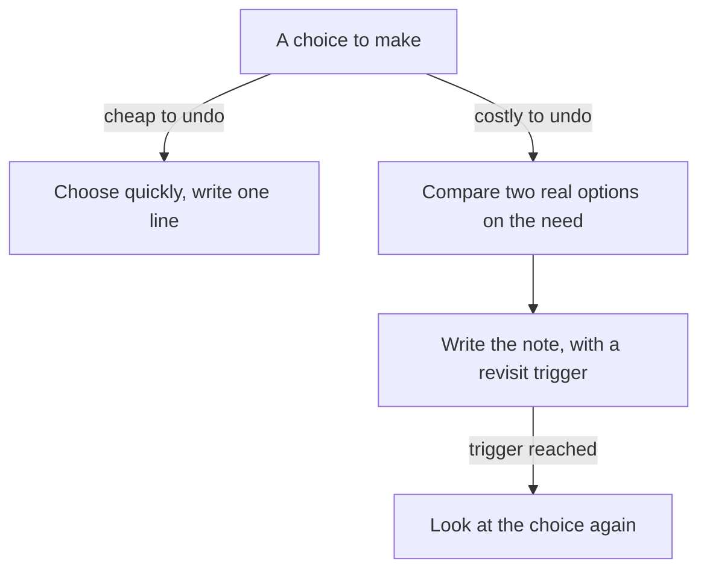

## Two founders in one week

Yazan has two interviews in the same week. The first is with the founder of a six-person team that builds a delivery tool. She runs the business side. She asks Yazan what changed for merchants after his report job, and how he knows. Yazan gives his numbers and their source, and the call is friendly and short. She asks about his team, about a time he disagreed with a lead, and about what he wants to learn.

The second is with the technical founder of a four-person team that builds a booking system for small gyms. He wrote much of the first version himself, and he reads code. He asks about the same report job, but his questions go in another direction. "Why a background job and not a nightly run? Why that database? What would make you change it?" Yazan has the answers to the first question. He has never thought about the other two.

## Two kinds of founder

Both founders check the same basics. They want to know which part of the work was yours, what you decided, and how you know it worked. A business-side founder, often called the CEO founder, also listens for values, for the effect of your work on people and money, and for how you work with others. She often notices an empty answer quickly, because it has no number, no time and no example.

A technical founder checks all of that, and one thing more: was the choice technically sound? He asks why you chose something, why you did not choose the other option, and whether it was the right choice for the need. Some founders are both, and in a small team you may meet both on the same day. This is practice advice from this course, not a research finding. It is useful because the technical founder's questions can be prepared for, with the same honesty you have used so far.

<BigWordAlert term="Decision note" plainEnglish="Two or three lines you write at the time of a choice: the need, the options, what you chose and why, and when you would look at it again." whyItMatters="It lets you answer 'why not that?' months later with the reasons you really had, not a tidy reason invented afterwards." />

## Predict what earns trust

Before the chapter shows the parts of a good answer, think about the third question the technical founder asked: what would make you change the job? Yazan has not thought about it.

```predict
prompt: "The technical founder asks Yazan: 'What would make you change the background job?' Yazan has never thought about it. Which answer does the founder trust more?"
options:
  - id: forever
    label: "It is the right choice, so nothing would do it"
  - id: trigger
    label: "A size or cost where he would look again"
correctOptionId: trigger
explanation: "Every choice fits a need at one size and one cost. A trigger such as 'if reports pass a size, or the email limit is reached' shows that Yazan knows where his choice stops fitting. 'Nothing would' sounds sure, and it tells the founder that he has not looked."
```

## The six parts of a choice that holds

A choice holds under "why not that?" when you can show six things. They are course advice, and each one answers a question that a technical founder asks.

First, the requirement it served. What had to be true? For Yazan, merchants asked for reports at any time, and some needed the numbers the same day. A choice without a need is a taste.

Second, what you compared and rejected, and why. A night run was the other option, and it gave old numbers. You do not need ten options. Two real ones are enough, and the reason you rejected one should be about the need.

Third, you chose on the need, not on habit or fashion. "It is what I knew" is an honest answer when it is true. Say it plainly. Then say whether it fitted the need: "I chose it because I knew it, and it fitted because the data is small." That is better than a reason dressed up afterwards. "It is popular" is the answer that fails, because the next why asks popular for what.

Fourth, how hard it is to undo. This is reversibility: what a change would cost, and how tied you are to one provider. Some choices are cheap to reverse, like the wording of a label. Others are costly, like the shape of your database or the provider that holds your data. The harder a choice is to undo, the more care it deserves, and the more important it is to know the cost.

Fifth, when you would revisit it. This is a trigger: a size, a cost or a new need at which the choice should be looked at again. "If reports pass 10 minutes" is a trigger. "Someday" is not.

Sixth, a short decision note written at the time. It is the habit that makes the other five easy. Write two or three lines when you choose: the need, the options, the choice, why, and when to revisit. A note written then is a record of your real reasons, and chapter 3.3 explained why those are worth more than reasons you tidy up later.

## The choices you can be asked about

A technical founder may ask about any layer of your project. The table lists common layers, with generic options to compare and one question for each. A cache keeps a saved copy of something that is slow to fetch. A content network is a set of servers near the user that keep copies of pages and files. Serverless functions run your code only when it is called, with no server for you to look after. A <GlossaryTerm term="key-value store" definition="A database that keeps one value under one name, like a very fast list of labels. It is good for lookups by name and weak for searching by anything else." /> is the simplest kind of database. What would you check? Whether you ever need to find records by anything except their name. An <GlossaryTerm term="event stream" definition="An ordered record of things that happened, which many programs can read, and read again later." /> keeps events in order so that more than one program can read them. What would you check? Whether a second program needs to replay the same events, or whether a plain queue, where each job is taken once, is enough.

| Layer | Options to compare | Question to ask |
|---|---|---|
| Where data lives | Relational database, document store or key-value store | Does the data link together, and do totals need to be exact? |
| Slow work | A message queue or an event stream | Does work wait in line, or do many readers need the same events? |
| Search | Search inside the database, or a separate search service | How much search do I need, and can the database do it? |
| Speed-ups | A cache in the app, a shared cache or a content network | What is repeated, and what happens when the saved copy is old? |
| Where code runs | Serverless functions, containers or virtual machines | How steady is the traffic, and who looks after the servers? |
| Who builds it | Build, buy or use open source | What is my time worth against the cost? |
| Who runs it | A managed service, or one you run yourself | Who updates, backs up and wakes up when it fails? |

You will not have chosen at every layer, and nobody has. For layers you did not choose, the honest answer is "that was decided before I joined", followed by whether it fitted the need. The canvas shows one choice at one layer, defended twice.

<InteractiveCanvas slug="why-not-that-choice" />

The canvas puts the same question to a candidate twice, first with a label and then with a decision note, and asks you a question before each step. Say your own first sentence before you press Next at step 1, and compare it with the note at step 5. The numbers belong to this example, and the founder in it might still have chosen differently.

## Yazan's two answers

Here is the question that Yazan could not answer in chapter 5.1, with the six parts behind it. First, the question about the job.

> **Technical founder:** "Why a background job, and not a nightly run?"
>
> **Yazan (weak):** "It is the standard way to do this."
>
> **Technical founder:** "The standard way for what need?"

The weak answer gives a label, and the follow-up has nothing under it. The stronger answer uses the parts.

> **Yazan (stronger):** "Merchants ask for reports at any time, and some need today's numbers. A night run gives yesterday's. It is not hard to undo: the job is one piece of code, and a night run could replace it in a day. I would look again if the email service limit is reached."

It names the need, the rejected option, the cost to undo and the trigger, in four sentences. The technical founder then asks about the database.

> **Technical founder:** "Why that database?"
>
> **Yazan:** "I did not choose it. The team chose it before I joined. It fits our payments data, because the totals must be exact and the records link to each other. I have not compared it with other kinds."

That is a full answer. It says whose decision it was, says whether it fitted the need, and says what he did not do. He does not pretend he chose it, and he does not invent a comparison.

## When the answer is that it was wrong

Sometimes the honest answer is that the choice was wrong for the need. Osama is a developer who built a delivery dashboard. He chose a document store, a kind of database that keeps each record as a separate document, because many articles praised it. His reports then needed to join drivers to deliveries, and the document store made that slow to write and slow to run. After three months he moved to a relational database. The move took two weeks.

Asked about it, Osama does not hide it. "That choice was wrong for this need. I chose it because it was popular, and my reports needed joins. I would choose a relational database now. The move took two weeks, and I learned to write the need down first." A technical founder values that answer more than a polished one, because it shows that Osama can look at his own work and say what he found. Hindsight bias, which chapter 3.3 explained, makes a wrong choice look obvious afterwards. Say what you knew then and what you know now.

## A diagram of the cost to undo

The canvas shows one choice. The diagram below shows how the cost to undo changes how much care a choice needs. It is a rule of thumb from this course, not a research finding.



Read the first split. A cheap choice, like the name of a label, needs a line and no more. A costly choice, like the database or the provider that holds your data, deserves a comparison on the need, a note and a trigger. The last arrow is the point of the trigger: it turns "someday" into a moment you will recognise. The takeaway is that care should follow the cost to undo.

## What a weak answer sounds like

Weak answers have a few common shapes. The table shows each one, what the technical founder hears, and what to say instead.

| Weak answer | What the founder hears | Say instead |
|---|---|---|
| "It is popular." | No need, only a crowd | "It fitted the need because..." |
| "It is best practice." | A label with no reason | "I chose it because the need was..." |
| "It is what I knew." | Honest, but is it a fit? | "It is what I knew, and it fitted because..." |
| "It scales." | A claim without a number | "I did not test it. The first limit I would check is..." |

The third row is not a weak answer when it is true. It becomes weak only when it stops there. Say it plainly, then say whether the choice fitted the need.

## Write a decision note today

Pick three choices in your own project: one that is hard to undo, such as a database or a provider, and two smaller ones. For each, write two or three lines: the need, the options, the choice and why, and when you would revisit it. If you did not note the reasons then, write what you know now and say so. Then ask a friend to read one note and ask "why not the other option?". If you prefer a provided case, use Hadeel's: she rejected a two-week rewrite for a two-day fix, which the gate describes.

## Check your understanding

```quiz
type: mcq
question: "Sana is an operations coordinator at a school office. She built a room-booking sheet that 6 teachers used. Now 40 teachers use it, and last month two teachers edited the sheet at once and overwrote each other's rows twice. A technical founder asks: 'Was a sheet the right choice?' Which answer is best?"
options:
  - "Yes, it was right. It still works for 40 teachers, and 2 overwritten rows in a month is a small problem."
  - "No, it was a mistake from the start, and in the first term I should have built a full app for 6 teachers."
  - "Sheets do not suit bookings, so after the 2 overwritten rows I will not use one for a school again."
  - "For 6 teachers it was right. At 40, with 2 overwritten rows last month, it is not, so I would use a small form."
correct: 3
explanations:
  - "The overwritten rows are the sign that it no longer fits. 'It still works' ignores the one fact that says it has outgrown its need."
  - "At 6 teachers a sheet fitted the need, and an app would have cost far more. Saying it was a mistake from the start is hindsight, not what she knew then."
  - "An absolute rule is not an honest answer. A sheet was fine at 6 teachers, and the answer depends on the need and the size."
  - "Right. It says when the choice fitted, when it stopped fitting, the fact that shows it, and the change she would make. It is plain about both the past and the present."
```

```quiz
type: mcq
question: "Wael leads 5 support agents who share one inbox. He chose 5 labels over buying a ticket tool at $40 a month per agent. His note says: Need: urgent messages seen first. Options: 5 labels, or the tool. Chose: labels. Why: all 5 agents already knew labels, and the tool needed 2 weeks to set up. A technical founder asks: 'When would you change it?' Which line should Wael add to his note?"
options:
  - "Revisit when: the team has a free week, because the tool is better in the end for a team of 5."
  - "Revisit when: more than 3 urgent messages wait over a day in a week, or the team has 8 agents."
  - "Revisit when: the tool costs less than $40 a month per agent, since cost was the reason for labels."
  - "Revisit when: at no point, because labels are free and the 5 agents are happy with them now."
correct: 1
explanations:
  - "A free week is not a trigger, and 'better in the end' is a claim his note does not support. The trigger should come from the need."
  - "Right. Both parts come from the need, urgent messages seen first, and from the team's size. Someone can check them, and they tell Wael when to look again."
  - "Cost was not his reason. He chose labels because the agents knew them and the tool needed 2 weeks, so a price trigger does not follow from his note."
  - "'Never' removes the trigger, and a choice with no trigger cannot be revisited. Happy agents today do not say what will happen at 8 agents."
```

**Next:** Check your work area by area: thirteen plain questions for your own project, and how to answer honestly when you did not do something.
