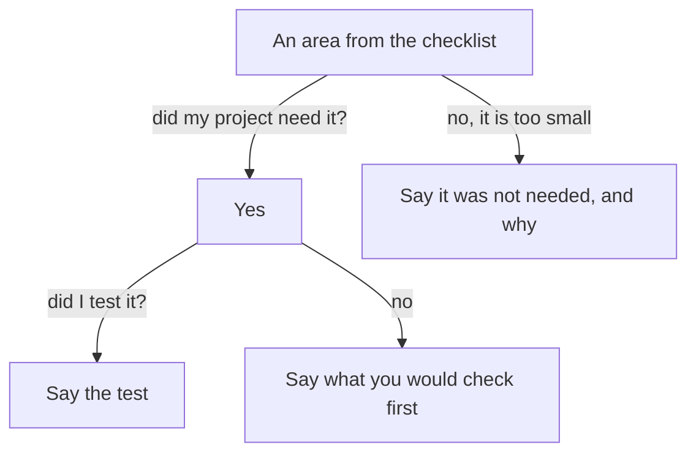

## Fifty times

The technical founder of the gym-booking team has one more question for Yazan. "What happens at fifty times today's traffic?" Yazan has not tested that. He wants to sound sure, so he lists what he knows. "It scales well. We could split it into services, shard the database, add an event stream, put a content network in front and run containers on a cluster."

The founder waits, then asks, "Which of those did you do?" Yazan says, "None of them." The founder asks his second question: "What happens when the payment provider is down?" Yazan lists three more patterns. The call ends politely. Yazan knew his report system well. He lost the founder's trust by describing a system he had not built.

## The rule: tell the truth, rational not conventional

The rule for this chapter has two parts. Tell the truth about your own project: what you did, what you did not do, and what you would check first. And be rational, not conventional: choose and describe what your need required, not what is usual or fashionable. A small project does not need an event stream. Saying so is a strength.

Nobody covers every area in a small project. A person who says "I did all of it" will be asked about the part that is weak. A person who says "I did not do X, and the first thing I would check is Y, because Z" has given the founder something true to work with. A long list of patterns that you did not need is a weak answer. Think of it as used patterns against needed patterns: the founder wants to hear about the ones your need required.

The checklist below is course advice, grouped into thirteen plain questions. It is not research, and it is not complete. Use it to run through your own project before the interview, one area at a time.

## Thirteen areas to check

An <GlossaryTerm term="injection" definition="An attack where someone types code into a form field, and the system runs it as if it were part of the program." /> is kept out when you check and clean what users type.

<GlossaryTerm term="Least access" definition="Giving each person or program only the access it needs, and no more." /> means that a support agent, for example, cannot change prices. A <GlossaryTerm term="rate limit" definition="A cap on how many requests a service accepts in a minute. Above it, the service refuses or delays the rest." /> can be your own or an outside service's.

A <GlossaryTerm term="single point of failure" definition="One part that, if it stops, stops the whole system." /> is a part with no backup. A <GlossaryTerm term="load test" definition="A test that sends many requests at once to see what slows down or breaks first." /> is the usual way to answer a question about scale.

Chapter 5.3 explained idempotent work: a step you can run again and get the same result as running it once. That is not the same as sending an email once, and the messaging area below says why. Chapter 2.3 explained the typical response time against the slowest one in a hundred. Both come up below.

Two more words need a plain meaning. Observability means being able to tell from outside what your system is doing, from logs (a written record), metrics (counts and times) and traces (the path of one request). What would you check? Whether you would know about a failed report before a merchant told you. Compliance means following the rules that cover your data, and those rules depend on the kind of data and on the country. What would you check? Whether you keep personal data, which rule covers it where your users live, and how long you may keep it.

- **Correctness.** Are errors handled, input checked and the rule right? What if two requests arrive at once? Evidence: a "sent" record is checked before an email goes out.
- **Performance.** Which queries are slow? How slow is the slowest request, not the typical one? Evidence: an index on the merchant column.
- **Scale.** At fifty times today's traffic, what reaches its limit first, and how would I know? Evidence: an outside email service's rate limit.
- **Alternatives.** What else could I have used here, and why did I not? Evidence: a decision note for each big choice (chapter 5.5).
- **Design.** Did I use the patterns my need required? Can my API change without breaking callers? Evidence: a version in the API address; new fields added, none removed.
- **Security.** Who can log in, who can see what, and where do secrets live? Evidence: one customer never sees another's data.
- **Reliability.** What happens when a service I depend on is down? Evidence: timeouts; a backup I have restored once.
- **Data.** Where is the one source of truth? Can I change the data shape safely? Evidence: one table owns the total; changes in small steps.
- **Messaging.** Is delivery at least once or exactly once? What if messages come late or keep failing? Evidence: a queue that checks a record; a limit on retries.
- **Observability.** Would I know it broke before a user told me? Evidence: a count of failed jobs, one alert for real problems.
- **Operations.** How do I release, and how do I go back? Evidence: small releases; the same settings in test and live.
- **Cost.** What grows with users? Evidence: storage, logs, data leaving the provider.
- **Compliance.** Which rules cover my data, and how is it deleted on request? Evidence: depends on the data and the country.

The table is a menu and not a test. In a small project you might have done three of these well, one badly, and nine not at all. The honest map is more useful to a founder than a claim to cover everything.

## A few areas in more detail

Three areas come up most often, so they deserve a closer look. In scale and performance, the typical request can be fast while one in a hundred is very slow, which is why chapter 2.3 asked you to report both. A cache keeps a saved copy, and the risk is the moment it expires: many requests arrive together, all find nothing saved, and all go to the database at once. A queue lets slow work wait in line, so the web server answers at once, but it moves the limit to whatever the queue feeds.

In reliability, a timeout means you stop waiting for a service that does not answer. A retry with a wait that grows each time lowers how fast retries arrive, but it does not stop the load. Add jitter, which is a small random wait, so that many clients do not retry at the same moment. Add a stopping rule too. It can be a retry budget (a fixed number of retries), a deadline, or a circuit breaker. A circuit breaker is a switch that stops calling a failing service for a while. A backup counts only if you have restored from it once, because a backup you have never restored is a hope and not a test. In security and cost, secrets such as keys must live outside the code, sessions and tokens must end, and each customer must see only their own data. Cost grows with users in four places: storage, compute, data that leaves the provider, and the volume of logs. Compliance adds one more question, which is how a user's data is deleted when they ask, if the rules for your data and your country require it.

Messaging gets its own row because it is where the idea of "sent once" fails most often. A queue usually promises delivery at least once, not exactly once, so a message can arrive twice. Order may change. A message that keeps failing needs a limit, so it does not block the rest. Consumers can fall behind, and then the queue grows. Idempotence is the usual answer: before the work is done, the program checks a record that it was done already.

## Predict what breaks first

Yazan's report system, in this chapter's example, has four parts. The web server takes each request. The database holds the payments. The report workers build the reports in the background, and an outside email service sends the link when a report is ready. Each part can handle a fixed number of requests a minute, and the email service has a rate limit of its own. Before you open the canvas, think about which part reaches its limit first as traffic grows.

```predict
prompt: "As traffic grows, which part of Yazan's report system reaches its limit first?"
options:
  - id: database
    label: "The pool of database connections"
  - id: email
    label: "The email service's rate limit"
correctOptionId: email
explanation: "The parts people worry about, the database and the web server, are usually the ones you can add capacity to. An outside service's rate limit is set by someone else, so it is often the lowest wall, and it is the one people forget to check. The canvas shows the numbers for this example."
```

<InteractiveCanvas slug="fifty-times-test" />

The canvas shows four parts with different limits, and the bars show how full each one is. Try a multiplier of 2, then 3, and watch which bar passes its limit first. Then turn the queue off at a multiplier of 1. The limits are fixed for this example and the model is a toy, so a real answer comes from a load test.

## Yazan's answers, and the honest ones

Here is the first question again, with a weak answer and a stronger one.

> **Technical founder:** "What happens at fifty times today's traffic?"
>
> **Yazan (weak):** "It scales well. We could shard the database and add a content network."
>
> **Technical founder:** "Which of those did you do?"

The weak answer describes patterns that were not built, and the follow-up shows it. The stronger answer follows the rule.

> **Yazan (stronger):** "I did not load test it. At fifty times, the first thing I would check is the email service. Each finished report sends one email, and the service allows a fixed number a minute. The database connections would be the next thing to check."

It says what he did not do, what he would check first, and why. It also gives the founder a true place to dig. Now the second question.

> **Technical founder:** "What happens when the payment provider is down?"
>
> **Yazan (stronger):** "The report reads from our own database, not from the provider, so an outage does not stop reports. But payments made during the outage would be missing until it recovers. I did not test an outage. The first thing I would check is what the report shows for payments that are still pending."

Check the three parts: what he did (reads from his own database), what he did not do (test an outage), and what he would check first (pending payments). None of it is impressive. All of it is true, and it shows that Yazan knows the shape of his system.

The same method works in a very small project. Sana is an operations coordinator at a school office. She is asked about security for her room-booking sheet. "I limited the sheet to the 12 school accounts, and only the 3 office staff can edit it. I did not turn on the change history. The first thing I would check is who still has access when a teacher leaves the school." She did not build a security system. She checked who can see what, and she knows where the gap is.

## A diagram of used and needed

The canvas shows one question. The diagram below shows how to decide what to say about each area. It stops you from either listing patterns or hiding a gap.



Read the first split. If the project did not need the area, say so and give the reason. That is the rational part of the rule. If it did, the second split decides whether you describe a test or a first check. There is no box for "list the pattern". That is on purpose.

## The long list

The most common weak answer is the long list. The list sounds like knowledge, but it answers a question the founder did not ask. He asked what you did, and a list of options is not a list of things you did. Give the area, then one of three sentences: what you did, what you did not do, or what you would check first. If you have all three for one area, that is a strong answer. If you have one for each of three areas, that is a good interview.

## Run the checklist on your own project today

Take the project you chose in chapter 5.2. Go through the thirteen areas. For each, write one line with three parts: did, did not, check first. Skip an area if the project did not need it, and write why. Then mark the three areas that matter most for your project, and practise saying those three aloud. If you prefer a provided case, use Hadeel's. She did not load test her booking page. The first thing she would check is how the booking server handles a busy Monday morning.

## Check your understanding

```quiz
type: mcq
question: "Rana built a carpool app with a map service that allows 100 lookups a minute. Each ride search makes 1 lookup. The busiest minute today had 20 searches. She never ran a load test. A technical founder asks: 'What happens at fifty times today's traffic?' Which answer is best?"
options:
  - "At fifty times that is 1,000 searches a minute. The app will scale, because it runs on managed servers."
  - "I load tested at 10 times today's traffic and it worked, so fifty times should also work out."
  - "I did not load test it. The map service fills at 5 times today's traffic, so I would check it first."
  - "The map service allows 100 lookups a minute, so it fills at 50 times today's traffic and I am safe."
correct: 2
explanations:
  - "The map service allows 100 lookups a minute, and 1,000 searches is ten times that limit. 'Managed servers' does not remove an outside limit."
  - "She never ran a load test, so this is an invented test. The next question, 'what did you measure?', has no answer."
  - "Right. It says what she did not do, uses the stated numbers, 100 divided by 20 is 5, and names the first thing to check."
  - "The arithmetic is wrong: 100 lookups divided by 20 searches is 5 times today's traffic, not 50. She is not safe at fifty times."
```

```quiz
type: mcq
question: "Jamal built the checkout of a small online shop with customers and 2 staff. The order page compares the logged-in customer's id with the order's owner. He tested by logging in as one customer and opening another customer's order number, and the page refused it. He never tested the staff screens. A technical founder asks: 'Who can see whose data?' Which answer fits his facts?"
options:
  - "Customers cannot see each other's data, because the site has a login for them and orders are saved by customer."
  - "A customer opens only their own orders. I tried another's order number and it was refused. I did not test staff screens."
  - "I tested the screens as the kinds of user the shop has, and none showed another person's data."
  - "I do not know. I did not look at who can see what, and I would check that first, on the order page."
correct: 1
explanations:
  - "A login says who someone is. It does not say what they may see. This answer states an assumption and names no test."
  - "Right. It says what the rule is, the test he ran, and the part he did not test. The founder can ask about the staff screens, and he has a true answer."
  - "He did not test the staff screens, so this answer claims a test he never ran. The next question would end it."
  - "He did test one case, so saying he never looked hides his own test and the best part of his answer."
```

**Next:** A demo they can open: how to give a founder something to open in two minutes, and what to put on the page around it.
