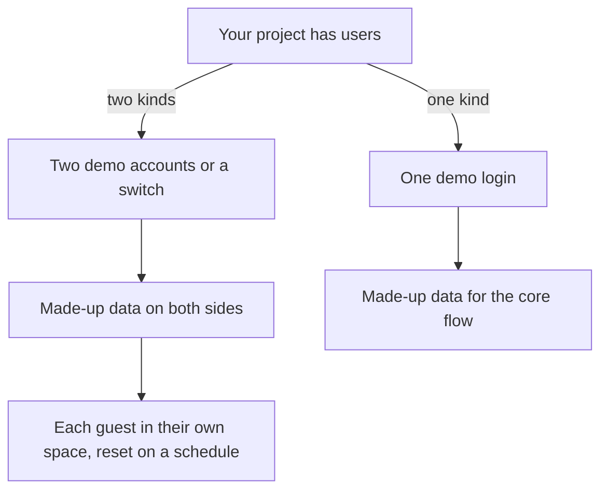

## A link to a folder

Osama is a developer who built a delivery dashboard. Before his interview with the technical founder of a four-person team, he sends a link to his project. The link goes to a folder of code, with a long readme that begins: install a database, set six settings, run four commands.

The founder has ten minutes between two calls. She opens the link, sees the folder, scrolls to the setup steps, and closes the tab. She does not doubt Osama. She has no time to install a database on a busy afternoon, and the readme does not tell her what the project does. Osama's work was good. The way he showed it asked for more time than she had.

This chapter is about the other side of the technical founder's questions. Words are one way to show your work. A demo they can open is another, and it answers the questions before they are asked.

## The idea in plain words

A link to code alone asks the founder to install and run your project, and few people will do that. What a founder will do is open something in one click. A demo has layers, and each layer adds to the one before. This is practice advice from this course, not a research finding, and it comes from putting yourself in the founder's ten minutes.

The first layer is a version that is already running, which people can open. The second is a guest or demo login with sample data, so a stranger does not meet a sign-up wall, or a sign-in with one step. The third is a two-minute screen recording that shows the core flow: the thing your project is for. It should not show the login screen or the colour settings. The fourth is a short page, or a readme, that says what the project does, what you built, the key choices, and an honest list of what is not done.

Three rules sit beside the layers. Keep secrets and real user data out of the demo, always. Make the demo safe to share, as the safe demo contract below explains. And if your project has two kinds of users, such as a driver and a rider, give the founder two demo accounts or sample data. Then one person can see both sides.

## Predict which message gets opened

Two fellows send the same founder a message. The first sends a link to the code, with ten setup steps. The second sends a link that opens the app, with a Try as a guest button on the first page. The founder has ten minutes.

```predict
prompt: "A founder has ten minutes between calls. Which message is she more likely to act on?"
options:
  - id: code-link
    label: "A link to the code with ten steps to set up"
  - id: guest-link
    label: "A link that opens the app as a guest"
correctOptionId: guest-link
explanation: "The guest link asks for one click. The code link asks her to install and run something, and few busy people will. The code may be better. What counts at this moment is how much work the founder must do before she sees anything."
```

<InteractiveCanvas slug="demo-they-can-open" />

The canvas follows one founder through two links to the same app, and asks you a question before each step. At the sign-up step, count how many steps stand between a stranger and the core flow of your own project. At the guest step, ask whether one login could show both kinds of users. The numbers belong to this example, and some founders will read code.

## The page around the demo

The demo shows the flow. The short page shows your thinking. It is the same thinking you practised in the earlier chapters, written down in five lines. Here is a message that works, from Rana, who built a carpool app for students.

> **Rana:** "My carpool app for students: [live link]. Press Try as a guest. It has made-up rides, so you can search a ride, book a seat and switch to the driver view. A two-minute recording is on the same page. The page also says what I built, the two choices I made, and what is not done: payments and notifications. If ten times more students came, the first thing I would check is the map service's limit."

The message has the link, the first click, the time it takes, and the gaps. The founder can decide in seconds whether to open it. When she does, she finds answers to the questions she would have asked: the choice of a map service, the cost of moving away, what is missing. A page that lists what is not done is a strength, because the founder sees that you know where your own work ends.

## A safe demo contract

A demo that many people open must not let one visitor harm another. Treat these four rules as a contract that you keep with every visitor. First, use sample data only, made up and never copied from real users. Second, give each guest their own session or space, or reset the demo on a schedule, so that one reviewer never sees what another one changed. Third, give guests the least access that still shows the flow, which means read-only wherever the flow allows it. Fourth, keep secrets out of the demo, in the code and in the settings a guest can see.

The contract also protects you. A shared demo account that anyone can edit will, sooner or later, hold a rude message or a deleted record, and the next founder will see it. A resettable demo with its own space for each guest avoids that. If you cannot build all four rules, say which ones are missing on your page, and use a recording instead of a live demo.

## What a recording should show

A recording is for the founder who will not click or cannot load your app on a slow connection. It should be about two minutes long and should show the core flow from the first click: the thing your project is for. It should not show the login screen, the colour settings or a tour of the menus. Say aloud, or write in a caption, what each step does and why you made one choice, such as why a rider books a seat before the driver confirms. Keep the file small, because the founder may open it on a phone, and because your own data may be limited too.

Osama's folder of code could have worked if he had added three things. A live version of the dashboard, a guest login with made-up deliveries, and a two-minute recording of a dispatch action reaching a driver. The code can stay, behind a line that says "the code is here if you want to read it". It becomes a second step, after the founder has seen what it does.

## Sample data, secrets and real people

Sample data must be made up. A demo with real customers' names, phone numbers or orders puts those people at risk, and it may break the promise your users made to you. Fill the demo with invented people and rides. Say on the page that the data is made up.

Secrets must stay out of the demo. A secret is a password, a key for a service, or a setting that gives access. If a key was ever written into your code, treat it as shared with everyone who could read the code, and replace it. Keep keys in the settings of the place where the demo runs, not in the files you publish.

Two kinds of users need a plan. In the carpool app, a rider and a driver see different screens. If the founder logs in as a rider, she cannot see how the driver side works. Either give her two demo accounts with a clear label, or add a switch inside the demo, and put made-up data on both sides. Each account should be disposable, as the next section explains.

## A diagram for two kinds of users

The canvas shows a path from a link to a core flow. The diagram below shows a different question: how many logins the founder needs, and what the sample data must hold.



Read the first split. A project with one kind of user needs one login, and the sample data must cover the core flow. A project with two kinds needs a second login or a switch, and the data must cover both sides, or the founder sees half the project. The takeaway is that the number of logins follows the number of kinds of user.

## When the demo is not a website

Not every project is a website, and not every fellow can host one. A designer has a clickable prototype: a link that opens on the first screen, with a short recording of the order flow. An operations coordinator has a spreadsheet. Sana is one of these. Her room-booking sheet holds the real names of teachers. So she makes a view-only copy with made-up names, and she keeps the colours that mark a clash. She adds two lines about what the sheet does. The founder sees the idea without anyone's data.

Perhaps you cannot host your project, because your connection is weak or the data costs too much. Then a short screen recording and a few screenshots are the next best thing. Keep the recording small and short, and say on the page that a live version does not exist yet. The honest sentence is better than a link that does not open.

## Try it on your own project today

Open your demo on a phone, in a private window, with no logins saved, as a stranger would. Time how long it takes to reach the core flow. If it is more than two minutes, or if you meet a sign-up wall, add a guest login or a recording. Then write the page: what it does, what you built, two key choices, and what is not done. If you have no project to show, use Hadeel's booking page as a model: what it does, what she changed, and what she did not test.

## Check your understanding

```quiz
type: mcq
question: "Manar is a product designer. She built a clickable prototype of a bakery's order form with 6 screens and tested it with 6 customers. A founder has ten minutes. Which package should she send?"
options:
  - "A zip file of the design files, and a note asking the founder to install the design tool and open them."
  - "A link that opens the prototype on screen 1, a 90-second recording, and a note on what was tested."
  - "A link to the prototype that asks the founder to create an account and confirm it before screen 1."
  - "The 6 screens in one long PDF with no note, so the founder can see all 6 screens at once."
correct: 1
explanations:
  - "The founder must install a tool before she sees anything. The design files may be fine, but they ask for the same effort as a link to code."
  - "Right. One click opens the flow, the recording shows it in 90 seconds, and the note says what was tested with the 6 customers and what was not."
  - "An account is the sign-up wall. The founder has ten minutes and will leave before screen 1."
  - "A long PDF shows the screens but not the flow, and with no note the founder cannot tell what was tested, chosen or left out."
```

```quiz
type: mcq
question: "Osama's delivery dashboard has two kinds of users: dispatch staff and drivers. A founder has ten minutes. His real data holds 40 drivers' names and phone numbers. Which setup lets her see both sides?"
options:
  - "Two sign-up forms, one for each kind of user, that the founder fills in and confirms by email."
  - "A dispatch demo login only, with the driver screens described in the readme."
  - "The real accounts of 3 drivers, so that the data feels true when she looks."
  - "One guest button for each role, with the same 20 made-up deliveries shown on both sides."
correct: 3
explanations:
  - "Two forms with email confirmation put two walls in front of the founder. She has ten minutes and will not finish either."
  - "The founder sees only the dispatch side. The driver side is a description, so half the project is not shown."
  - "Real drivers' accounts put real names and phones in a demo. Made-up data shows the same flow without risk to anyone."
  - "Right. Each role is one click away, and the same made-up deliveries on both sides show how a dispatch action reaches a driver."
```

This chapter covers the demo a founder opens during or before an interview. Building a full showcase, with one-click access, a short demo of the core and a written case study of the project, is taught step by step in module 5 of the course "Your Career Brand: Proof of Work, Resume, LinkedIn and Writing" (chapters 5.2 to 5.5).

**Next:** A quiz with five short cases on choosing and explaining your best technical work, including why not that, the area checks and an AI answer to check.
