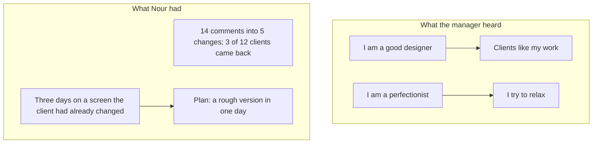

<BigWordAlert term="Humblebrag" plainEnglish="A boast dressed up as a complaint or as modesty, such as 'my weakness is that I work too hard'." whyItMatters="It sounds safe, but it tells the interviewer nothing real about you, and the next question asks you for a real example." />

## A call at 14:00

Nour is 24. She is a product designer, which means she designs how an app looks and how people use it. For two years she has worked as a <GlossaryTerm term="freelancer" definition="A person who works for several clients, not for one employer." /> for 12 small clients. Now she wants a steady place on a small remote team. A team of five builds a booking tool for gyms, and its hiring manager has asked her for a video call.

Nour prepared for the practical things. The power in her street is usually on in the afternoon, so she asked for 14:00. She shares a room with her sister, who studies there in the mornings. Her sister agreed to study in the kitchen for one hour. Nour charged her laptop, put on her headphones with a microphone, and opened the portfolio she wanted to talk about. The connection was a little slow, but it worked.

The first questions were friendly. The hiring manager asked about her clients and her tools. Then she asked two questions that Nour had hoped would not come.

## Two questions, two short answers

> **Hiring manager:** "What are you good at?"
>
> **Nour:** "I am a good designer. I work hard, and I learn fast."
>
> **Hiring manager:** "How do you know?"
>
> **Nour:** "Um. Clients like my work."

Nour smiled and waited. The manager wrote a short note. Then she moved to the second question.

> **Hiring manager:** "What is your biggest weakness?"
>
> **Nour:** "My weakness is that I am a perfectionist. I care too much about the details."
>
> **Hiring manager:** "Can you give me an example?"

Nour has no example ready, and the line goes quiet. The manager is kind, and the call has only 12 minutes left. Before you read on, think about the next minute of the call.

```predict
prompt: "Nour cannot give an example of her perfectionism. What does the manager most likely do next?"
options:
  - id: asked-more
    label: "She asks what Nour does about it"
  - id: moved-on
    label: "She moves on, to be kind and save time"
correctOptionId: asked-more
explanation: "Kindness and a short call are real reasons to move on, and some managers do. But an answer that cannot be checked usually draws one more question, and the next one comes from the same missing piece. To the manager, a weakness with no example sounds like a prepared line, so she asks what Nour does about it. Moving on would leave her with nothing she can use."
```

On the screen, Nour's face did not move, and for a moment the manager thought the call had frozen. It had not. Nour was thinking about how to answer, and nothing came. After about ten seconds she said, "I just always want the work to be perfect." The manager asked, "And what are you doing about it?" Nour answered, "I try to relax more."

The manager now has two answers in her notes. One is "good designer, works hard", and the other is "perfectionist, tries to relax". She cannot check either of them.

## What Nour never said

Nour had a real strength. Her clients send her messy feedback: comments in three emails, a voice note, a photo of a page with a pen mark on it. She is good at turning all of that into one clear list of changes. Last month one client sent 14 comments, and she grouped them into 5 changes. Three of her 12 clients have come back for more work. One of them wrote to her that her summaries saved them a meeting. She said none of this.

She also had a real weakness. She shows her work late. She likes to polish a screen before anyone sees it. Once she spent three days on a sign-up screen before she showed it to a client. By then the client had changed the plan, and the screen was no longer what they needed. She knows this about herself, and she has a plan: show a rough version within one day. She did not say that either.

So the manager heard two things that sounded like Nour, and neither was Nour. "Good designer" is a claim every designer could make. "Perfectionist" is an answer people give when they do not want to name a real weakness. People call it a humblebrag. Both answers were safe. Neither gave the manager one fact she could check.

Imagine the same two answers with the same facts. "I turn messy client feedback into one clear list of changes. Last month one client sent 14 comments, and I grouped them into 5 changes. One client wrote that my summaries saved them a meeting." And then: "My weakness is that I show my work late. I once spent three days on a sign-up screen before I showed it, and the client had changed the plan. Now I show a rough version within one day." Each of those has a time, a fact and a next step. The manager can ask a real question about either one, and Nour has a true answer ready.

The same pattern appears in every kind of work. A developer says "I am a fast learner" and cannot name the last thing she learned. An operations coordinator says "I am very organised" and forgets that he built the sheet that stopped the team double-booking a van. A product designer says "I work too hard" and is asked what that cost. The words feel safe because they are general. They stop being safe at the first "how do you know?".

There is one more thing to say about the moment itself. Nour was nervous, and the call was on a screen, with a slow connection and a shared room. None of that is unusual, and none of it was her fault. Her real problem was that she had no answer ready for a question that almost every interviewer asks in some form. That is a problem you can fix with practice, and this module is that practice.

## Why this matters in founder and small-team interviews

On a small team, each person's strengths and weaknesses matter a lot. There is no large company to hide a weakness in. A hiring manager asks these questions because she wants to know how you work and what she should watch. A good answer tells her. A prepared line does not, and she has to decide with what is left.

A small team also hires for how you will act when work goes wrong. A weakness you can name, with a plan, tells the manager that you will say so early when a problem appears. A weakness hidden behind a strength tells her nothing. This is one of the few places in an interview where she hears you describe yourself in your own words, so it is worth the preparation. It is also a place where a calm, specific answer helps you a lot.

Interviews are also hard to do well because they are social. You are being watched, the connection may be weak, the room may not be quiet, and your English may be your second language. These are things you can prepare for, and some of them you cannot control. This module covers both: what you say about yourself, and how you handle the situation around it.

Nour's long pause was not a failure of intelligence. She had not practised answering a question about herself with a fact. Most people have not, because the questions feel personal and the answers feel like a risk. The module gives you a method that makes them ordinary questions with ordinary answers.

The diagram sets two columns side by side. The left column is what the manager heard in each answer. The right column is what Nour actually had, and the dialogue could not show that gap.



Read the left column first. Both answers end in a sentence with nothing to check. Now read the right column. Every item there is a fact, with a number or a time, and none of it reached the manager. She asked fair questions, and Nour gave answers that were safe and empty. The chapters ahead fill the gap.

## What this module covers

The module has three teaching chapters and a gate. In chapter 6.2, you name a strength that is narrow, so someone can check it, with a recent example and something another person said or saw. In chapter 6.3, you name a real weakness that matters for the work, with an example and a plan. In one study, people who read interview answers preferred a real weakness to a disguised strength. In chapter 6.4, you learn what to do about what you cannot control: nerves, a video call, and listeners who judge accents. You also learn what you can control: a clear first answer, short sentences, a pause to think, and a check that you understood.

The gate asks you to write one strength with evidence and one real weakness with a plan. You can use your own, or Hadeel's, a fellow whose work is provided. The people and teams in this chapter are fictional, and so are Nour and the hiring manager.

<LearningObjectives items={["Name a strength that is narrow enough for someone to check, with a recent example", "Say what another person said or saw, instead of rating yourself", "Name a real weakness that matters for the work, with an example and a plan", "Handle nerves, a video call and a long question with a pause and a check that you understood"]} />

## Key words

| Word | Plain English |
|---|---|
| **Strength with evidence** | Something you do well, shown by one real time and by what another person said or saw |
| **Real weakness** | A habit or a skill gap that affects the work, which you can name without hiding it |
| **Plan** | One thing you already do, or will do, about the weakness |
| **Bias** | A habit of judging that is unfair, and that the person may not notice |
| **Check question** | A short question to make sure you understood, such as "Do you mean...?" |
| **Pause** | A short, planned silence before you answer, to think |

## What is in this module

| Chapter | You will practise |
|---|---|
| 6.2 | A narrow strength with a recent example and what someone else said or saw |
| 6.3 | A real weakness with an example and a plan, not a humblebrag |
| 6.4 | Nerves, video calls and accent bias: what you cannot control and what you can |
| 6.5 | A graded quiz with five short cases, including an AI answer to check |
| 6.6 | One strength and one weakness with evidence, practised with the AI interviewer or in writing |

**Next:** How to turn a broad claim like "I am a good designer" into a strength an interviewer can check.
