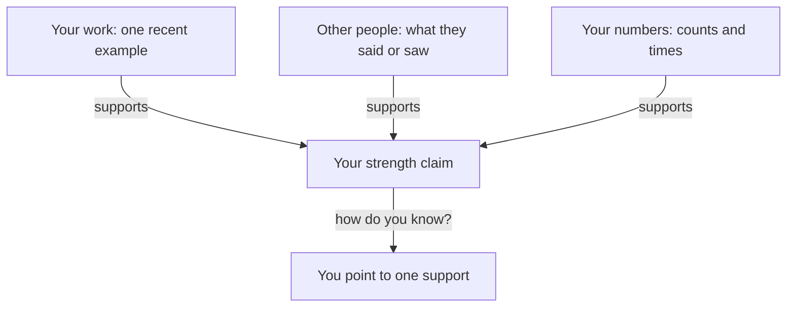

## One proof, please

After her call, Nour calls her friend Rana, a mobile developer who also works from home. She tells Rana what she plans to say next time: "I am a good designer, I work hard, and I learn fast." Rana listens and says, "Show me one thing that proves it." Nour opens her mouth, and she has nothing ready. She has a lot of good work. But the sentence she wrote does not point to any of it.

This is the problem with a strength you claim about yourself. It sounds like a fact, and it is really an opinion. The interviewer cannot check it, and she knows that you know that. This chapter teaches how to say a strength so that she can check it, and so that you can say it without feeling that you are boasting.

<BigWordAlert term="Narrow strength" plainEnglish="A strength described as one specific skill, with a time and a witness, so that someone else can check it." whyItMatters="A broad strength like 'good designer' has no edge to check. A narrow one has an edge, and it still works when the interviewer asks 'how do you know?'." />

## The idea in plain words

A strength you can prove has three parts. First, it is narrow: one skill, named so that someone could look at an example and judge it. Second, it has a recent example: one real time, as you learned in chapter 1.2, with a fact or a number from that time. Third, it has a witness: something another person said or saw, or something that happened because of it.

The witness can be small. A client who came back for more work is a fact. A manager who asked you to teach a colleague is a fact. A sentence in an email is a fact if you can show it. A witness is not a title or a prize you are proud of, and it is not an adjective you chose. It is something outside your own head.

This matters because most of us are not very accurate judges of our own skills. Psychologists such as David Dunning have found that people's views of their skills are only modestly linked to how they actually do. Other people sometimes predict a person's results better than the person does. A review that combined many studies found that the link was stronger for a specific skill, such as "I can write a database query". It was weaker for a broad one, such as "I am a good engineer". So the rule is simple: be narrow, and bring evidence.

One well-known study, by Justin Kruger and David Dunning, found something simple. People who scored lowest on tests of humour, grammar and logic thought they had done a bit better than average. This does not mean that beginners think they are experts. It means everyone should check their view of themselves against evidence, and the evidence is exactly what an interviewer wants.

## Predict the hard case

Nour narrows her strength in steps. Each step asks one plain question: which part, what exactly, when, who saw it. The canvas lets you answer for her before each step shows what she said. At the end she has to say what someone else saw. Think about a harder case first. Suppose no client has put anything in writing, and the interviewer asks, "Who else saw you do this?"

```predict
prompt: "No client has put praise in writing. The interviewer asks Nour: 'Who else saw you do this?' What should she say?"
options:
  - id: honest-gap
    label: "That no client has written it yet, and she will ask"
  - id: skip-witness
    label: "That the example speaks for itself, and add no more"
correctOptionId: honest-gap
explanation: "An honest gap is better than an empty claim, and much better than a quote you cannot show. She can say that no client has put it in writing yet and that she will ask the next one for a sentence. That tells the interviewer she knows what evidence would look like. Leaving the witness out returns her to a claim with nothing under it."
```

<InteractiveCanvas slug="broad-to-narrow-strength" />

The canvas narrows one strength step by step and asks you a question before each step. Write your own broad strength on a line first, and ask yourself "which part?" and "what exactly?" as you go. The numbers belong to this example, and some strengths, such as staying calm, are hard to narrow.

## Nour's final sentence

By the last step, Nour's claim is one skill, one recent time and one fact someone else can check. She turns messy client feedback into one clear list of changes. Last month one client sent 14 comments, and she grouped them into 5. Three of her 12 clients came back for more work, and one wrote that her summaries saved them a meeting. The sentence is about 60 words, and each part of it points to something she can show. That is all the canvas adds to the idea above.

## A full worked example with a different case

Here is the same method on someone else, with the follow-up that shows the gap in the weak answer. Wael is a support lead at a small online shop. His broad claim is "I am good with customers".

> **Hiring manager:** "What are you good at?"
>
> **Wael (weak):** "I am good with customers. I am patient, and I like helping people."
>
> **Hiring manager:** "How do you know?"
>
> **Wael (weak):** "Customers say thank you a lot."

The weak answer has no second layer. Each follow-up gets another general sentence, and the next follow-up has nothing to hold. Now Wael asks himself the two narrowing questions. Which part of working with customers does he do well? He finds out why customers write to the shop twice about the same thing. What exactly does he do? He reads the repeat messages and looks for the cause.

> **Wael (stronger):** "I find why customers write to us twice about the same thing. Last month 38 customers wrote twice about delivery dates. I found that the confirmation email did not show the date, and I added one line to it. The next month it was 12. I counted them in the inbox. The shop owner then asked me to check the refund emails too."

Check the reasoning step by step. The skill is one sentence, and it names an input (repeat messages) and an output (a cause). The example has a time and counts: 38, then 12. The source is the inbox, and he says so. The witness is an action: the owner asked for more. Nothing in it is an adjective, and it is about 65 words.

What if Wael had no witness? Ask. Send one past client, teacher or lead a short message: "Could you write one sentence about what you saw me do on the project?" Most people say yes. If the answer is no, use the honest gap, as the predict showed. Do not write the sentence for them and quote it as theirs. Do not paste their names or messages into the AI interviewer. Use roles: "a client", "my team lead".

## A diagram of the supports

The canvas shows the strength getting narrower. The diagram below shows what holds a strength up once it is narrow. A claim stands on three supports, and the interviewer's "how do you know?" asks you to point to one of them.



Read the three arrows into the claim first. Each support is independent, so you do not need all three. One strong support is enough for most questions. Then read the last arrow. The question "how do you know?" always sends you to one of the three. If none of them is ready, the claim is not ready. The takeaway: a strength is not an adjective. It is a claim with something under it.

## Where people go wrong

The first mistake is a list of adjectives: hard-working, fast learner, team player. Each one is broad, and the interviewer cannot check any of them. The second is naming three strengths in one breath. One narrow strength with proof is stronger than three broad ones. The third is borrowing the team's strength: "we are very good at delivery". Chapter 1.3 taught you to say your part and the team's.

The fourth is an old example. If it was five years ago, the interviewer may wonder whether it is still true. The fifth is making the witness bigger than it was. If a client wrote "your summaries saved us a meeting", do not say "the client said I am the best designer they have worked with". The next question, "can I see the message?", ends that answer.

The last mistake is the opposite one: saying nothing, or saying "I am not that good". Many people are taught that it is rude to speak well of themselves. But a true, specific statement about your work is not boasting. Researchers who study interviews separate honest self-presentation, which is showing your real strengths well, from deceptive self-presentation, which is not true. The first is what you are doing.

## Try it with your own strengths

Write down the three strengths you would say in an interview. Next to each, ask "which part?" and "what exactly?" until it is one skill. Then find one recent example with a count, a time or an amount, and one witness. If you cannot find a witness, write the name of the person you will ask, as a role. Choose the strength with the best proof, and practise saying it in under 60 words. If you prefer, use Hadeel's: her strength is finding why pages are slow on cheap phones, which the gate gives you in full.

## Check your understanding

```quiz
type: mcq
question: "Jamal builds the checkout of a small online shop. Last month, checkout error reports fell from 31 a week to 9 after he found two bugs in the card form. The shop owner wrote to him that 'customers stopped writing about double charges'. He is asked 'What are you good at?' Which answer fits his facts best?"
options:
  - "I am a reliable developer who cares about quality. Last month I fixed 2 bugs in the card form, and errors fell from 31 a week to 9 in the shop."
  - "I am the strongest on my team at fixing checkout errors, and people ask me first. They fell from 31 a week to 9 last month, after 2 fixes."
  - "I fixed the checkout errors, and the shop owner says I am excellent at my work. They fell from 31 a week to 9 last month, after 2 fixes."
  - "I find why checkout errors happen. Last month they fell from 31 a week to 9, and the owner wrote that customers stopped writing about double charges."
correct: 3
explanations:
  - "The numbers are right, but the skill is broad: 'reliable' and 'cares about quality' cannot be checked, and no witness is named."
  - "'The strongest on my team' and 'people ask me first' are not in his facts. No one on the team is said to have said it, and the interviewer will ask who."
  - "The owner wrote that customers stopped writing about double charges. That does not say he is excellent at his work, so this makes the witness bigger than it was."
  - "Right. It is one narrow skill, one recent example with a before and an after, and a witness who spoke about the result. Each part is in his facts."
```

**Next:** A real weakness with a plan: why most people say "perfectionist", what research found about it, and what to say instead.
