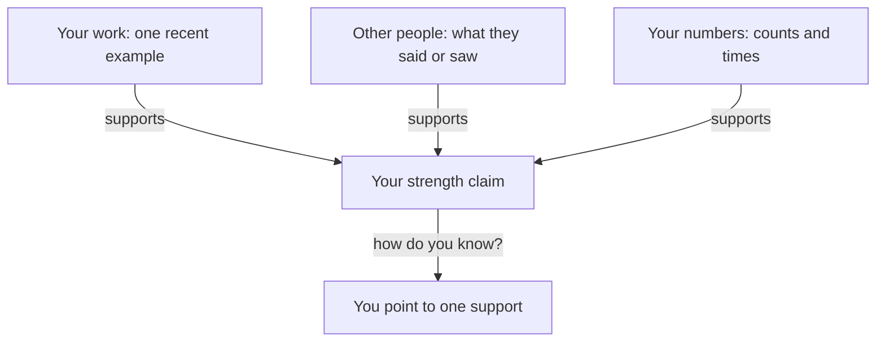

## One proof, please

After her call, Nour calls her friend Rana, a developer who also works from home. She tells Rana what she plans to say next time: "I am a good designer, I work hard, and I learn fast." Rana listens and says, "Show me one thing that proves it." Nour opens her mouth, and she has nothing ready. She has a lot of good work. But the sentence she wrote does not point to any of it.

This is the problem with a strength you claim about yourself. It sounds like a fact, and it is really an opinion. The interviewer cannot check it, and she knows that you know that. This chapter teaches how to say a strength so that she can check it, and so that you can say it without feeling that you are boasting.

<BigWordAlert term="Narrow strength" plainEnglish="A strength described as one specific skill, with a time and a witness, so that someone else can check it." whyItMatters="A broad strength like 'good designer' has no edge to check. A narrow one has an edge, and it holds when the interviewer asks 'how do you know?'." />

## The idea in plain words

A strength you can prove has three parts. First, it is narrow: one skill, named so that someone could look at an example and judge it. Second, it has a recent example: one real time, as you learned in chapter 1.2, with a fact or a number from that time. Third, it has a witness: something another person said or saw, or something that happened because of it.

The witness can be small. A client who came back for more work is a fact. A manager who asked you to teach a colleague is a fact. A sentence in an email is a fact if you can show it. A witness is not a title or a prize you are proud of, and it is not an adjective you chose. It is something outside your own head.

This matters because most of us are not very accurate judges of our own skills. Psychologists such as David Dunning have found that people's views of their skills are only modestly linked to how they actually do. Other people sometimes predict a person's results better than the person does. A review that combined many studies found that the link was stronger for a specific skill, such as "I can write a database query". It was weaker for a broad one, such as "I am a good engineer". So the rule is simple: be narrow, and bring evidence.

One well-known study, by Justin Kruger and David Dunning, found something simple. People who scored lowest on tests of humour, grammar and logic thought they had done a bit better than average. This does not mean that beginners think they are experts. It means everyone should check their view of themselves against evidence, and the evidence is exactly what an interviewer wants.

## Predict the last step

Nour narrows her strength in steps. Each step asks one plain question: which part, what exactly, when, who saw it. At the end she has to say what someone else saw. Think about a harder case first. What if no one has said anything yet?

```predict
prompt: "At the last step, no client has put praise in writing. What should Nour say?"
options:
  - id: honest-gap
    label: "That no client has written it yet"
  - id: skip-witness
    label: "Nothing about it: leave the witness out"
correctOptionId: honest-gap
explanation: "An honest gap is better than an empty claim, and much better than a quote you cannot show. She can say that no client has put it in writing yet and that she will ask the next one for a sentence. That tells the interviewer she knows what evidence would look like. Leaving the witness out returns her to a claim with nothing under it."
```

<InteractiveCanvas slug="broad-to-narrow-strength" />

**What this shows:** one strength narrowed step by step, from a claim nobody can check to a claim with an example and a witness. **Try this:** write your own broad strength on a line, then ask "which part?" and "what exactly?" until it is one skill. **What changed:** at each step the claim got shorter to check. At the end, the sentence names a skill, one recent time with numbers, and what clients said. The last step shows an honest gap. **Limits of the model:** the numbers belong to this example. Some strengths, such as staying calm under pressure, are hard to narrow, and a short example can still carry them.

## What the canvas showed

Look at how the claim changes at each step. "I am a good designer" is true of many people, so it separates Nour from nobody. "I am good with clients" is better, because it names a kind of work. But "I turn messy client feedback into one clear list of changes" is different in kind. It is a thing she does, with an input and an output, and a stranger could look at one of her lists and judge it.

The last two steps carry the proof. The recent example, 14 comments into 5 changes, gives the interviewer a size and a time. The witness, three clients who came back and one who wrote that the summaries saved a meeting, gives her something she did not hear from Nour's own mouth. Neither is large. Together they are enough to make the claim hold when the interviewer asks "how do you know?".

## A full worked example

Here is the same follow-up that broke Nour's first answer, now with the stronger version.

> **Hiring manager:** "What are you good at?"
>
> **Nour (weak):** "I am a good designer. I work hard, and I learn fast."
>
> **Hiring manager:** "How do you know?"
>
> **Nour (weak):** "Clients like my work."
>
> **Hiring manager:** "Which clients? What did they like?"

The weak answer has no second layer. Each follow-up gets another general sentence, and the next follow-up has nothing to hold. The stronger version:

> **Nour (stronger):** "I turn messy client feedback into one clear list of changes. Last month one client sent 14 comments in three emails and a voice note. I grouped them into 5 changes and put them in the order the client wanted. Three of my 12 clients have come back for more work, and one wrote that my summaries saved them a meeting."

Check the reasoning step by step. The skill is one sentence long, and it names an input (messy feedback) and an output (one list). The example has a time (last month) and counts (14 and 5). The witness is two facts: three clients came back, and one wrote a sentence. All of it can be checked, and none of it is an adjective. Notice also that it is about 60 words. A strong answer to this question is short.

A second example, from a different role. Wael is a backend developer. His broad claim: "I am good with databases." His narrow claim: "I find the cause of slow database queries." His recent example: "Last month the monthly report took 12 seconds to open. I looked at the query plan and added one index, and it opened in 2 seconds. I timed it five times." His witness: "My team lead asked me to look at the other slow pages after that." Each part is something he did or something that happened. The numbers are from his own timing, and he says so.

What if you have no witness? Ask. Send one past client, teacher or lead a short message: "Could you write one sentence about what you saw me do on the project?" Most people say yes. If the answer is no or nothing, use the honest gap, as the canvas showed. Do not write the sentence for them and quote it as theirs. Do not paste their names or messages into the AI interviewer. Use roles: "a client", "my team lead".

## A diagram of the supports

The canvas shows the strength getting narrower. The diagram below shows what holds a strength up once it is narrow. A claim stands on three supports, and the interviewer's "how do you know?" asks you to point to one of them.



Read the three arrows into the claim first. Each support is independent, so you do not need all three. One strong support is enough for most questions. Then read the last arrow. The question "how do you know?" always sends you to one of the three. If none of them is ready, the claim is not ready. The takeaway: a strength is not an adjective. It is a claim with something under it.

## Where people go wrong

The first mistake is a list of adjectives: hard-working, fast learner, team player. Each one is broad, and the interviewer cannot check any of them. The second is naming three strengths in one breath. One narrow strength with proof is stronger than three broad ones. The third is borrowing the team's strength: "we are very good at delivery". Chapter 1.3 taught you to say your part and the team's.

The fourth is an old example. If it was five years ago, the interviewer may wonder whether it is still true. The fifth is making the witness bigger than it was. If a client wrote "your summaries saved us a meeting", do not say "the client said I am the best designer they have worked with". The next question, "can I see the message?", ends that answer.

The last mistake is the opposite one: saying nothing, or saying "I am not that good". Many people are taught that it is rude to speak well of themselves. But a true, specific statement about your work is not boasting. Researchers who study interviews separate honest self-presentation, which is showing your real strengths well, from deceptive self-presentation, which is not true. The first is what you are doing.

## Try it on your own resume today

Write down the three strengths you would say in an interview. Next to each, ask "which part?" and "what exactly?" until it is one skill. Then find one recent example with a count, a time or an amount, and one witness. If you cannot find a witness, write the name of the person you will ask, as a role. Choose the strength with the best proof, and practise saying it in under 60 words. If you prefer, use Hadeel's: her strength is finding why pages are slow on cheap phones, which the gate gives you in full.

## Check your understanding

```quiz
type: mcq
question: "Jamal is a mobile developer. Last month, crash reports for his clinic app fell from 31 a week to 9 after he found two bugs in the login screen. A nurse manager wrote to him that the app 'stopped freezing in the morning'. He is asked 'What are you good at?' Which answer fits his facts best?"
options:
  - "I am a reliable developer who cares about quality and fixes problems fast, and I learn quickly in every new project and team."
  - "I am the best on my team at fixing crashes, and everyone there says I am the one to ask when an app freezes up."
  - "I fixed the crash problem, and the nurse manager says I am great at everything I touch on the clinic app now."
  - "I find why apps crash. Last month crashes fell from 31 a week to 9, and a nurse manager wrote the app stopped freezing."
correct: 3
explanations:
  - "This is a list of broad adjectives. None of them has an example, so 'how do you know?' has no answer."
  - "'The best' and 'everyone says' are not in his facts. No one on the team is described as saying it, and the interviewer will ask who."
  - "The nurse manager wrote that the app stopped freezing. She did not say he is great at everything, so this makes the witness bigger than it was."
  - "Right. It is one narrow skill, one recent example with a before and an after, and a witness who spoke about the result. Each part is in his facts."
```

**Next:** A real weakness with a plan: why most people say "perfectionist", what research found about it, and what to say instead.
