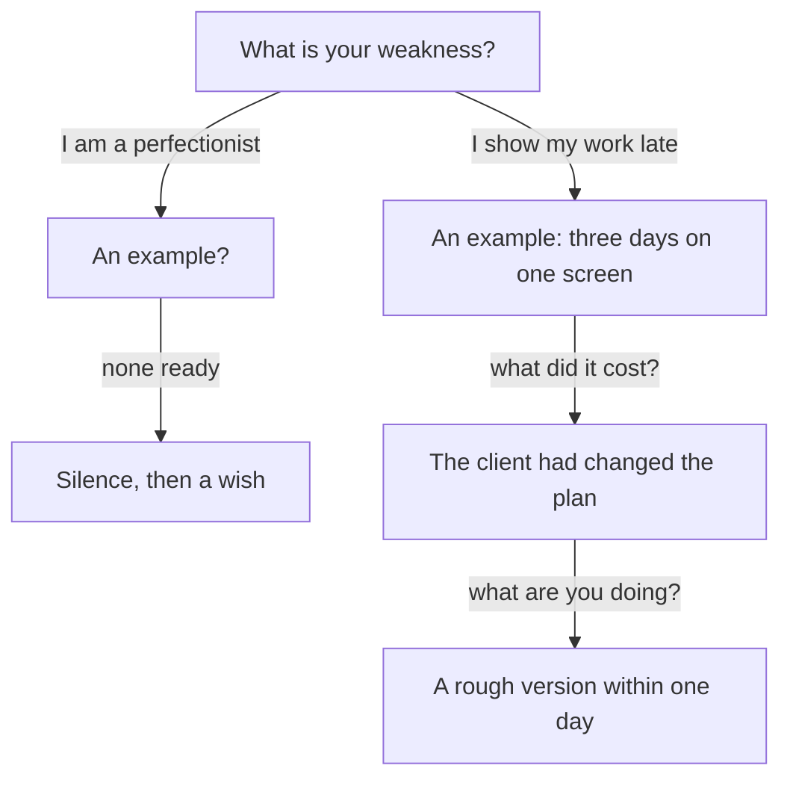

## "That sounds like a strength"

Nour practises with her friend Rana. She says, "My weakness is that I am a perfectionist." Rana laughs. "That is not a weakness. That is a strength." Nour laughs too, and then she is quiet. Rana asks, "So what is a real one?"

Nour thinks about her last year of client work. There is one habit that costs her time again and again. She waits to show a design until she has polished it. She tells Rana about a sign-up screen. She spent three days on it before she showed it to the client. By then the client had changed the plan, and the screen was not needed in that form. Rana says, "That is a real weakness. Why did you not say that?" Nour answers, "It sounds worse."

It does sound worse. That is the exact reason most people choose the safe answer. This chapter looks at why, and at what the safe answer costs.

## The idea in plain words

A real weakness answer has four parts. First, you name the weakness plainly, as a habit or a skill gap that matters for the work. Second, you give one example, a real time with a fact in it. Third, you say what it cost. Fourth, you say what you are doing about it, in a way that someone could see.

Good weaknesses to choose from are skill and habit weaknesses: asking for help late, showing work late, underestimating the time for testing, or checking data too fast. They are real, they matter in a team, and a person can change them. They are not the whole job. A developer who says "I cannot read other people's code" has named a weakness that removes her from the work.

<Callout type="info" title="Keep hardship out of it">
You never have to name health, family or hardship as a weakness. Those are not habits at work, and no interviewer needs them. Choose a skill or a habit.
</Callout>

## What research found

In one study, researchers asked 122 university students in the United States to write how they would answer "What is your weakness?" in a job interview. About three in four, 77 percent, gave a humblebrag: a strength dressed as a weakness, most often perfectionism or working too hard. The other 23 percent named a real weakness. Then other people read the answers. They were more willing to hire the writers who named a real weakness.

This is one study, with written answers by students. It is not a study of real hiring. But it matches other work by the same researchers. Across nine studies, humblebragging was seen as insincere, and it lowered how much people liked the speaker and how skilled they thought the speaker was, compared with plain bragging. So the safe answer is not as safe as it feels. It costs you a little trust each time.

## Predict the scores

The canvas shows three answers to "What is your weakness?": the humblebrag, a real weakness with no plan, and a real weakness with an example and a plan. Each is scored on four questions: is it honest, does it matter for the work, does it show what you do about it, and does it feel safe to say. The scores are Nour's own judgment, and yours would differ. Before you open it, decide what you expect when all four questions count the same.

```predict
prompt: "When honesty, usefulness, a plan and feeling safe all count the same, which answer leads?"
options:
  - id: real-plan
    label: "A real weakness with an example and a plan"
  - id: humblebrag
    label: "The perfectionist answer, as it is safe"
correctOptionId: real-plan
explanation: "The perfectionist answer scores best on only one question: feeling safe to say. A real weakness with a plan scores well on honesty, on mattering for the work and on showing what you do. With equal weights, the three questions it wins outweigh the one it loses."
```

<InteractiveCanvas slug="weakness-answer-choice" />

The canvas scores three weakness answers on four questions, and the weight you give each question decides which answer leads. Move the weight on feeling safe first, and then move the weight on honesty. It is a simple illustration of why people choose the safe answer, and it cannot tell you which weakness to name.

## What the weights explain

The weights explain a habit. The perfectionist answer comes out ahead only when feeling safe becomes the main question. That is how most people feel in the moment: the answer that feels safe wins. The canvas shows what that choice gives up. You trade honesty, use and a plan for a few seconds of comfort.

Look at the middle answer too. A real weakness with no plan is honest, and it matters for the work. But it leaves the manager holding a problem. "I show my work late" is true, and the next question, "what are you doing about it?", has no answer. It scores low because it hands over the risk and the solution is missing. The plan is what turns a confession into a skill.

To score your own answers, take a sheet of paper and write the same four questions across the top. Write two or three weakness answers down the side. Give each answer a score from 1 to 5 on each question, in your own judgment, and see which answer you would choose if you were honest about all four.

## A full worked example

Here is Nour's answer to the question that froze her, built in steps. First, the weak answers, and the follow-up that shows the gap in each one.

> **Hiring manager:** "What is your biggest weakness?"
>
> **Nour (humblebrag):** "I am a perfectionist. I care too much about details."
>
> **Hiring manager:** "Can you give me an example?"
>
> **Nour:** "I just always want the work to be perfect."

The first answer cannot survive the first "example?". It was never a real habit, so there is no time to point to. The second try, a real weakness with no plan:

> **Nour (no plan):** "I show my work late."
>
> **Hiring manager:** "What are you doing about it?"
>
> **Nour:** "I am trying to do better."

This one is honest, but "trying to do better" is a wish. The manager cannot see it. Now the stronger answer.

> **Nour (stronger):** "I show my work late. I like to polish a screen before anyone sees it. Once I spent three days on a sign-up screen, and the client had already changed the plan. Now I send a rough version within one day. I started this recently, so I cannot yet say how much time it saves."

Check the reasoning, step by step. The weakness is named in one plain sentence. The example is one time, with a number of days and a cost: the screen was not needed in that form. The plan is something you can see, a rule with a time limit. The last sentence is an honest limit, which stops her from claiming a result she does not have. It is about 55 words.

A second example, from a different role. Wael is a support lead at a small online shop. His weakness: "I put off hard replies. Last month a customer waited three days for an answer about a refund, because I kept it for later. Now I answer the hardest message first thing in the morning, and I write down how long each answer takes." Notice the same four parts: a plain weakness, one time with a number, a cost, and a plan that someone can see.

## A diagram of the two paths

The diagram shows where the answer splits. A humblebrag and a real weakness start from the same question, and they meet the manager's next question in very different ways.



Read the top path first. The first answer reaches the manager's first question and stops, because there is no time to point to. Now read the lower path. The same question leads, step by step, to a cost and a plan, and each step is a fact that Nour already has. The takeaway: the two answers do not differ in tone. They differ in what is behind the first sentence.

## A failure story

Osama is a developer who has read that he should name a weakness. To be safe, he prepares three. In the interview he says, "I am a perfectionist, I sometimes miss deadlines, and I cannot work with people who are slow." The manager hears three problems at once, and she asks about the one that matters to her team: "Which deadline did you miss?"

Osama has no example ready, because he chose the sentence for how it sounds. He says, "Oh, in general." She asks, "What are you doing about it?" He says, "I will try harder." Then she thinks about the third weakness. "People who are slow" sounds like blame, and her team has people with different speeds. After two minutes she has heard three problems and no plan, and Osama has made the interview harder for himself.

The same interview could have gone differently with one weakness. Osama leaves testing to the end. On his last project he planned one day for testing and needed three. His plan: he writes the test for each part when he writes the part. Three lessons come out of the story. One real weakness with a plan is enough. A weakness that is the whole job, or a weakness that blames other people, hurts you. And a plan must be something a person could see you do, not a wish. A weakness you have already fixed completely is also a poor choice, because the manager has no present habit to judge.

## Try it with your own habits

Think of your last two projects. Write down two habits that cost you time or caused a problem. Choose the one that matters least for the job you want and that you can change. Write the four parts in about five sentences: the weakness, one time, the cost, the plan. Check the plan by asking, "Could a person see me do this?". If you prefer to use Hadeel's, her weakness is that she waits too long before asking for help, and the gate gives you her example and plan.

## Check your understanding

```quiz
type: mcq
question: "Sana is an operations coordinator at a school office. She told the head teacher's assistant that the new timetable sheet would take 2 days, and checking for room clashes made it take 4. On her next sheet she planned 4 days and finished in 4. She is asked 'What is your weakness?' Which answer fits her facts best?"
options:
  - "I am too detail-focused, so the team waits while I check. Last term I took 4 days for a sheet that I planned in 2."
  - "I am bad at planning. I said 2 days and it took 4, and I have no fix yet, but I know that it is a problem."
  - "I underestimate the time checking takes. I said 2 days and it took 4. Now I add the same time again."
  - "I care too much about accuracy, so I check each room 3 times. It cost me 2 days once, and I am proud of it."
correct: 2
explanations:
  - "This is a humblebrag in a different shape: a strength dressed as a weakness. It has numbers, but the habit it names is not the one Sana has, and it has no plan."
  - "She does have a plan, because she planned 4 days on her next sheet and it worked. Saying she has no fix hides her best fact."
  - "Right. It names a plain weakness, gives one time with 2 and 4 days, and a plan she has already used once. Each part is in her facts."
  - "This is the same humblebrag, with a figure. 'Check each room 3 times' is a claim of care, not a habit that cost anything, and her facts give no such count."
```

```quiz
type: mcq
question: "Osama says his weakness is that he waits too long before asking for help. Last month he lost a day on a form bug before he asked. His plan is: 'I will try to be braver.' Since then he has asked after 2 hours, twice. Which rewrite of his plan is best?"
options:
  - "After 2 hours stuck, I write down what I tried and ask my lead. I have done this twice."
  - "I will try harder to ask for help sooner next time. I hope to improve over the next 6 months."
  - "I now ask for help on each task as soon as I start it. That way I do not lose another day to a bug."
  - "I have fixed this, so it is not a weakness now. My lead has had no problem since the form bug."
correct: 0
explanations:
  - "Right. It is a rule with a time limit that someone could see, and it gives the true count so far. 'Twice' is honest and small."
  - "'Try harder' is a wish. A manager cannot see it, and it gives no limit to check."
  - "This goes past his facts: asking on each task as soon as he starts is not what he does. It is also not a real plan for a busy team."
  - "Two times is a start, not a finished fix. Saying it is gone claims more than he knows, and it leaves the manager with no weakness to judge."
```

**Next:** Nerves, accent and time to think: what you cannot control in an interview, and what you can.
