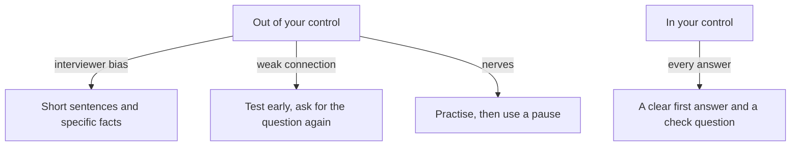

## Before the next call

Nour has another interview next week. This time she does not worry about her answers first. She worries about everything around them. Her hands shake when she is nervous. Her connection freezes at the worst times. An interviewer once said to her, "I am sorry, I could not follow your accent." She wonders if the problem is her.

It is not a problem with her, and the first step is to separate two lists. One list holds the things she cannot control: how an interviewer hears her accent, how the network behaves, and the nerves she feels. The other list holds the things she can: how she starts, how she builds her sentences, when she pauses and what she asks. This chapter gives you both lists, and a plan for each item on them.

## The idea in plain words

You cannot make an interview calm, and you cannot change how every listener hears you. You can make your side of the conversation easier to follow and harder to derail. Five habits do most of the work. Start with one clear first answer. Use short sentences, with one idea in each. Take a planned pause before you answer. Check that you understood the question. And ask for the question again if you did not hear it.

None of these habits is a trick. They are the same things a good listener does when the person in front of her is speaking a second language: slow down, ask, confirm. The difference is that you do them for yourself.

## What research found

First impressions start early. In a study of structured interviews for internships, candidates who made better early impressions got higher ratings and more offers. Early judgments of competence carried over to other interviewers. A follow-up study found that part of what interviewers pick up early is real, job-related content. So the first minutes matter, mostly because interviewers start judging your competence early. Have a clear first answer ready: one real time, as chapter 1.2 taught.

Video calls matter too. A review that combined 12 studies found that interviewers rated people lower in phone and video interviews than in face-to-face ones, and that applicants reacted less well to them. Founder interviews for remote teams are often video calls. That is not a reason for worry. It is a reason to test your camera, your light and your sound, and to have a plan for a weak connection.

Accent is the hardest topic, so here is one plain paragraph. In studies where actors read the same words with different accents, the accented speakers were rated lower. One study was for an entry-level software job, where they were seen as less suitable. Another was for a middle-management job, where they were less likely to be recommended. That is the listener's bias, not your failure. This course does not teach accent change. What you control is clear structure, specific facts and checking that you were understood, and the rest of this chapter is about those.

Nerves are normal. In studies, people with more interview anxiety did a little worse in the interview itself. In two later studies, anxiety did not predict how well people did in the job. So the interview can understate you. Preparation and practice are the best tools you have.

## Predict the cost

Nour's question on the call is "How do you handle feedback?" She has two choices. She can start talking right away, which feels fast and confident. Or she can say "Let me think for a moment" and wait about five seconds. Then she asks, "Do you mean feedback I give or feedback I get?" Suppose she starts right away and answers about the wrong kind of feedback. After a minute the manager says what she meant, and Nour must start again. Before you open the canvas, compare the two costs in time.

```predict
prompt: "The check costs about five seconds of pause and one short question. The wrong answer cost Nour about a minute. Which costs more time in the whole answer?"
options:
  - id: wrong-answer
    label: "Answering the wrong question"
  - id: check
    label: "The check question at the start"
correctOptionId: wrong-answer
explanation: "The check costs a few seconds once. The wrong answer cost a full minute, and then Nour had to start the right answer from the beginning, so she spent the minute and the whole answer again. A pause and a check feel slow, but they are the cheaper choice whenever a question can mean two things."
```

<InteractiveCanvas slug="time-to-think" />

The canvas lets you choose what Nour does before each step shows her next move. Compare the cost of the pause with the cost of the wrong answer, and write one "Do you mean" question for your own call. The seconds are made up for this example, and no study shows how interviewers judge a request to repeat a question. This is course advice.

## Why the pause helps

The canvas showed two prices. The pause cost a few seconds that nobody counted. The wrong start cost a minute, and it cost something less visible: Nour began her real answer feeling more worried. A calm start keeps the nerves smaller, and a corrected start makes them larger.

Notice what the pause is. It is not silence for its own sake. It is one sentence, "Let me think for a moment", and then a real moment to choose one time to talk about. Coaches recommend this, and it is practice advice, not research. There is one research finding behind a related idea. Listeners judge how fluent a second-language speaker sounds mostly by the length of pauses and by speed. Our own reasoning goes one step further: a planned pause at the start may be less costly than a long pause in the middle of a sentence, and short sentences make the second kind rarer, because there is less to hold at once. This is course advice, not a research finding.

## A full worked example with a different question

Rana is a mobile developer, and English is her second language. An interviewer asks her, "What would you do in your first week?" The question has two readings. It can mean what she would learn, or what she would deliver. Nour's call showed one case in the canvas, so here is a different one.

> **Rana:** "Let me think for a moment." (a short pause) "Do you mean what I would learn, or what I would deliver?"
>
> **Interviewer:** "What you would learn."
>
> **Rana:** "On day one I would read the code for the booking screen. On day two I would run the app and write down what is slow. By Friday I would ask the team three questions."

Check the steps. She asks for a moment, using one plain sentence. She checks the question, with an either-or so it is easy to answer. Then she answers with a short plan, in sentences of 10 to 15 words, and each sentence holds one idea. If she had started at once, she might have talked about delivering a feature for two minutes, and the interviewer wanted to hear how she learns.

Here is how a long sentence becomes short ones. The long version: "When the client told me that the first version was too busy, I decided to remove half of the buttons because I thought that if they could see fewer choices they would finish the sign-up faster and then we could test it again." That is 43 words in one breath. The short version: "A client said the first version was too busy. I removed half of the buttons. I thought fewer choices would help people finish sign-up. Then we tested it again." Four sentences, one idea in each.

Now the weak connection. Later in a call the video freezes in the middle of a question. A weak reply is to guess: Rana hears "Tell me about a time you..." and starts a story about a failure. A stronger reply: "Sorry, the call froze after the words 'a time you'. Could you say the question again?" Asking costs one sentence. Guessing can cost the whole answer.

One more practical case. If an interviewer asks about a gap in your work, one calm sentence is enough: "My work was on and off for a time. In that time I built this, and I can tell you about it." You do not have to explain more than that. Then move to the thing you built.

## A diagram of the two lists

The diagram puts both lists together. The top group holds what you cannot control, and the arrows show the plan for each. The bottom group holds what you can control, and these are the habits to use every time.



Read the top group first. For each item you cannot control, there is a plan that you can do. You do not fight the bias or the network. You make your side clear and keep a spare plan. Then read the bottom group. These habits do not depend on anyone else. The takeaway: you cannot make a listener fair, but you can make every sentence easy to follow.

## Where people go wrong

The first mistake is speaking fast to hide nerves. Fast speech in a second language costs understanding, and listeners judge fluency by speed and pauses. A steady pace with short sentences is better. The second mistake is long sentences, which you saw above. The third is filling a pause with sounds for many seconds. "Let me think for a moment" is better than a long "um".

The fourth is guessing the question. If you are not sure, ask. Answering the question they asked matters more than answering fast. The fifth is skipping the setup test. Before the call, check your camera, your light and your sound. Close other apps to save data, and plan the call for a time when the power is steady. Have one sentence ready if the connection drops: "My connection dropped. Could we continue in a minute?"

The last mistake is to apologise again and again for your English. You can say once, "If anything is unclear, please stop me", and then speak.

## Try it with your own voice

Do three small things today. First, record a short voice note answering "Tell me about one project" twice: once at once, and once with "Let me think for a moment" first. Listen to both. Second, practise three sentences until they are easy: "Let me think for a moment." "Do you mean this or that?" "Could you say that question again?" Third, call a friend and test your camera, light and sound. If you prefer a provided case, use Hadeel's: her strength and weakness are in the gate.

## Check your understanding

```quiz
type: mcq
question: "Rana is on a video interview, in her second language. The interviewer speaks fast. Rana understood: 'Tell me about a time you disagreed with...', and she missed the last 2 words. The interviewer is waiting. What should she do?"
options:
  - "Guess that it was a disagreement with a manager and start a story about one."
  - "Say what she understood, 'a time you disagreed with', and ask for the last 2 words."
  - "Say she missed the question and ask the interviewer to move on to the next one."
  - "Wait for 20 seconds in silence, in case the last 2 words come back to her."
correct: 1
explanations:
  - "She does not know whom the disagreement was with, so a guess can send the whole story in the wrong direction. The guess might also be about a person the interviewer did not mean."
  - "Right. She repeats the part she understood, so the interviewer knows what to say again, and she asks only for the missing 2 words. It costs one sentence and saves the answer."
  - "She understood most of the question, so asking to move on throws away a chance to answer it. One short request would give her the missing words."
  - "Silence for 20 seconds adds nerves, and the words will not come back to her. The interviewer may think she is stuck."
```

**Next:** A quiz with five short cases on strengths, weaknesses and handling the interview, including an AI answer to check.
