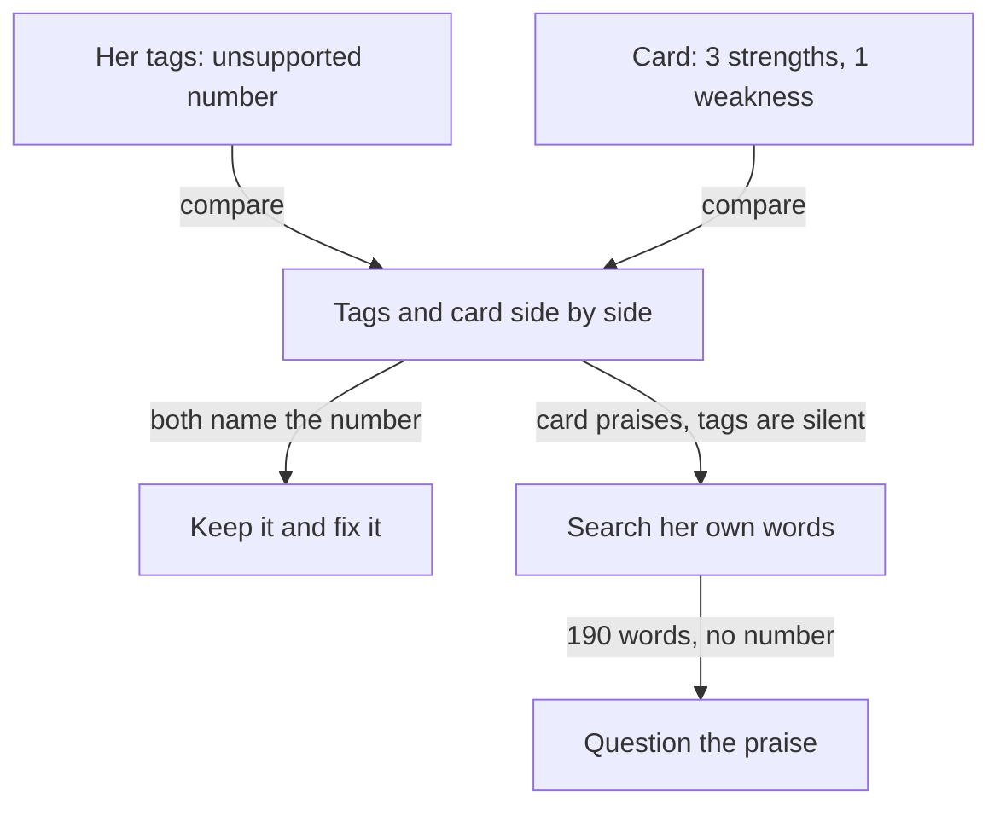

## Two practice interviews, three weeks apart

Tala is 26 and writes phone apps. For two years she has built the lesson-booking app of a driving school, in a team of three developers. She is now applying to a small remote team. In the last three weeks she has used the AI interviewer at the end of four course modules, and each time it gave her a feedback card.

Tonight she wants to know one thing. Did the practice work? She does not trust a feeling, so she uses a method. She opens the transcript of her first interview and the transcript of her most recent one. In each, she tags her own answers. To tag an answer means to write one of five flag names beside a sentence of your answer, with your own words in quotes. Only after that does she open the two cards.

The people and teams in this course, including Tala, her team and the driving school, are fictional.

## The five flag names

The card has strengths, weaknesses with a fix each, notes for each area, a short list called "Things to watch" and three next steps. "Things to watch" names the flags the interviewer found, each with your own words. It uses the same five names, which you met in the chapters, so the table is a reminder, not a new lesson. You still tag your own answers first: a card can miss a flag, or praise an answer your own words do not support.

| Flag | What it looks like | Where you met it |
|---|---|---|
| Vague ownership | "We" for everything, and your own part is never named | 1.3 |
| Pseudo-story | What you usually do, not one time | 1.2 |
| Unsupported number | A number with no before, no window or no source | Module 2 |
| Invented reason risk | A tidy reason that is not the one you had then | 3.3 |
| Jargon without explanation | Words that a founder cannot follow | 5.3 |

## The first interview

The first question was: "Tell me about one piece of work you owned from start to finish. What was the problem, and what was your part?" This is how Tala answered.

> "We built a booking app for a driving school. We usually test on real phones, and we made the lesson screens about 50 percent faster. The users were happy."

The interviewer asked two follow-up questions. "What was your part?" Tala answered, "We all worked on it." "Where does that number come from?" She answered, "I think it was in a report from my lead."

Now Tala reads her transcript and tags it. She finds three. Vague ownership: "We built a booking app", and every other sentence also says "we". Pseudo-story: "We usually test on real phones" describes a habit, not one time. Unsupported number: "about 50 percent faster" has no before, no after and no source. Then she opens the card. It has two weaknesses with fixes. One says her answer used "we" in every sentence, and one says the 50 percent had no source. The card did not mention the habit. Her own tags found something the card missed.

## The last interview

Three weeks later, Tala answered a different question: what was the best change she made to the app. She told the story of the offline mode. Her team lead had said that learners often tried to book a lesson in a car park with a weak signal, and the booking failed. Tala decided that the app should save the booking on the phone and send it when the signal came back. She had thought about an error message that asked the learner to try again. She rejected it, because the learner would still lose the time slot. She built the offline mode herself, and her lead checked it.

This time she said "I" for her own part and "we" for the team, and she told one time. The interviewer asked what changed because of it. Tala gave a long answer of about 190 words. She explained how the phone keeps the request, how the screen shows the word "saved", and how learners no longer need to try again in the car park. Then the interviewer asked for a number. Tala said, "After the change, crashes fell by about a third." Asked where that came from, she said, "I think it was on a dashboard. I am not sure of the dates."

She tags the transcript before she opens the card. She finds one flag: unsupported number, on the crash claim. The card agrees on that: its "Things to watch" list names the same flag with her words, and its one weakness says the crash number had no source. But the card also lists three strengths, and the third one says: "Strong impact. Your detailed answer about the offline mode shows clear results." Before you read on, think about that line.

```predict
prompt: "The card says 'strong impact' about Tala's long answer on the offline mode. What should she do with that line first?"
options:
  - id: check-words
    label: "Look in her own answer for a number"
  - id: trust-card
    label: "Believe it, since the AI read the whole answer"
correctOptionId: check-words
explanation: "Impact needs a before, an after and a source, or an honest 'I did not measure that'. A card can read the whole answer and still praise the wrong thing. Tala's first step is to look for those parts in her own words."
```

## What changed, and what did not

Tala went to the answer and the result was clear. The long answer had no number in it. It had no before and no after. It did not even say "I did not measure that". The only number she gave in the whole interview was the one that the card called unsupported. So the card praised the answer that had no numbers, and criticised the only number she said. Those two lines do not fit together.

First, the good news. Her tags went from three to one. The words that removed the others are in her transcript: "I decided", "my lead checked it", "the other option was". She told one time, and her own part was clear. Chapters 1.2 and 1.3 gave her those tools, and her own tags show they work. The news that needs work is the tag that stayed. A number with a source is not a matter of how you speak. It needs evidence that you have to go and find, which is why module 2 spent a whole chapter on where numbers live.

| Flag | Tags in her first interview | Tags in her last interview |
|---|---|---|
| Vague ownership | 1 | 0 |
| Pseudo-story | 1 | 0 |
| Unsupported number | 1 | 1 |
| Card line to question | None | "Strong impact" for a long answer with no number |

Read the table down each column, then across each row. Down the middle column you see what she had to fix. Down the last column you see what is left, and one new thing to check. Across a row, you see whether a problem moved. This only works because she used the same five names both times. A card is a list of claims about your answer, and each claim asks one question: do my own words show this?

## What the card got wrong

The card made one mistake, and it is a typical one. The answer was long and full of detail, so the card called it strong. But impact in this course needs a before, an after, a time window and a source, or an honest gap with a plan to measure. Length is not on that list. People who build and test AI tools have found that these tools tend to agree with the person they talk to, and that they tend to like long answers. The interviewer is set up to score what an answer contains and not how long it is, and it still can make this mistake.

This does not mean the card was useless. Two of its three strengths were right, and its weakness was right. One wrong line in a card is normal. The skill is to find it, and the way to find it is an evidence check.

<BigWordAlert term="Evidence check" plainEnglish="Finding your own words in the transcript that prove or disprove one line of feedback, before you believe the line or reject it." whyItMatters="A feedback card is practice, not a hiring decision, and it can be wrong. An evidence check tells you which lines to act on and which to ask your mentor about." />

The diagram shows two sources of information about the same interview: Tala's own tags and the card. Where they agree, she acts. Where only the card speaks, she checks.



What to notice: neither source is the boss. Her tags can be too kind, because she wrote them. The card can be too kind, because it is a machine that likes long answers. When they agree, she can act with more confidence. When only one speaks, her own words decide.

## Why this matters in a founder interview

In a real interview, nobody hands you a card. The founder's follow-up questions are the feedback, and they come while you are speaking. When a founder asks "from what?" or "what was your part?", that is a flag in plain words. Practice cards let you read your own answers slowly, afterwards, so that you can hear the same questions before they come.

The interviewer is only a practice partner. Its feedback can be wrong, and it cannot see what you know and did not say. Your mentor reads the transcript too, so you can ask a mentor when you disagree with a line. A fellow who reads feedback with an evidence check learns faster than one who believes every line, and faster than one who rejects every line.

## What Tala does next

Tala writes three lines in her notes. First: the tag I keep, unsupported number. Second: the line I question, strong impact, because my answer has no number. Third: the gap in my story, a number I can source. Her offline-mode story is her best one, and it has no honest number yet. How could she get one? She could ask her lead for permission to count the failed bookings in the logs before and after. If that is not possible, she needs an honest answer ready. Chapter 7.2 shows both ways.

## What this module covers

Module 7 puts the course together. You will tag your own answers and read feedback the way Tala did, compare your tags across practice interviews, and find the gaps in your story bank. You will plan how to fill a gap honestly, including a small project built around a need of your own. Then you run two practice interviews and defend your stories to a mentor.

<LearningObjectives items={["Tag your own answers with the five flag names and check each line of a feedback card against your own words", "Keep the lines your words support and question the lines they do not", "Compare your tags across two practice interviews", "Find a gap in your story bank and plan an honest way to fill it", "Run two practice interviews, read them critically, and defend your stories to a mentor"]} />

## Key words

| Word | Plain English |
|---|---|
| **Tag** | A flag name written beside a sentence of your own answer, with your words in quotes |
| **Gap** | Something your story bank cannot show yet, such as a number you can source |
| **Need** | Something you or people near you do by hand every week, or that keeps breaking |
| **Defence** | A five-minute talk where your mentor picks a resume line and a story and asks four whys on each |
| **Interview kit** | One line for each tool of the course, kept where you can see it |

## What is in this module

| Chapter | You will practise |
|---|---|
| 7.2 | Tagging your answers, reading a card, and filling a gap, with a small project around a need |
| 7.3 | A mixed review: in fresh answers from every module, finding the quality that is missing |
| 7.4 | The capstone: your story bank, your audited resume, two practice interviews and your defence |
| 7.5 | The course checklist, your interview kit and your plan for the next interview |

**Next:** How to tag your own answers, read a card against them, keep what the evidence supports, and plan how to fill the gap you find.
