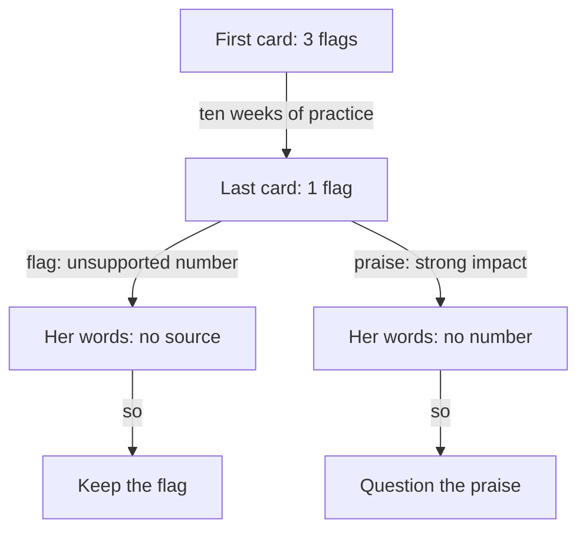

## Two cards on one phone

Tala is 26 and writes mobile apps. For two years she has built an Android app for a driving school, in a team of three developers. She is now applying to a small remote team. For ten weeks she has used the AI interviewer at the end of the course modules, and each time it has given her a feedback card.

Tonight the power is on and her phone is charged. She opens two saved cards: the one from her first practice interview, at the end of module 1, and the one from her most recent interview, at the end of module 6. She reads them one after the other, and scrolls up and down between them. She wants to know one thing. Did the practice work?

The people and teams in this course, including Tala, her team and the driving school, are fictional.

## The first card

The first interviewer question was: "Tell me about one piece of work you owned from start to finish. What was the problem, and what was your part?" This is how Tala answered.

> "We built a booking app for a driving school. We usually test on real phones, and we made the lesson screens about 50 percent faster. The users were happy."

The interviewer asked two follow-up questions. "What was your part?" Tala answered, "We all worked on it." "Where does that number come from?" She answered, "I think it was in a report from my lead." Then the card came back with three flags. A flag is the name the interviewer gives to a common problem in an answer.

The first flag was vague ownership. Every sentence said "we", and her own part was never named. The second was a pseudo-story, the kind of answer you met in chapter 1.2. "We usually test on real phones" describes a habit, not one time. The third was an unsupported number. "About 50 percent faster" had no before, no after and no source, and Tala could not say where it came from. None of this was a surprise to her. She had read the same three problems in module 1.

## The last card

Ten weeks later, Tala answered a different question: what was the best change she made to the app. She told the story of the offline mode. Her team lead had said that learners often tried to book a lesson in a car park with a weak signal, and the booking failed. Tala decided that the app should save the booking on the phone and send it when the signal came back. She had thought about a simple error message that asked the learner to try again. She rejected it, because the learner would still lose the time slot. She built the offline mode herself, and her lead reviewed it.

This time she said "I" for her own part and "we" for the team, and she told one time. The interviewer asked what changed because of it. Tala gave a long answer of about 190 words. She explained how the phone keeps the request, how the screen shows the word "saved", and how learners no longer need to stand in the car park and try again. Then the interviewer asked for a number. Tala said, "After the change, crashes fell by about a third." Asked where that came from, she said, "I think it was on a dashboard. I am not sure of the dates."

The card had one flag: unsupported number. It also listed three strengths. The third one said: "Strong impact. Your detailed answer about the offline mode shows clear results." Before you read on, think about that line.

```predict
prompt: "The card says 'strong impact' about Tala's long answer on the offline mode. What should she do with that line first?"
options:
  - id: check-words
    label: "Check her own answer for a number"
  - id: trust-card
    label: "Trust it, the AI read the whole answer"
correctOptionId: check-words
explanation: "Impact needs a before, an after and a source, or an honest 'I did not measure that'. A card can read the whole answer and still praise the wrong thing. Tala's first step is to look for those parts in her own words."
```

## What changed, and what did not

Tala went to the transcript, and the answer was clear. The long answer had no number in it. It had no before and no after. It did not even say "I did not measure that". The only number she gave in the whole interview was the one the card flagged. So the card praised the answer that had no numbers, and flagged the only number she said. Those two lines do not fit together.

First, the good news. Three flags became one. The words that removed them are in her transcript: "I decided", "my lead asked", "the other option was". She told one time, and her own part was clear. Chapters 1.2 and 1.3 gave her those tools, and the card shows they work. Second, the news that needs work. The flag that stayed is the hardest one. A number with a source is not a matter of how you speak. It needs evidence you have to go and find, which is why module 2 spent a whole chapter on where numbers live.

| Line on the card | First card (module 1) | Last card (module 6) |
|---|---|---|
| Vague ownership | Flagged | Not flagged |
| Pseudo-story | Flagged | Not flagged |
| Unsupported number | Flagged | Flagged |
| Praise to question | None | "Strong impact" for a long answer with no number |

Read the table down each column, then across each row. Down the first column you see what she had to fix. Down the last column you see what is left, and one new thing to check. Across a row, you see whether a problem moved. This only works because both cards use the same flag names. A card is a list of small claims about your answer, and each claim asks one question: do my own words show this?

## What the card got wrong

Tala's card made one mistake, and it is a typical one. Look at the chain of reasons. The answer was long and full of detail, so the card called it strong. But impact in this course needs a before, an after, a time window and a source, or an honest gap with a plan to measure. Length is not on that list. People who build and test AI tools have found that these tools tend to agree with the person they talk to, and that they tend to like long answers. A tool that was set up to score features, as the interviewer is, can still slip.

This does not mean the card was useless. Two of the three strengths were right, and the flag was right. One wrong line in a card is normal. The skill is to find it, and the way to find it is an evidence check.

<BigWordAlert term="Evidence check" plainEnglish="Finding your own words in the transcript that prove or disprove one line of feedback, before you believe the line or reject it." whyItMatters="A feedback card is practice, not a hiring decision, and it can be wrong. An evidence check tells you which lines to act on and which to ask your mentor about." />

The diagram shows what Tala did with the two lines. Each arrow says what she did next. One path ends with a flag she keeps. The other ends with a line she questions.



What to notice: both paths start at the same card and use the same method. She did not trust the card, and she did not throw it away. She opened the transcript, found her own words and decided line by line. The same words kept one line and questioned the other. That is the whole skill of this module.

## Why this matters in a founder interview

In a real interview, nobody hands you a card. The founder's follow-up questions are the feedback, and they come while you are speaking. When a founder asks "from what?" or "what was your part?", that is a flag in plain words. Practice cards let you read your own answers slowly, afterwards, so that you can hear the same questions before they come.

The interviewer is only a practice partner. Its feedback can be wrong, and it cannot see what you know and did not say. Your mentor reads the transcript too, so you can ask a mentor when you disagree with a line. A fellow who reads feedback critically learns faster than one who believes every line, and faster than one who rejects every line.

## What Tala does next

Tala writes three lines in her notes. First: the flag I keep, unsupported number. Second: the line I question, strong impact, because my answer has no number. Third: the gap in my story, a number I can source. Her offline-mode story is her best one, and it has no honest number yet. How could she get one? She could ask her lead for permission to count the failed bookings in the logs before and after. If that is not possible, she needs an honest answer ready. Chapter 7.2 shows both ways.

## What this module covers

Module 7 puts the course together. You will read feedback the way Tala did, compare your cards across practice interviews, and find the gaps in your story bank. You will plan how to fill a gap honestly, including a small project built around a need of your own. Then you run one full practice interview and defend your stories to a mentor.

<LearningObjectives items={["Read practice feedback line by line and check each line against your own words", "Keep the flags your transcript supports and question the lines it does not", "Compare the same flags across two practice interviews", "Find a gap in your story bank and plan an honest way to fill it", "Run one full practice interview and defend your stories to a mentor"]} />

## Key words

| Word | Plain English |
|---|---|
| **Evidence check** | Finding your own words in the transcript that prove or disprove one line of feedback |
| **Gap** | Something your story bank cannot show yet, such as a number you can source |
| **Need** | Something you or people near you do by hand every week, or that keeps breaking |
| **Defence** | A five-minute talk where your mentor picks a resume line and a story and asks four whys on each |
| **Interview kit** | One line for each tool of the course, kept where you can see it |

## What is in this module

| Chapter | You will practise |
|---|---|
| 7.2 | Reading feedback with an evidence check, comparing cards, and filling a gap, including a small project around a need |
| 7.3 | A mixed review: in fresh answers from every module, finding the quality that is missing |
| 7.4 | The capstone: your story bank, your audited resume, one full practice interview and your defence |
| 7.5 | The course checklist, your interview kit and your plan for the next interview |

**Next:** How to read a feedback card line by line, keep what the evidence supports, and plan how to fill the gap you find.
