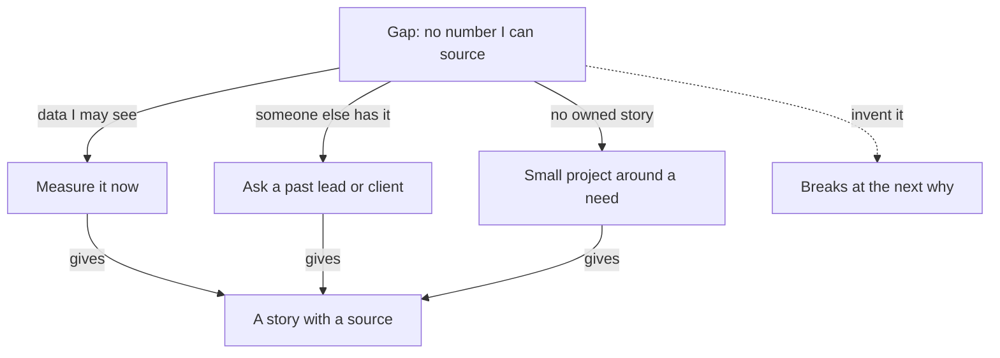

## Three lines in a notebook

Tala has three lines in her notes from last night. The flag she keeps is unsupported number. The line she questions is "strong impact". The gap is a number she can source. Today her connection is slow, so she works from the saved transcript on her phone and does not load anything new. She has twenty minutes before work.

She could do several things with those three lines. She could believe the card, because it was kind to her. She could ignore the card, because one line was wrong. Or she could do the slower thing: check each line, then act on what survives. This chapter teaches the slower thing, in four steps, and then shows how to fill the gap it finds.

## The idea in plain words

Feedback from a practice interview is evidence. It is not a verdict. A verdict says what you are. Evidence says what someone saw, and it can be right or wrong. When a card says "vague ownership", it is making a claim about your words. Your words are in the transcript, so you can check the claim yourself. You met this idea as the evidence check in 7.1. Here are the four steps.

**Step 1: find your words.** For each line on the card, find the sentence in your transcript that the line is about. Copy it. If you cannot find one, write "not found".

**Step 2: keep or question.** If your words match the line, keep it and put it on your list to fix. If your words do not match, question the line. Do not delete it yet. Mark it for your mentor, who can read the same transcript.

**Step 3: compare cards.** Put your cards in order and look at the same flag names. The interviewer uses five flags every time: vague ownership, unsupported number, pseudo-story, invented reason risk and jargon without explanation. Because the names do not change, you can see which problems went away, which stayed and which are new.

**Step 4: find the gap and fill it.** Look at your story bank, the set of stories you started in module 1. Ask what the bank cannot show yet. Then plan an honest way to fill that gap, with a step and a date.

## What the tools are known to do

People who build and test AI tools have found that these tools tend to agree with the person they talk to, and that they tend to like long answers. This is a known weakness, and it is the reason this chapter exists. The practice interviewer is set up to score features, not length, and to prefer "I did not measure that" to a number with no source. That reduces the problem. It does not remove it.

So treat the card as a practice partner's notes. It is quick, it is kind, and it is sometimes wrong. A line that praises you is as likely to be wrong as a line that criticises you. Before you move to the canvas, make one prediction about Tala's card.

```predict
prompt: "Tala's card flags 'unsupported number' for 'crashes fell by about a third'. Before you step through, what do you expect her transcript to show?"
options:
  - id: matches
    label: "The flag fits: she gave no source"
  - id: wrong
    label: "The flag is wrong: she did give a source"
correctOptionId: matches
explanation: "In 7.1 Tala said she thought the number was on a dashboard and she was not sure of the dates. That is a number with no source, so the flag fits her words. Not every flag is wrong. Checking tells you which ones are right."
```

Step through the canvas below. At each step, ask what words Tala would search for before you read the note.

<InteractiveCanvas slug="feedback-to-next-project" />

**What this shows:** one feedback card checked against the transcript, line by line, and then turned into a plan. **Try this:** at step 3, check your prediction, then at step 4 count the numbers in the long answer. **What changed:** the same card gave two verdicts. One flag was kept because her words matched it. One praise was questioned because her words did not match it. **Limits of the model:** this is one card and two lines. A real card has more lines, and sometimes the transcript is unclear. In that case, keep the line for now and ask your mentor.

## A full example, three ways to read the same card

Look at three readings of Tala's card. The first reader believes everything. She reads "strong impact" and feels good. She copies the praise into her notes as a strength, and in the next interview she gives another long answer with no number. The founder asks "what changed because of it?", and she has nothing to say.

The second reader rejects everything. She sees that one line is wrong and decides the AI cannot be trusted. She throws away the flag too. Then in a real interview the founder asks "where does that number come from?" She has no answer, because the card had warned her and she did not listen.

The third reader does the evidence check. She finds "crashes fell by about a third" and "I think it was on a dashboard". The flag fits. She searches the 190-word answer for a number and finds none. The praise does not fit. She keeps one and questions the other. This reader is the only one who learned something true from a card that was partly wrong.

Now compare Tala's two cards. The first had vague ownership, pseudo-story and unsupported number. The last had only unsupported number. The transcripts show why: "I decided", "my lead asked" and one story about one time. Be careful with comparisons, though. A shorter card can also mean a shorter interview or an easier question. Compare the same kind of question, and look for the words that explain the change.

## A second example, from another role

Fares is 27 and helps run the stock sheet of a charity shop. His card has a flag, pseudo-story, on this answer: "Whenever the sheet showed a mistake, I would check the shelf and fix the number." He does the evidence check. His words are "whenever" and "I would". There is no day, no item and no result. The flag fits, so he keeps it.

Then he rewrites the opening so that it tells one time. "In March, the sheet said 12 tins of beans and the shelf had 4. I counted the shelf, fixed the sheet, and asked why it was wrong." That is a story he can defend. He did not invent anything. He picked one time he already had and said it.

## Filling a gap honestly

A gap is something your story bank cannot show yet. A common gap is an impact number you can source. Another is a story you owned from the problem to after it shipped. There are three honest ways to fill a gap, and one dishonest way that always fails.

The first way is to measure something you can measure now. Tala can ask her lead for permission to count failed bookings in the logs, four weeks before and four weeks after the offline mode. She uses only data she is allowed to see, she writes each number with its source, and she never pastes private data into the AI interviewer. This is the method from chapter 2.3.

The second way is to ask a past lead or client for a fact. A short message is enough: "Do you remember roughly how many bookings failed each week before the offline mode? I am preparing for interviews." Write down the answer with the person's role and the date. If they say no or do not know, that is also an honest answer.

The third way is for fellows who have no story they owned from end to end. Build a small project around a real need of your own or of people near you, and own it from the problem to after it ships. Chapter 1.3 called this the whole path: you noticed it, decided, built, shipped and checked after. The course does not choose the project for you, because a story is stronger when the need is really yours. It gives you three questions. What do you or people near you do by hand every week? What breaks? What would you check first to know it worked?

Mustafa, a student, answers these for himself. His university club counts event sign-ups by hand from a group chat, and the count is wrong every month. He wrote down how many names were wrong at the last three events. He built a small sign-up form and ran it for the next three events. Then he counted again. His answers are his own. Yours will be different, and that is the point. If none of the three ways works for you today, the fallback is always honest: "I did not measure that. Here is what I would measure, and how."

The diagram shows these ways as paths from one gap. Look at the paths that lead to a story with a source, and at the one that does not.



What to notice: three paths end at the same place, a story you can defend with a source. The dotted path is the tempting one. If you invent a number to fill the gap, the founder's next "how do you know?" breaks it. An honest gap with a plan is stronger than an invented fix.

## Where people go wrong

The first mistake is believing a card because it praises you. The second is rejecting a card because one line was wrong. A third is fixing "unsupported number" by saying a bigger or rounder number. The fix is a source, never a better-sounding number. A fourth is comparing two cards that came from different questions and calling the change progress. The last is filling a gap with a tutorial project that has no real need, no decision of yours and no "after". It gives you something to show, but it does not give you a story you can defend.

## Try it on your own resume today

Open your most recent feedback card, or Hadeel's card in 7.4 if you prefer. Pick two lines: one you agree with and one you doubt. For each, write the sentence from the transcript that decides it, or write "not found". Then list your five stories on one page and mark the gap in each: no number, no source or no owned end. Choose one gap, one of the three honest ways, and a date.

## Check your understanding

```quiz
type: mcq
question: "Shahd is a data assistant who built a weekly sales sheet for a small pharmacy. Her card says: 'Strong impact. Your detailed answer shows clear results.' Her transcript answer is about 150 words. It says the sheet 'helps the owner see which medicines sell'. It has no number, no before and no 'I did not measure that'. What should she do with that line?"
options:
  - "Keep it, since the card read her whole answer"
  - "Question it: the answer has no number or gap"
  - "Throw out the card, since one line was wrong"
  - "Give a longer answer, since detail was liked"
correct: 1
explanations:
  - "The card did read the whole answer, but it can still praise the wrong thing. Her transcript has no number, no before and no honest gap, so the line is not supported."
  - "Right. Her own words show no number, no before and no honest gap. Impact is not shown yet, so she questions the line and asks her mentor."
  - "One wrong line does not make the whole card wrong. Other lines may be right, and she can only tell by checking each one against her words."
  - "Length is not what impact needs. A longer answer with no number has the same problem. She needs a before, an after and a source, or an honest gap."
```

```quiz
type: mcq
question: "Ola is a final-year student. Her story bank has four stories. All are team projects, and in each one she did a single task in the middle, such as testing. Her card says she has no story she owned from the problem to after it shipped. She has three weeks and no job. Which plan fits?"
options:
  - "Tell the team project she knows best as if she led it"
  - "Finish a tutorial project and describe what it built"
  - "Find a real need near her and fix it end to end"
  - "Wait for a first job and collect stories from it"
correct: 2
explanations:
  - "She did a single task in the middle, so saying she led it would claim ownership she did not have. The next 'what was your part?' would break it."
  - "A tutorial has no real need, no decision of hers and no 'after' to check. It gives her something to show but not a story she owned."
  - "Right. A small fix for a real need lets her own the whole path, from noticing to checking after. Three weeks is enough for something small."
  - "She has three weeks, not a job. Waiting leaves the gap open when the interview comes, and she can start a small project today."
```

**Next:** A mixed review: five fresh answers from all six modules, and the one quality missing from each.
