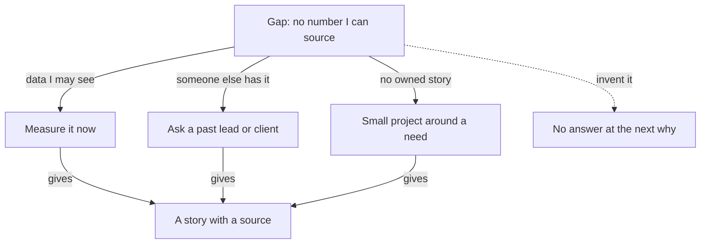

## Three lines in a notebook

Tala has three lines in her notes. The tag she keeps is unsupported number. The card line she questions is "strong impact". The gap is a number she can source. She has twenty minutes before work, and she must turn those three lines into actions.

She could believe the card, because it was kind to her. She could ignore the card, because one line was wrong. Or she could do the slower thing: tag, compare, check each line, then act on what survives. This chapter teaches the slower thing in four steps, then shows how to fill the gap it finds.

## Four steps for reading a card

Feedback from a practice interview is evidence. It is not a verdict. A verdict says what you are. Evidence says what someone saw, and it can be right or wrong. Your words are in the transcript, so you can check any claim about them yourself. You met this as the evidence check in 7.1. Here are the four steps.

**Step 1: tag first.** Before you open the card, read your transcript and tag your own answers with the five flag names from 7.1. Write the flag, then your own words in quotes. Tag first, so that the card does not decide what you see. On the written path, tag your six written answers in the same way.

**Step 2: read the card and compare.** The card has strengths, weaknesses with a fix each, notes for each area and three next steps. Where a card line and one of your tags say the same thing, act on it. Where the card makes a claim that your tags do not show, run the evidence check: find your own words, then keep the line or question it. On the written path, your mentor's one or two follow-up questions play the part of the card.

**Step 3: compare across interviews.** Put your tags from your first and your latest interview next to each other. Because you use the same five names each time, you can see which problems went away, which stayed and which are new. Compare the same kind of question. A shorter list of tags can also mean an easier question.

**Step 4: find the gap and fill it.** Look at your story bank, the set of stories that you have been building since module 1. Ask what it cannot show yet. Then plan an honest way to fill that gap, with a step and a date.

## What the tools are known to do

People who build and test AI tools have found that these tools tend to agree with the person they talk to, and that they tend to like long answers. This is the reason for step 2. The practice interviewer is set up to score what an answer contains, and to prefer "I did not measure that" to a number with no source. That reduces the problem. It does not remove it.

You are also a reader to be careful about. Most of us are not very accurate judges of our own skills, and that includes how we judge our own answers. So tagging yourself first is not enough alone. It gives you a second view to put beside the card, and your mentor gives a third. Where two of the three agree, you can act. Where they differ, look at the words. Before you step through the canvas, make one prediction.

```predict
prompt: "At the end of the canvas, Tala asks her lead if she may count failed bookings. Suppose her lead says no. What should Tala say in an interview about her crash claim?"
options:
  - id: dashboard
    label: "About a third fewer crashes, from the app's dashboard in March"
  - id: not-measured
    label: "I did not measure that. I would first count the failed bookings."
correctOptionId: not-measured
explanation: "Tala cannot source the dashboard claim, and her lead did not allow a count. The honest answer says what she did not measure and what she would measure. The story itself is strong because of her own decision, so she keeps it."
```

The canvas follows Tala's card from her tags to a plan. At every question, answer in your own words before you press Next. The last step shows where an honest gap ends up.

<InteractiveCanvas slug="feedback-to-next-project" />

This canvas uses one card and one story, so a real card will have more lines to check. Start by deciding, before step 4, whether Tala's words support the praise. If your tags and the card ever disagree and you cannot settle it from the words, ask your mentor.

## A different case: Fares and the bus route sheet

Fares is 28 and works as an operations assistant at a small school. He keeps the bus route sheet that tells each driver which streets to visit in which order. After his practice interview, he tags his own answers. In his second answer, he said: "Whenever a route had a mistake, I would walk it and fix the sheet." He tags it pseudo-story. His words are "whenever" and "I would", and the answer has no day, no street and no result. He also tags the third answer, vague ownership, because it said "we planned the new routes" and never said which part was his.

Then he opens the card. The card has a weakness: "Your answer on the new routes had no number. Fix: say how many drivers or minutes changed." That matches nothing in his tags, but his words support it, so he keeps it. The card also has a strength: "Strong ownership. You led the route project." He searches his transcript. His words were: "I helped the head teacher with the sheet. She chose the streets." He did not lead the project. The line is not supported, and he marks it for his mentor. Notice that the card missed his pseudo-story, and his tags missed the missing number. Each source found something the other did not.

That is the reason to use both. Fares then compares with his first interview, where he had tagged four. Now he has two, and his words explain why: in his other answers he now names one day and one street. Then he looks for a gap. His best story, the new route order, has no number at all. He asks the head teacher if he may time how long route planning takes for five weeks with the old order and five with the new. Fares did not copy the card's praise into his plan. A fellow who had done that would have said "I led the route project" in a real interview, and the founder's "what was your part?" would have shown it was untrue.

## Filling a gap honestly

A gap is something your story bank cannot show yet. A common gap is an impact number you can source. Another is a story that you owned from the problem to after it was released to users. There are three honest ways to fill a gap, and one dishonest way that fails at the next why.

The first way is to measure something you can measure now. Tala can ask her lead for permission to count failed bookings in the logs, four weeks before and four weeks after the offline mode. She uses only data she is allowed to see, she writes each number with its source, and she never pastes private data into the AI interviewer. This is the method from chapter 2.3.

The second way is to ask a past lead or client for a fact. A short message is enough: "Do you remember roughly how many bookings failed each week before the offline mode? I am preparing for interviews." Write down the answer with the person's role and the date. If they say no or do not know, that is also an honest answer.

The third way is for fellows who have no story they owned from end to end. Build a small project around a real need of your own or of people near you, and own it from the problem to after it is released. Chapter 1.3 called this the whole path: you noticed it, decided, built, released and checked after. The course does not choose the project for you, because a story is stronger when the need is really yours. It gives you three questions. What do you or people near you do by hand every week? What breaks? What would you check first to know it worked?

Mustafa, a student, answers these for himself. His study group of eight shares notes in a chat, and every week someone asks where the latest notes are. He counted the questions for three weeks: 5, 6 and 4. He built a one-page index of the notes, and counted again for three weeks. His answers are his own. Yours will be different, and that is the point. If none of the three ways works for you today, the fallback is always honest: "I did not measure that. Here is what I would measure, and how."

The diagram shows the paths from one gap. Look at the paths that lead to a story with a source, and at the one that does not.



What to notice: three paths end at the same place, a story you can defend with a source. The dotted path is the tempting one. If you invent a number to fill the gap, the founder's next "how do you know?" has no honest answer. An honest gap with a plan is stronger than an invented number.

## A card that only said nice things

Ola is a final-year student. After her first practice interview, she read the card once. It said "great answer" in two places and "clear ownership" in a third. She felt good and changed nothing. She did not tag her answers, and she did not search for her own words. Her answers said "we" in almost every sentence, because her four stories were team projects where she did one task in the middle.

The real test came in a call with a founder, who asked "What was your part?" three times. Her answers were the same as in the practice interview, because she had changed nothing. A card cannot do the work of reading it. This is why step 1 comes before the card, and why the card is only one of three views.

## Do it today with your last card

Open your most recent transcript. Tag your answers with the five flag names, with your own words in quotes, before you open the card. If you have no practice interview yet, use Tala's two transcripts from 7.1. Compare your tags with the card, and pick one card line to question and one to act on. Then list your stories on one page and mark the gap in each: no number, no source or no owned end. Choose one gap, one of the three honest ways, and a date.

## Check your understanding

```quiz
type: mcq
question: "Shahd is a data assistant at a pharmacy. After a practice interview, her card says in a weakness: 'You gave two different reasons for choosing a weekly sales sheet.' She tagged nothing like that. The card quotes only her last answer: 'The owner asked for a weekly sheet.' The transcript is open on her phone. What should she do first?"
options:
  - "Find her earlier answers and compare her actual words"
  - "Accept the line, since the card saw the whole transcript"
  - "Reject the line, since her own tags did not show it"
  - "Start a new interview, so the card is made again"
correct: 0
explanations:
  - "Right. The line is about two answers, and the card quotes only the last. She searches for the earlier answer, reads both in her own words, and then keeps the line or questions it."
  - "The card did see the whole transcript, but it can be wrong. The line is a claim about two answers, and she has only seen one of them. She needs to read both."
  - "Her tags can miss things, as the card can. Fares's tags missed a missing number that his card found. A line that her tags do not show still needs a check."
  - "A new interview makes a new transcript and a new card. It does not tell her whether this line is right. The words are already there to check."
```

```quiz
type: mcq
question: "Ola is a final-year student. Her story bank has four stories. All are team projects, and in each one she did one task in the middle, such as testing. Her card says she has no story she owned from the problem to after it was released. She has three weeks and no job. Which plan fits?"
options:
  - "Tell the team project she knows best as if she had led the whole team"
  - "Finish a tutorial project and describe what it built in her answers"
  - "Find a real need near her, then build, release and check a small fix there"
  - "Wait for a first job, then collect the stories that she needs from it"
correct: 2
explanations:
  - "She did one task in the middle of each project. Saying she led one would claim ownership she did not have, and 'what was your part?' would show that it was untrue."
  - "A tutorial has no real need, no decision of hers and no 'after' to check. It gives her something to show, but not a story she owned."
  - "Right. A small fix for a real need lets her own the whole path, from noticing to checking after. Three weeks is enough for something small."
  - "She has three weeks and no job. Waiting leaves the gap open when the interview comes, and she can start a small project today."
```

If the gap you found is a project, the course "Your Career Brand: Proof of Work, Resume, LinkedIn and Writing" helps you choose and plan it: module 4 covers what still counts when building is fast, a filter for project ideas and where open source fits, and how to plan the work with a time box. This course does not choose the project for you; that course gives you a filter to test your own idea for real use.

**Next:** A mixed review: five fresh answers from all six modules, and the one quality missing from each.
