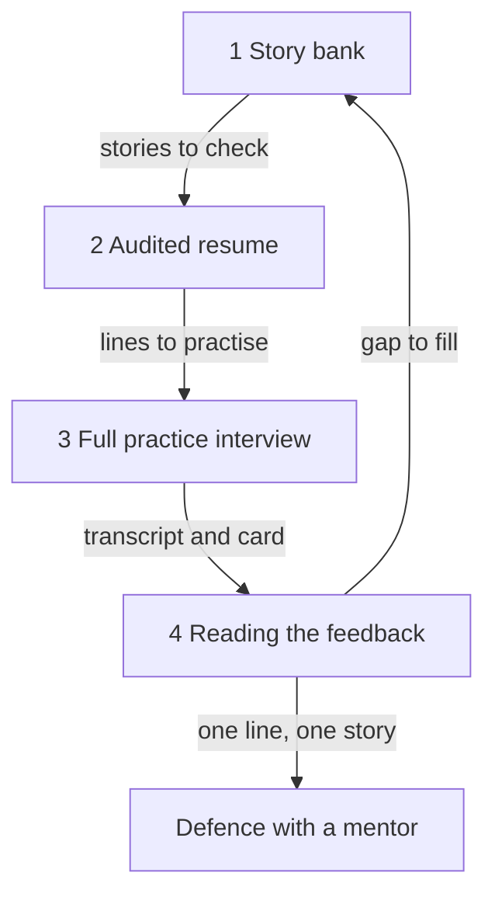

## Your turn

Layla is 27. She coordinates the work of a translation agency with five people. Over six weeks she has done several practice interviews, and she has notes in six different places: a resume file, three feedback cards, a page of story ideas and a message to herself. Today she wants all of it in one place. She has about 80 minutes and a phone with a slow connection.

This is the capstone of the course. You will build four things and use everything from modules 1 to 7. Plan about 80 minutes: 20 for your story bank, 15 for your resume, 20 for the full practice interview, 15 for reading the feedback and 10 to write it up. You do not need to finish in one sitting. If your power or your data stops during the interview, open the page again. A running interview is saved and continues where you stopped.

## The four parts

1. **The story bank.** Five owned stories, one short paragraph each: the time, your part, the decision, the number with its source or the honest gap, and what you would change. At least one is your best technical work, in both versions. At least one shows a weakness and what you did about it.
2. **The audited resume.** Check each line: what you did, why, the result and how you know. Rewrite the two weakest lines, and keep both the old and the new line.
3. **One full practice interview.** The AI interview below, or the written version for anyone without a key.
4. **Reading the feedback.** Which flags appeared, one you agree with and what you will change, one you question and why, and one gap in your story bank with a plan to fill it.

The four parts depend on each other. Your stories decide which resume lines you can defend. Your resume lines decide what the interviewer asks about. The interview gives you a transcript and a card. The evidence check on that card shows you a gap, and the gap sends you back to the story bank. After you submit, your mentor picks one line and one story from this loop and asks four whys on each. The diagram shows the loop and where the defence sits.



What to notice: the arrow from part 4 goes back to part 1. The capstone is not a straight line, and a gap you find is a good result, not a failure. Read the loop as a rule: every part must be something you could say aloud and defend.

## Worked example: Layla

Layla's first story is the one she owned most completely. In the job sheet for her agency, she saw that 12 of 60 jobs in eight weeks went to clients after the due time. She had three options: ask translators to start earlier, send a daily reminder, or build a job sheet with a due time for each step and a colour for late rows. Reminders had been tried before and ignored, so she chose the sheet. In the next eight weeks, 6 of 60 jobs were late. The source is the agency's job sheet, with its due time and sent time columns. Her share needs care. In the same period, the owner stopped taking rush jobs, and 4 of the 12 late jobs before were rush jobs. Without them, 8 of 56 were late before, about 14 percent, against 10 percent after. So Layla claims about 4 points, not the 10. What she would change: ask the translators before adding the colours, because two of them found the sheet confusing in the first week.

That one paragraph holds all five features of a story: one time, her part, a decision, a sourced number with her share, and a change. Her other four stories are shorter. One is the sheet itself, as her best technical work, with a founder version and an engineer version. One is training two new freelancers, where she says: I did not measure how fast they learned, and I would compare their errors in the first week. One is a weakness: she underestimates how long testing takes, and she now plans twice her first guess. The last is a strength with evidence: she turns unclear client requests into a one-line brief, and a translator once said the brief saved a call.

Now her resume. The old line said, "Built a file workflow for a translation agency; late deliveries fell by half." Under the next why, "workflow" means nothing exact and "half" has no base. The new line says, "Built a job sheet with due times for a five-person translation agency; late jobs fell from 12 of 60 to 6 of 60 over eight weeks each." The second weak line was "Trained new freelancers", which she rewrote to say how many and what she taught.

Then she ran the interview. Her card had two flags. The first was jargon without explanation: she had said "conditional formatting" to a founder without saying what it does. She agreed, and she will say "the sheet turns a row red when its due time has passed". The second was pseudo-story, on her weakness answer. She did an evidence check. Her words were: "One Friday in March, I planned a day for the colour check and it took three." That names a time, so the flag is not supported. She questioned it and marked it for her mentor. Her gap was in the best technical story: she never measured the time the sheet saves. Her plan is to ask the owner if she may time five jobs with the sheet and five without, next week. If the owner says no, she will say: I did not measure that, and here is how I would.

Notice what Layla did not do. She did not round a number up, she did not claim the owner's decision, and she did not hide the rush jobs. Each of those would have broken at a second why. Also notice that her story bank came before the interview. She went into the interview already knowing which five stories she would lead with.

## Choose your material

You can use your own resume and stories, or Hadeel's. Hadeel is a fictional frontend developer who is applying to small remote teams. Her material is below, so nobody has to share a real resume. Choosing Hadeel's material is not an easier path. You still do all four parts, and her feedback has a mistake that you must find.

If you use your own material, remove names before you paste anything into the interviewer. Do not paste your full name, phone, email, address, ID numbers, client or employer names, passwords, keys or private company data. Use roles, such as "a logistics client" or "my team lead". Paste only the resume lines you want to practise. Ask your lead before you count anything in a system you are not sure you may read.

## Hadeel's material

Hadeel is 24. She did a six-month remote internship with a five-person team (the founder, two developers, a designer and a part-time support person) building a clinic booking web app used by 6 small clinics. Then she did four months of freelance work and some volunteer teaching. Here is her resume.

| Line | Text |
|---|---|
| A | Built the patient booking page of a clinic booking app used by 6 clinics. |
| B | Added text-message reminders; missed appointments fell from 18 percent to 11 percent. |
| C | Cut the booking page's load time from about 6 seconds to about 2 seconds on a low-cost phone. |
| D | Improved team productivity with better processes. |
| Freelance | Built an online order form and a stock sheet for a family bakery. |
| Volunteer | Taught basic spreadsheet skills to 12 students at a community centre, in 8 weekly sessions. |

She ran a full practice interview with the AI interviewer. It was shortened to eight exchanges here. "I" is the interviewer and "H" is Hadeel.

> **1. I:** Tell me about one piece of work you owned from start to finish. What was the problem, and what was your part?
>
> **H:** At my internship I built the booking page for a clinic app used by 6 clinics. I built it from the designer's screens. At one clinic I watched three patients struggle with one long form on a phone. I proposed splitting it into three short steps, and the designer agreed. The backend and the clinic dashboard were built by others.

> **2. I:** Why three steps and not a shorter form?
>
> **H:** The three patients each stopped at the long form and asked the receptionist for help. I did not test other options. I did not measure whether more patients finished the form after the change. I would ask the other developer if the booking records show how many started and how many finished.

> **3. I:** Your resume says missed appointments fell from 18 percent to 11 percent. What was your part, and where does that number come from?
>
> **H:** The founder decided to add reminders. I built them and chose to send them at 18:00 the day before, not the morning of the visit, because the clinics said many patients missed early slots. The other developer chose the text-message service. The numbers come from the clinics' booking records. The other developer and I counted missed appointments out of all appointments, two months before and two months after.

> **4. I:** Was it only the reminders?
>
> **H:** No. In the second month, two of the six clinics also started phoning patients. In the four clinics that did not phone, missed appointments fell from 18 percent to 12 percent. So I say about 6 points in the clinics that only had reminders. Two months is short, so I treat it as a good sign, not proof.

> **5. I:** What is the best technical thing you have done? Explain it first the way you would to a founder who does not write code.
>
> **H:** The booking page took about 6 seconds to load on our cheapest test phone, on a slow connection. I made the clinic photos smaller and lazy-loaded them, and I cached the clinic list in the browser for one hour. Now it takes about 2 seconds. I loaded the page 10 times before and 10 times after, and I report the middle value.

> **6. I:** Why not rewrite the page with another framework? And what happens if a clinic changes its hours?
>
> **H:** A rewrite would take about two weeks, and the fix took two days. The problem was mostly the images. The saved list can show old hours for up to an hour. Once, a patient booked a slot after a clinic had closed early. The backend developer and I added a check at booking time on the server.

> **7. I:** Tell me about the bakery work. What changed because of it?
>
> **H:** I built an online order form and a stock sheet for a family bakery, over four months. The owner told me phone calls at busy times dropped. That is the owner's words, not a number. I did not count orders. I would count form orders and phone orders for two weeks.

> **8. I:** What is one real weakness, and what do you do about it?
>
> **H:** I wait too long before I ask for help. I once spent two days stuck on a time-zone bug in the booking form. The backend developer found it in an hour. Now, after two hours stuck, I write down what I tried and I ask. I did this on the bakery work.

This is the feedback card the interviewer produced.

> **Strengths**
> 1. Ownership is clear. "I proposed splitting it into three short steps" and "the backend and the clinic dashboard were built by others" separate your part from the team's.
> 2. Strong impact. "Missed appointments fell from 18 percent to 11 percent" is a clear result from booking records. Lead with it.
> 3. Honest gaps. "I did not measure whether more patients finished the form" and "I did not count orders" each came with a plan.
>
> **Weaknesses, each with a fix**
> 1. Jargon without explanation: "lazy-loaded" and "cached" in your founder version. Fix: say "loaded the photos after the form" and "kept the list in the browser for an hour".
> 2. The weakness answer has one example. Fix: add a second example, or say what changed after you started the two-hour rule.
> 3. The case question was not reached. Fix: ask for one next time.
>
> **Flags:** jargon without explanation (once, in answer 5).
>
> **Next steps:** 1. Rewrite the founder version of line C in plain words. 2. Practise a case question. 3. Add a strength story.

Read the card with an evidence check before you move on. The provided card contains one mistake, as real cards sometimes do. Your task in part 4 is to find it with Hadeel's own words, and to say what the card should have said.

## Part 3: the full practice interview

The interviewer asks one opening question, follows your answer with "why" and "how do you know", and then moves to another area. In this capstone it covers all eight focus areas, up to 20 answers, with your resume as context. It ends with strengths, weaknesses with a fix each, and next steps. Answer as you would in a real interview. "I did not measure that" and "that was not my decision" are good answers. The feedback is practice, not a hiring decision, and it can be wrong. If you do not have a key, the written version below completes this part.

Before you start, the privacy line: use roles, not names, and paste only resume lines with names removed.

```aiinterview
title: "Full practice interview"
opening: "Tell me about one piece of work you owned from start to finish. What was the problem, what was your part, and what changed because of it?"
focus: [ownership, impact, five-whys, resume, best-technical, storytelling, case-study, strengths-weaknesses]
context: resume
maxTurns: 20
whyDepth: 3
required: false
rubric: "A strong interview shows five qualities: one real time, not what the learner usually does; the learner's own part, I for their work and we for the team; a decision with options and what mattered then; an honest number (before, after, time window, source, own share) or a plain 'I did not measure that' with how they would; and the real reason they had at the time, including 'that was not my decision'. For a case question look for clarifying questions, spoken assumptions, two or three options, one choice and the number to watch. For technical work look for a short founder version first and an engineer version on request. Probes: if an answer describes habits, ask for one specific time. If it says we, ask 'What was your part?'. After any number ask 'How do you know?' or 'Where does that number come from?'. On technical answers ask 'Why this and not another way?' and 'What happens if it fails?'. Stop rules: accept 'I did not measure that', 'I don't know' and 'that was not my decision' as full answers, reply briefly, ask what they would do or measure next, and never push for a guessed number or an invented example. Score features, not length; an honest gap with a plan beats an unsourced number; quote the learner's words. Use these flags by name: vague ownership, unsupported number, pseudo-story, invented reason risk (a reason that appears only after probing and contradicts an earlier answer), jargon without explanation. Be kind and direct, about the answer and not the person. When evidence is thin, suggest how the learner could get it, such as a small project built around a need of their own."
```

**The written version.** Answer these six questions, one for each of modules 1 to 6. For each, also write the two follow-up whys you expect and your answers to them. Use roles, not names.

1. Tell me about one piece of work you owned from start to finish. What was your part?
2. Pick one piece of work that made a difference. What changed because of it, and how do you know?
3. Pick the line on your resume you are proudest of. Why did you do it that way?
4. A small online shop got 450 orders a month. Last month it got 300. The shop also raised its delivery fee last month. You start next week. What would you do?
5. What is the best technical thing you have done? Explain it first to a founder, then to an engineer.
6. What is one real strength you bring, with an example, and one real weakness, with what you are doing about it?

You can add one optional step if you have a friend or a mentor. Practise two of your answers aloud with them. Text practice trains the content and the structure of an answer, but it does not train your pace or your voice. Ask your listener one thing only: did they understand the answer the first time?

## Part 4: reading the feedback

Use the four steps from 7.2. For each line on your card, find your own words. Keep what they support and question what they do not. Compare the flags with your earlier cards if you have them. Then name one gap and one honest way to fill it, with a step and a date. If you are using Hadeel's material, you are reading the card above, and it holds one mistake that you must find.

## How your mentor will read it

Your mentor uses the table below. Two fellows can submit different stories and both be Met, as long as each claim has its source or its honest gap.

| Line | Met | Partly | Not yet |
|---|---|---|---|
| 1. Story bank | Five full stories; best technical work in both versions; one weakness story | Five stories, but one or more is missing a part, or only one technical version | Fewer than five, or stories that describe habits |
| 2. Audited resume | Two weakest lines, old and new; each new line has a sourced result or says plainly what you did | Two lines rewritten, but a new line still has an unsourced number or a vague verb | No rewrite, or a new line that adds an invented claim |
| 3. Practice interview | The AI interview was run, or all six written answers are there with two expected whys each | Four or five written answers, or no expected whys | Fewer than four answers |
| 4. Reading the feedback | One flag kept and one line questioned, each with your words; one gap with a step and a date | Flags named without quotes, or no plan | The feedback is copied or rejected without a check |

**Pass rule:** your work passes when no line is "Not yet" and lines 1 and 4 are both "Met".

## Your five-minute defence

After you submit, your mentor picks one resume line and one story and asks four whys on each. They do this in about five minutes, in writing or aloud. Prepare short answers to these five questions before you meet.

| Defence question | A good answer |
|---|---|
| Which part of this was yours alone? | Separates your work from the team's in one or two sentences |
| Where does that number come from? | Gives the source, the window and your share, or says plainly that you did not measure it |
| Why that option and not the other? | Names the other option and what mattered at the time, including "my lead asked" |
| What would you do differently? | Gives one concrete change |
| What did the feedback get wrong? | Quotes your words, names the line, and says what the card should have said |

The questions are not traps. They are what a founder would ask. If your answer does not pass yet, your mentor replies with one or two questions about the weakest line, and you answer them in writing or in a voice note.

## Submit your capstone

Write the four parts in order, with a short heading for each. Say whether you used your own material or Hadeel's, and whether you ran the AI interview or the written version. If writing is hard today, add a voice note link and keep the written part shorter, as long as it covers all four parts.

```openquestion
prompt: "Submit four parts, and say whether you used your own material or Hadeel's. 1. Story bank: five stories, one short paragraph each, with the time, your part, the decision, the number with its source or the honest gap, and what you would change. Include your best technical work in both versions and one weakness story. 2. Audited resume: your two weakest lines, with the old and the new line. 3. Practice interview: say whether you used the AI interview or the written version, and give the three answers you would most want your mentor to read. 4. Reading the feedback: which flags appeared, one you agree with and what you will change, one you question and why with your own words as evidence, and one gap in your story bank with a plan."
required: true
minWords: 250
allowSpeechInput: true
allowUrl: true
urlRequired: false
urlLabel: "Voice note link (optional)"
urlHint: "An audio link your mentor can open without signing in. Audio only is fine."
modelAnswer: "Mentor key for Hadeel. Story bank (accept any five of these, in the learner's words). A, the booking page: her part is building the page and proposing three short steps; the designer agreed; the backend and dashboard were others'. Honest gap: she did not measure form completion; plan to ask the other developer whether the booking records show started and finished forms. B, the reminders: the founder decided, she built them and chose 18:00 the day before because clinics said many patients missed early slots, the other developer chose the text-message service; numbers from the clinics' booking records, two months before and after; attribution: two of six clinics also phoned patients, so in the four that did not, 18 to 12 percent, about 6 points; two months is a hint, not proof. C, the best technical work: founder version is about 6 seconds to about 2 seconds on the cheapest test phone, smaller photos loaded after the form, the clinic list kept in the browser for an hour, measured with 10 loads before and after, middle value; engineer version covers a rewrite versus a two-day fix (two weeks against two days, mostly images), the stale hours risk of up to an hour, one patient who booked after an early closing, and the server check at booking time. Bakery: honest gap, the owner said phone calls dropped at busy times, she did not count orders, plan to count form orders and phone orders for two weeks. Weakness: she waits too long to ask for help; two days on a time-zone bug that the backend developer found in an hour; plan: after two hours stuck, write down what she tried and ask; she has done this on the bakery work. Two weakest lines: D, 'Improved team productivity with better processes', becomes 'Wrote a short test checklist we used before each release for my last three months'; B becomes something like 'Built text-message reminders for 6 clinics; missed appointments fell from 18 to 11 percent (18 to 12 percent in the 4 clinics with reminders only)', because the original line claims the whole change. The feedback's mistake: strength 2 calls the 18 to 11 percent result strong and tells her to lead with it, but her own answer 4 says two clinics also phoned patients, that the clearer figure is about 6 points in four clinics, and that two months is short. The card should have credited the attribution and told her to lead with the 6 points. Also accept as a reading: she agrees with the jargon flag and will say 'loaded the photos after the form'; she also names a gap, such as no completion number for line A. Do not accept: copying the card, saying the AI is wrong with no quote, ignoring the attribution, or inventing a number to fill a gap. Model answer for a different fellow, Layla (operations coordinator, translation agency). Story 1: in eight weeks 12 of 60 jobs went to clients late; I chose a job sheet with due times over reminders, which had been ignored; the next eight weeks 6 of 60 were late, from the agency's job sheet; the owner also stopped rush jobs, and without the 4 rush jobs it was 8 of 56 before against 6 of 60 after, about 4 points; I would ask translators before adding colours. Stories 2 to 5: training two freelancers (I did not measure how fast they learned; I would compare first-week errors); the sheet as best technical work with a founder and an engineer version; a testing-time weakness with a plan to plan twice my first guess; a one-line client brief as a strength. Resume: 'Built a file workflow for a translation agency; late deliveries fell by half' becomes 'Built a job sheet with due times for a five-person translation agency; late jobs fell from 12 of 60 to 6 of 60 over eight weeks each'. Feedback: I agree with the jargon flag and will say 'the sheet turns a row red when its due time has passed'. I question the pseudo-story flag on my weakness answer because I said 'One Friday in March, I planned a day for the colour check and it took three'. Gap: I never measured the time the sheet saves; I will ask the owner to let me time five jobs with the sheet and five without."
```

**Next:** The course checklist, your interview kit, and your plan for the next interview.
