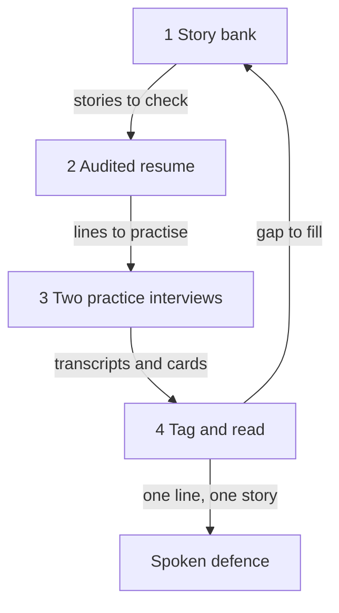

## Your turn

Layla is 31. She coordinates the jobs of a bicycle repair workshop with six people. Over three weeks she has done four practice interviews, and she has notes in six places: a resume file, three feedback cards, a page of story ideas and a message to herself. Today she wants all of it in one place. She has two hours and a phone with a slow connection.

This is the capstone of the course. Plan about 120 minutes: 15 to add your fifth story and gather your bank, 15 for your resume, 40 for two practice interviews, 25 to tag your answers and read the feedback, 15 to write it up, and 10 to say your defence aloud once. You do not need to finish in one sitting. If your power or your data stops during an interview, open the page again. A running interview is saved and continues where you stopped.

## What your mentor reads

Four parts build the work, and two more things are checked across all of them.

1. **The story bank.** Five owned stories, one short paragraph each: the time, your part, the decision, the number with its source or the honest gap, and what you would change. You already wrote four in the gates: story 1 in gate 1, story 2 in gate 2, your technical story in both versions in gate 5, and a weakness story in gate 6. Today you write the fifth, and you tidy the other four. If a slot is empty, fill it now.
2. **The audited resume.** Check each line: what you did, why, the result and how you know. Rewrite the two weakest lines, and keep both the old and the new line.
3. **Two practice interviews,** or their written version.
4. **Tag and read.** Tag your own answers with the five flag names, then read the feedback against them.
5. **Your own work.** At least two of the five stories and the resume audit must be yours. Study, volunteer, freelance and family business work all count.
6. **A spoken defence.** After you submit, your mentor picks one of your own resume lines and one story, and asks four whys on each, live.

The parts depend on each other. Your stories decide which resume lines you can defend. Your resume lines decide what the interviewer asks about. The interviews give you transcripts and cards. Your tags and the evidence check on those cards show you a gap, and the gap sends you back to the story bank. The diagram shows the loop, and where the defence sits.



What to notice: the arrow from part 4 goes back to part 1. The capstone is not a straight line, and a gap that you find is a good result, not a failure. Read the loop as a rule: every part must be something you could say aloud and defend.

## Worked example: Layla

Layla's first story is the one she owned most completely. In the workshop's job sheet she saw that 12 of 60 jobs in eight weeks were ready after the time promised to the customer. She had three options: ask the mechanics to work faster, send a daily reminder, or build a job sheet with a promised time for each job and a colour for jobs close to their time. Reminders had been tried before and ignored, and she did not want to blame the mechanics, so she chose the sheet. In the next eight weeks, 6 of 60 jobs were late. The source is the workshop's job sheet, with its promised time and ready time columns.

Her share needs care, because the jobs changed. In the first eight weeks, 6 of the 60 jobs were same-day rush jobs, and 4 of those were late. Of the 54 other jobs, 8 were late, about 15 percent. In the next eight weeks the owner stopped taking rush jobs, and 6 of 60 jobs were late, 10 percent. So Layla claims about 5 points, not 10, and she says that the mix of jobs changed. What she would change: ask the mechanics before adding the colours, because two of them found the sheet confusing in the first week.

That paragraph has all five features of a story: one time, her part, a decision, a sourced number with her share, and a change. Her other four stories are shorter. One is training two new helpers, where she says: I did not measure how fast they learned, and I would compare their mistakes in the first week. One is the colour rules in the sheet as her best technical work, with a founder version and an engineer version. One is a weakness: she underestimates how long testing takes, and she now plans twice her first guess. The last is her new fifth story, a strength: she turns unclear customer requests into a one-line job note, and a mechanic once said the note saved a phone call.

Now her resume. The old line said, "Built a job system for a bicycle workshop; late jobs fell by half." Under the next why, "job system" means nothing exact, and "half" has no base. The new line says, "Built a job sheet with promised times for a six-person bicycle workshop; late jobs fell from 12 of 60 to 6 of 60 over eight weeks each." Her second weak line was "Trained new helpers", which she rewrote to say how many and what she taught.

Then she ran her two interviews and tagged her own answers before she opened either card. In the first, she tagged unsupported number: she had said "late jobs fell by half" before giving the counts. The card had a weakness that said the same thing, so she acts on it. In the second, she tagged jargon without explanation: she had said "conditional formatting" to a founder without saying what it does. The card did not mention it, so her tag found something that the card missed. She will say "the sheet turns a row red when its promised time has passed".

The card also said, "Your weakness answer describes a habit, not one time." She did an evidence check. Her words were: "One Friday in March, I planned a day for the colour rules and it took three." That names a time, so the line is not supported. She questioned it and marked it for her mentor. Her gap was in the technical story: she never measured the time the sheet saves. She will ask the owner if she may time five jobs with the sheet and five without, next week. If the owner says no, she will say: I did not measure that, and here is how I would.

Notice what Layla did not do. She did not round a number up, she did not claim the owner's decision, and she did not hide the rush jobs. Each of those has no honest answer at a second why.

## Your own work, and Hadeel

Use your own stories and your own resume. At least two of the five stories and the resume audit must be yours, and your mentor will run the defence on one of your own lines. If you have no story yet that you owned from the problem to after it was released, follow the path in 7.2 first: find a small need of your own, build a small fix, and check it after.

Hadeel's material is there for practice. You can use it for the stories you do not have, for the cards and the transcripts, and to see what a finished bank looks like. Using her material for a story is fine, as long as you say so. It does not replace your own two stories, your own audit, or your own defence. Hadeel is a fictional fellow whom you met in 1.1. She is 24 and a frontend developer, which means she builds the part of an app that people see and use. Her full resume was shown in 3.6.

If you use your own material, remove names before you paste anything. Do not paste your full name, phone, email, address, ID numbers, client or employer names, passwords, keys or private company data. As 1.1 explained, what you paste goes to the company behind your key, so use roles, such as "a logistics client" or "my team lead". Ask your lead before you count anything in a system you are not sure you may read.

## Hadeel's material

Hadeel did a six-month remote internship with a five-person team (the founder, two developers, a designer and a part-time support person) building a clinic booking web app used by 6 small clinics. Then she did four months of freelance work and some volunteer teaching. Here is her resume.

| Line | Text |
|---|---|
| A | Built the patient booking page of a clinic booking app used by 6 clinics. |
| B | Added text-message reminders; missed appointments fell from 18 percent to 11 percent. |
| C | Cut the booking page's load time from about 6 seconds to about 2 seconds on a low-cost phone. |
| D | Improved team productivity with better processes. |
| Freelance | Built an online order form and a stock sheet for a family bakery. |
| Volunteer | Taught basic spreadsheet skills to 12 students at a community centre, in 8 weekly sessions. |

She ran the two practice interviews of this capstone. Each real interview has 12 answers, three for each of four focus areas. Here they are shortened to the exchanges that matter, and the card for each follows. "I" is the interviewer and "H" is Hadeel.

**Interview 1, "Your stories"** (ownership, impact, five whys, resume):

> **1. I:** Tell me about one piece of work you owned from start to finish. What was the problem, what was your part, and what changed because of it?
>
> **H:** At my internship I built the patient booking page of a clinic booking app. I built it from the designer's screens. On one visit to a clinic near my home, I watched three patients struggle with the one long form on their phones. I proposed splitting it into three short steps, and the designer agreed. The backend and the clinic dashboard were built by others.

> **2. I:** Why three steps and not a shorter form?
>
> **H:** The three patients each stopped at the long form and asked the receptionist for help. I did not test other options. I did not measure whether more patients finished the form after the change. I would ask the other developer if the booking records show how many started and how many finished.

> **3. I:** Your resume says missed appointments fell from 18 percent to 11 percent. What was your part, and where does that number come from?
>
> **H:** The founder decided to add reminders. The other developer built the text-message sending service. I built the reminder rule and the setting screen, and I chose to send at 18:00 the day before, not the morning of the visit, because the clinics said many patients missed early slots. The numbers come from the clinics' booking records. The other developer and I counted missed appointments out of all appointments, two months before and two months after.

> **4. I:** Was it only the reminders?
>
> **H:** No. In the second month, two of the six clinics also started phoning patients. In the four clinics that did not phone, missed appointments fell from 18 percent to 12 percent. So I say about 6 points in the clinics that only had reminders. Two months is short, so I treat it as a good sign, not proof.

> **5. I:** Why 18:00 and not the morning of the visit?
>
> **H:** The clinics told me many patients missed early slots, so a morning text would come too late for them. I did not test 18:00 against other times.

> **6. I:** Your resume says 'Improved team productivity with better processes'. What exactly did you do?
>
> **H:** I wrote a short test checklist that we used before each release, for my last three months. 'Better processes' is too big a phrase for that. I will change the line.

> **7. I:** How do you know the checklist helped?
>
> **H:** I do not know. I did not count mistakes before and after. The checklist is all I can claim.

This is the card for interview 1.

> **Strengths**
> 1. Ownership is clear. "I proposed splitting it into three short steps" and "the backend and the clinic dashboard were built by others" separate your part from the team's.
> 2. Strong impact. "Missed appointments fell from 18 percent to 11 percent" is a clear result from booking records. Lead with it.
> 3. Honest limits. "I did not measure whether more patients finished the form" and "I do not know" each said plainly what was not measured.
>
> **Weaknesses, each with a fix**
> 1. Line D was vague until you were asked. Fix: change the line to say what you did, as you did in your answer.
> 2. The story about the three steps has no number. Fix: ask the other developer for the counts of started and finished forms.
>
> **Notes by area:** ownership, clear. Impact, a sourced result. Five whys, reasons given with their limits. Resume, line D weak.
>
> **Things to watch:** none.
>
> **Next steps:** 1. Rewrite line D. 2. Ask for the form counts. 3. Practise the same answers aloud.

**Interview 2, "Thinking aloud"** (best technical work, a case question, storytelling, strengths and weaknesses). Before it, she pasted about 100 words on the load-time work, with roles instead of names.

> **1. I:** What is the best technical thing you have done? Explain it first the way you would to me, a founder who does not write code.
>
> **H:** The booking page took about 6 seconds to load on our cheapest test phone, on a slow connection. I made the clinic photos smaller and lazy-loaded them, and I cached the clinic list in the browser for one hour. Now it takes about 2 seconds. I loaded the page 10 times before and 10 times after. I put the ten times in order and report the middle one.

> **2. I:** Why not rewrite the page with another framework? And what happens if a clinic changes its hours?
>
> **H:** A rewrite would take about two weeks, and the fix took two days. The problem was mostly the images. The saved list can show old hours for up to an hour. Once, a patient booked a slot after a clinic had closed early. The backend developer and I added a check at booking time on the server.

> **3. I:** A small gym's class booking page got 90 bookings a week. Last week it got 60. The same week the gym moved its classes one hour later. You start next week. What would you do?
>
> **H:** First I would ask if anything else changed, such as the price. I assume most members book on phones and that the later time is the main change. Option one: tell members about the new time. Option two: move classes back for two weeks. Option two is cheaper to test, so I choose it. I watch bookings against 90 a week.

> **4. I:** Tell me about the bakery work. What changed because of it?
>
> **H:** I built an online order form and a stock sheet for a family bakery, over four months. The owner told me phone calls at busy times dropped. That is the owner's words, not a number. I did not count orders. I would count form orders and phone orders for two weeks.

> **5. I:** What is one real strength you bring?
>
> **H:** Finding why a page is slow on a cheap phone. After the booking page, the founder asked me to check the clinic dashboard too.

> **6. I:** And one real weakness?
>
> **H:** I wait too long before I ask for help. I once spent two days stuck on a time-zone bug in the booking form. The backend developer found it in an hour. Now, after two hours stuck, I write down what I tried and I ask. I did this on the bakery work.

This is the card for interview 2.

> **Strengths**
> 1. A plain explanation with a measured result, and the method: 10 loads before and after, and the middle time.
> 2. The case answer asked a question, said an assumption, compared two options, chose one and named a number to watch.
> 3. A real strength with a witness, and a real weakness with a plan that she has used.
>
> **Weaknesses, each with a fix**
> 1. Jargon without explanation: "lazy-loaded" and "cached" in the first answer. Fix: say "loaded the photos after the form" and "kept the list in the browser for an hour".
> 2. The case answer names no target for bookings. Fix: say how many bookings a week would make you keep the change.
>
> **Notes by area:** best technical, plain except two terms. Case, a good shape without a target. Storytelling, two real times. Strengths and weaknesses, both with evidence.
>
> **Things to watch:** jargon without explanation: "lazy-loaded".
>
> **Next steps:** 1. Say the founder version again without the two terms. 2. Add a target to the case answer. 3. Record your answers aloud and listen.

If you use Hadeel's material for part 4, tag her answers yourself, with her words in quotes, and then read both cards against them. Everything on the cards matches the transcripts except one thing. Your task is to find that one mistake with her own words, and to say what the card should have said.

## Part 3: two practice interviews

Each interview asks one opening question, follows your answer with "why" and "how do you know", and then moves to the next area. Each one allows 12 answers, with two follow-up questions for each area, so three answers for each of four areas. Neither interview covers all eight focus areas. Together they do, at three answers each. The interviewer chooses its own case question in interview 2, so it will not be the case in the written version. Each interview ends with a card: strengths, weaknesses with a fix each, notes for each area, "Things to watch" (the flags it found, each with your own words) and three next steps.

Answer as you would in a real interview. "I did not measure that" and "that was not my decision" are good answers. The card is practice, not a hiring decision, and it can be wrong. Before you start, use roles, not names. Interview 1 has two boxes: paste your resume lines in the first and 50 to 150 words about one important piece of work in the second, with names, contact details and client names removed. For interview 2, paste 50 to 150 words about the one story from your bank that you want to explain as technical work, with roles instead of names. If you do not have a key, the written version below completes this part.

```aiinterview
title: "Your stories"
opening: "Tell me about one piece of work you owned from start to finish. What was the problem, what was your part, and what changed because of it?"
focus: [ownership, impact, five-whys, resume]
context: resume-and-project
maxTurns: 12
whyDepth: 2
required: false
rubric: "A strong interview shows these qualities. Ownership: one real time, not what the learner usually does, with I for their own work and we for the team, and the line between them clear. Impact: an honest number (before, after, time window, source, own share) or a plain 'I did not measure that' with how they would. Why chain: a decision with options and what mattered then, and the real reason they had at the time, including 'that was not my decision'. Resume: each line explained as what they did, why, the result and how they know. Probes: if an answer describes habits, ask for one specific time. If it says we, ask 'What was your part?'. After any number ask 'How do you know?' or 'Where does that number come from?'. Stop rules: accept 'I did not measure that', 'I don't know' and 'that was not my decision' as full answers, reply briefly, ask what they would do or measure next, and never push for a guessed number or an invented example. Score features, not length; an honest gap with a plan beats an unsourced number; quote the learner's words. Where they apply, use these flag names: vague ownership, unsupported number, pseudo-story, invented reason risk (a reason that appears only after probing and contradicts an earlier answer), jargon without explanation. Be kind and direct, about the answer and not the person. When evidence is thin, suggest how the learner could get it, for example a small project built around a need of their own."
```

```aiinterview
title: "Thinking aloud"
opening: "What is the best technical thing you have done? Explain it first the way you would to me, a founder who does not write code."
focus: [best-technical, case-study, storytelling, strengths-weaknesses]
context: project
maxTurns: 12
whyDepth: 2
required: false
rubric: "A strong interview shows these qualities. Technical work: a short founder version first (the problem in user terms, what they built in one sentence, the key choice, the result), then an engineer version when asked: why this and not another way, what happens if it fails, how they tested it, what they would change. Words a founder cannot follow are jargon without explanation. Case question: invent one small case about a number that fell after a change; look for one or two clarifying questions, spoken assumptions, two or three real options, one choice, the number to watch with a target, and the point at which they would change course. Storytelling: one real time, with their own part and an honest number or gap. Strengths and weaknesses: a narrow strength with a recent example and what someone else saw; a real weakness with an example and what they do about it. A strength dressed as a weakness is not a real weakness: say so kindly and ask for a real one. Probes: if an answer describes habits, ask for one specific time. If it says we, ask 'What was your part?'. After any number ask 'How do you know?'. Stop rules: accept 'I did not measure that', 'I don't know' and 'that was not my decision' as full answers, reply briefly, and never push for a guessed number or an invented example. Score features, not length; quote the learner's words. Where they apply, use these flag names: vague ownership, unsupported number, pseudo-story, invented reason risk, jargon without explanation. Be kind and direct, about the answer and not the person. When evidence is thin, suggest how the learner could get it."
```

**The written version.** Answer these six questions, one for each of modules 1 to 6. For each, also write the two follow-up whys you expect and your answers to them. Use roles, not names.

1. Tell me about one piece of work you owned from start to finish. What was your part?
2. Pick one piece of work that made a difference. What changed because of it, and how do you know?
3. Pick the line on your resume you are proudest of. Why did you do it that way?
4. A small online shop got 450 orders a month. Last month it got 300. The shop also raised its delivery fee last month. You start next week. What would you do?
5. What is the best technical thing you have done? Explain it first to a founder, then to an engineer.
6. What is one real strength you bring, with an example, and one real weakness, with what you are doing about it?

You can add one optional step if you have a friend or a mentor. Practise two of your answers aloud with them. Text practice trains the content and the structure of an answer, but it does not train your pace or your voice. Ask your listener one thing only: did they understand the answer the first time?

## Part 4: tag and read

Tag your own answers before you read any card. The card's "Things to watch" list can miss a flag or name one your words do not show, and on the written path there is no card. Read your transcript from each interview, or your six written answers, before you open any card. Beside each problem write the flag name and your own words in quotes. Then, on the interview path, read each card and compare. Where a card line and a tag agree, act on it. Where the card makes a claim that your tags do not show, do an evidence check: find your own words, and keep the line or question it. On the written path, your tags are the reading, and your mentor's follow-up questions play the part of the card.

Your write-up has four items: the flags you found in your own answers, with quotes; one that you will act on, and what you will change; one card line or mentor question that you question, and why, with your own words as evidence; and one gap in your story bank, with an honest way to fill it, a step and a date. Both paths can reach Met.

## How your mentor will read it

Your mentor reads six parts. Each part has three levels.

**Part 1: story bank.**
- Met: Five stories with time, your part, decision, number or gap, and change; best technical work in both versions; one weakness.
- Partly: Five stories, but a part is missing in some, or one technical version is missing.
- Not yet: Fewer than five stories, or stories that describe what you usually do.

**Part 2: audited resume.**
- Met: Two weakest lines found, old and new shown; each new line has a sourced result or says plainly what you did.
- Partly: Two lines rewritten, but a new line still has an unsourced number or a vague verb.
- Not yet: No rewrite, or a new line that adds a claim you cannot support.

**Part 3: two practice interviews.**
- Met: Both interviews run, or all six written answers with two expected whys each; the case and the weakness are there.
- Partly: One interview, or four or five written answers, or no expected whys.
- Not yet: Fewer than four answers, or nothing that shows the practice was done.

**Part 4: tag and read.**
- Met: Flags tagged with your quoted words; one to act on; one line questioned with evidence; one gap with step and date.
- Partly: Tags without quotes, or no questioned line, or a gap with no step or date.
- Not yet: A card copied or rejected with no check against your own words.

**Part 5: your own work.**
- Met: At least two stories and the resume audit are yours, and the defence is on one of your lines.
- Partly: Two stories are yours, but the audit comes from Hadeel's material, or the reverse.
- Not yet: Everything comes from Hadeel's material or from another person.

**Part 6: spoken defence.**
- Met: Plain words, one idea per sentence, a pause or a check question used, and the founder version in under a minute.
- Partly: The content is clear, but the sentences are long, or the founder version runs over a minute.
- Not yet: You cannot separate your part from the team's, or you read a script and never check you were understood.

**Pass rule:** your work passes when no part is "Not yet" and at most one part is "Partly".

## Your five-minute defence

After you submit, your mentor picks one of your own resume lines and one of your stories, and asks four whys on each. This is live, by call or voice, and takes about five minutes. Prepare short answers to these five questions before you meet.

| Defence question | A good answer |
|---|---|
| Which part of this was yours alone? | Separates your work from the team's in one or two sentences |
| Where does that number come from? | Gives the source, the window and your share, or says plainly that you did not measure it |
| Why that option and not the other? | Names the other option and what mattered at the time, including "my lead asked" |
| What would you do differently? | Gives one concrete change |
| What did the feedback get wrong? | Quotes your words, names the line, and says what the card should have said |

The questions are not traps. They are what a founder would ask. Say your answers aloud once before you meet, and time your founder version. If your answer does not pass yet, your mentor replies with one or two questions about the weakest part, and you answer them in writing or in a voice note.

## Submit your capstone

Write the parts in order, with a short heading for each. Say which stories and which resume lines are your own and which come from Hadeel's material, and whether you ran the interviews or the written version. If writing is hard today, add a voice note link and keep the written part shorter, as long as it covers all four parts.

```openquestion
prompt: "Submit four parts, and say which items are your own and which are Hadeel's. 1. Story bank: five stories, one short paragraph each, with the time, your part, the decision, the number with its source or the honest gap, and what you would change. Include your best technical work in both versions and one weakness story. At least two stories must be your own. 2. Audited resume: your two weakest lines, with the old and the new line. 3. Practice interviews: say whether you ran the two interviews or the written version. 4. Tag and read: the flags you found in your own answers with your quoted words; one you will act on; one card line or mentor question you question, and why, with your own words; and one gap in your story bank with a step and a date."
required: true
minWords: 600
allowSpeechInput: true
allowUrl: true
urlRequired: false
urlLabel: "Voice note link (optional)"
urlHint: "An audio link your mentor can open without signing in. Audio only is fine."
modelAnswer: "Mentor key for Hadeel. Story bank (accept any five, in the learner's words). A, the booking page: her part is building the page from the designer's screens and proposing three short steps after she watched three patients struggle with the one long form on a visit to a clinic near her home; the designer agreed; the backend and dashboard were others'. Honest gap: she did not measure form completion; plan to ask the other developer whether the booking records show started and finished forms. B, the reminders: the founder decided to add them; the other developer built the text-message sending service; she built the reminder rule and the setting screen and chose 18:00 the day before because clinics said many patients missed early slots; numbers from the clinics' booking records, two months before and after; two of six clinics also phoned patients, so in the four that did not it was 18 to 12 percent, about 6 points; two months is a hint, not proof. C, best technical work: founder version is about 6 seconds to about 2 seconds on the cheapest test phone, photos made smaller and loaded after the form, the clinic list kept in the browser for an hour, measured by 10 loads before and after with the middle time reported; engineer version covers a rewrite against a two-day fix (two weeks against two days, mostly images), the risk of old hours for up to an hour, the patient who booked after an early closing, and the check at booking time on the server. Bakery: honest gap; the owner said phone calls dropped at busy times; she did not count orders; plan to count form orders and phone orders for two weeks. Weakness: she waits too long to ask for help; two days on a time-zone bug that the backend developer found in an hour; plan: after two hours stuck, write down what she tried and ask; done on the bakery work. Two weakest lines: D becomes 'Wrote a short test checklist we used before each release for my last three months'. B becomes 'Built the reminder rule and setting screen for text-message reminders at 6 clinics; missed appointments fell from 18 to 11 percent (18 to 12 percent in the 4 clinics with reminders only)', because the old line claims the whole feature and the whole change. Tags: interview 2, first answer, jargon without explanation ('lazy-loaded', 'cached'); interview 1 has no tag in her answers, and line D was vague on the resume until she explained it. The mistake: on the card for interview 1, strength 2 calls the 18 to 11 percent result strong and says to lead with it, but her own answer 4 says two clinics also phoned patients, that the clearer figure is about 6 points in four clinics, and that two months is short. The card should have credited the attribution and told her to lead with the 6 points. Everything else on both cards matches the transcripts. Gap: no completion number for the three-step form, or no order count for the bakery, with a step and a date. Accept a reading that agrees with the jargon line and questions strength 2 with her quoted words. Do not accept: copying the cards, saying the AI is wrong with no quote, ignoring the attribution, or inventing a number to fill a gap. Partly example: five stories listed, but 'Story 3: I improved team productivity' has no time or part, or tags with no quotes. Not yet example: 'I will practise more and be more confident', with no tags, or a card copied as the reading. Own work: check that at least two stories and the audit are the learner's, and run the defence on one of the learner's lines. Model answer for a different fellow, Layla (coordinator, bicycle repair workshop). Story 1: in eight weeks 12 of 60 jobs were ready after the promised time; I chose a job sheet with promised times over reminders, which had been ignored, and over asking mechanics to work faster; the next eight weeks 6 of 60 were late, from the job sheet. The mix changed: before, 6 of the 60 jobs were rush jobs and 4 of those were late; of the 54 other jobs, 8 were late, about 15 percent; after, there were no rush jobs and 6 of 60 were late, 10 percent. So I claim about 5 points, not 10. I would ask the mechanics before adding colours. Stories 2 to 5: training two new helpers (I did not measure how fast they learned; I would compare first-week mistakes); the colour rules as technical work with a founder and an engineer version; a testing-time weakness with a plan to plan twice my first guess; a one-line job note as a strength. Resume: 'Built a job system for a bicycle workshop; late jobs fell by half' becomes 'Built a job sheet with promised times for a six-person bicycle workshop; late jobs fell from 12 of 60 to 6 of 60 over eight weeks each'. Tags: unsupported number in interview 1 ('late jobs fell by half', before the counts) and jargon in interview 2 ('conditional formatting'). I question the card line that my weakness answer is a habit, because I said 'One Friday in March, I planned a day for the colour rules and it took three'. Gap: I never measured the time the sheet saves; I will ask the owner by Friday to let me time five jobs with the sheet and five without."
```

**Next:** The course checklist, your interview kit, and your plan for the next interview.
