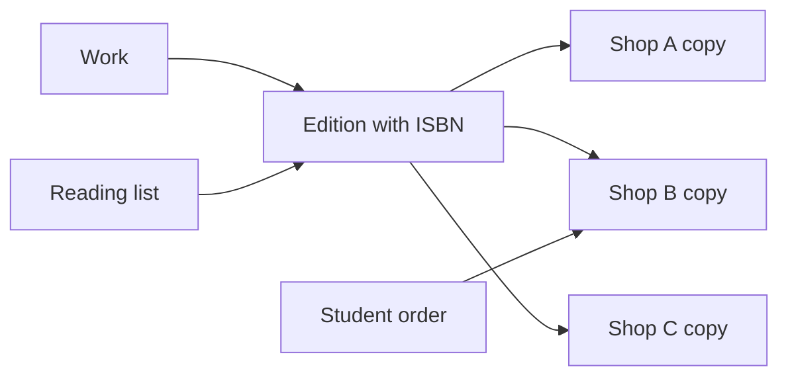

# Build Hamesh, a marketplace for exact editions and used copies

A student needs the edition assigned for a course. Three bookshops have copies of the same edition. One copy is new, one has pencil notes, and one has water damage. Their prices differ, but the title and ISBN describe the same edition. If every shop creates a separate record for the book, a reading-list search misses some copies. If you merge the copies into one product with a stock count, a buyer cannot see which condition they will receive. Hamesh is built around that boundary.

This course teaches you to make a shared catalogue of works and editions, while each bookshop owns its individual listings. A shop enters an ISBN, finds or creates the edition, grades the actual copy, records defects honestly, adds photos and sets a price. A student imports or enters a course reading list. The matcher finds eligible copies across shops, ranks them by edition match, condition and price, and explains why it chose each one. Missing titles become want-list entries. A new eligible listing triggers an alert exactly once per student and copy. Checkout still charges once and creates one order per shop, with immutable snapshots of edition, grade, defects and price.

## Three records, three responsibilities

| Record | Meaning | Who may change it |
|---|---|---|
| Work | The intellectual title and author grouping | Platform process or authorized admin |
| Edition | A specific published edition and format, identified by ISBN where one exists | Shared catalogue workflow; locked for shops once listings use it |
| Listing | One physical copy with grade, defects, photos, shop and price | The owning shop while the copy is available |

That split gives the marketplace a stable place to match a reading-list item and an honest place to describe the item a student will collect. An ISBN identifies an edition and format, not a condition grade or an individual used copy. The listing is the sell-once object. When two buyers try to check out the same listing, one can hold it; the other gets a clear unavailable response and, where possible, a substitute from the same edition. A cached offer summary may help browsing, but checkout checks the database state directly.

Follow the arrows before choosing collections. A reading-list item names the edition it accepts, perhaps a set of acceptable editions. The offer search walks from that edition to available copies. A checkout line chooses one actual copy. The resulting order snapshots the edition and that copy's grade, defects and price. If a shop later changes its listing, the order still explains what the student agreed to buy. Work and Edition are shared catalogue facts; Listing is a shop-owned sale offer.

## The people and the boundary

A student can search, compare copies, make a private reading list, buy and see their own order. A shop owner can open one shop, list and grade its own copies, publish a course reading list if that feature is enabled, and manage pickup. An admin can correct shared catalogue metadata under a logged policy. A shop owner must not change another shop's listing or silently rewrite the shared edition after buyers and reading lists point to it. The course will make these rules concrete in an authorization matrix and two-shop IDOR tests.

Use fictional shop names and books you are permitted to describe in seed data. The core build accepts manual edition entry, so a live external book API is not a dependency. A lookup provider can be a later extension with a cache and manual fallback. The core checkout is pickup at a shop using a collection code; delivery logistics stay out of scope. These constraints keep the build focused on catalogue identity, matching and single-copy integrity.

## The four demos

By the end of Week 1, both apps run and the database shows three shops, shared editions and graded listings. You can draw the Work, Edition and Listing links and explain ownership. By the end of Week 2, a shop enters an ISBN, lists a graded copy with photos, and a student compares that copy with other offers. By the end of Week 3, a reading list finds copies across shops, the student pays once, and the worker sends order notifications. By the end of Week 4, a missing-title alert fires once when a new matching copy appears. A parallel test shows that only one of two students can buy the same copy, and a markdown re-runs matching without inventing another alert.

Your evidence is the code and the observed behaviour: ISBN normalization tests, a unique edition index, an authorization matrix, a two-buyer race test, a query-count comparison, a worker replay test, a live HTTPS URL and a five-minute defense. Start your learning log with two questions. Why does a shop own a listing but not the edition it points to? Why must an order retain the grade and price it showed at checkout even if the shop edits its listing later? Revisit these after the data model and payment modules.

## A worked match before any code

A reading list asks for an exact second edition of a textbook. Shop A has a new copy of the first edition; Shop B has a Good copy of the second edition with highlighting; Shop C has a Very Good copy of the second edition at a higher price. A title-only search might rank Shop A first. Hamesh must reject that mismatch before price or grade is considered. Among the exact-edition copies, a student's grade floor and price ceiling decide eligibility. The matcher should explain why it chose the Good copy or why it left the title unmatched. A student may decide that highlights are acceptable; missing pages are a different defect and should not be hidden behind a single grade.

An ISBN is a useful edition identifier, but the input at a shop counter can be messy. A shop owner may type spaces and hyphens, scan an older ISBN-10, or copy a number with a wrong check digit. The ISBN module normalizes and validates before it looks for the edition. ISBN-10 can be converted to a 978-prefixed ISBN-13 where valid. A 979-prefixed ISBN-13 has no equivalent ISBN-10. Do not shorten it to ten digits to make it fit a form. If the input is invalid, return a field error that helps the shop owner correct it; do not create a second catalogue record under the bad string.

Two shops may enter the same valid ISBN at the same moment. “Look up, then insert” is not enough because both requests can look before either inserts. A unique index on normalized ISBN-13 is the final guard. One request creates the edition. The other reads the winning row after a duplicate-key result, then creates only its own listing. This is a good place to learn why a server-side uniqueness rule is more reliable than a browser warning. A shop's listing still belongs to that shop; the shared Edition does not become its property just because it inserted it first.

The reading list also has a time dimension. An unmatched title goes on a want-list. When a new eligible listing appears, a background job checks standing wants and sends an alert once per student and listing. The alert does not reserve the copy. Another student may reach checkout first. If that happens, the link opens the edition's available offers, where the student can see substitutes or remain on the want-list. A markdown can make a listing eligible under a student's price ceiling, so price changes also trigger matching. Replaying the same job must not send a second alert; a unique alert key is stronger evidence than an in-memory “already sent” flag.

## Keep the core product honest

The core path uses manual edition entry and shop pickup. External metadata lookup, delivery logistics and a recommendation engine are extensions. This constraint matters for a fellow who loses internet while working: the system's own catalogue and seed data still support the full demo. Use real ISBNs only when you can verify the edition details and have rights to any cover image. A generated placeholder cover is preferable to a mislabeled book. For each used copy, take or use a permitted photo of that actual copy, because a publisher cover alone cannot show its defects.

As you build, test the claims a student relies on. Search by ISBN should return the right edition, not just a similar title. Grade filters should use an ordered rank and separate defect flags. A shop should be unable to edit another shop's listing. An order should retain the grade and price seen at checkout. Two buyers should not both pay for one copy. A want-list replay should not send duplicate alerts. These checks tie the data model to the user promise in the opening story.
