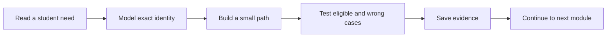

# How to use this course

Hamesh is built in a sequence because a shared book catalogue needs reliable identity before a reading-list matcher can recommend a copy. Work through chapters in order, save a small result after each build, and return to the gate before starting the next dependency. A title search that looks useful can still match the wrong edition. A checkout that looks successful can still sell the same physical copy twice. Gates ask for evidence against those failures, not merely a screenshot of a pleasant page.

A Read chapter introduces product choices and terms. A Learn chapter asks you to trace a mechanism and explain it. A Build chapter gives a bounded coding task. A Check chapter lets you test readiness before a harder dependency. A Gate chapter names the pass condition for a module and asks for a learning log answer, test output or demo. The same Hamesh project continues across them. Do not reset to a new example app at each chapter; later stories depend on the Works, Editions, Listings and student lists already in your database.

## Put one question in the learning log

Create `docs/learning-log.md`. After a lesson, write the question it answered and the record or test that supports the answer. For ISBN validation, record the input, canonical ISBN-13 and accepted or rejected result. For Shop ownership, record a raw wrong-Shop PATCH and the unchanged Listing. For the reading-list matcher, record the accepted Edition IDs, grade floor and price ceiling behind a result. A log entry like "search works" is too broad to help when a student reports a wrong book.

At the end of a session, add the last passing command and next task. A power cut can interrupt a Mongoose migration or a seed. A local Git commit and short note make the state recoverable without internet. Avoid committing real student course lists, bookshop contacts, provider secrets or copyrighted scans. Fictional accounts and publisher-verified bibliographic identifiers are enough to test the model.

## Understand the evidence ladder

A diagram can show intended relationships. A database row can show those relationships are stored. A raw API denial can show a route applies ownership. A concurrent test can show one unique Edition or one last-copy winner under race. Each is stronger evidence for a different claim. A diagram alone cannot prove a unique index exists; one successful listing does not prove two Shops cannot create duplicate Editions at the same time. Match your evidence to the chapter's promise.

Module 5 asks for an ERD and repeatable seed that separates shared Work and Edition from Shop-owned Listing. Module 11 deepens ISBN entry and concurrent shared creation. Module 18 matches reading lists to exact eligible copies. Module 24 watches for a new Listing that satisfies a want entry and sends one durable alert. A gate in one module does not pre-approve the next. Keep the evidence scoped: the seed's sold Listing is a fixture, not proof that a payment webhook has run.

## Practice with a wrong candidate

When a worked example shows a student matching one required print ISBN, vary it. Offer an older edition with a similar title, an Acceptable copy below a Good floor, and a Good copy above a price ceiling. Explain why each is excluded. Then find one copy that qualifies. This practice reveals whether your query checks all dimensions rather than relying on title text. A correct happy match with only one book in the seed is weak evidence.

Later, vary the actor. Shop A may edit its own Listing but not Shop B's, even though both point at the same Edition. Student A may read their own ReadingList but not Student B's. IDs appear on public pages and in URLs; permission comes from stored ownership and authenticated actor, not secrecy of an ID. Put each valid/denied pair in a test file as the route is built.

## Ask for useful review

If stuck, share a concise case: the required ISBN, Listing IDs and grades, expected result, actual query response and relevant index or filter. An instructor can help decide whether the issue is normalization, grade logic or stale cache. A vague "matcher is broken" forces them to reproduce your whole state. Redact private data and use the fictional seed when asking for help. For a checkout race, save both raw responses and the final Listing document rather than only a screen recording.

The next chapter introduces the students, Shops and admin who use these records. Keep asking what each person needs to know and what they must not be able to change. The actor boundaries will guide the first ERD and every later API endpoint.

## Reopen a failed match with evidence

Suppose the page says a ReadingListItem is complete, but the suggested copy has the ISBN of an older edition. Start with the student's accepted Edition IDs. Next inspect the Listing's Edition ID and the query used by the matcher. A title similarity may have entered the result as if it were exact. Record the wrong result and the correct exclusion reason in the learning log. After the query is fixed, keep a regression fixture with the older Edition so the bug cannot return when search or caching is added.

This repair is different from a low-grade case. A correct Edition with an Acceptable copy may be ineligible under a Good floor. The same page might show it as a clearly labelled alternative, but it should not mark the requirement complete. Save the raw result fields that explain why: canonical ISBN, grade rank, price and available state. A screenshot of a title card alone will not show which filter was missing. A mentor reviewing the gate should be able to see the decision in data.

## Use a question that changes the next chapter

At the end of the Work and Edition model lesson, ask what happens when two Shops enter one ISBN at the same time. That question sends you to the unique-index and race test. At the end of the Listing lesson, ask how one physical copy is claimed when two students pay. That sends you to the conditional hold. At the end of the WantList lesson, ask how a worker retry avoids a second alert. That sends you to the alert uniqueness rule. The learning log should connect each question to a later gate rather than become a diary of commands without purpose.

A good entry also states what remains unproved. After seeding one sold Listing, you have a useful display fixture but no evidence of verified payment. After declaring `isbn13` unique in a Mongoose schema, you have an intended index but need to inspect the actual database. After a single successful match, you still need wrong-edition, grade and price cases. This precision keeps the team from using a green page as a substitute for a tested rule.

## Review a returner's path

If you return after a week away, use the last local commit and learning-log line to recover. Run the narrow test that last passed, inspect the database name and seed counts, and then reproduce the one open failure. Do not start by re-running a destructive seed against an unknown database. This matters for Hamesh because duplicate Editions or stale Listing fixtures can make a matcher appear broken even when the query is correct. A short recovery note saves time and protects data.

When sharing with an instructor, include one fixture ISBN and the exact format from its publisher source, one Listing ID, the expected eligibility and the observed response. Redact student details. This packet can be reviewed over a weak connection and makes it possible to distinguish an identity bug from a UI copy problem. The next chapter supplies the people behind those records.
