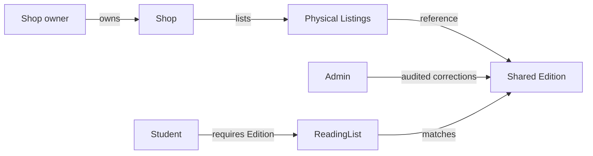

# The product and its people

A student arrives with a reading list and a budget. They need the edition their instructor accepts, then a physical copy whose condition and price work for them. A Shop owner has used and new copies to describe honestly, often several copies of the same ISBN with different wear. A platform admin maintains shared bibliographic records and resolves mistakes that affect everyone. Hamesh connects these people without making one Shop the owner of the shared title or making a student's study plan public.

The arrows have different meanings. The student owns a private list, not an Edition. The Shop owns its Listings, not an Edition. The admin can correct a shared Edition through an audited path, but that role does not make every student list public. A Listing carries one copy's grade, defects, photos, price and sale state. A shared Edition carries ISBN, revision and format. The buyer chooses and purchases a Listing after comparing offers for the accepted Edition.

## Student intent

A syllabus may name an ISBN, a revision, a format or only a title. When the requirement is exact, Hamesh should match the canonical ISBN or accepted Edition IDs. A vague title can start a search, but it should not silently satisfy an exact item. The student may set a minimum grade and maximum price. If no copy qualifies, a WantListEntry can remember the rule and notify the student when an eligible Listing appears. A near match should be labelled as an alternative, not counted as a completed requirement.

The student also needs privacy. Their course names and reading list may reveal study plans or location. A Shop can publish a book without seeing individual demand records. The later alert worker can evaluate eligibility internally and deliver a notification to the student. A Shop might someday see aggregate interest, but that would be a separate product choice with safeguards. The core path keeps ReadingLists and WantListEntries scoped to their owner.

## Shop responsibility

A Shop owner lists a particular physical copy. They can state condition grade, visible defects, price, photos, pickup or shipping options, and whether it is available. They cannot rewrite a shared Edition title or ISBN simply because they were first to type it. They may submit a correction suggestion when metadata is wrong. Another Shop owner cannot edit their Listing, even though its ID and price are visible on a public page. The server must query Listing by both ID and owned Shop ID for an edit.

An ISBN identifies an edition or format, not the used copy. Shop A and Shop B can list under the same Edition, but each copy may differ substantially. This is why a single "stock quantity" under Edition is misleading. If Shop A sells its last Good copy, Shop B's Very Good copy remains available. The shared Edition stays as the reading-list target even if all current Listings sell out.

## Admin stewardship

Shared catalogue metadata can be wrong. An admin may review evidence from a publisher or the physical book and correct a Work or Edition, with an audit record of the old and new values. An admin should not silently accept every Shop's typed title as authoritative. A correction may affect reading-list matches and cached offer summaries, so the change needs careful scope. Sometimes one Listing was attached to the wrong Edition; moving that Listing is safer than rewriting the shared ISBN for every seller.

The admin role is also bounded. Its catalogue correction permission is not a reason to edit Shop prices or read a student's private list as a routine action. Write an authorization matrix for Shop edit, Listing edit, Edition correction, ReadingList read and Order read. Fill each cell for student, Shop owner and admin. A later support exception, if needed, should be explicit and logged rather than hidden behind a broad role check.

## Put the people into a demo

Use three fictional Shops and two students in the seed. A student requires a print edition and compares two copies with different grades. The second student has a different list, so a cross-user read can be denied visibly. One Shop tries to edit another's Listing and fails. An admin corrects a bibliographic typo through an audited fixture. The point is not to show every screen in Week 1, but to make the relationships testable from the beginning.

The next chapter limits the product and explains what a condition grade promises. Keep the three questions from this chapter: which edition does the student require, which copy does a Shop own, and who may correct shared metadata?

## Follow a wrong-Shop edit

Shop B opens a public offer from Shop A and can see its Listing ID. B sends a direct PATCH with a lower price. The server reads the authenticated User ID, resolves B's Shop, and looks for a Listing with both the requested ID and B's Shop ID. It finds none and makes no change. If the route checks only that the caller has a Shop role, B may edit A's copy. Write both query shapes side by side and explain why the extra predicate matters. The frontend's hidden Edit button is a convenience, not the control.

Now let Shop A change its own available Listing price. The shared Edition metadata and Shop B's price remain unchanged. A student with a saved ReadingListItem may see the revised current offer on refresh, while a paid OrderLine from an earlier sale retains the old agreed price. This one scenario connects Shop ownership, shared catalogue and historical snapshot. Use it as a test fixture before adding real payments.

## Let the student correct a requirement

A student enters an ISBN from a syllabus, then learns the instructor also accepts another revision. The student can add the second Edition to that ReadingListItem. That action changes their own private requirement, not the shared Edition records or Shop Listings. A Shop should not learn the student's full course list merely because it owns a matching copy. Test Student B asking for Student A's list by ID and confirm no course names or target ISBNs are returned. The later want-list worker needs the private rule internally but does not expose it to sellers.

The student may also remove an accepted Edition or tighten a grade floor. A stale cached match should be recalculated under the new constraints. A saved alert rule should follow the current ReadingListItem or be updated deliberately. These are future behaviors, but the introduction's actor map should make the owner of the decision clear. The platform does not get to broaden a syllabus requirement silently because it would make the search page look fuller.

## Define an admin correction as a review

A Shop reports that an Edition's title is wrong. The admin checks a publisher source or physical evidence and records the old and new metadata. The correction may be on Edition, Work, or just the reporting Shop's Listing link. A global ISBN rewrite would affect every Shop and student, so the admin must inspect scope. The audit entry should name actor, source and changed fields. A broad admin role still should not adjust Shop prices or browse private ReadingLists without an explicit support purpose.

Practice a sentence for each actor: the student defines what edition they need; the Shop describes the physical copy it owns; the admin stewards shared bibliographic identity. Then name a direct request each must be denied. This gives the authorization matrix a human reason and prepares you for the scope chapter.
