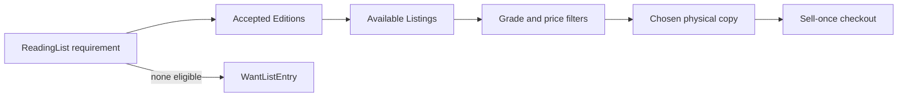

# Scope and condition grades

Hamesh helps students find exact editions from small bookshops, compare separately graded physical copies, buy a chosen copy once, and receive an alert when a missing item becomes available. The core path includes ISBN normalization, shared Work and Edition records, Shop-owned Listings, private ReadingLists and WantListEntries, server-priced checkout, verified test payments, per-Shop Orders, basic pickup or shipping choices, search, caching, a worker and a deployed demo. Each feature exists to support a decision a student or Shop must make.

A condition grade is an ordered summary, not a complete inspection report. A student who accepts Good or better can filter with a grade rank, but they still need defect notes and photos. Two Good copies may differ in highlighting, cover wear or missing supplements. The Shop must describe the actual copy honestly. A grade does not guarantee that an access code works, that every page is pristine, or that a book's edition satisfies a particular syllabus. Exact Edition matching and copy condition are separate checks.

## Make the grade rubric visible

Use a small controlled scale such as Acceptable, Good, Very Good and Like New, with an ordered rank behind each label. State buyer-facing examples of wear for each and require defects that materially affect study to be disclosed. The rank lets a reading-list item set a floor; it does not let the platform certify a copy unseen. A Shop may change an available Listing's grade after discovering damage, and that change should invalidate an old match or offer summary. A sold OrderLine retains the condition promised at sale.

Avoid a misleading price badge that says "best copy" without explaining whether best means cheapest, highest grade or fewest defects. Later matcher chapters define a tie-break after eligibility. A Good copy under budget might be a better choice for one student than a Like New copy over budget. The core model keeps grade, price and defect notes separate so the UI can show that tradeoff.

## What the course includes

A Shop enters or finds an Edition by validated ISBN and lists one physical copy with grade, defects, price and photos. A student builds a private list whose items accept specific Editions, grade floor and price ceiling. The matcher selects eligible Listings without reusing one copy for two items in a result. Checkout holds an exact Listing and prevents a second buyer from purchasing it. Stripe is used in test mode, and one payment splits into one Order per Shop. A worker evaluates new Listings against standing wants and records one alert per want-and-copy pair.

The project also teaches general engineering: authentication, ownership checks, snapshots, database indexes, server totals, media storage, background retries, cache invalidation and deployment. These skills appear through book records rather than grocery products. A generic Product lesson that carries `stockQty`, perishability or kilograms needs a Hamesh-specific replacement before a student uses it. Correct code names alone do not make a grocery example an accurate book-trade lesson.

## What stays outside the core

Hamesh does not provide a national library catalogue, verify every book's authenticity, guarantee that a seller's condition description is true, or resolve every academic syllabus ambiguity automatically. It does not copy or sell digital textbook files, calculate real tax or pay out real money to Shops. Test-mode payments and fictional Shops keep the learning environment safe. Carrier integrations and real collection logistics would need operational policies beyond this course. An admin correction workflow is taught, but a full bibliographic editorial team is not built.

A student should see uncertainty rather than a false match. If the syllabus lists only a title, the app can suggest possible Editions and ask the student to confirm. If an ISBN is invalid, the Shop can save a draft or request review instead of creating a confident shared record. If no Listing passes grade and price filters, a want entry is honest. These states are within scope because they keep the core promise credible.

## Write a product boundary statement

In your learning log, write one sentence about exact Edition identity and one about physical copy choice. Add a sentence describing what a grade floor filters and what it cannot certify. Then list two features outside the course and a phrase the UI should avoid, such as "guaranteed perfect" for an unseen used copy. Ask a peer whether your statement would help a student decide what to buy rather than merely describe a database schema.

The entry diagnostic next checks the basic route, query, Git and ISBN arithmetic skills needed to build this promise. It is a repair guide, not a test of prior book-industry knowledge.

## Compare condition with completeness

A Like New copy may have clean pages but be missing a required access code. A Good copy may have margin notes yet include every printed page. The grade summarizes physical wear; it does not promise supplements, authenticity or syllabus suitability. Give the Shop separate fields or defect notes for missing materials and show them clearly. A student may decide the notes are acceptable if the exact Edition and price fit, while another student may not. Hamesh should provide facts for that decision rather than make a hidden universal score.

The grade rubric also needs a correction path. A Shop can discover water damage after listing a book and lower its grade. If a student had saved a match but not paid, the current offer should reflect the new grade and may become ineligible. If the copy was already sold under a higher grade, the OrderLine snapshot preserves the old promise and a dispute or refund path handles the mismatch. Silently rewriting the receipt to the new grade would erase evidence of what was advertised. This illustrates why grade belongs to current Listing and snapshot belongs to OrderLine.

## Keep exact identity separate from suggestions

A syllabus might say "College Algebra, second edition, print." If the student enters a verified print ISBN, exact matching is straightforward. If they type only a title, the app can show candidate Editions and ask for confirmation. It should not mark the list item found merely because a Work title matches. A wrong revision can have similar cover and title while differing in exercises. Label suggestions as uncertain until an accepted Edition ID is chosen. This is an interface rule backed by a data-model distinction.

A want-list can be created for the exact accepted set when no eligible copy exists. A broad title-only want may send noisy alerts for unusable books. If the product supports unresolved requirements, keep them in a draft state and ask the student to resolve identity before automatic alerts. This does not make the app less helpful; it keeps the alert promise precise enough to trust.

## Identify a core failure before it happens

A Listing appears available on a page, but another buyer claims it seconds later. The student should receive a conflict at checkout and see eligible alternatives rather than be charged for an unavailable copy. The condition grade does not solve that race; Listing status and a conditional hold do. Keep the two concerns separate in scope: eligibility says a copy is suitable for the student's list, availability says it can still be claimed now. Both must be checked at the appropriate moment.

For the scope statement, list a claim Hamesh can verify, such as "this Listing has a seller-entered Good grade and matching ISBN," and a claim it cannot certify automatically, such as "this used copy is perfect." Ask a peer whether the UI wording respects that boundary. The entry diagnostic next tests the technical foundations needed to implement it.
