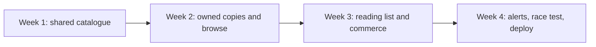

# Course outline

Hamesh takes one project through four weeks. The first week builds the client and server skeleton, database connection, shared Work and Edition model, Shop-owned Listings, seed and access controls. The second week makes listing and browsing usable: a Shop enters an ISBN, describes a specific copy, adds condition photos and price, while a student finds the exact Edition and fills a Cart. The third week connects reading-list matching, sell-once checkout, test payment, per-Shop Orders, cache and search. The fourth week adds want-list alerts, hardens concurrency and retries, deploys the system and prepares the capstone defense.

The order matters. A student cannot safely match a reading list until Edition identity is canonical and Listings carry grade and price. A Shop cannot safely sell a copy until the server can prove ownership and claim that exact Listing once. A want-list alert is trustworthy only when a new Listing event can be matched to accepted Editions and deduplicated for the same student and copy. Each week's demo uses the previous week's records instead of inventing another sample application.

## Week 1 evidence

Show two apps talking, a healthy database connection, three fictional Shops, several publisher-verified Editions, copies across grades and a demo ReadingList. Open `docs/erd.md` and identify the ownership and catalogue reference arrows. Run a wrong-Shop Listing edit test and a wrong-student ReadingList read test. A seed screenshot is helpful but cannot prove either denial. The module gates require raw responses and actual indexes where uniqueness is claimed.

The shared Edition creation race can be introduced in the model and deepened in Module 11. At Week 1, you should at least know that ISBN-13 has a unique index and that Shop ID is absent from Edition. If the seed has three Edition rows for one ISBN because each Shop typed a slightly different title, the week is not done even if the browse page appears full.

## Week 2 evidence

A Shop can type a valid ISBN, find or create the shared Edition, and list one physical copy with grade, defects, photo and price. A student sees one Edition page with distinct offers and can add an exact Listing to a Cart. Try an invalid check digit, a foreign Listing edit and a grade/label mismatch. A product card should not hide the defect note behind a quality badge. The demo may use test assets, but the photos should represent the actual copy fixture rather than an unlicensed publisher cover.

The Cart is intent, not reservation. Two students may view the same available copy. Later checkout decides who gets it. Week 2 can show a stale Cart warning but should not claim that a copy is sold exactly once until the concurrent hold test and payment path exist. This distinction helps the next week focus on the actual race.

## Week 3 evidence

A student imports or enters a ReadingListItem with accepted Editions, grade floor and price ceiling. The matcher selects eligible Listings across Shops without using one copy twice. The buyer chooses a particular Listing, and checkout splits one test payment into Orders per Shop. A verified webhook marks payment and preserves title, ISBN, grade, defects and price snapshots. Search and cache may speed browsing, but checkout must reread authoritative Listing state. Demonstrate a wrong-edition exclusion and a stale Listing conflict, not only a successful purchase.

The provider stays in test mode. A success redirect is not proof that Orders should be marked paid; the verified server event is. If the event arrives twice, the buyer should still have one sale outcome. The course's payment gate will ask for the replay evidence and provider amount comparison.

## Week 4 evidence

A missing ReadingListItem creates a standing WantListEntry. When a Shop lists an eligible copy, the worker evaluates it and creates one MatchAlert for that student and copy, even if the job retries. The student sees an alert but is not guaranteed the copy until checkout holds it. Show a worker-down test and a duplicate-job test. Then deploy API, client and worker over HTTPS and run a last-copy race with two buyers. Record one winner and one conflict. End with a five-minute demo and viva that explain the design without reading code aloud.

Write a one-page demo plan now. Mark which records Week 1 seeds and which behaviors arrive later. The next chapter gives the book-trade vocabulary needed to keep every week precise, especially the difference between a Work, an Edition and a Listing.

## Link a weekly demo to a raw test

For Week 1, do not stop at a Compass screenshot of Editions and Listings. Show the actual unique ISBN-13 index and a raw wrong-Shop edit denial. These observations prove different parts of the model. For Week 2, show a valid ISBN create and a bad check-digit rejection, then two separately graded offers under one Edition page. For Week 3, show one exact reading-list match, one wrong-edition exclusion and one last-copy conflict. For Week 4, show a retry that does not duplicate a MatchAlert and a deployed HTTPS page after a worker restart. The weekly story becomes stronger when each demo has a failure case.

Keep a small evidence folder under the learner project with text transcripts and a short note about fixture IDs. Do not store real student schedules, Stripe secrets or scans of textbook pages. If network access is limited, text output from a local test is often easier to share than a long recording. The final capstone can include a short video, but its claims should be backed by tests and database records that a reviewer can inspect independently.

## Plan the repair path into the schedule

The entry diagnostic may reveal that a learner needs practice with filtered queries or Git. Put that practice before the module that relies on it. A missing query skill will appear again as a Shop isolation bug or an incorrect matcher; a missing Git habit makes a long course fragile under power cuts. Use the first week to repair these foundations while the data set is small. Do not wait until Stripe and workers are involved, when the same mistake is harder to isolate.

The roadmap includes buffer time for hard cases. Use it for concrete risks: concurrent Edition creation, last-copy checkout, duplicate worker alerts, or a deployment restart. If a demo fails, record which gate remains open and continue independent work that does not depend on the broken boundary. For example, condition copy can be reviewed while a provider sandbox is down, but a paid Order cannot be claimed as verified without its webhook test. This distinction helps the team keep progress honest.

## Name the final portfolio claim

At the capstone, you should be able to say: I built a shared catalogue of Works and Editions, let Shops list separately graded physical copies, matched students to acceptable Editions under grade and price rules, sold one copy once, and alerted students about newly eligible offers without duplicate alerts. Each phrase corresponds to a module and evidence. If a phrase has no test or demo, mark it for work rather than soften the claim with a polished screen.

Keep the four-week diagram in the learning log and add the module gate under each week. The next vocabulary chapter will give you precise words for those claims, which makes the final defense easier and the code names less ambiguous.

A missed demo target should leave a specific note. If the ISBN race still creates duplicates, record the index state and keep shared creation out of a readiness claim. Other work, such as condition-copy review, can continue, but a matcher built on duplicate Editions would inherit the error. The weekly plan helps you identify that dependency and repair it before another feature makes the data harder to migrate.
