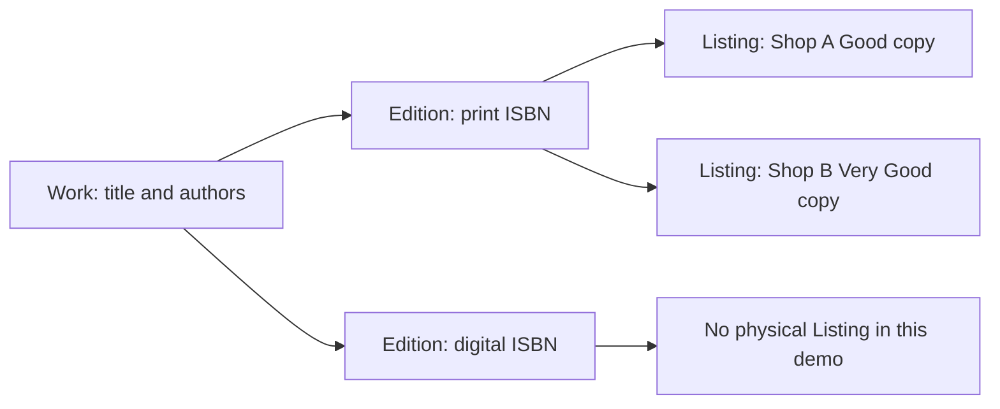

# Book trade vocabulary

Hamesh needs words that identify different things. A Work is the broad intellectual title and author group. An Edition is a particular release and format with an ISBN. A Listing is one Shop's physical copy of that Edition, with its own condition and price. An ISBN identifies an edition or format, not the copy in someone's hands. A condition grade summarizes wear on that copy, while defect notes and photos explain the specifics. Use these words consistently in code, UI and the learning log.

The diagram prevents two common mistakes. A print and digital version may have different ISBNs even when title and authors match. Two used copies may share the print ISBN while their grades and prices differ. If you attach condition to Edition, Shop A's notes would appear on Shop B's copy. If you attach the ISBN only to each Listing without a shared Edition, the app can create duplicate catalogue pages and miss exact reading-list matches.

<TraceRequest title="Find a usable copy for one syllabus line">
  <TraceStep actor="Student" label="Enter required print ISBN" detail="Resolve the canonical Edition" />
  <TraceStep actor="Matcher" label="Find available Listings" detail="Apply accepted Edition, grade floor and price ceiling" />
  <TraceStep actor="Student" label="Choose one Listing" detail="Cart names the physical copy, not just its Edition" />
</TraceRequest>

## Work and Edition are related, not interchangeable

A professor may say "use the second edition" because page numbers or exercises differ. A title search can show related Works and Editions, but the exact requirement should resolve to an Edition ID or canonical ISBN. The Work groups discovery; the Edition determines whether a particular release and format is accepted. If a syllabus allows two revisions, a ReadingListItem can explicitly accept both Edition IDs. Do not infer acceptance from a matching Work title alone.

The International ISBN Agency describes ISBN-13 with 978 or 979 prefixes and a check digit. Older ISBN-10 numbers can appear on used books. A valid 978-based old ISBN-10 may be converted to a canonical ISBN-13; a 979 ISBN-13 has no equivalent ISBN-10. The numbers should be strings, not database Number values, so leading zeros and a final X in ISBN-10 are preserved. Module 5 teaches calculation and indexes; this chapter gives the reason the identifier matters to a student.

## Listing is the unit of sale

A Shop can have two copies of one Edition. One may be Acceptable with writing, the other Very Good with light wear. They need separate Listing IDs, photos, prices and statuses. A Cart stores the Listing ID the student chose. Checkout later holds and sells that exact copy once. If one sells, the other remains available. The Edition remains even if no copy is on sale, because reading lists and want entries can still refer to it.

A Listing may be draft, available, held, sold or archived. A student viewing a sold page can be shown substitutes under the same accepted Edition, but a direct stale Cart request must fail. A Shop can edit its own available Listing, while another Shop cannot. These are ownership and state rules attached to the copy, not to the shared ISBN.

## Grade is a filter with explanation

A grade rank lets "Good or better" become a comparison. The label alone is not enough: a Good book may have a creased cover, notes or a missing supplement. Defect notes and photos should sit beside the grade. A price ceiling is independent of the grade floor. A cheap Acceptable copy does not satisfy a Good requirement, and an expensive Like New copy may fail a budget. The matcher should explain exclusion rather than give a mysterious score.

Try three offers in your learning log: one wrong Edition with a high grade, one right Edition below the grade floor, and one right Edition within both grade and price limits. Identify the qualifying Listing and the different reason each other offer fails. Then ask what record changes if the qualifying copy is sold. Only that Listing's status changes; the shared Edition and ReadingList requirement remain.

## Say the words aloud

Describe one student purchase without saying "book" for every entity. Say which Work the student searched, which Edition the syllabus accepted, which Listing from which Shop they chose, and what grade and defect facts were captured in the OrderLine. If you cannot make the story unambiguous, revisit the diagram. The next chapter turns this vocabulary into a daily working rhythm and a recoverable first-week plan.

## Use ISBN with its limit

An ISBN check digit catches many transcription mistakes, but a mathematically valid number does not prove the seller's title, format or edition metadata. Check a publisher source or reviewed catalogue record before treating the number as shared truth. If a Shop enters a valid ISBN for the wrong physical copy, the Listing must be corrected; the ISBN validator did its arithmetic job but could not inspect the book. This is why Edition identity has a review process and the Listing carries photos of the exact copy.

The print version and PDF version of one textbook may have distinct ISBNs. The student who needs a physical print copy should not receive a PDF Edition as an eligible Listing just because both belong to one Work. Conversely, two used print copies from different Shops can share the same ISBN while differing in grade, price and defects. Write both examples in your learning log and draw the one-to-many relationships. The vocabulary should help you predict where fields belong before any schema syntax is chosen.

## Query with the correct noun

If you search by Work title, you are discovering related books. If you filter by Edition ID, you are checking a syllabus requirement. If you update Listing status, you are selling or withdrawing one physical copy. If you read OrderLine, you are looking at a historical purchase snapshot. Try replacing each noun in those sentences with another. The meaning breaks. That is why route names and variable names should not call every record `product`; a generic word can conceal a wrong query.

A Shop dashboard query should include Shop ID and return its Listings. An Edition page query can gather all public available Listings under one Edition across Shops. A student's ReadingList query should include the student's authenticated ID. Those three requests touch related book data but cross different access boundaries. Write a valid and denied actor for each. The noun tells you which collection to query; the actor relationship tells you how to scope it.

## Test a false friend: quantity

A Shop with three used copies of one Edition does not necessarily have a stock quantity of three on one row. One copy may be Acceptable, another Good, and another missing a supplement. Each has its own Listing. Selling the Good copy should not decrement a shared Edition count and accidentally hide the others. The Edition remains the same bibliographic identity even if no copy is currently available. A WantListEntry can continue to target it.

This distinction also shapes substitute suggestions. If a chosen Listing sells before checkout, the app may suggest another Listing of the accepted Edition that meets grade and price constraints. It cannot silently replace the student's choice because the Shop, condition and amount may differ. Say the selected Listing ID aloud when describing a Cart line; it will help you remember that the transaction concerns an exact physical object.

Use the next working-rhythm chapter to keep these distinctions in your notes and test names. An accurate term is a small tool for debugging: "wrong Edition" directs you to normalization and acceptance, while "stale Listing" directs you to status and hold.

One more term belongs on the diagram: WantListEntry. It is a student's standing request for a future eligible Listing, not a reserved copy and not a completed Cart line. An alert means the system observed a possible match at one moment. Another buyer may still claim that copy before checkout. Saying these terms precisely keeps the notification screen from promising ownership it cannot guarantee.
