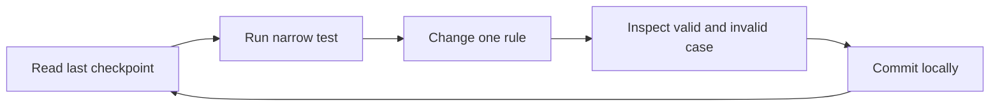

# Your working rhythm

Hamesh depends on careful identifiers and repeatable tests. At the start of a session, read the last learning-log entry and run the narrow test that was passing when you stopped. At the end, commit a coherent change locally and write the next action. A weak connection may delay a push, but it does not prevent a local Git commit. This is particularly useful while building an ISBN validator or seed: a half-finished migration is easier to repair when you know the last consistent database state and test command.

A useful checkpoint says "ISBN-13 normalization passes; concurrent Edition create still needs unique-index test" or "wrong-Shop Listing PATCH denied; raw response assertion to add." It includes a file and command. "Continue catalogue" does not. Keep the log in text so you can read it offline on a phone. Protect credentials and real student data: a learning log is a review artifact, not a place to paste a private reading list or a payment key.

## Verify sources once, then seed offline

Use publisher or International ISBN Agency sources while authoring fixture data. Record the exact ISBN, format and source URL in the seed note. Do not fetch publisher pages on every seed run; local development should still work without internet. A source-verified identifier can be committed as data, while copied textbook pages, cover art and instructor resources may have separate licensing conditions. Use owned placeholder condition photos and fictional Shops. This keeps the fixture small and legally simpler.

A seed should be idempotent. If power stops after Work and Edition rows are written, a rerun should find them and continue with Listings, not create duplicate shared identities. Print the target development database and final counts. Protect any reset command from running against production. If counts double, inspect the stable fixture key and actual unique ISBN index rather than changing the expected count to match the mistake.

## Debug by boundary

If a student gets the wrong book, check the normalized ISBN and accepted Edition IDs before changing a React label. If the right Edition appears but an ineligible copy is suggested, check Listing grade, price and status filters. If a copy sells twice, inspect the conditional hold update and Checkout identity. If a want alert repeats, inspect the unique alert key and worker retry behavior. The visible symptom may be one card, but the responsible rule lives on a specific relationship or state transition.

Read raw errors. A 400 for a bad check digit means input was rejected; a 403 for another student's list may be correct; a 409 for a last-copy race is expected; a 500 from a missing database index or failed worker needs investigation. Capture the status, response and relevant server log correlation ID. Do not patch the client to hide an error until the API and database agree on what happened.

## Review with another person

Ask a peer to trace a seeded ReadingListItem to accepted Editions and eligible Listings. Give them the ERD, not your verbal explanation first. If they choose the wrong edition or believe Shop A owns the shared Edition, revise the labels and test data. For a Shop ownership check, let them send a direct wrong-Shop request. A hidden Edit button is not proof of isolation. This kind of review is small enough for a short call or text exchange even on weak internet.

Keep the capstone in mind without copying a finished implementation. You will need to defend why the catalogue is shared, why one physical copy is sold once, why a grade rank is paired with defect details, and how a want alert avoids duplicates. A series of local commits, tests and learning-log entries gives you a path back through those decisions. Code you cannot explain will be hard to debug under a new syllabus or seller case.

## Prepare the next session

Write a Week 1 target: client and API communicate; the seed has three fictional Shops, several verified Editions, graded Listings and a private reading list; the ERD labels shared and owned links; and at least one cross-Shop or cross-student denial is visible. Mark which parts are still planned. Save the last passing command and the next file to edit. The final checklist asks you to show this plan and the entry diagnostic repair, then Module 2 begins the project skeleton.
