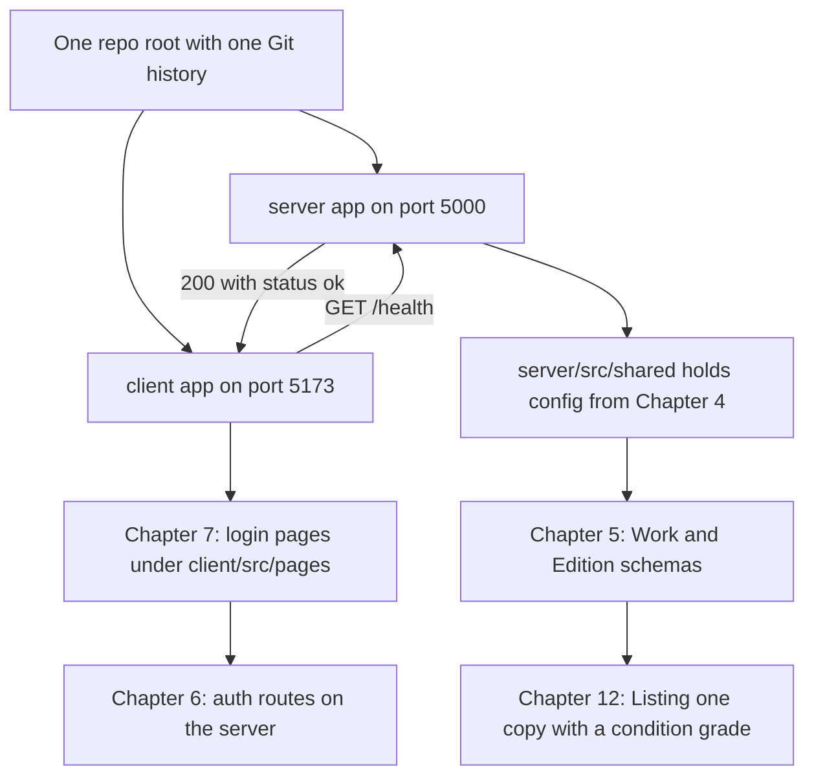

# 2.1: Set the scene

> **[Read]** · Chapter 02, Project skeleton · *What "standing the project on disk" means*

You cleared the introduction checklist. You know what you're building, how the course gates progress, and what's in scope. **Nothing in your marketplace repo exists yet**, or it shouldn't, if you're starting clean.

<BigWordAlert term="Monorepo layout" plainEnglish="One Git repository that holds both the client app and the server app, usually in separate top-level folders." whyItMatters="Hamesh keeps `client/` and `server/` side by side so you can run and deploy them together while keeping concerns separate." />

This chapter is where that changes.

<ArticleBreak title="Before you write feature code: how Hamesh is wired" subtitle="A five-minute map of client, server, and the first request" readMinutes={6}>

Hamesh runs as two applications: a Vite + React client and an Express + Node server. The client never talks to MongoDB directly. It calls HTTP routes on the server, and the server owns all data access.

The point of this chapter is narrow on purpose: prove the wiring before any feature leans on it. A health payload appearing on your home page is a four-part confirmation. Port bound and listening. Base URL configured in the client. CORS permitting the browser's origin. JSON surviving the round trip in both directions.

Every later chapter plugs into this same pattern. Auth adds protected routes. The catalogue adds public read routes. Checkout adds payment routes. The skeleton is boring on purpose. Boring infrastructure is what lets the exciting features ship safely.

</ArticleBreak>

<LearningObjectives objectives={["Explain how the React client talks to the Express API.", "Create a clear folder layout for client, server, and shared code.", "Run both apps and prove the health check works."]} />

## Bridge from last chapter

Chapter 1 was about **clarity before code**. You named your product (or picked a placeholder), read what Hamesh is for, checked prerequisites, and learned how this course gates progress, finish one chapter's checklist before opening the next. You should have completed the Chapter 1 gate and learning log on the platform. None of that required a running app; it required you to understand *what* you are building and *how* the course expects you to work.

What carries forward: your product name, your learning log habit, and the discipline of not skipping gates. What does **not** carry forward yet: any folder structure in a repo you own. The introduction told you the story; this chapter makes the story **physical on disk**.

The hat you wear now is **builder of the skeleton**. You are not designing the database, wiring login, or styling a shop. You are answering boring questions every professional team answers on day one: where does the API live, where does the React app live, how do we know both halves are alive? When Chapter 4 adds MongoDB, it slots into folders you already understand. When Chapter 7 adds login pages, they land in `client/src/pages/` you created here. This chapter is the floor everything else stands on.

<RealWorldEvent title="Shopify's modular commerce platform" when="2006-present" summary="Shopify grew from a single-product store builder into a platform with separate admin, storefront, and API surfaces, all coordinated through clear project boundaries." lesson="Starting with a deliberate folder skeleton prevents painful renames later when vendor, cart, and payment code all need room to grow." />

## In plain English

| Term | Meaning |
|---|---|
| **Skeleton** | The empty but runnable shape of the app: folders, entry files and a health check, before any real feature |
| **Monorepo** | One Git repository containing both `server/` and `client/` as separate apps |
| **Module folder** | A directory grouped by product area (auth, products, cart), not by technical type (all controllers together) |
| **Health check** | A simple API route that answers "is the server up?", your first proof the backend works |
| **Full-stack** | Browser UI (client) talking to Node API (server) over HTTP |
| **Scaffold** | Create folders and stub files so later chapters have named places to add code |
| **Gate / checklist** | Tickable outcomes at chapter end: you do not proceed until each box is checked |

## Think of it like…

**Fitting out a bookshop before the first copy is listed.** You pour the floor, erect the shelves, run the wiring, and hang a sign that says "We're open", even though no bookshop has listed a single copy yet. The health check is that sign: it proves the power and the structure work. Later chapters are the booksellers, the catalogue and the pickup counter moving in. If you skip the shop and start pricing one copy in an empty field, every next delivery has nowhere to plug in.

<MustRead
  title="Introduction to client-side JavaScript frameworks"
  url="https://developer.mozilla.org/en-US/docs/Learn_web_development/Core/Frameworks_libraries/Introduction"
  source="MDN"
  description="Short MDN primer on why frameworks like React exist and what problems they solve. Helps you understand why the client is a separate app from Express."
  readMinutes={12}
/>

## Common questions

**Q: Why not start with MongoDB or login, the interesting parts?**  
A: Because those features need *somewhere to live*. Without `server/src/modules/` and a running Express app, every later chapter would say "add this somewhere" and you'd paste into random files you don't understand. Think of it as fitting out the bookshop before the shelves hold anything: you lay the floor, run the wiring, and hang an "open" sign before the first copy is listed. Get the skeleton right once, and every later feature (database, auth, listings) slots into a folder you already know.

**Q: Do I build inside the course folder (`multi-vendor-marketplace/`)?**  
A: No. That folder is the textbook and the course content lives there. Your app is a **separate Git repository** you create in sub-chapter 2.8, somewhere like `~/projects/hamesh-app/`. If you build inside the course folder, your app and the course materials get tangled, commits mix together, and instructions that say "create a file in your project root" become ambiguous. Keep the book on the shelf and your workspace separate: that's what real teams do too.

**Q: I have never used Express or Vite. Is this chapter too early?**  
A: Not too early, because this chapter introduces them **one small step at a time**. You'll install packages, create entry files, and verify with curl and the browser, so each concept appears the moment you need it. Unfamiliar errors will happen, and that's fine; use the working rhythm from Chapter 1: read the message, search the docs, fix the smallest failing piece. By the end you won't be an Express expert. You'll just know enough to run a server and a client, which is precisely what's needed next.

**Q: Why two terminals, can't one command run everything?**  
A: Because the client and server are **two separate programs** during development, and two terminals make it obvious which half broke. You run `npm run dev` in `server/` to start the API on port 5000, and `npm run dev` in `client/` to start the React app on port 5173. When something fails, the terminal that shows the error tells you exactly where to look: "client works, API down" is a sentence you'll say often. Running both from one command is possible later, but it hides the architecture you're here to learn.

**Q: What if I already have a MERN starter template?**  
A: Unless it matches this course's **module-based** layout, `server/src/modules/…`, it will fight you. Every chapter names an exact path like `modules/products/products.routes.js`, and if your repo has no `modules/` folder, you'll translate every instruction for twenty chapters or diverge from the guide. Scaffolding fresh here takes an afternoon; un-teaching a random boilerplate takes weeks. If you love your template, adapt it to the target tree in 2.3; otherwise, start clean and stay aligned.

**Q: What does the health check actually prove?**  
A: The health check, `GET /health` returning `{ "status": "ok" }`, proves the wiring between Express and the browser works before you add anything complicated. When your React Home page fetches that endpoint and displays the result, you've confirmed the server boots and listens, the client renders, HTTP works across the two, and your folder conventions hold real files. It's the smallest possible proof that the full-stack loop is alive. Skip it and you'd debug connection problems later with database and auth code mixed in, which is much harder.

## Where you are

| You have | You don't have yet |
|---|---|
| A name for your product (or a placeholder) | A Git repository with code |
| The course outline in your head | `server/` or `client/` folders |
| Chapter 1 gate cleared on the platform | A running API or React app |
| Prerequisites checked (Node, Git, editor) | MongoDB connected: that's Chapter 4 |

Chapter 1 was **mindset and product**. Chapter 2 is **the skeleton**, the physical shape of the application on disk, before databases, auth, or listing logic.

## What "standing the project on disk" means

Professional teams don't start by writing a login handler. They start by answering boring questions:

- Where does the API code live?
- Where does the React code live?
- How do we start each app with one command?
- How do we know both halves are alive?

**Standing the project on disk** means: at the end of this chapter, you can open your repository in an editor, see a **folder tree you understand**, run **two commands in two terminals**, and **demo something real**: the React home page calling the API health check and showing the response.

No users. No products. No MongoDB. Still a **working full-stack skeleton**, and every future chapter attaches to it like scaffolding on a building.

## Why this chapter comes before MongoDB

Chapter 4 connects MongoDB. Chapter 5 builds schemas. You might wonder why not start with the database.

Because the **app must exist before the app needs a database**. The health check in this chapter proves:

- Express boots and listens
- React boots and renders
- HTTP works between browser and server
- Your folder conventions hold real files

When Chapter 4 adds `MONGODB_URI`, it slots into `server/src/shared/`, a place you already created and understand. If you started with Mongoose before you had `app.js`, every chapter would say "add this somewhere" and you'd paste into random files.

**Order matters:** skeleton → config & DB → data model → features.

## The dependency order this chapter fixes

The diagram below is not a chapter map. It is a dependency argument: each node needs the node to its left to exist before it can hold anything, which is why Chapter 2 is the one chapter you cannot skip and return to later. The two arrows leaving the repository root are the two halves of one product, and every arrow after them is a chapter that needs a home before it can hold code.

Two parts of that picture are worth slowing down for. The only pair of arrows pointing in both directions is the health check. Everything else flows outward from the root and never comes back, because features do not change the shape of the skeleton; they fill it. That is why the health check is the one piece of near-throwaway code in this chapter that earns its place: it is the only point where both halves of Hamesh prove they can hear each other before any real feature exists.

The second thing to notice is that the arrows from the client and the arrows from the server never cross. The login pages in Chapter 7 sit under `client/src/pages/`, and the auth routes they call sit under `server/src/modules/auth/`. The client is not allowed to reach into `server/` and the server never renders a page, so a learner who loses track of which side a file belongs to can read this diagram instead of guessing. If you catch yourself wanting a database call inside a React component, or a chunk of page markup inside an Express route, you have drawn an arrow that is not here.

So the takeaway is practical rather than philosophical. Build the two roots and the return path first, and every later chapter has somewhere to land. Skip the root and the later nodes do not become wrong, they become homeless.

## What this chapter is not

- **Not** the auth chapter, no JWT, no passwords
- **Not** the data model, no User, Work or Edition schemas yet
- **Not** a UI design chapter, one plain Home page is enough
- **Not** deployment, localhost only

It **is** the chapter where you make the **one structural decision** the rest of the course assumes: **module-based folders** in `server/src/modules/`. Change that later and every subsequent chapter's file paths stop matching.

## The milestone you'll feel

When this chapter gates clear, you'll say:

> *"I built the project skeleton."*

That means:

1. One Git repo with `server/` and `client/`
2. Module-based server layout committed
3. `GET /health` returns `{ "status": "ok" }` (or equivalent JSON)
4. React Home page displays the health response from your API
5. You can draw the folder tree from memory

That's Week 1's **first demo brick**, the second brick is MongoDB + seed (Chapters 4-5).

## How this chapter is organized

You'll move through the usual arc:

**Open (2.1-2.3)**, why structure matters; preview the tree  
**Learn (2.4-2.6)**, layer vs module; client vs server; mandatory read  
**Build (2.8-2.16)**, create repo → server folders → health route → client → connect  
**Wrap (2.17-2.19)**, optional practice; recap; checklist gate  

Sub-chapter **2.7** is a short project-structure knowledge check. Use it to confirm the client/server boundary before the build begins.

Each **build** sub-chapter is one concrete action: create this folder, create this file, verify with this command. You write the logic; the course specifies behaviour and contracts.

## Continuity promise

Every build sub-chapter opens with **where the repo stands** after the previous step. You should never wonder "what file do I touch next?", only "how do I write this function?" (which is yours to figure out from the spec).

After 2.8 you'll have a Git repo.  
After 2.11 the API will answer on a port.  
After 2.13 the client will render in the browser.  
After 2.15 the client will talk to the API.  
After 2.16 you'll have your **first screenshot** for the portfolio.

## Before you continue

- [ ] Chapter 1 checklist cleared  
- [ ] Node 18+ and Git verified (`node --version`, `git --version`)  
- [ ] Empty directory chosen for your marketplace repo (outside the course content folder)  
- [ ] Editor ready, you'll create many files this chapter  

**Estimated time:** one full work day at medium pace, faster if you've scaffolded MERN before; slower if Vite or Express are new (that's fine).

## Time and tooling expectations

| Sub-chapter range | Focus | Rough time |
|---|---|---|
| 2.1-2.7 | Understand structure & reads | 2-4 hours |
| 2.8-2.11 | Server repo + health API | 3-5 hours |
| 2.12-2.16 | Client + full-stack connect | 3-5 hours |
| 2.17-2.19 | Stretch, recap, gate | 1-2 hours |

If Express or Vite are new, expect the upper end, not because the steps are complex, but because unfamiliar tooling generates searchable errors. That's normal; the working rhythm from Chapter 1 applies: read the error, check docs, reduce to smallest failing case.

## Two repositories, don't confuse them

You are reading course files in the **guides** repository (or folder) that contains `multi-vendor-marketplace/` course content. You are **building** in a **separate Git repository** you create in 2.8. Never commit your app into the course textbook folder unless your mentor explicitly uses a monorepo for both, default is **separate app repo**.

## Key ideas

- Chapter 2 = **skeleton on disk**, not features  
- **Server + client** both exist before MongoDB  
- **Module folders** decided here  
- **End demo** = browser shows API health  
- **Separate app repo** from course materials  

## Mentor checkpoint

Before sub-chapter 2.8, confirm: empty directory chosen, Node 18+, Git installed, Chapter 1 learning log written. Missing any of these is cheaper to fix now than after you've scaffolded the wrong folder.

Next: why folder structure is a real decision, not aesthetics.
