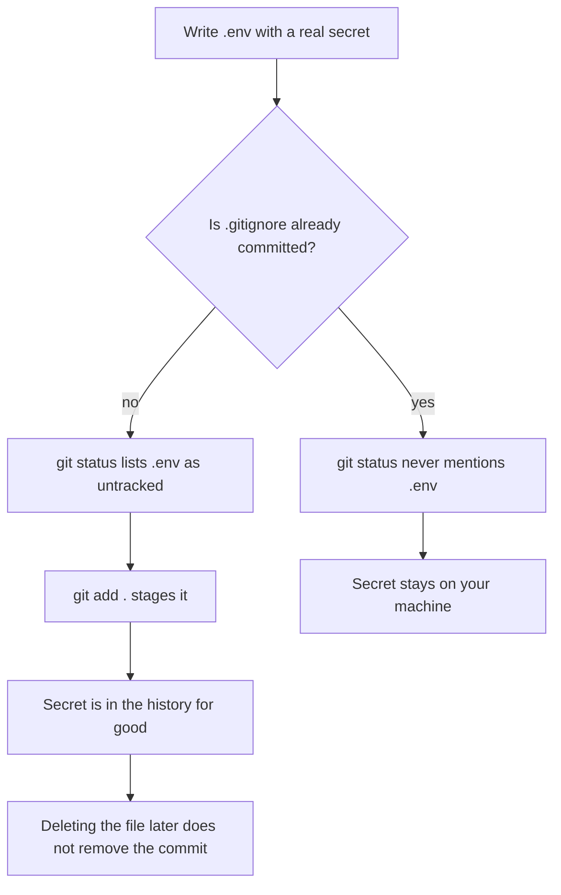

# 2.8: Create the repo

> **[Build]** · Chapter 02, Project skeleton · *Init git; root `.gitignore`; `README.md` stub*

**Why this step matters:** Everything you build for Hamesh lives in a repo you own, not in the course guides folder. This step creates that root with Git, ignore rules, and a learning log so every later sub-chapter has a committed home and secrets stay out of history from day one.

<BigWordAlert term="Git repository" plainEnglish="Version-controlled project folder where every change is tracked and reversible." whyItMatters="Hamesh lives in one repo from day one, commits mark chapter milestones you can demo or roll back." />

**Where the project is now:** You have no application repository, only the course materials you read. After this sub-chapter you'll have a Git root with ignore rules and a place for the learning log.

**After this step:** You own a Git repository with a root `.gitignore` that keeps secrets out, a README stub, and a `learning-log/` folder, the committed home every later sub-chapter builds inside.

## What you must do

Create a **new directory** for your Hamesh application, **not** inside the course guides folder. Initialize Git inside that directory, add a root `.gitignore`, and stub `README.md`. Everything else in Chapter 2 happens inside the folder you create now, so these next few minutes decide the shape of every path you type for the rest of the course.

## One repository for one product

A student browsing an Edition page and a bookshop listing one copy of that Edition are two faces of the same product. That matters for version control because the two faces share a contract: the shape of the JSON the API returns, and the shape of the data the React screens expect. Whenever that contract changes, the client and the server change in the same breath. In one repository that is a single commit holding both halves, which is a unit you can review, demo and roll back. In two repositories it is two commits, two pushes, and a window where the deployed client expects a field the deployed API no longer sends.

You should still know why larger teams often choose the opposite arrangement. Two repositories give each deployable its own history, its own permissions and its own release cadence, which is worth the coordination cost when different teams own each half and the API is versioned and documented. You have one person, a handful of chapters, and a contract that changes several times a week, so the coordination cost is the expensive part and the isolation is worth almost nothing to you yet. Hamesh therefore uses a monorepo of two apps, and that phrase matters: it is not one big app. `server/` and `client/` each get their own `package.json`, their own dependencies and their own dev command. Nothing is shared except the Git history and the rules at the root.

The last decision is where not to put this repository. Do not create it inside the course folder that holds `multi-vendor-marketplace/`. That folder is the textbook. If your app lives there, your commits sit beside lesson files you never wrote, `git status` reports edits to chapters when you meant to edit a route, and any instruction that begins "from the repository root" becomes ambiguous because there are two roots in your editor. Keep the book on the shelf and the workspace beside it.

## Why these four files belong at the root

Every repository has exactly one place where repository-wide rules live, and that place is the root. A rule about `.env`, `node_modules/` or an editor folder applies to both apps equally, and a rule written once at the root cannot drift. The alternative, one ignore file per app, works until the day you add a third app or a shared package and forget to copy the patterns across. The same logic puts `README.md` at the root: a reader who clones the repository needs to know how to run both halves, and a per-app README hides half the answer.

The `learning-log/` folder is at the root for a different reason. It is not application code and it is not course content. It is the record of your own decisions, the file a mentor reads when they ask why you chose module folders, or how you diagnosed a failed CORS request. Keeping it inside the repository means the evidence travels with the code, and keeping it outside both `server/` and `client/` means neither app needs to know it exists. The optional `docs/` folder follows the same rule: Chapter 3 puts an ERD draft there and Chapter 8 puts an authorization matrix there, and neither document belongs to a single app.

## Step 1, Create the project directory

Choose a name that matches your product rather than a generic one. The examples in this course use `hamesh-app`, and the rest of this sub-chapter assumes you are in that folder.

```bash
mkdir hamesh-app
cd hamesh-app
```

Two facts about that pair of commands matter. It creates an ordinary empty directory, and Git has not been told anything yet: there is no history, no branch and no repository. Confirm where you are with `pwd` before you go further, because `git init` in the wrong directory is the most common way to start a repository you later have to delete.

## Step 2, Initialize Git and read what it reports

```bash
git init
```

This creates a hidden `.git/` directory holding the object store, the index and the branch pointer, and it prints the name of the initial branch. Your Git version may call that branch `main` or `master`. Either is fine, and nothing in the course depends on the name. What `git init` does **not** do is record anything about your files. Straight after it, `git status` lists every file as untracked, and `git log` fails with a message about not having any commits yet.

That gap is the reason this sub-chapter ends with a commit rather than ending here. Until the first commit exists, the directory on disk is the only copy of your work, and one careless `rm -rf` ends an afternoon of typing. The commit is also the first point at which a mistake becomes reversible: before it nothing can be recovered, and after it almost everything can.

Do not create a remote or push yet. A remote is a copy of history, and you should be confident about what the history contains before you send it anywhere. The push comes at the end of this sub-chapter, after the ignore rules are proven.

## Step 3, The ignore file has to exist before the secret does

Create `.gitignore` at the **repository root** with at least these patterns:

```gitignore
# Dependencies, reinstall from package.json
node_modules/

# Environment files, secrets never in Git
.env
.env.local
.env.*.local

# Logs
npm-debug.log*
*.log

# OS / editor
.DS_Store
Thumbs.db
.idea/
.vscode/*
!.vscode/extensions.json

# Build output
dist/
build/

# Optional: coverage
coverage/
```

Read that list as three different intentions rather than one long rule. `node_modules/` is ignored because it is reproducible: `npm install` rebuilds it from `package.json`, and committing it adds thousands of files that make every diff unreadable. `dist/` and `build/` are ignored for the same reason, since they are outputs of a command rather than sources you edit. The `.env` lines are ignored for a completely different reason. Those files are not reproducible, they hold the MongoDB connection string and later the JWT secret, and they must never leave your machine.

The ordering of two writes is the part people get wrong. `.gitignore` only influences what happens at the moment you stage a file. If `.env` is created first and staged before the ignore rule exists, the ignore rule cannot reach back and undo it. The diagram below follows both orders and shows why the empty file has to be written first.



The arrow into "for good" is the whole argument. A commit is not a snapshot you can edit casually; it is an entry in an append-only chain, so removing a file in a later commit removes it from the working tree, not from the older commit. Anyone who clones the repository can still read that object. This is why the recovery step for a leaked secret is to rotate the secret in the provider that issued it, and only then to clean up the repository. Rotating first is cheaper than rewriting history, and it is the only step that actually limits the damage.

Prove the rule before you trust it:

```bash
touch .env
git status    # .env should NOT appear as untracked
git check-ignore -v .env    # prints the matching pattern and line
rm .env       # you'll recreate server/.env in Chapter 4
```

If `.env` does appear in `git status`, the rule is wrong, usually because the pattern was written with a typo or placed inside a subdirectory where it only matches paths below that directory. Fix the file before the first commit rather than after. Do not reach for `git add -f .env` to make a problem disappear; the force flag exists to override the ignore file, and overriding it "just once" is how secrets enter public history.

## Step 4, Stub `README.md`

Create the root `README.md`. Its job is narrow and worth doing properly: a reader who has never seen your machine should be able to clone the repository, read this file, and know that there are two apps, which folder holds which, and what to run in each terminal.

```markdown
# Hamesh

A multi-vendor marketplace for used books. A bookshop lists individual copies
with a condition grade; a student searches by ISBN and arranges pickup.

## Structure

- `server/`: Express API, owns all data access
- `client/`: React app built with Vite, renders every screen

## Run locally

Two terminals, one per app.

### API

Run `npm install` then `npm run dev` inside `server/`.

### Client

Run `npm install` then `npm run dev` inside `client/`.
```

Those commands do not work yet, because `server/` arrives in 2.9 and `client/` in 2.12. Write them anyway. The README states the contract you are about to satisfy, and a reader who opens the file in Chapter 9 gets the truth rather than a note promising to explain later. Add the ports once you have run both apps, and add the health check URL in 2.16 when there is something to check.

## Step 5, Learning log and optional docs folders

```bash
mkdir -p learning-log
mkdir -p docs
```

`learning-log/` is where written answers to gate questions can live if you prefer files to platform text boxes, and it gives a mentor a place to look for reasoning that does not fit in a commit message. `docs/` stays empty for now and gains the Chapter 3 ERD draft and the Chapter 8 authorization matrix. Neither folder needs a placeholder file inside it, because Git tracks files rather than directories, so an empty folder simply appears in the history once you add the first document to it.

## Step 6, First commit

```bash
git add .
git status    # review: no .env, no node_modules
git commit -m "chore: initialize repository with gitignore and learning log"
```

The `git status` line in the middle is not decoration. Between staging and committing you get one clean look at the filenames that are about to become permanent, and at this point that list should contain `.gitignore` and `README.md` and nothing from your home directory. If you see `node_modules`, a `.env`, or an absolute path from outside the project, stop and fix the cause before the commit lands.

Push once the commit exists. Create an empty repository on your Git host, copy its URL, then run `git remote add origin <url>` and `git push -u origin main`, using whichever branch name `git init` printed. A private repository is fine for this course, but your mentor must be able to open it, so invite them before you submit the URL below.

## Failure modes and their symptoms

`git status` listing thousands of files almost always means `git init` ran one directory too high, often in your home directory. Run `git rev-parse --show-toplevel` to see which directory Git believes is the root, and if it is not your project folder, remove the stray `.git` and initialize again inside `hamesh-app/`.

A repository that refuses to notice new files usually means you are standing inside a nested repository. That happens when an app folder is copied from a starter that shipped with its own `.git`, or when the project was created inside another tracked folder. The symptom is a `git status` reporting a clean tree while your editor clearly shows new files.

Committing `node_modules` by accident creates a repository measured in tens of thousands of files and a push that takes minutes or fails outright. The fix is to add the ignore pattern and then untrack the folder without deleting it from disk, using `git rm -r --cached node_modules`, followed by a commit. The old objects remain in history, which is why the ignore file is worth checking before the first commit rather than after.

A secret in history is a different class of problem, and it does not improve with time. If you find `.env` in `git log`, rotate every credential inside it first, then decide whether the history needs rewriting. Do not assume that a later delete commit fixed anything.

A repository with no remote is not broken, only unshared: `git log` works, the commit exists, and the only missing step is the push. The inverse mistake is worth naming too. Pushing before reading `git status` sends whatever you staged to a server you do not control, which is exactly the order this sub-chapter avoids.

## Verify

| Check | Expected |
|---|---|
| `git log --oneline` | One commit with your message |
| `git status` | Clean working tree |
| `git check-ignore -v .env` | Prints the matching pattern from `.gitignore` |
| `git ls-files` | `.gitignore` and `README.md` at this stage |
| `git remote -v` | Your repository URL |
| `.gitignore` lists `.env` | yes |

Read that table as the evidence a reviewer will ask for, not as a formality. A reviewer opens the URL, reads `README.md`, counts the commits, and runs `git log --all -- "**/.env"` to confirm that no environment file was ever committed. An empty result means the ignore rule worked from the beginning. A commit in the output means the rule arrived too late and the secret inside that file needs rotating.

```openquestion
prompt: Paste the GitHub repository URL for your Hamesh project and briefly confirm that the first commit is pushed and no secrets are tracked.
submissionMode: url_required
allowUrl: true
urlRequired: true
urlLabel: Hamesh repository
urlHint: Paste a public or mentor-accessible GitHub repository URL. If it is private, give your mentor access before submitting.
minWords: 0
required: true
```

## ✅ Do / ❌ Don't

**✅ Do:** Commit after each major sub-chapter through Chapter 2 (2.11, 2.15, 2.16), so every milestone has a commit you could demo or roll back to.

**❌ Don't:** Clone someone else's marketplace repo and erase their code. Start empty; the course builds it with you, and an unfamiliar history hides exactly the mistakes this chapter teaches you to avoid.

**❌ Don't:** Put `server/` or `client/` outside this repo root. One product, one history, one place to look when a reviewer asks what changed.

## Hint

If `git status` shows thousands of files, you accidentally initialized Git in your home directory or parent folder. `cd` to the intended project folder only, remove the mistaken `.git` if needed, and re-init **inside** `hamesh-app/`.

The same symptom with only a handful of files usually means the ignore file is missing patterns rather than that the repository sits in the wrong place, so read the first column of `git status` before deleting anything. And if the push is rejected over a mismatch between `main` and `master`, check the branch name with `git branch --show-current` and push that name rather than renaming your history to match a tutorial.

## What's next

**Sub-chapter 2.9:** Create `server/` folder skeleton, `src/app.js`, `src/server.js`, `modules/`, `shared/`.

Continue when the first commit is done and the repository URL is pushed.
