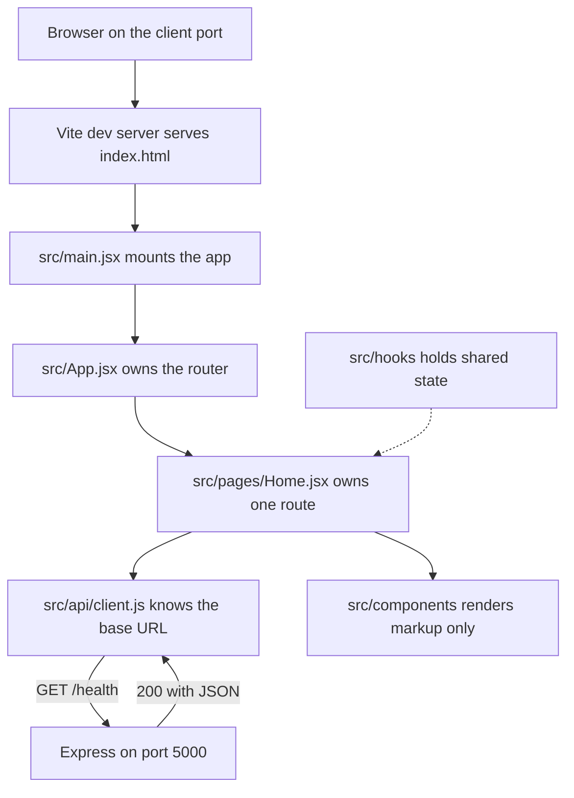

# 2.12: Scaffold client folders

> **[Build]** · Chapter 02, Project skeleton · *Vite React app in `client/`; `src/pages/`, `src/components/`, `src/api/`, `src/hooks/`*

**Why this step matters:** Hamesh is a product students meet in a browser, not a headless API. Scaffolding Vite + React now establishes where login pages, Edition screens and API helpers live for the rest of the course.

<BigWordAlert term="React SPA shell" plainEnglish="A single-page app with routing and layout components but minimal pages, the UI skeleton." whyItMatters="Hamesh's client starts as a shell; browse, Edition and cart pages plug into the same router later." />

**Where the project is now:** The server runs, and `GET /health` returns 200 JSON via curl.

**After this step:** A Vite + React app exists in `client/`, with `pages/`, `components/`, `api/` and `hooks/` folders, running on its own port and committed to Git.

## What you must do

Create the React app inside `client/` at the repository root, not inside `server/`. Install its dependencies, add the four folders this course uses everywhere, prove the dev server starts, and commit. No real screen is built here; the point is that every later screen has a named place to live.

## Why the client is a separate application

The server from 2.9 can already answer a request. A student cannot use it, because a browser asking for a page needs HTML, CSS and JavaScript, and Express in this course returns JSON. One option is to have Express render the pages itself, which keeps one process and one command. The course does not take that option, and the reason is the shape of Hamesh rather than a preference for React.

Hamesh has two audiences with very different screens. A student browses Work and Edition pages, checks a condition grade, and reserves one copy for pickup. A bookshop owner works behind a login, listing copies and marking orders collected. Those two experiences share data and share nothing else. Serving both from one rendered document set means every navigation reloads a page, every interaction round-trips through the server, and the two experiences stay tangled in the same templates. A single-page client keeps the interface in one place, calls the API for exactly the data it needs, and lets routing decide what a student sees without a full page load.

There is a second, more practical reason: the two apps fail independently. When the React dev server is running and the Express server is stopped, the browser still renders and the failing request appears in the Network tab with a clear error. That separation is the teaching tool for the rest of the course. In a single rendered app, a broken database call and a broken button look like the same blank page.

## Why these four folders instead of a flat `src/`

React does not care where your files live, which is exactly why the decision has to be made deliberately and once. The course groups client files by the job they do inside the interface, because a screen is composed rather than owned: a single page pulls in several components, one API helper and often one hook.

`pages/` holds the files a route points at, one file per URL the app can show. `components/` holds markup that more than one page needs, so a `ListingCard` used on a browse page and on a bookshop page is written once. `api/` holds the only code that knows the server's address, so `client/src/api/client.js` becomes the single place where the base URL and later the Authorization header live. `hooks/` holds stateful logic that pages reuse, which in this course starts empty and gains `useAuth.js` in Chapter 7.

The alternative, one flat folder sorted by file type, works for a demo and collapses around Chapter 9, when four pages and a dozen components arrive in the same week. With folders by job, a new screen has an obvious address: the page goes in `pages/`, its reusable parts go in `components/`, and its fetching goes through `api/`. You should also notice what the layout prevents. There is no folder called `server-things`, so a learner who wants to reach into the database from a button has to notice that no folder welcomes the idea.

## Step 1, Create the Vite app

From the **repository root**, not from inside `server/`:

```bash
npm create vite@latest client -- --template react
```

The `--template react` flag pins the plain JavaScript React template, so the generator does not stop to ask which framework or variant you want. If your version does prompt anyway, choose **React** and then **JavaScript**, not TypeScript. The course uses plain JavaScript throughout so that a type error never becomes the reason a lesson cannot be finished.

```bash
cd client
npm install
```

`npm create` downloads the template into a new `client/` folder. `npm install` reads the generated `package.json` and fills `client/node_modules/`. Both steps need network access, and the second one is the one that takes a minute. If the first command created the folder but the second fails, nothing is broken: run `npm install` again from inside `client/`.

## Step 2, The tree you are aiming for

After the install and the next step, `client/` should look like this. Read it as a contract rather than a screenshot, because later chapters name these paths directly.

```
client/
├── index.html
├── package.json
├── vite.config.js
├── public/
└── src/
    ├── main.jsx
    ├── App.jsx
    ├── index.css          ← from Vite template; trim later
    ├── pages/
    │   └── .gitkeep
    ├── components/
    │   └── .gitkeep
    ├── api/
    │   └── .gitkeep
    └── hooks/
        └── .gitkeep
```

The generator already created `index.html`, `main.jsx` and `App.jsx`. Those three files are the entry path of every React app: the HTML file contains one empty `div`, `main.jsx` finds that `div` and mounts the app into it, and `App.jsx` decides what the app currently renders. Everything else in the tree is either your convention or a file you will trim.

## Step 3, Create the convention folders

```bash
cd client/src
mkdir -p pages components api hooks
touch pages/.gitkeep components/.gitkeep api/.gitkeep hooks/.gitkeep
```

The `.gitkeep` files exist because Git tracks files and not directories. An empty `pages/` folder is invisible to `git add`, so the folder would never reach the repository and a teammate cloning it would scaffold their own. A zero-byte placeholder keeps the folder in the tree until the first real file replaces it, and it costs nothing to delete in 2.13 when `pages/Home.jsx` arrives.

You can remove the template's `App.css` and the logo assets in `src/assets/` if you prefer a clean start. That cleanup is not required for the gate, and doing it later costs nothing, so do not let it delay the commit.

## Step 4, Start the dev server and read its output

```bash
cd client
npm run dev
```

The terminal prints a Local URL, normally `http://localhost:5173`, and the browser shows the Vite and React welcome content. That screen is not Hamesh yet; it is proof that the toolchain compiled your JavaScript, served it, and that the browser could run it.

Read the URL carefully, because Vite does not insist on 5173. If another process already holds that port, Vite takes the next free one and prints 5174 instead. This matters more than it looks: in 2.15 the server's CORS rule names the client origin, so an unexpected port creates a blocked request that looks like a server bug. Note the port you actually got, and stop the server with Ctrl+C once you have seen the page.

## Where a screen comes from at runtime

The diagram follows one screen from the address bar to the JSON response, and it is the map for every screen you build after this one.



Every arrow points one way, and that is the argument. The page may compose components and call the API helper, but a component never calls the server directly and a hook never renders markup on its own. Only `src/api/client.js` knows the address `http://localhost:5000`, which means changing that address, or adding an Authorization header in Chapter 7, is a one-file change rather than a search across twelve components. When you later wonder where a piece of client code belongs, follow the arrows: if it renders and is reused, it goes in `components/`; if it fetches, it goes through `api/`; if it holds state across renders, it goes in `hooks/`; if it owns a URL, it is a page.

## Step 5, The client ignore file

The Vite template usually ships a `client/.gitignore` already ignoring `node_modules` and `dist`. Check it and make sure `.env` and `.env.local` are listed too, because Chapter 2.14 creates `client/.env` for `VITE_API_URL` and Chapter 4 adds server-side secrets. The root `.gitignore` from 2.8 already covers most of these patterns, and a duplicate inside `client/` is fine: the root protects the whole repository, and the client file protects anyone who later copies that folder out on its own.

## Step 6, Commit

From the repository root:

```bash
git add client/
git commit -m "chore(client): scaffold vite react app with folder convention"
```

Staging the folder rather than the whole tree keeps this commit to one intention. Read `git status` before you commit and confirm that `node_modules` is not in the list; if it is, the ignore file is missing a pattern and this is the cheapest moment to fix it.

## npm scripts from the template

| Script | Purpose |
|---|---|
| `npm run dev` | Development server with HMR |
| `npm run build` | Production bundle into `dist/` |
| `npm run preview` | Serve the production build locally |

You will use `build` in the Chapter 23 deployment. `preview` is worth knowing now: it serves the built output on a port of its own, so a production-only problem, such as a missing environment variable that Vite inlines at build time, can be reproduced before deployment rather than after.

## What each client folder holds later

| Folder | Chapter 2 | Later |
|---|---|---|
| `pages/Home.jsx` | 2.13-2.15 | Browse, Edition page, Cart, Login, bookshop dashboard |
| `components/` | empty | `ListingCard`, `Layout`, empty states |
| `api/client.js` | 2.14 | Central fetch plus base URL |
| `hooks/` | empty | `useAuth.js` in Chapter 7 |

That table is the reason the scaffolding step exists at all. In Chapter 12 a bookshop lists one copy, and the form it uses is a page with components inside it. In Chapter 14 a student searches by ISBN, and the results grid is a page with a card component. In Chapter 17 the cart is a page fed by a hook. None of those chapters create folders; they fill the ones you made in the last five minutes, which is why a wrong layout now costs a rename in every later chapter.

## Failure modes and their symptoms

Running `npm create vite@latest client` from inside `server/` creates `server/client/`, so the app exists but the paths in every later chapter point somewhere else. Check with `pwd` before you run it, and if it happened, delete the nested folder and repeat from the root.

A browser tab that says the site cannot be reached after `npm run dev` usually means the install never finished. The terminal usually shows the compilation error, and a missing `node_modules` is the common cause, fixed by running `npm install` inside `client/`.

A page that renders but shows nothing but a blank white screen is normally an entry-path problem rather than a React problem. The usual causes are a renamed `main.jsx` that `index.html` still points at, or a stray `import` of a file you deleted during cleanup. The browser console names the missing module, and the fix is to make the import match the file that exists.

Port confusion is the most expensive failure to diagnose later. If your client is on 5174 and your server allows only 5173, the request fails with a CORS error that names the server, not the port. Read the Local URL in the Vite output before you debug anything on the server.

Committing the template's default assets is harmless, but committing `node_modules` is not: it is tens of thousands of files and a push that fails. The fix is the same one from 2.8, an ignore pattern plus `git rm -r --cached client/node_modules`.

## ✅ Do / ❌ Don't

**✅ Do:** Keep `client/` as a sibling of `server/`, not nested inside it. Two apps at the root is the whole point of the layout.

**✅ Do:** Run the client and server dev scripts in **separate terminals** simultaneously from 2.15 onward, so a failure names the half that broke.

**❌ Don't:** Proxy the API through Vite in this chapter unless you document it and skip the CORS teaching. The course uses an explicit `VITE_API_URL` plus CORS so that the origin boundary is visible.

**❌ Don't:** Put Express code inside `client/`. A route handler in a React folder has no server to run it.

## Verify

| Check | Expected |
|---|---|
| `client/package.json` exists | yes |
| `npm run dev` shows the React page | yes |
| `src/pages`, `api`, `hooks`, `components` exist | yes |
| `git ls-files client/src` lists the four `.gitkeep` files | yes |
| Committed to Git | yes |

The `.gitkeep` line is the one that proves the folders survived the trip into version control. A reviewer who clones your repository and sees no `pages/` folder has found a scaffold that only exists on your disk, and that reviewer is right to send it back.

## Hint

If `npm create vite` fails or warns about the Node version, check `node --version` and make sure it is 18 or newer. If the generator cannot reach the registry, the alternative is a manual Vite setup following the official guide, which gives you the same tree. And if you are unsure which port the client took, the Vite output prints it on the first line after startup, before the ready message.

## Next

**Sub-chapter 2.13:** the React Router shell and a `pages/Home.jsx` placeholder, kept minimal because the health fetch arrives in 2.15.
