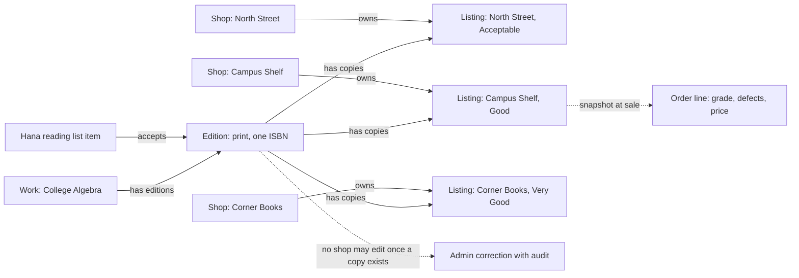

# One book, many copies

At 09:10 on the first Monday of term, Hana opens Hamesh on her phone and searches for the textbook her algebra lecturer named. Three bookshops near her faculty each have one copy of that edition on the shelf. One is Acceptable with pencil notes at 1,600 minor units, one is Good at 2,300, and one is Very Good at 3,100. To Hana this is one book with three prices. To the database it is three separate physical objects that happen to share one identity.

That gap is the problem this module exists to name. The ISBN printed above the barcode belongs to the edition, and every shop holding a copy of that edition is selling the same published thing. The copy itself does not belong to the edition in any practical sense. North Street Books owns its copy, grades it, photographs it, prices it and hands it over at the counter. Two copies of one edition are not interchangeable, because a creased cover and a missing access code are facts about one copy alone.

A team that stores one record per book, carrying a price and a condition and one number that goes down, meets the consequences within a week. Shop A reprices its copy and Shop B's offer changes too. A student buys the Good copy and the shared record now describes a book that is no longer there. A shop corrects a typo in the title and every saved reading list silently points at a different string. None of those is a hard bug. Each is the same bug: one record answering two questions at once.

## Three questions, three records

Hamesh has to answer three questions in order, and each one deserves its own record. What work is this, in the broad sense of a title and its authors? Which published edition satisfies the syllabus? Which physical copy can Hana buy today, from which shop, at which grade and price? A Work answers the first, an Edition answers the second, and a Listing answers the third.

The Edition is where the ISBN lives, together with the format, the edition label, the publisher and the year when those facts are known. The Work groups related editions so a student who has not yet found the exact required copy can still browse a title. The Listing names one shop, one edition, one physical copy, a condition grade, a set of defect notes, condition photographs, a price in minor units and a sale state. Only the Listing can be sold, and only once.

That cardinality is the part worth memorising. One Work has many Editions. One Edition has many Listings, from one shop or from five. One Listing belongs to exactly one shop and points at exactly one edition. Nothing about a Listing can be shared, and nothing about an Edition can be owned by a seller.

## Why the edition cannot belong to a shop

Imagine the first shop to type a new ISBN is treated as the owner of the edition record. That shop can now rename the title, change the publisher and alter the format. Every other shop's offer card changes with it, and every student's reading list points at whatever text that shop last saved. If the shop closes next term, the edition it created has no natural keeper, and the platform has to invent one in a hurry.

Ownership in Hamesh follows a person through a shop to a copy. Reference runs the other way, from a copy to a shared edition and from there to a work. These two arrows mean different things, and the gate at the end of this module asks you to draw them separately. The first decides who may edit a price. The second lets a student discover the right book.

There is a second failure that looks like the opposite mistake. A team that distrusts the shared record gives each shop its own edition, created from whatever the shop typed at the counter. Now one ISBN has three catalogue pages with three slightly different titles. Hana compares two of them and never sees the third shop's cheaper copy. The reading-list matcher finds one shop's copies and misses the rest, and a want-list entry for that edition never fires because the new copy points at a different page. Duplicating the shared record does not remove the sharing problem; it hides it inside a search that returns less.

## What the shared record has to be good at

A shared Edition is read far more often than it is written. Browse pages read it, the matcher reads it, a student's phone reads it, and the admin correction route writes it perhaps twice a year. The record therefore needs one reliable identity, which is the canonical ISBN, and it needs to be small. Title, authors, format, edition label, publisher and year are enough to render a comparison. Price and condition do not belong on it, and this is the decision a reviewer will test first.

The identity has to survive messy input. Two shops will type the same number with hyphens, with spaces, or with a final X in the case of a ten digit ISBN. Module 11 builds the normalisation and the race test, but the draft you write this week already assumes one canonical key. If your draft stores whatever the shop typed as the lookup field, the shared record is not shared; it is a best effort.

A shared record also has to survive a correction. When an ISBN is attached to the wrong title, an admin needs to change the shared fields once, with an audit entry that names the old value, the new value and the person. That route is not a shop route. A shop can report the problem from the edition page, and the report carries no edit right.

## What the copy has to be good at

A Listing has to answer questions that change daily. Is this copy still available? What grade is it now, after the shop found a torn page? What does it cost today? Which checkout, if any, has claimed it? Those answers must be local to one document, because they are read and written by one shop and one sale.

The grade is the field learners underestimate. Hamesh stores a grade code and a rank, so Acceptable is 1 and New is 5. A student who says "Good or better" is then asking for `gradeRank >= 2`, which is one indexed comparison. If the grade were only a label, the same question would become a text match, and the text match would also match a defect note containing the word good. Module 5 builds the grade map; this module decides that the grade lives on the copy, not on the edition, because two copies of one edition are damaged differently.

The sale state is the second local field. A copy moves from draft to available, then held while a checkout runs, then sold. It can be archived when a shop withdraws it. A shared edition has no equivalent state, because an edition does not sell; a copy does. When the last copy of an edition is sold, the edition still exists, still belongs on Hana's reading list, and can be listed again by another shop next week.

## The third timeline

Two timelines are easy to see: the catalogue as it currently reads, and the copy as it currently stands. The third one is the agreement, and it is easy to lose. When Hana pays for the Good copy, her order line records the title, the ISBN, the grade code, the defect summary, the photo reference and the price she accepted. That order line is neither the edition nor the listing. It is a snapshot of both, frozen at one instant.

Without that snapshot, a shop that regrades a sold copy tomorrow rewrites yesterday's receipt. With it, the shop can correct its live listing and the historic order stays honest. Module 19 builds the snapshot and tests it; this module only insists that the draft distinguishes three records rather than two. A draft that draws the order line as an arrow to the Listing, and nothing else, will fail that test later.

## Read the diagram as two kinds of arrow

The diagram below is the smallest version of the model, and it separates ownership from reference. Solid arrows carry ownership or requirement. The dotted arrow carries history, which is not ownership at all.

Three things are worth noticing. The shops point at their copies, not at the edition, so a shop closing does not remove the shared record. Hana's reading-list item points at the edition, not at a copy, because her requirement is about the syllabus and the copy is a choice she has not made yet. The dotted arrows leave the model: one goes into a historical record, the other goes to a privileged path that shops cannot use.

## What this module asks you to decide

By the end of the module you will have compared a relational shape and a document shape for exactly this catalogue, and committed a decision in `docs/erd-draft.md`. The comparison is not a vote for a brand. It is a list of trades: which store enforces the unique ISBN for you, which one makes the order snapshot natural, which one makes the reading-list item awkward, and what you give up either way.

PostgreSQL will win on at least two points in this domain, and the next lesson says so plainly. A unique constraint on the ISBN and a foreign key from the copy to the edition are declarations, not code. MongoDB gives you neither by default. Saying that out loud is part of the decision, because a reviewer will ask what your application now has to guarantee instead.

The module does not build schemas. Module 4 connects the database, Module 5 writes the Mongoose models and the seed, and Module 11 proves the ISBN race. What you commit here is a draft with a decision paragraph, a decision table, one ERD and a list of open questions. Keep Hana, North Street Books and the three copies in front of you while you write it. A sentence about your model that cannot be checked against those three copies is probably too general to test.
