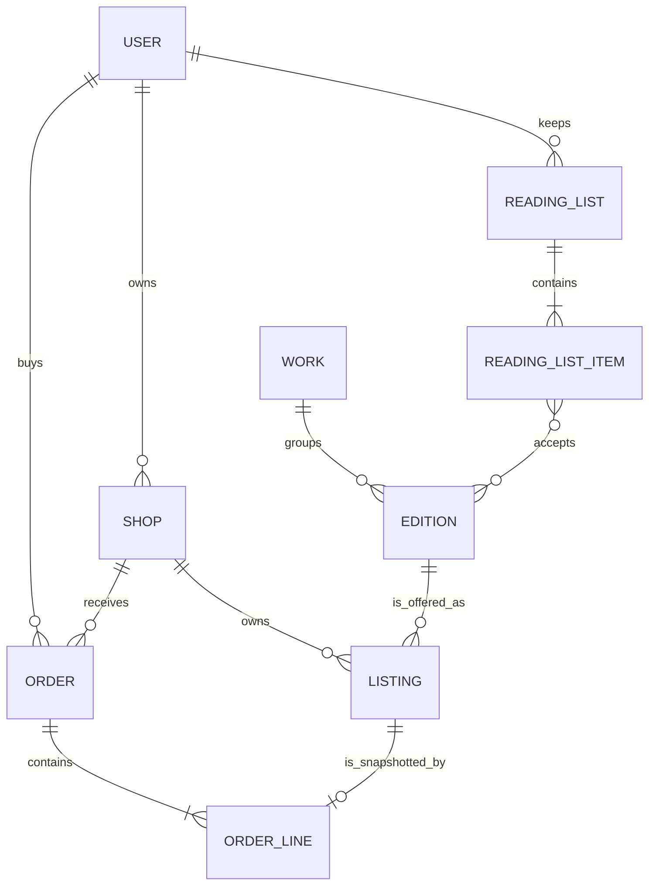

# The decision for Hamesh and the first ERD

A decision you cannot defend out loud is a preference. You have now seen that PostgreSQL would beat MongoDB on referential integrity and on check constraints for this catalogue, and that MongoDB fits the reads and writes the course actually performs. The work in this lesson is to write that trade down in a form a reviewer can attack, then draw the first ERD that supports it.

You are not building the model. Module 5 owns the finished schemas and the seed, Module 11 owns the ISBN race, and Module 19 owns the order snapshot. What you commit today is `docs/erd-draft.md`: a decision paragraph, a decision table, one ERD, a short field list and a list of questions you cannot answer yet. A draft that names its weak point is worth more than a tidy one that hides it.

## Write the decision as one paragraph

Start the file with four or five sentences and no headings. Say which store Hamesh uses, which records it must hold, which guarantees the database will supply and which two the application must supply itself. Keep it short enough that a reader cannot escape into detail.

A usable paragraph reads like this. Hamesh stores its catalogue in MongoDB because one edition is read together with its shop-owned copies, a reading list is read whole by one screen, and an order line freezes facts that belong to other records at the moment of sale. The cost is that MongoDB does not enforce a reference from a copy to its edition, so every write path has to prove the edition exists, and the seed script is one of those paths. The second cost is that a negative price and a grade rank outside the scale are protected by a validator the team must install and keep in step with the schema, while PostgreSQL would refuse the row with a check constraint.

Notice what that paragraph does not do. It does not claim MongoDB is faster in general, and it does not claim that tables cannot model a book. It names a read pattern, a benefit and two costs, so a reviewer can disagree with one sentence instead of with the whole choice. If your own paragraph contains the phrase "because it is JavaScript everywhere", delete it and start again; that is a description of the stack, not a reason.

## Put every decision in the table

The table is the part a reviewer reads first, because it shows the comparison rather than the conclusion. Add a row only where the row changes a design choice. A row that says "documents are flexible" changes nothing and will be treated as filler.

| Decision | Hamesh shape | Relational alternative | Cost accepted |
|---|---|---|---|
| Edition identity | Unique index on canonical `isbn13`, partial unique on `isbn10` | Unique constraints on the same columns | Must normalise before every lookup |
| Copy to edition link | Stored `editionId` reference, checked in the service | Foreign key, refused by the database | Every write path must check existence |
| Copy facts | Grade code, grade rank, defects, photos, price on the Listing | Same columns on the listing table | Grade map lives in application code |
| Price and grade bounds | Schema validator plus server side grade map | Check constraints on the row | Validator must be installed in each database |
| Reading list | One document with an items array | Parent table plus item table | Array must stay bounded per student |
| Accepted editions | Array of edition IDs inside the item | Join table on item and edition | Reverse queries need a multikey index |
| Order line | Embedded snapshot of title, ISBN, grade, defects, price | Snapshot columns on a line table | Duplicate data by design |
| Copy claim | Conditional update on one Listing document | Update with a status filter and returning | Same idea, different syntax |
| Cross-shop checkout | One order document per shop per checkout | Rows in one transaction | Recovery path must be tested |
| Admin correction | Update the Edition and write an audit document | Update the row and insert an audit row | Audit write is not atomic with the update |

Two rows will be challenged. The first is the copy to edition link, because it is the row where the relational store is clearly stronger and you are choosing the weaker guarantee. The second is the order line, because a reviewer trained on normal forms will see duplicated fields and call them a mistake. Have the answers ready: the link is checked in one service function that every write path calls, and the snapshot is duplicated on purpose so a receipt cannot change.

## Draw the first ERD

The ERD below is deliberately small. It has to fit on a phone screen, because a draft you cannot review in one sitting does not get reviewed at all. Insert the diagram into `docs/erd-draft.md` as a Mermaid block so a later change is a diff rather than a new image.



Label the arrows by meaning, not by direction alone. "User owns Shop" and "Shop owns Listing" are ownership. "Listing references Edition" is a pointer to a shared record with no edit right. "Reading list item accepts Edition" is a requirement written by a student. "Order line snapshots Listing" is history, and the cardinality is one copy to at most one sold line.

Two details are easy to get wrong on the first attempt. Do not draw a line from Listing to Work; the path runs through the Edition, and adding the short cut creates a second source of truth for which work a copy belongs to. Do not draw Shop ownership over Edition; if a shop closes, the edition must survive for the other shops, the reading lists and the past orders.

## List the fields that carry an argument

You do not need every field on day one. You do need the fields a reviewer will check against later lessons, because those are the ones that decide whether the model holds. Keep the list short and mark it as draft.

```ts
// Draft field list for docs/erd-draft.md. Types are indicative, not final.
interface WorkDraft {
  title: string;
  authors: string[];
  language?: string;
}

interface EditionDraft {
  workId: string;            // shared work
  isbn13: string;            // canonical identity, unique
  isbn10?: string;           // absent for 979 editions
  editionLabel: string;      // for example "9th edition"
  format: 'paperback' | 'hardback' | 'pdf';
  publisher?: string;
  publishedYear?: number;
}

interface ListingDraft {
  shopId: string;            // ownership
  editionId: string;         // reference to a shared record
  gradeCode: 'acceptable' | 'good' | 'very_good' | 'like_new' | 'new';
  gradeRank: 1 | 2 | 3 | 4 | 5;
  defectFlags: string[];     // highlighting, handwriting, water damage, missing access code
  photoUrls: string[];
  priceMinor: number;
  status: 'draft' | 'available' | 'held' | 'sold' | 'archived';
  hold?: { checkoutId: string; expiresAt: Date };
}

interface ReadingListDraft {
  studentId: string;         // private owner
  courseCode: string;
  items: Array<{
    itemId: string;
    label: string;
    acceptedEditionIds: string[];
    gradeFloorRank: number;
    priceCeilingMinor?: number;
  }>;
}
```

Read the four shapes together and find the field that is missing. There is no price on the edition, no condition on the edition, and no count of copies on the edition. The only number that goes down is inside one listing's status and hold. If your draft still carries a shared price or a shared count, delete it and write one line explaining why the copy owns those facts.

## Prove one rule with a failing test

A decision without a test is a sentence. Write the smallest test that shows the weaker guarantee, run it, and keep the output. The test asserts that the database refuses a copy which points at an edition that does not exist.

```js
// tests/model/listing-edition-reference.test.js
import { describe, it, expect, beforeAll, afterAll } from 'vitest';
import { connect, disconnect, Listing } from '../../src/db.js';

beforeAll(connect);
afterAll(disconnect);

it('refuses a listing whose editionId names no edition', async () => {
  const orphan = {
    shopId: '66f0c1a2b3c4d5e6f7a8b9c0',
    editionId: '66f0c1a2b3d4d5e6f7a8b9c1',   // never created
    gradeCode: 'good',
    gradeRank: 2,
    priceMinor: 2300,
    status: 'available',
  };
  await expect(Listing.create(orphan)).rejects.toThrow();
});
```

On a fresh database with the Listing model in place, the insert succeeds and the test fails. That failure is the point of the lesson, so read it rather than skipping past it.

```text
FAIL  tests/model/listing-edition-reference.test.js
AssertionError: expected promise to reject but it resolved with
  { _id: ..., editionId: '66f0c1a2b3d4d5e6f7a8b9c1' }
```

Now add the check that the application owns. The create route loads the edition inside the same shop scope, returns a typed 404 when it is missing, and only then writes the listing. Re-run the test against the route and it passes, and the honest note in your draft says the guarantee moved from the database to one function that every write path must call.

Then write the second test, the one the database does keep. Insert two editions with the same canonical `isbn13` and watch the unique index refuse the second with error 11000. Two rules, two homes: one enforced by the store, one enforced by the service. That contrast is the decision in miniature, and it belongs in the draft as one table row each.

## Where a reader will push back

Three challenges arrive every time this draft is reviewed, so answer them in the file before anyone asks. The first is about the missing foreign key. Someone will point out that a broken reference now becomes a runtime bug rather than an insert error, and they are right. Write down which paths write a listing, name the one function they all call, and add the test that proves the route behaves. A reviewer accepts a gap with an owner; they do not accept a gap with a promise.

The second challenge is about the reading-list array. A student who imports a syllabus could add sixty items, and one document that large becomes slow to update and awkward to review. The course caps a core reading list, which makes the array safe at this scale. Say so, and name the condition that would force a change: a list that regularly exceeds a few dozen items would move items into their own collection and pay for the extra read.

The third challenge is about duplicate edition fields on the listing, if you added any for search. Explain what refreshes them, or remove them. The safest draft this week has none, because a field that is copied and not refreshed is a bug with a long delay.

## Draft the file and commit it

Create `docs/erd-draft.md` with five sections in this order: the decision paragraph, the decision table, the ERD, the field list and the open questions. The last section is not decoration. Write at least two questions you cannot answer yet, such as where the shop's pickup instructions live and whether the admin correction audit is its own collection or an embedded array.

Fill one worked row so the draft stops being abstract. Take the College Algebra edition, then write North Street Books at Acceptable with handwriting, Campus Shelf at Good with a clean interior, and Corner Books at Very Good at 3,100. For each, name the shop ID, the edition ID and the listing ID, and count the records: one work, one edition, three listings, three shops. Then mark which of those seven records a shop may edit and which only an admin may change.

Commit the draft with the two tests and both outputs, and do not commit a connection string. Leave your reasoning visible rather than rewriting it into a summary. The gate in the next lesson asks you to defend the draft, and a reader who can see one failed test and one passing test will believe the rest of the file.

## Acceptance criteria

- [ ] `docs/erd-draft.md` opens with a decision paragraph that names one benefit and two costs.
- [ ] The decision table has a row for edition identity, the copy link, the reading list, the order snapshot and the copy claim.
- [ ] The ERD shows Work to Edition to Listing as reference, Shop to Listing as ownership, and the order line as a snapshot.
- [ ] The field list contains no price and no copy count on the Edition.
- [ ] The orphan-listing test fails before the service check and passes after it.
- [ ] The duplicate-ISBN test shows error 11000 from the unique index, not from application code.
- [ ] The open questions section names at least two unsolved problems with a sentence each.

If the draft answers every question, it is hiding one. A model this young has at least two unknowns, and the honest version names them where a reviewer can see them.
