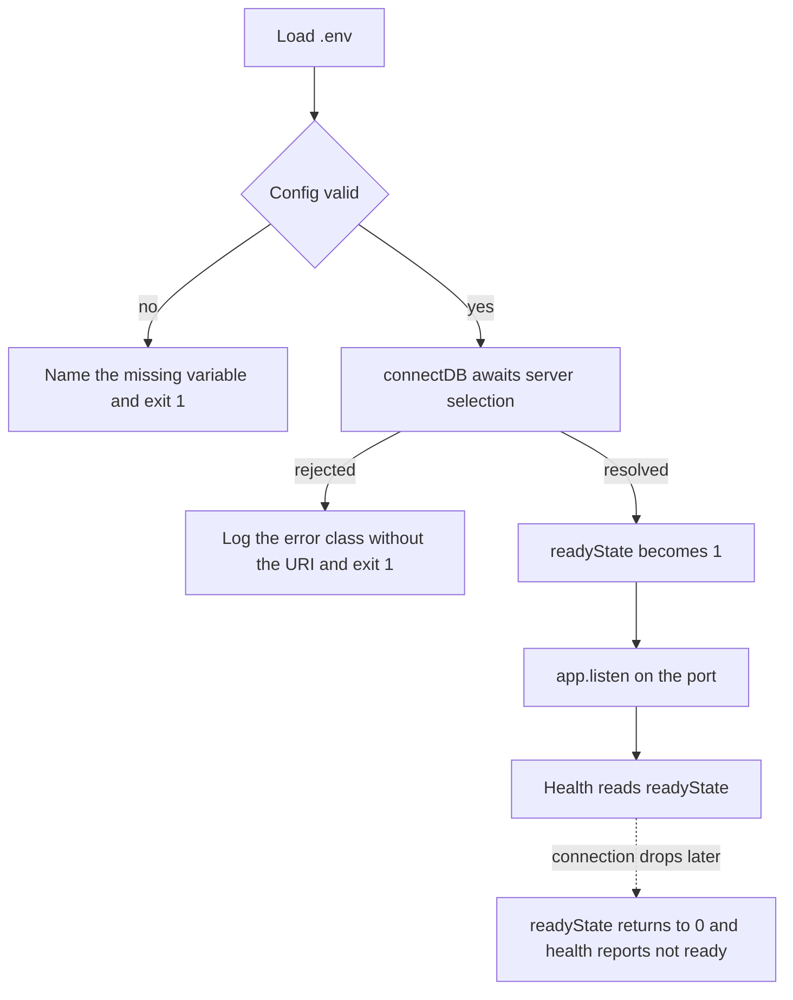

# 4.6 ,  Prime your thinking

> **[Learn]** · Chapter 04 ,  Config & database · *Mandatory read: Mongoose connection docs*

Before you write `shared/db.js`, read how **Mongoose** expects connections to work in modern Node (async/await, connection events, disconnect). This sub-chapter is a **mandatory reading assignment** ,  not optional skimming.

<BigWordAlert term="Twelve-factor config" plainEnglish="Store config in the environment, not in code ,  so dev, staging, and production differ by env vars only." whyItMatters="Hamesh follows this pattern: one codebase, many deployments, secrets injected at runtime." />

You already decided *why* MongoDB (Chapter 3). This read covers *how* the driver connects ,  so your boot sequence in 4.11-4.12 matches official patterns.

```predict
prompt: "MongoDB is unavailable when Hamesh starts. Which boot sequence tells the truth?"
options:
  - id: listen-first
    label: "Start listening first, then connect in the background"
  - id: connect-first
    label: "Connect to the database first, then start listening"
correctOptionId: connect-first
explanation: "Connecting first prevents the API from accepting requests it cannot complete. A failed connection should stop startup with a clear error instead of exposing a misleading healthy process."
allowRetry: true
```

## Why this matters

Nothing in a connection error tells you which of the four boot steps went wrong, and "Mongoose buffering timed out" arrives with no context at all. The Connections page is twenty minutes that buys you three facts you will use immediately: `await connect` must come before `listen`, what each `readyState` number reports, and why the seed script in Chapter 5 imports the same `db.js`. None of this is vocabulary for its own sake. It is the difference between a Week 1 backend that stalls and one that fails loudly in the right place.

## The boot order decides what a failure looks like

Two Hamesh deployments can run identical code and behave completely differently at startup, because the order of four steps decides whether a wrong credential shows up in the boot log or hides until a student's browse request fails ten minutes later. The order is environment, then validated config, then connection, then listener. Each step consumes the guarantee the step before it established: `shared/config.js` cannot check `MONGODB_URI` before `.env` has been loaded, `connectDB()` cannot open a pool before config has approved that URI, and `app.listen()` should not accept a single request before a pool exists.

That ordering feels fussy until you see the alternative from the outside. A process that calls `listen` first looks healthy to everything that matters: the host accepts the port, the release is marked live, and the health probe may even pass because the HTTP server genuinely is up. Only students notice, because every Edition lookup hangs or returns an empty array while the connection is still being negotiated. Failing before `listen` converts a silent user-facing outage into one operator-facing crash on one screen, which is a much cheaper place to discover a typo in a connection string.

The diagram below follows the same four steps and draws every arrow that leaves them. Notice that exactly one path reaches `listen`, and that both failure paths end the process instead of leaving a running server that cannot serve.



The takeaway is the shape of the graph rather than any single box: startup is a chain of preconditions, and a server that reports readiness is only telling the truth when the left-hand column of that chain actually completed.

## What `connect()` is really waiting for

Think of `mongoose.connect(uri)` as a negotiation rather than a switch. What it actually does is begin server selection, lay down a pool of connections, and settle only once some host in the cluster answers. Everything odd about a first backend week follows from that. A `Work.findById` issued while the promise is still pending will not reject on the spot; Mongoose parks the operation in a buffer and holds it against a connection that does not exist yet, then fails the entire parked queue in one shot when the wait runs out. That wait is `serverSelectionTimeoutMS`, thirty seconds unless you say otherwise, which is why a hostname typed with one wrong letter presents as silence instead of as an error.

Shortening that window on your own machine is a debugging convenience and nothing more; it is not a view you should carry into production. What the number really encodes is patience, meaning how long this process should keep pretending that success is imminent. A managed cluster that goes dark for twenty seconds while it elects a new primary deserves patience, and a generous window turns that blip into a failover nobody notices. A laptop pointed at a database process that was never started deserves none, and a tight window puts the real message on screen while you still remember which line you just edited.

## Worked trace: one cold boot

Trace the Hamesh server starting against a cluster that is reachable but slow to elect a primary. Each step is a line you should expect in the boot log, and the reason the order matters is that steps three and four can otherwise be waiting at the same moment.

<TraceRequest title="Boot against a cluster that is slow to elect a primary">
  <TraceStep actor="Server" label="config: load .env, then validate" detail="MONGODB_URI and JWT_SECRET are present, so config returns a frozen object" />
  <TraceStep actor="DB" label="connectDB: await server selection" detail="The pool opens, the driver waits for a primary, readyState moves from 2 to 1" />
  <TraceStep actor="API" label="server: mount routes, then listen" detail="The listener starts only after the awaited connection resolves" />
  <TraceStep actor="Server" label="health: report readyState" detail="Health answers 1 while the pool is up and 0 after a drop" />
</TraceRequest>

Read the trace backwards to see why the order is not cosmetic. Health can only report a connection that `connectDB` established, `listen` can only serve routes that expect a connection, and `connectDB` can only use a URI that config already validated. Break one link and the later steps do not fail loudly; they keep serving requests that cannot complete.

## Failure modes and the path through them

Nearly every startup failure in this chapter falls into four groups, and each one has a different first move. "Mongoose buffering timed out" means something ran a query or started listening before the connection resolved, so the fix is ordering, not the URI. An authentication failure means the username, password or auth database inside the URI is wrong, which is the one case where you must read the URI carefully and then avoid logging it. A server selection timeout with no other detail usually means the host is unreachable: the Atlas network access list, a VPN, or a wrong cluster name. A refused connection on a local address means nothing is listening on that port, so check that the local database process is running before you touch application code.

One procedure handles all four cases, and the order of it is the whole point. Start by printing `connection.readyState` at every transition rather than printing the URI. Then reduce the problem to a five-line script whose only job is to call `connectDB()`, so nothing in the HTTP layer can muddy the reading. Compare what you see against the values config actually resolved. Done in that order, the procedure splits one vague symptom into three separate verdicts: bad config, bad connection, bad ordering.

## Common questions

**Q: Can I copy the Mongoose docs sample server verbatim?**  
A: Don't copy it wholesale ,  adapt the pattern to your project's structure. The docs show a complete server with the connection inline, but your course layout already decided that config lives in `shared/config.js` and the connection helper is `connectDB()` in `shared/db.js`. What you *should* take from the docs is the concept: `await mongoose.connect(uri)` before you start listening, and how the connection events behave. Think of the docs as the recipe and your modules as the bookshop ,  same ingredients, arranged the way your project already does things.

**Q: Should health use `readyState` or a boolean I set?**  
A: Both pass, provided the JSON you return always describes the connection as it is right now. Mongoose already tracks that in `connection.readyState`, where `0` is disconnected, `1` connected, `2` connecting and `3` disconnecting, so reading the property costs nothing and cannot drift out of date. A flag you flip after `connectDB()` resolves is the simpler option, but it records one moment and then freezes: kill the database an hour later and your flag still reports `true`. A health check has exactly one duty, and that duty is telling the truth, so the live property is the honest one to report.

**Q: Why read disconnect if MVP never shuts down gracefully?**  
A: Because the assumption that the dev machine never restarts expires the moment the code reaches a host, and disconnect is simply connect seen from the other end, so learning it is what makes the model click into place. Deploy platforms send a shutdown signal when they restart a process; catching it and awaiting `mongoose.disconnect()` gives in-flight writes a chance to land and closes the pool in order, rather than yanking the database out from under a request that is halfway through. The gate does not require it, so treat this as optional reading, but skimming it now means `SIGTERM` handlers and graceful shutdown stop being foreign words later.

**Q: What is "Mongoose buffering timed out" and why does it happen?**  
A: It is Mongoose reporting that your code reached for the database before a connection existed. While the connection is still being negotiated, Mongoose *buffers*: every operation is held in a queue and waits for the connection to complete. If it never completes, that queue expires together and you get this message, which in nearly every case means a query ran, or `listen` was called, before `mongoose.connect()` had resolved. The repair is the same ordering this chapter keeps repeating: load env, validate config, connect, listen. When `MONGODB_URI` points somewhere wrong or the server is down, the process should die at boot with a readable reason rather than surfacing as a timeout much later.

## Mandatory read

**Primary:** Mongoose ,  Connections  
https://mongoosejs.com/docs/connections.html

**Focus on these sections:**

1. **Connecting to MongoDB** ,  the basics of `mongoose.connect(uri)`  
2. **Connection states** ,  what each `readyState` value reports  
3. **Error handling** ,  failures at connect time versus failures at query time  
4. **Disconnection** ,  `mongoose.disconnect()` and graceful shutdown  
5. **ESM note** ,  with `"type": "module"`, your import style follows the Chapter 2 setup  

**Secondary (skim):** Connection string format  
https://www.mongodb.com/docs/manual/reference/connection-string/

Enough to understand `mongodb://` vs `mongodb+srv://` ,  you already picked URI in 4.5.

## What to extract for your implementation

While reading, note answers to these ,  you'll implement in 4.11:

| Question | Why it matters |
|---|---|
| Is `connect()` a Promise? | `server.js` needs `await connectDB()` before it listens |
| What if the URI fails to parse? | The process should stop at boot, not mid-request |
| How do I confirm the connection is live? | Log once at boot; let the health route read current state |
| Do I need to pass options to `connect()`? | Only where you want a clearer dev failure, e.g. `serverSelectionTimeoutMS` |
| Is the pool shared across modules? | Yes by default; connect once per process, not per module |

**Do not copy-paste** the docs' entire sample server into your repo ,  adapt to your `config.js` + module structure.

## Connection states cheat sheet (from docs)

Mongoose tracks `connection.readyState`:

| Value | State |
|---|---|
| 0 | disconnected |
| 1 | connected |
| 2 | connecting |
| 3 | disconnecting |

Health endpoint in 4.13 may use this ,  or a boolean you set after successful `connectDB()`. Either is valid if accurate.

## Common beginner mistakes (read before coding)

1. **Calling `listen` before `connect` resolves** ,  the first request can reach a database that is not ready.  
2. **Calling `connect()` more than once** with no guard ,  duplicate pools and confusing duplicate errors.  
3. **Swallowing connection errors** ,  an empty catch leaves a server running with no database behind it.  
4. **Printing the whole URI** when something fails ,  the password ends up in a terminal or a log file.  
5. **Skipping the `.env` load** before config reads it ,  `MONGODB_URI` arrives as `undefined`.  

Chapter 4 build steps explicitly order: load env → validate config → connect → listen.

## Optional deep read (not gate)

- **Buffering:** Mongoose queues operations while connecting ,  know it exists; don't rely on it for health semantics.  
- **Server selection timeout:** Tuning Atlas vs local failure messages.  

One paragraph in learning log if you tune timeouts ,  optional.

## Reflect ,  write in notebook or learning log draft

After reading, answer without opening the docs:

1. What is the difference between a **connection error at startup** and a **query error** after connected?  
2. Why should `connectDB()` live in `shared/db.js` instead of inline in `server.js`?  
3. What does `mongoose.disconnect()` do and when would you call it?  

If you can't answer #2, re-read the "Connections" page section on best practices.

## How this connects to Chapter 5

Chapter 5 creates **models** ,  `User`, `Edition`, `Listing`, etc. Models require an **active connection** before `Model.create()` works. Same `connectDB()` helper will be imported by `scripts/seed.js`.

If `db.js` is wrong, every schema chapter fails for the same reason ,  fix connection once, everywhere benefits.

## Time box

**Minimum:** 25 minutes focused reading + reflect questions.  
**If rushed:** Read "Connecting" + "Error handling" + disconnect section ,  skip advanced pooling.

## ✅ Do / ❌ Don't

**✅ Do:** Read official Mongoose docs ,  version matches your `npm install mongoose` major version.

**✅ Do:** Keep docs tab open while writing `db.js` in 4.11.

**❌ Don't:** Use deprecated callback-only patterns from old Stack Overflow answers.

**❌ Don't:** Skip reading because "I'll figure it out when it breaks" ,  boot bugs waste evenings.

## Next

**Sub-chapter 4.7:** Configuration and database knowledge check ,  complete it before **4.8** starts the build.

Reading done → hands on keyboard in the build cluster.
