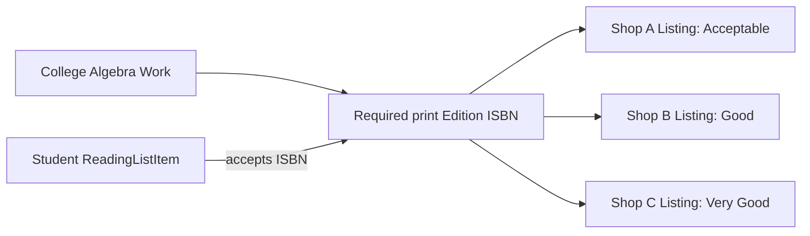

# The product that is not one product

A shelf-stock Product can often combine catalogue description, price, seller and available quantity in one record. Hamesh cannot. Several shops may have the same textbook edition, but each shop owns a separate physical copy with a separate price and condition. The shared bibliographic facts should appear once; the sale facts should appear once per copy. Begin with a sketch of one title, two editions and three physical offers, then ask which ID the student must enter in a cart.

Use Work for a conceptual book title and authors, Edition for a specific format and edition identified by a canonical ISBN, and Listing for one shop-owned copy. A Work can have several Editions: an older revision, newer revision, paperback or digital format may have different identifiers. An Edition can have many Listings from different shops. A Listing belongs to one Shop and has exactly one current sale state. It is the unit that can be sold once. These cardinalities matter more than a familiar field name like Product.

A student reading list usually names a required edition, sometimes by ISBN. If the matcher sees only a title, it may suggest an older textbook that is cheap but unusable for class. If two copies of the right edition exist, the student should compare grade, price and defects without seeing duplicate catalogue pages. Separating Edition from Listing makes this user journey possible. The edition page owns title and ISBN; each offer card owns condition, price, photos and shop.

Draw what changes when a shop reprices one copy. Only its Listing price changes; the shared Edition and another shop's Listing stay the same. Draw what changes when the catalogue corrects an author spelling. The Edition or Work metadata can be corrected through an audited admin process without rewriting a past OrderLine snapshot. A shop should not gain the ability to alter a shared Edition just because it created the first Listing for it.

The seed for this module should make that distinction visible without a large database. Use three fictional bookshops, two editions of one Work, several graded copies and a reading list requesting one exact edition. Show both matching and mismatching copies on paper before coding. If you cannot say which collection stores a fact, write a sentence about who is allowed to change it and whether it is shared or copy-specific.

## Put three copies on one reading-list item

A student has a syllabus line for a specific print edition of College Algebra. Shop A has an Acceptable copy with written notes for 1,600 minor units. Shop B has a Good copy for 2,300. Shop C has a Very Good copy for 3,100. All three Listings point to one Edition ISBN. The student may require Good or better and see B and C, while A remains visible in an unrestricted offer list. The model needs one shared edition page and three independently owned copies to express that simple choice.

The arrow from ReadingListItem to Edition is a requirement, not a sale. The student buys Listing B or C, and that exact copy becomes unavailable after checkout. If the Cart stored only Edition ID, the payment route would not know which Shop receives an Order, which grade was promised or which physical copy must be held. If Edition stored one price, Shop B's repricing would overwrite the offer from Shop C. The diagram explains why a generic Product row is insufficient.

## Keep broad discovery apart from exact matching

A Work groups related bibliographic identity. It can help a student browse "College Algebra" even if the syllabus has not specified a revision. Edition narrows the identity to a format and release with an ISBN. Listing is one copy. A search box may query Work title and author, but a strict reading-list match should compare accepted Edition IDs or canonical ISBNs. A Work-level title match can produce helpful suggestions labelled uncertain; it must not silently claim that an older edition satisfies a syllabus that names a newer one.

Take an older and newer edition with nearly identical title text. Put both under a Work only when the metadata supports that relationship, but give each a different Edition ID and ISBN. Then put one Listing under each. A student who accepts only the newer edition should see one eligible offer, not two. This test distinguishes discovery from fulfillment. It also prevents a want-list from disappearing merely because some shop has a vaguely related book in stock.

## Place mutable and historical facts

Shared Work title and Edition metadata may be corrected by an audited admin route. A Shop changes its own Listing price and condition while available. An OrderLine captures title, ISBN, grade, defects and price at the moment of sale. These are three timelines: catalogue truth as currently maintained, copy state as currently offered, and historical agreement. Draw a box for each. If a seller edits its current defect note after a sale, an earlier buyer's receipt should not silently change. If an admin fixes a title typo, that should not grant a Shop permission to rewrite other sellers' Listings.

Seed three fictional Shops and several copies so the first page already demonstrates one-to-many relationships. Do not seed three nearly identical Work rows with slightly different title strings; that would encode the duplicate-edition trap as if it were normal data. Use source-verified ISBNs for edition examples and owned placeholder images for copy condition. Ask a peer to point to the exact row sold once. If they point to Work or Edition, revise the diagram before implementing schemas.

## Ask what happens after a copy sells

When Shop B's Good copy sells, only its Listing changes to sold. The Edition still exists because Shop A and Shop C may offer copies, and the Work still exists even if every Shop temporarily has none. A WantListEntry for the required Edition remains meaningful during that gap. If the entire Product row were marked out of stock, the app might hide every offer or conclude the book no longer exists. A shared catalogue lets demand outlive today's inventory.

A Shop may close or withdraw all its Listings. The shared Edition should remain for past Orders, reading lists and future sellers. Deleting it as a side effect of shop closure would break those links. A Listing may be archived, and the Shop may become inactive, while Edition and Work persist under platform stewardship. This lifecycle is another way to check whether each field belongs to the right record. Ask which fact survives a seller leaving: ISBN and title do, while one copy's grade and price do not.

For a mobile learner, a page with three offer cards should not repeat an entire long title and author block on each card. Show shared metadata once, then concise copy-specific grade, defects, price and Shop on each offer. This interface shape follows the model and makes a comparison easier. If the API sends three duplicate Edition objects with slightly different titles, the screen will inherit that ambiguity. One Edition ID and an offers array is a cleaner response contract to document in the ERD.

End by naming the three distinct questions Hamesh must answer: what work is this, which edition satisfies the syllabus, and which physical copy can be bought now? Work, Edition and Listing answer those in order. A later match or checkout route may traverse all three, but it should never substitute one answer for another.
