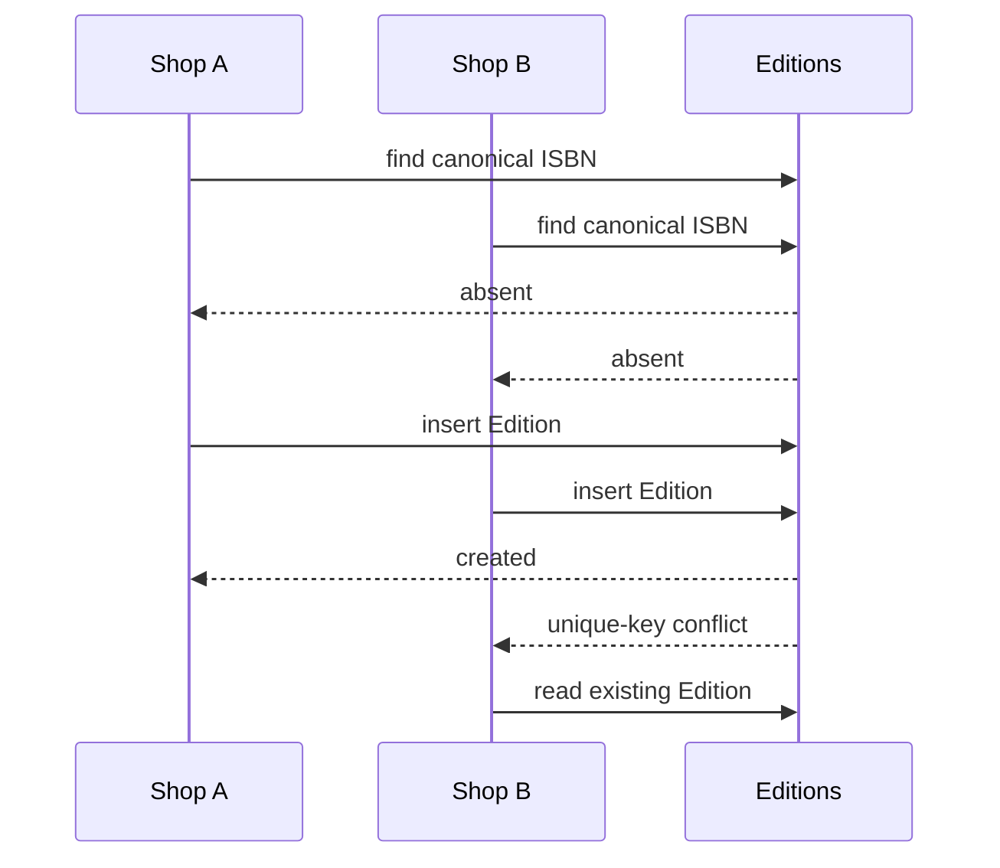

# The duplicate edition trap

Imagine Shop A lists "College Algebra," Shop B types "College Algebra 2nd Edition," and Shop C writes the author's name into the title. If each shop's form creates a new catalogue record, a student searching for the required ISBN sees several apparently different books. A reading-list matcher may mark the item missing even while a copy is available. A want-list could then alert the student about the wrong record, or the same physical edition could have three separate review and cache entries.

Normalize an ISBN before the shared Edition lookup: remove permitted separators, uppercase a final ISBN-10 X, validate length and check digit, and produce canonical ISBN-13 for storage. Search by that canonical key. The application may let a shop suggest a metadata correction, but it should not overwrite shared title or author from an arbitrary listing form. A unique database index on `isbn13` is essential because two shops can create the same Edition concurrently. A `findOne` followed by insert can race; one insert wins and the loser reads the winner.

Do not collapse distinct formats because their titles look similar. A print textbook and an ebook can carry different ISBNs and may not serve the same reading-list requirement. Similarly, a revised edition can reuse much of the title while changing exercises or page numbers. Work groups related editions for discovery; Edition identifies the required format and revision; Listing identifies the particular copy. Keep all three identities visible in the ERD.

Consider a shop that enters a mistyped ISBN with a valid shape but wrong check digit. A length-only validator would create a false Edition, and later student searches would miss the real one. A check-digit validator catches many transcription errors, though it does not prove that the title metadata is true. After validating the number, use a reviewed metadata source or an admin correction path. Do not silently trust the first shop's typed title forever. The uniqueness rule protects identity, not factual accuracy.

In a test, have two shops submit the same valid ISBN with different punctuation and slightly different titles at the same moment. The database should end with one Edition and two Listings. Then submit a related book with a different ISBN and show it remains a separate Edition. A reviewer should understand why deduplication uses the identifier rather than title similarity, and why the shop's current offer lives outside the shared record.

## Run a collision on paper first

Shop A types `978-1-938168-38-3`; Shop B types `9781938168383`. The strings look different but normalize to the same 13 digits. If the app inserts first and checks later, it may create two Edition records and split offers between them. If it checks `findOne` before inserting, two simultaneous requests can both see no row. Put a unique index on canonical `isbn13` and treat duplicate-key as a normal concurrent outcome: the losing request reads the winner and continues to create its own Listing.

This race is more instructive than saying "deduplicate titles." A title is free text: spelling, punctuation, translation and edition labels vary. An ISBN is a structured identifier but still needs normalization and a valid check digit. It identifies an edition or format, not a physical copy. The database index enforces one Edition row for a canonical number; the application then links multiple Listings to it.

## Keep wrong metadata from spreading

Suppose Shop A types the correct ISBN but an incorrect title. The unique index prevents Shop B from creating a second Edition, yet it does not fix the bad title. The create route should use trusted metadata if available or mark a new Edition as needing review. A Shop may suggest a correction without getting general PATCH authority over shared catalogue fields. Otherwise the first seller to type a number controls what all other sellers and students see. An audited admin correction path can update Work or Edition and record the old and new values.

A mathematically valid number also might describe the wrong format. The print and digital versions of a textbook can have distinct ISBNs. If a student needs a physical print copy, the digital ISBN should not be joined to a physical Listing simply because the title matches. Seed one print example and record its exact published source. For a second format, use the publisher's separately published identifier. Do not invent an ISBN to make a demo work. A bad fixture teaches the model to normalize false data confidently.

## Write the concurrency test

Create two Shop accounts and an empty disposable Edition collection with the real unique index built. Send both create requests concurrently, with the same valid ISBN in different formatting and different typed title suggestions. Expect one Edition row. Both responses may return the same Edition ID, one created and one reused. Then create a Listing under each Shop. If one create fails with a generic 500 after duplicate-key, the catalogue identity is safe but the seller journey is broken; handle that conflict by reading the winner and continuing. Repeat the test, then inspect both Listing owner IDs.

Add a negative case with a bad check digit. The route should return a field error before inserting an Edition. A title similarity algorithm must not override that rejection. If a shop cannot read the ISBN clearly, the UI should let them save a draft Listing or request manual review rather than attach an uncertain copy to a shared Edition. The next chapters give the precise ownership and validation rules needed for this behavior.

## Repair a duplicate before matching

Suppose an old development database already has two Edition rows with the same normalized ISBN because the index was absent. Adding a unique index will fail until the duplicate is resolved. Do not delete one row blindly: Listings, ReadingListItems and OrderLines may reference both. In a disposable fixture, enumerate dependent IDs, choose the verified canonical Edition, move eligible references carefully, preserve historical snapshots, and then remove or archive the duplicate. Only after the data is consistent should the index build. Document this as a migration exercise, not a normal request path.

A second trap is a partial identifier typed from a damaged cover. If the number fails validation, the UI should not attach it to a title-matched Edition as if it were exact. Permit a draft listing with a review status if the product supports it, or ask the seller to check the copyright page. The important promise is that exact matching uses verified identifiers. A guessed match can be offered as a suggestion with visible uncertainty, but it cannot satisfy a student's strict reading-list item automatically.

Compare two test runs. In the first, the same ISBN is submitted serially and the code finds the existing row. In the second, the requests race and the unique index rejects one insert. Both must leave one Edition and two Listings. A serial test alone cannot prove the database rule. Save the actual index listing with the test output so a mentor can see whether the safety came from MongoDB or merely from lucky timing.

A seller may scan a barcode that includes more than the ISBN, such as a price extension. The client should display the parsed candidate and let the seller confirm the exact ISBN before sending it. The server still normalizes and validates independently. Do not let a barcode scan bypass the same check used for typed input. In tests, a valid ISBN with extra trailing digits must be rejected or parsed under an explicit scanner rule; blindly taking the first thirteen characters can attach the wrong Edition.
