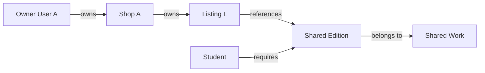

# Ownership with a shared catalogue

A student needs to compare every shop's offers for one edition. The shared catalogue therefore cannot belong to whichever shop happened to type the ISBN first. Ownership follows User to Shop to Listing. Reference follows Listing to Edition to Work. These arrows mean different things. The first chain determines who may edit condition, price, photos and state. The second chain lets a student discover and match the right book. Label both chains and their different permissions in `docs/erd.md`.

For a Listing edit, the server starts with the authenticated user, finds that user's Shop, then updates a Listing whose `shopId` matches it. Knowing an Edition ID is not enough to edit any offer under that Edition. An admin metadata correction uses a different route and writes an audit entry. Do not let a shop PATCH `/editions/:id` simply because it has a Listing. Two shops may disagree on the title spelling, but neither owns a shared object that affects the other's page.

A Work record groups broad bibliographic identity, such as title and authors. Edition records carry specific revision, format, publisher details and ISBN. A Listing references Edition and Shop, not Work directly; the Work path can be traversed through Edition. If you duplicate Work ID on Listing for search performance later, declare it as a derived field with an update rule. At this stage, one authoritative path is easier to verify than two fields that can disagree.

Test Shop A changing its own available copy price, Shop B attempting the same, and an unauthenticated user trying to edit the Edition. The wrong shop must be denied even if its owner knows the Listing ID from a public offer page. The public page can expose a Listing ID for navigation; IDs are not secrets. Authorization comes from the stored `shopId` predicate. Inspect the raw API response and the database after denial to prove no fields changed.

An OrderLine will later embed the title, ISBN, grade, defects and price shown at sale. That snapshot is neither the shared Edition nor the mutable Listing. It records what the buyer agreed to. This third temporal perspective is easy to miss in an ERD, so draw it as a separate historical box. If an admin corrects the shared title tomorrow, yesterday's receipt does not silently rewrite itself.

## Trace a shop edit against the shared record

Shop A owns Listing L for Edition E. The owner may adjust L's price or grade while it is available, but may not change E's ISBN or Work W's title through that route. Shop B also owns a Listing for E. If Shop A could edit E directly, one seller's input would alter both offers and any student's reading-list match. Put owner and reference links on different arrows in the ERD; a plain line without a label hides this boundary.

A server update can start by resolving Shop with authenticated `ownerId`, then update Listing with both Listing ID and Shop ID. It should not load a Listing by ID and rely on the frontend to have hidden the button. A public offer page exposes Listing IDs for navigation. Their secrecy is irrelevant; the stored Shop link decides permission. Build a test with two shop accounts that asks B to PATCH A's Listing. Inspect status and unchanged row.

<TraceRequest title="A public Listing ID is not edit permission">
  <TraceStep actor="Shop B" label="Read Shop A's public offer" detail="Listing ID is visible" />
  <TraceStep actor="Shop B" label="Try a price PATCH" detail="Session resolves Shop B, not Shop A" />
  <TraceStep actor="API" label="Query Listing by ID and owned Shop" detail="No matching owned row; deny mutation" status={403} />
</TraceRequest>

## Decide who corrects catalogue metadata

A shared Work or Edition may contain an error. The Shop that first created a Listing is not its permanent owner. Offer a correction suggestion to sellers or students, then let an admin or reviewed process update the shared record with an audit entry. The audit should name the changed field, old value, new value and actor. This is not bureaucratic decoration: an ISBN correction can redirect every Listing and reading-list match, so a silent edit can make students buy wrong copies.

If an ISBN was attached to wrong Work metadata, do not automatically merge or move all Listings without inspection. A physical copy photo and printed title can help confirm its true Edition. Keep a review state so the marketplace can stop matching uncertain records while a correction is made. The data model should permit one shared authoritative Edition without pretending all user-entered metadata is reliable.

## Preserve sale evidence outside both chains

After a student buys L, its OrderLine embeds title, ISBN, grade, defects and price. The Listing may later be marked sold, and Work metadata may be corrected. The OrderLine still explains what the student agreed to buy. This is not a third owner; it is a historical snapshot. Draw it as a separate box from current Listing. If a receipt queries current Listing fields every time, a seller could change its price after payment and make the receipt inconsistent with the provider amount.

Use a fixture to test three updates: Shop A reprices its own available Listing; Shop B's Listing is unchanged; a prior OrderLine remains unchanged. Then deny Shop B's edit to A's Listing. These checks connect the ERD to behavior. The next lesson adds a grade rank so a student's threshold can be expressed as a query instead of a string comparison.

## Check three edits with one fixture

Create Work W, Edition E, and two Listings L1 and L2 under different Shops. Shop A edits L1's price; L2's price and E's metadata must remain unchanged. Shop A tries to edit E's ISBN; the route must deny or route it through a correction proposal rather than updating the shared record. Shop B tries to edit L1's grade; the route denies. These three requests exercise distinct relationships, even though all involve the same book page. Record before and after documents, not only HTTP statuses.

The public page can show a "Report incorrect edition" action without granting direct edit rights. The report may reference E and include evidence from the printed book. An admin reviews it and may decide one Listing was attached to wrong E. That repair could move only that Listing, leaving other Shops' offers intact. A broad Edition update would be wrong if the issue is one seller's misidentification. The model needs stable IDs and clear audit links to support this judgement.

Ask what happens if a Shop owner changes their account email. The Listing owner check should still work because it follows User ID to Shop.ownerId, not a copied email on Listing. Ask what happens if a Shop changes its public name. Current offer cards can show the new name, while a prior Order may retain the seller name displayed at sale. These temporal examples show why reference, ownership and snapshot arrows cannot be reduced to one generic relation.

Before closing the chapter, label every ERD arrow with a verb. "User owns Shop," "Shop owns Listing," "Listing references Edition," "Edition belongs to Work," and "OrderLine snapshots Listing facts" are different statements. A teammate should be able to derive both an authorization query and a receipt query from them without guessing which table owns a price.

A shop closure test makes the shared boundary especially clear. Mark Shop A inactive and archive its available Listings. Edition E and Work W remain, because Shop B still sells its copy and students may still require E. An OrderLine from Shop A remains readable to its buyer under the historical order policy. If deactivating a Shop cascades deletion through Edition, the relationship has been modelled as ownership when it should have been a reference.
