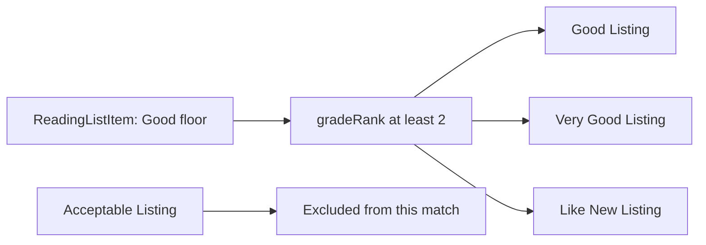

# Condition grades as ranks

Used copies are not interchangeable. A student may accept any copy rated Good or better, but a grade is also a seller's claim that should be explained with visible defects. Store a controlled grade label and an ordered numeric rank. For example, Acceptable could be 1, Good 2, Very Good 3 and Like New 4. A query for Good or better becomes `gradeRank >= 2`. If the course changes display wording later, the rank still makes the threshold unambiguous.

Do not let a label become a secret price guarantee. A copy graded Very Good can still have a highlighted page or a missing access code that matters to a student. Store defect notes and condition photos on Listing, and show them near the grade. The rank is useful for filtering; it does not replace honest description. Define the rubric in buyer-facing language and use the same rubric in the listing form. A seller should see why a heavily written-in book does not qualify for Like New.

The field must be validated server-side. A client could send `gradeRank: 99` or a label that contradicts the rank. Prefer a single canonical grade code and derive the rank in the server, or validate that code and rank match exactly. Write a test that submits mismatched values and gets a field error. Keep the chosen rank with the OrderLine snapshot, because a seller may edit a grade on an unsold listing after new damage is discovered; the old paid receipt should still show what was promised at purchase.

The reading-list matcher later combines edition identity with grade floor and price ceiling. Model the query now: find Listings of accepted Edition IDs, available state, `gradeRank >= floor`, and `priceMinor <= ceiling`. Sorting by grade alone may choose an expensive copy; sorting by price alone may choose an unacceptable one. The matcher will apply a written tie-break policy later, but the data model must make each filter possible without parsing free text.

Seed at least one copy in every grade and two copies of the same Edition with different grades and prices. Ask a student persona to set Good or better. The database query should include three grades and exclude Acceptable. Then add a defect note to one qualifying copy and verify the offer card still shows it. A clean filter result that hides the underlying defect would teach a false promise.

## Rank condition without hiding defects

A student sets a floor of Good. One copy is Acceptable with notes in the margins; another is Good with a creased cover; a third is Very Good with light shelf wear. Map the grades to ordered ranks 1, 2 and 3, with Like New at 4. The query for the student's floor uses `gradeRank >= 2`, but the offer cards still show each copy's defect notes and condition photos. A rank is a filtering aid, not a guarantee that two copies with the same label are indistinguishable.

Do not store arbitrary label and rank values independently. A malicious or buggy client could send label Acceptable with rank 4 and make a damaged copy pass the Good floor. Accept a canonical grade code and derive rank server-side, or validate the pair against one map. Test the mismatched case through the raw API. A UI dropdown is not enough because direct requests can bypass it. Keep the grade rubric in text so a seller knows what evidence supports each selection.

<TraceRequest title="Compare two offers under one threshold">
  <TraceStep actor="Student" label="Choose Good or better" detail="ReadingListItem stores floor rank 2" />
  <TraceStep actor="Matcher" label="Filter available Listings" detail="Edition accepted and gradeRank at least 2" />
  <TraceStep actor="Results" label="Show Good and Very Good" detail="Each card still shows defects and price" />
</TraceRequest>

## Join grade with edition and price

The matcher later needs all three constraints: accepted Edition IDs, grade floor and price ceiling. A Very Good copy of the wrong edition is not eligible. A Good copy above the student's ceiling is not eligible. An Acceptable copy under the ceiling is not eligible. Write four fixture Listings that each fail a different condition, and one that passes all three. A query that only checks price may look helpful but mislead a student into buying an unusable book. Keep the reason for exclusion visible in tests.

A Shop may revise a grade after discovering damage while its Listing is available. Log the change because it affects saved reading-list matches and price guidance. If the Listing is held or sold, define stricter rules to prevent changing a buyer's accepted condition without a remedy. The OrderLine snapshot preserves the grade and defects shown at sale. A current Listing grade and a historical receipt grade can legitimately differ, but the discrepancy must be explainable.

## Make the seed exercise every rank

Create one Listing per grade across the fictional Shops. Use distinct defect notes and owned placeholder photos so the grade is not a bare number. Ask a peer to sort the offers by price and by grade. The cheapest may be below the floor; the best grade may exceed budget. This leads naturally to the later matching policy, where the product must declare its tie-break rule rather than hide it inside an incidental database sort. Module 5's model only needs to make the inputs explicit and queryable.

## Challenge the grade claim

Have Shop A list a book as Very Good while writing "water damage on thirty pages" in the defect note. The system cannot know every condition truth automatically, but the form can flag a contradiction for review and prompt the seller to choose a lower grade. Do not discard the defect note to make the grade look clean. The buyer's decision depends on both structured threshold and descriptive evidence. The course can teach a clear rubric and test that the API stores both fields faithfully.

A grade change affects standing matches. If an available Listing drops from Very Good to Acceptable, a student with a Good floor should stop seeing it as eligible. The later worker may need to invalidate cached offer summaries or recompute matches. Model an `updatedAt` and audit reason so the change can be detected. An old MatchAlert may already have been sent; the app should not silently pretend the previous state never existed. The current query should use current grade while an OrderLine preserves historical grade at sale.

Try an edge with no defect note. For Like New, an empty note may be reasonable; for Acceptable, a required short explanation can help buyers understand the lower grade. This is a product validation choice to make explicit. A blanket required note for every grade may produce meaningless "none" text, while no guidance for low grades can hide serious wear. Write the chosen rule beside the grade map and test both a valid and invalid submission.

The rank should not become the only sort key. A student who accepts Good or better may prefer a cheaper Good copy to an expensive Like New copy. Later matching declares tie-breaks among eligible offers. Module 5 simply ensures grade, price and defect fields remain separate enough to support that choice. If the model only stores a computed "quality score," the app loses the explanation students need.

Use an API response test that returns the grade code, human label, rank, defect note and price for each offer. A client should not have to reconstruct rank from an English label or guess why a match qualifies. If the display language changes, the rank and code remain stable while translated labels can be rendered separately. This is valuable in a course for multilingual learners: machine-readable eligibility and clear buyer-facing explanation should reinforce each other without sharing a fragile free-text field.
