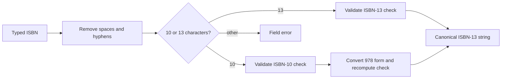

# ISBN-10, ISBN-13 and check digits

An ISBN is an identifier for an edition and format, not a magic title lookup. Modern ISBNs have 13 digits with a 978 or 979 prefix. Older ISBN-10 numbers may appear on used books. Strip spaces and hyphens from input, then check the permitted characters and exact length. For ISBN-10, the final character may be X, representing ten in its check-digit arithmetic; an X in any earlier position is invalid. Do not silently change the letter O into zero, because that hides a transcription error.

For ISBN-13, multiply the first twelve digits alternately by 1 and 3, add the results, and choose a final digit that makes the total divisible by ten. For ISBN-10, use the official weighted check rule and allow X in the final place. A valid old ISBN-10 can be converted to a 978-prefixed ISBN-13 by taking its first nine digits, prepending 978 and computing a fresh 13-digit check digit. A 979-prefixed ISBN-13 has no ISBN-10 equivalent. Preserve the original input for user feedback if useful, but index a canonical ISBN-13 string, not a numeric value that might lose leading zeros.

Walk through `1938168380`, the print ISBN-10 for an OpenStax College Algebra edition, and its corresponding `9781938168383` ISBN-13. Verify the last digit by calculation rather than trusting this sentence. Compare with the PDF edition ISBN, which is different; a student requiring the print edition should not be matched to the digital edition merely because both titles say College Algebra. OpenStax lists print and digital ISBNs separately in its book front matter.

Validation is necessary but not sufficient. A mathematically valid ISBN can still be attached to wrong metadata by a shop. The route should resolve existing Edition by canonical key or create a new record with reviewed metadata. Under simultaneous creation, a unique index chooses one winner. On duplicate-key, read the winner and continue to create each shop's Listing. Do not return a generic server error that asks the second shop to try again without explaining what happened.

Write unit cases for valid 10 and 13 digit inputs, a 979 number, a bad check digit, spaces and hyphens, an X in the wrong position, a letter O, and a number with the wrong length. The check function should return a normalized key or a structured error. Then race two create requests with alternate formatting. One Edition must remain. This test turns the ISBN rule into catalogue identity rather than a form hint.

## Calculate instead of trusting length

Write the twelve leading digits of ISBN-13 `9781938168383`. Multiply alternating positions by 1 and 3, sum the results, and find the last digit that makes the total divisible by ten. Then take ISBN-10 `1938168380` and apply the ten-position weighted check. The two numbers refer to the same print edition in the OpenStax College Algebra front matter. Do the arithmetic in a unit test and by hand once, so the validation function is not treated as an opaque package call.

For ISBN-10, X can represent ten only in the final check position. The letter O is never a replacement for zero. For ISBN-13, accept 978 or 979 prefixes as current ISBN prefixes, and do not try to convert a 979 number backward into ten digits. The International ISBN Agency says 979 does not have an ISBN-10 equivalent. Preserve leading zeros by storing the canonical number as a string. A numeric database field can change the identifier's shape before the unique index sees it.

<TraceRequest title="Normalize two spellings of the same edition">
  <TraceStep actor="Shop A" label="Submit 978-1-938168-38-3" detail="Separators removed, check digit validated" />
  <TraceStep actor="Shop B" label="Submit 9781938168383" detail="Same canonical key" />
  <TraceStep actor="Database" label="Unique isbn13 finds one Edition" detail="Both shops can create distinct Listings" />
</TraceRequest>

## Separate math from metadata

A valid check digit means the digits are internally consistent. It does not prove that a shop typed the correct title, edition or format. The publisher's front matter is a primary place to verify the print ISBN. A PDF edition may have a different ISBN; do not attach a physical used copy to the PDF identifier because the title text looks similar. The route should normalize first, then resolve a reviewed Edition record or create one in a review state. A Shop suggestion can be captured without granting unilateral edit access to shared metadata.

Unit tests need more than the one worked pair. Include an ISBN-10 ending in X, a valid 979 ISBN-13, wrong check digits, an X in the middle, an O mistaken for zero, too many characters and spaces or hyphens around a valid number. For each invalid input, expect a structured field error and no Edition row. A regex that only checks length will pass many wrong numbers; a validator that removes every non-digit will silently turn an O or X into a different number.

Finally, race two create requests for the same normalized ISBN. The database unique index, not the arithmetic function, prevents two Edition rows. The losing create path must read the winner and continue to its own Listing. These are separate guarantees: validation catches bad transcription, and uniqueness handles concurrency. Record both in the ERD notes so later catalogue code does not conflate them.

## Keep the ISBN calculation testable

Implement normalization as a pure function before any database call. Feed it a string and receive either a canonical ISBN-13 or a structured error. Test spaces and hyphens separately from check-digit arithmetic; stripping separators should not also erase unexpected letters. Use a string throughout so `0` at the start of a registration element remains intact. A function that parses to Number may accidentally change the identifier even when its arithmetic seems to pass.

When converting ISBN-10, do not append its last check digit to 978. Take the first nine digits, prefix 978, then calculate the new ISBN-13 check digit. The old and new check rules differ. Work the College Algebra pair by hand and compare to the publisher PDF. If your computed result differs, stop before seeding Editions. A wrong canonical key would make a unique index consistently protect the wrong identity and cause later reading-list misses.

For 979, leave `isbn10` absent. Do not store a placeholder such as an empty string under a unique index, and do not take the last ten digits. A partial index on real ISBN-10 values allows many 979 Editions without collisions. Test two distinct 979 Edition fixtures with no ISBN-10; both should insert, while a duplicate real ISBN-10 should fail. This ties the standards fact to a concrete database rule.

Finally, separate an input error from a catalogue conflict. A bad check digit returns a field error; a duplicate valid ISBN under a race returns or resolves to the existing Edition; a valid but unverified title enters review. These three responses teach sellers what to do next. A generic 500 for all three hides the actual state and makes a duplicate look like a broken payment or lost listing.

Write a quick property test around the check digit: change any one of several digits in a valid ISBN and verify most such mutations fail validation. A check digit does not catch every possible pair of errors and does not prove metadata, so do not describe it as a universal authenticity test. Its job is to detect many typing mistakes before they become shared catalogue identities. Pair the property test with exact known examples from the publisher source and the 979 no-conversion case.

A useful final check is to compare the exact input string, normalized digits and selected Edition ID in a test log. Keep the raw input only in a safe development log without student personal data. If two formatted inputs normalize to one ISBN but return different Edition IDs, inspect the stored index and conversion path before touching the UI. This log connects the arithmetic rule to the database identity it is meant to protect.
