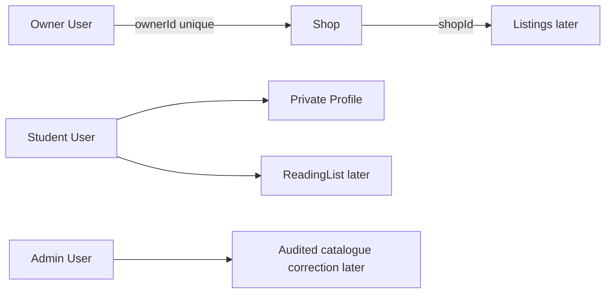

# User, Profile and Shop models

Start from the course's User and Profile concepts, but name the roles for Hamesh: student, shop owner and admin. User stores login identity and role. Profile holds buyer-facing name and contact settings without copying password data. Shop stores `ownerId`, public shop name, description, pickup or shipping choices and status. For this course, one owner has one Shop; place a unique index on `ownerId` and verify it in the development database.

An owner creates a Shop only after authentication. The server sets `ownerId` from the session, not from submitted JSON. A student may browse Shops but cannot create or edit one through a hidden vendor form. A shop owner may edit only their own Shop. Admin status does not mean every API response should include private buyer profiles. Document the role matrix before writing routes, because the shared catalogue and private orders will use different access rules.

Build a small service for `getOwnedShop(userId)` and use it in later Listing operations. It should return no Shop for a student and should not fall back to whichever Shop ID appears in a URL. Include indexes for owner lookup and public shop listing. A duplicate create race should fail at the unique index and return a clear conflict. Mongoose `unique` declares an index, not a normal validator; test against the actual database rather than expecting a validation error shape.

Seed three fictional Shops with different owner accounts. Give them different pickup rules so future order examples are credible. Do not use real shop names or student contact details. Add two student accounts with separate Profiles. With only one student, it is impossible to prove that a reading list or want-list stays private; with only one Shop, it is impossible to prove listing ownership.

Test owner A editing Shop B by direct API request, a student attempting a Shop edit, and owner A editing their own Shop. Read the database after denied requests to confirm no changes. The next lesson will create shared Work and Edition records, which no Shop owns. Keeping owner checks in one narrow service now prevents a later route from confusing `createdBy` with ownership of the shared catalogue.

## Give each actor a real boundary

Create three fictional Shop owners and two student accounts. An owner account can publish and edit Listings for its Shop, but a student account can only browse, maintain a private reading list and buy. An admin can review shared catalogue corrections under an audited route. Do not compress these into one `isVendor` flag on User: the later authorization tests need to distinguish a Shop owner from a student and from an admin. Profile stores buyer-facing name and contact preference without copying credentials into every order or listing.

Put a unique index on Shop.ownerId because this course allows one Shop per owner. A `findOne` followed by insert can race if the owner opens two create tabs. The database constraint chooses one row; the route returns a clear conflict or existing Shop rather than silently creating two. Mongoose declares indexes, but the test must verify the index exists in the connected database. An index declaration in code is not proof that an old test database built it successfully.

## Scope the seller helper

Write a `getOwnedShop(userId)` service that starts from the authenticated session, not a submitted owner ID. A Listing edit can then use the resolved Shop ID in its query. Test a valid Shop owner editing their Shop name, another Shop owner trying the same ID, and a student trying a direct PATCH despite having no Edit button. Inspect the database after denials. A route that writes and then notices an unauthorized actor is still broken even if it returns 403.

The Shop record can include pickup and shipping preferences, public name, description and active status. Keep exact home addresses or personal phone numbers out of public fields unless the product has a clear disclosure choice. A small bookshop may prefer collection at a public location. Model a buyer-facing pickup instruction separately from the owner's private account email. This distinction matters when Order snapshots later preserve what the buyer was told at sale.

## Prepare private student data

A Profile may hold a student's display name and notification preference. ReadingLists and WantListEntries will use User ID as ownership, not a public email address or course title. A Shop should not see a student's whole reading list just because it has a matching book. Later aggregate demand can be designed explicitly without exposing individual study plans. Seed two students so a raw request from Student B for Student A's list can fail. One student alone cannot prove isolation.

Finish with three stable Shop fixture keys and a test of the duplicate-owner race. The next build creates Work and Edition, which are shared across Shops. Ask the learner to explain why the first Shop to list a book does not own the Edition. If they say "because it has no ownerId," add the stronger reason: every other Shop and every student's reading-list match depends on one shared bibliographic identity that cannot be edited as one seller's offer.

## Put a duplicate request through the database

Owner A clicks Create Shop twice before the first response arrives. Both requests carry the same authenticated User ID. If the service only calls `findOne` then `create`, both may see no Shop. The unique owner index rejects one insert. Handle that result as a conflict or return the already created Shop rather than letting a raw database error become a 500. Then inspect the collection count and index list. The fixture should contain one Shop for that owner regardless of the timing.

Use a second owner who can create their own Shop, and a student who cannot create one. This distinguishes role from ownership. A Shop owner's authorization is not simply "vendor may edit": after creation, it is "this User owns this Shop." Test Owner B trying to update Owner A's pickup instruction with a valid Shop ID. The database row must remain unchanged. A student trying the same route should also be denied, though the reason is a different role boundary.

## Keep profile data minimal

A student Profile may include a display name and notification preference, but it should not contain a public list of courses or a shop-edit role. ReadingList and WantListEntry will refer to the student's User ID. A Shop order may need a buyer contact method for a specific sale, captured under that order's access policy, but a public Listing page never needs it. Write a response-field test before building ReadingList so a future broad `populate('profile')` cannot leak private study details into catalogue responses.

For a fictional seed, use names clearly labelled as demo and no real phone numbers. Give the two students different reading-list intentions so cross-user tests cannot pass accidentally by returning identical data. A denial should be proven by a raw request and a database query. If Student B sees no page because the frontend redirects but the API still returns Student A's Profile, the model's privacy promise has failed.

The admin correction role should be narrow. It may propose or approve a change to shared Work and Edition metadata, but it should not automatically see student ReadingLists or alter Shop prices. Write an authorization matrix with rows for Shop edit, Listing edit, Edition correction and ReadingList read. Fill each cell for owner, student and admin. If one role appears to have every permission because it is called admin, specify which support operations truly need that access and log them.
