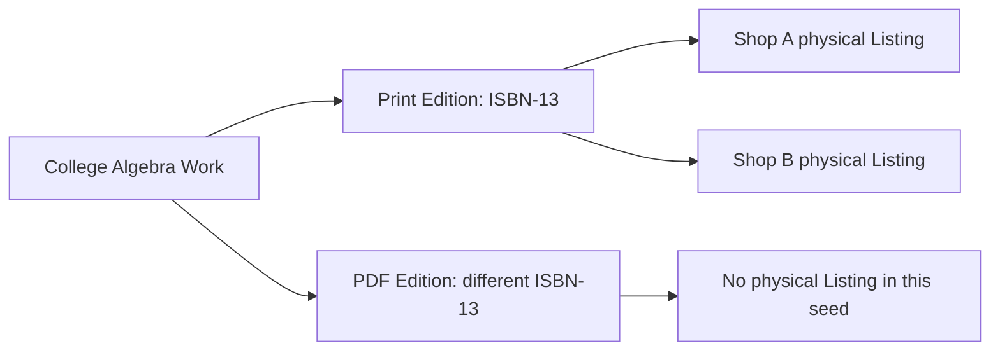

# Work and Edition models

Create Work for broad bibliographic identity: title, authors and perhaps language or subject tags. Create Edition for a specific format and revision, linked to Work. Edition stores canonical `isbn13`, optional `isbn10` for a valid convertible edition, edition label, format, publisher and publication year when known. Do not include Shop ID, grade, copy price or defects. Those belong to Listing. A shared Edition should survive a Shop closing or selling all its copies.

Declare a unique index on normalized `isbn13`. Declare an optional partial unique index on `isbn10` that includes only documents with a real string value. Without a partial filter, many Editions lacking ISBN-10 may collide on a null-like index entry. Verify the actual indexes in MongoDB after the model loads. Keep canonical ISBNs as strings. A 979 Edition has no equivalent ISBN-10, so do not manufacture one to fill the optional field.

A Work may have two Editions with similar titles but different revision or format. Seed a print and digital version of a known openly licensed textbook as separate Editions only if you have checked each published identifier at the source. Hamesh sells physical copies in this course, so mark the digital Edition as a comparison fixture rather than a purchasable Listing. Do not copy textbook pages or cover art into the seed merely because its bibliographic metadata is public.

The create flow normalizes and validates ISBN, looks up Edition by canonical ISBN-13, and inserts only if absent. Race two shops with the same number. The database unique index prevents duplicates; the losing request reads the winning Edition and proceeds. A shop may suggest title metadata, but a shop's later Listing form must not overwrite existing shared Edition fields. Reserve correction for an audited admin path.

Test duplicate ISBN-13, two missing ISBN-10 values, a 979 ISBN with no ISBN-10, and one Work with two Editions. Query an Edition page and show its Work title once, with no price or condition at that level. If the page needs one copy's price to render a shared title, the API boundaries are still mixed. Module 11 will deepen ISBN lookup and concurrency; Module 5 supplies the foundation.

## Create one Work with two Editions

Use a Work for a broad title and authors, then create a print Edition and a separate PDF Edition only when the publisher lists different ISBNs for them. Hamesh's purchasable Listings are physical copies, so the PDF Edition may appear as a comparison fixture without a physical offer. The example teaches that one Work can group related formats, while a student requiring the print ISBN must not be matched to the PDF identifier. Do not use title similarity as a substitute for the publisher's identifiers.

Work can hold title and authors. Edition holds Work ID, format, edition label, publisher, publication year when verified, canonical ISBN-13 and optional ISBN-10. Do not place a Shop ID or copy grade on either shared record. A title correction may affect every offer card, so reserve it for an admin-reviewed path. The first Shop's input can be a suggestion, not an ownership claim over the shared row.

## Build the real uniqueness rules

Declare a unique index on Edition.isbn13. For optional isbn10, use a partial unique index that includes only documents where the field is a real string. Without the filter, missing values may be indexed in a way that blocks multiple 979 Editions with no ISBN-10. Verify the index options in MongoDB, not only the schema file. Store ISBNs as strings so leading zeros and check characters are preserved. Do not create an ISBN-10 for 979: the International ISBN Agency says there is no equivalent.

Simulate two concurrent creates for the same canonical ISBN. A pre-insert lookup is useful to avoid unnecessary errors, but it cannot be the final guard. On duplicate-key, load the winning Edition and return it to the caller. Both Shops then create separate Listings. Test that one Edition row remains and that neither request overwrites the winner's metadata with its own typed title. An uncontrolled upsert with `$set` could silently let the losing request change the shared row.

## Correct a shared mistake carefully

If a shared Edition has the wrong format, changing it can make existing Listings and ReadingListItems point to the wrong book. An admin correction should inspect the physical copy evidence and record old and new metadata. Sometimes the right repair is to move a particular Listing to a different Edition, not rewrite the shared ISBN for every Shop. Mark that decision in the ERD notes. The data model should support an audited correction without requiring a shop owner to edit shared catalogue fields directly.

Seed real identifiers from publisher sources with a citation note and keep the bibliographic facts narrow. Do not copy textbook pages, covers or instructor materials into the course. A learner can use the ISBN to demonstrate catalogue identity without redistributing content. After creating the two Editions, query each and show that a physical Listing links only to the intended print one. This becomes the foundation for Module 11's ISBN entry and race tests.

## Repair a wrong Edition reference

Imagine Shop A's Listing photo shows a print book, but its `editionId` points to the PDF Edition. The shared ISBN records are valid; the Listing link is wrong. An admin correction should move that Listing after checking printed evidence, not rewrite the PDF Edition's ISBN to make the link appear correct. The move may affect a student's Cart or ReadingList match, so log the old and new Edition IDs and invalidate any cached offers. This scenario shows why shared identity and per-copy reference are separate concerns.

A Work grouping can also be wrong. Two books with similar titles may be unrelated; two revisions of one textbook may belong together. Keep a reviewed Work relationship rather than making a title-string algorithm authoritative. If a Work merge is needed later, preserve Edition IDs and dependent Listings. A student requiring exact ISBN can still be matched safely while a broad Work grouping is under review. This is one reason the exact identifier belongs on Edition, not on Work.

## Verify index behavior with missing values

Create two Editions without ISBN-10, both with distinct valid ISBN-13 values. They should coexist. Then insert a third Edition with an ISBN-10 already used by another row; it should fail. Inspect index options and the stored field values. An empty string is not the same as absent: if every 979 Edition stores `isbn10: ""`, a partial index that checks only existence may still include those rows. Prefer omitting the field when no equivalent exists and filtering on a valid string type in the index. Document the exact partial expression in the ERD.

Finally, compare two simultaneous creates for the same ISBN-13. The losing request must read the winning Edition and continue; it must not use an upsert that overwrites reviewed title or format with its own form text. Save both response IDs and the final shared metadata. This test proves both uniqueness and non-overwrite, which are distinct guarantees.

A new Edition may be created before every metadata field is confirmed. Give it a review state and limit exact-match publication if title or format is uncertain. A shop can still save a draft Listing linked to that pending Edition under the course policy. This is preferable to accepting the first typed title as permanent shared truth. When an admin approves the Edition, log the source used and release it for public matching. The ISBN unique index remains active throughout review, preventing another Shop from creating a competing shared row.
