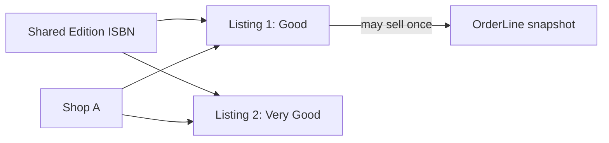

# Listing model

A Listing is one physical book copy. Store `shopId`, `editionId`, grade code and rank, defect notes, photo references, price in minor units, currency and status. Status can begin as draft or available, then move through held and sold, with archived for withdrawal. Do not add `stockQty`; a used copy with pencil marks is not interchangeable with another copy of the same ISBN. A Shop that owns five copies creates five Listings, each with its own ID and honest condition description.

Use a server-side grade map so label and rank cannot disagree. Validate nonnegative price, bounded defect notes and approved photo IDs. The Listing's Edition link is shared bibliographic identity, while its Shop link controls who may edit it. A workshop-style Artisan credit is irrelevant here. Keep identity fields narrow enough that a public offer response can include what students need without exposing seller private data.

The later checkout module will claim a Listing with an atomic conditional status change from available to held. The model should reserve a hold subdocument for checkout ID and expiry. Two students may open the same offer, but only one claim can win. The loser receives a conflict and a substitute suggestion from another Listing of the same Edition, rather than a generic "out of stock" page that loses the student's reading-list context.

Create at least two Listings for the same Edition, one from each Shop, with different grades, defects and prices. Query the Edition page: one shared title, two offer cards. Change one price and confirm the other offer stays unchanged. Try Shop B editing Shop A's Listing ID. The API must deny it by stored `shopId` even though the ID is public. A hidden Edit button alone does not protect the copy.

Do not let a sold Listing disappear from history. The public page may say sold and show a substitute, while the OrderLine snapshot retains title, ISBN, grade, defects and price at purchase. A later condition correction on an unsold copy should be logged if it affects the grade used by matching. The model does not yet implement that audit trail, but mark its need in the ERD so the grade-based price guidance module has a stable starting point.

## Give every physical copy its own row

Shop A has two copies of one print Edition. One is Good with margin notes; the other is Very Good with a clean interior. They are not a quantity of two in one Listing. Each has a different price, set of photos and sold state. If the first sells, the second remains available. Create two Listing IDs even though they share Shop and Edition IDs. The Cart will choose one Listing ID, and the future checkout will hold that exact document.

Store Shop ID and Edition ID as references, then copy-specific grade code and rank, defect notes, priceMinor, currency, ordered condition photos and status. Include draft, available, held, sold and archived as finite states. A sold Listing can remain as evidence and show other available copies of the same Edition, but its Add button and direct checkout route must reject reuse. Do not put condition on Edition because another Shop's copy can be damaged differently.

## Validate what a seller claims

A Shop submitting grade Very Good and rank 1 has sent contradictory data. Prefer accepting a grade code and deriving rank server-side, or reject a mismatched pair. Bound defect-note length, require nonnegative integer price and verify uploaded photos belong to this Shop's Listing. The condition grade is a claim; the photos and notes explain it. A student should not see only a reassuring label while important damage is hidden in a field the API omitted.

An owner route finds the caller's Shop, then Listing with that Shop ID. Test with another Shop using a valid Listing ID. The raw PATCH should fail and the Listing price should remain unchanged. A `role: shop` check without ownership would let every seller edit every copy. A public offer page can show Listing ID without making it a secret permission token. The query predicate is the protection.

## Prepare the sell-once claim

When two students start checkout for Listing 1, both may see its available page. The later claim route must make a conditional single-document update from available to held with checkout identity and expiry. Only one succeeds. Store hold fields now and sketch the transition test. A broad `updateOne({_id})` that sets held will let both callers believe they won; include expected status in the filter and inspect matched count. The losing student should receive a 409 and a substitute suggestion from another eligible Listing of the same Edition.

Seed grades across Shops and inspect an Edition page. It should show one title and multiple offers with independent grades, defects and prices. Change Listing 1's price and verify Listing 2 is unchanged. Create a fixture OrderLine snapshot for Listing 1, then change its current condition and show the historical grade remains. These checks prove that Listing is the right place for copy facts and that the shared Edition is not accidentally acting as a seller record.

## Show a substitute without switching the sale

A student puts Shop A's Good copy in a Cart. Another buyer purchases it. Shop B still has a Very Good copy of the same Edition, but at a higher price. The stale Cart response can suggest Shop B's Listing with its own grade, defects and price. It must not silently replace the selected Listing and charge the student more. That user journey depends on each copy having an ID, ownership and current status independent of the shared Edition.

If the only remaining copy is Acceptable and the student's reading-list floor is Good, do not call it an eligible substitute. The app may show it as an option outside the required criteria with a clear label, but a strict matcher must reject it. Keep grade rank and defect note available in the substitute query. A shared Edition page alone cannot decide this because all offers under it differ physically.

## Test a suspicious edit

Open a Listing editor before the copy is held. In another tab, begin checkout and claim it. Submit the stale editor with a new price and grade. The API should apply a documented rule for held state, such as rejecting material changes until the hold resolves. Do not let a stale form overwrite status back to available or alter a buyer's frozen offer. Use a targeted update that lists allowed fields, not a spread of arbitrary request JSON. This test makes the status field operational rather than decorative.

A sold Listing may still show a public record, but its condition photos could include buyer markings added later. The Shop can archive or annotate under a policy; the paid OrderLine remains the historical evidence of what was sold. Keep current Listing and receipt serializers separate. Ask a reviewer to identify the single document protected by the conditional hold and the snapshot used when the buyer later reports a mismatch.

A Listing photo should show the actual copy's cover and relevant defects, not a publisher cover downloaded for decoration. If a shop uploads a photo after creating a draft, keep the Listing draft until the image is ready and approved under the product rule. Store storage references and captions on Listing, not Edition. Two shops may have different damage to the same title. A shared cover image can help bibliographic discovery, but it cannot replace evidence of the particular used copy a student is buying.
